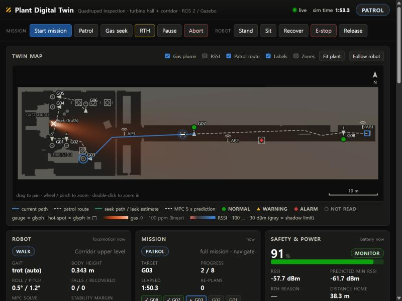
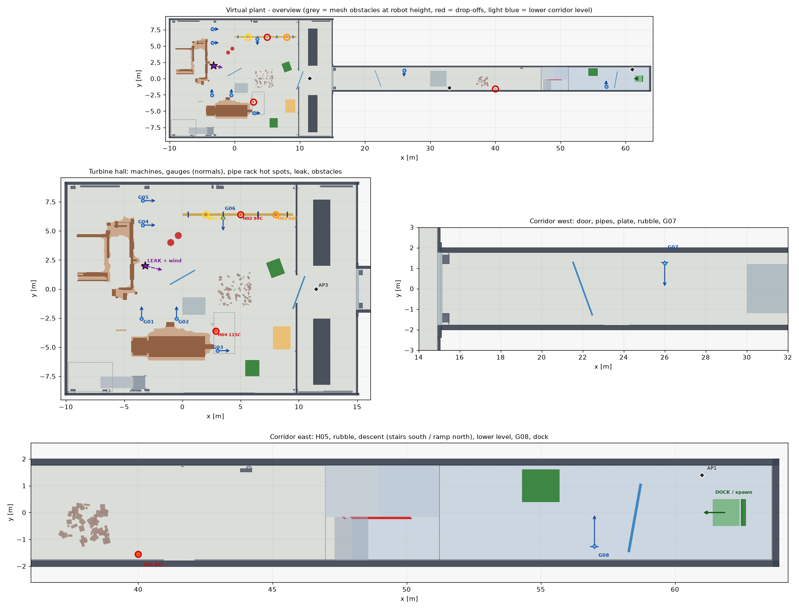
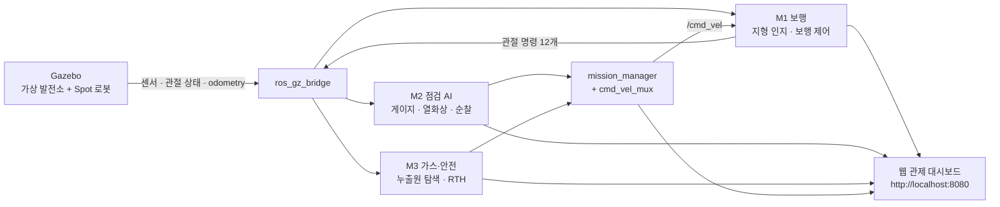

# DusanAI — 발전소 점검 4족 보행 로봇 디지털 트윈 (ROS 2 + Gazebo)

4족 보행 로봇이 가상 발전소를 자율 점검(게이지 판독·과열·가스 누출)하고, 그 상태를 웹 관제 대시보드에 실시간으로 보여 주는 ROS 2 + Gazebo 시뮬레이션 시스템입니다.

Spot형 로봇이 Gazebo 가상 발전소(터빈홀, 그리고 계단·경사로·배관·잔해가 있는 48 m 복도)를 걸어 다닙니다. 아날로그 압력 게이지를 읽고, 열화상으로 과열 배관을 찾고, 가스 농도를 따라 누출원을 추적합니다. 배터리가 떨어지거나 통신 음영이 예상되면 스스로 충전소로 돌아옵니다.

<p align="center">
  
  
</p>
<p align="center"><sub>왼쪽: 관제 대시보드 순찰 화면. 오른쪽: 가상 발전소 배치도</sub></p>

## 주요 기능

| 모듈 | 패키지 | 핵심 기능 |
|---|---|---|
| **M1 보행** | `module1_locomotion` | 깊이 카메라 기반 elevation map과 발 디딤 계획, 보행 제어 2종(stable 기본 / 5 s 예측 MPC), trot·crawl 전환, 넘어짐 감지와 자가 복구, 미끄러운 철판 슬립 모드, 키보드 텔레옵 |
| **M2 점검 AI** | `module2_inspection` | 아날로그 게이지 판독(바늘 각도 → 수치, OCR로 눈금 확인), 열화상↔RGB 정합과 과열 판정(경고 60 °C / 경보 80 °C), 판독성 기반 최적 순찰 경로 |
| **M3 가스·안전** | `module3_gas_safety` | 가스 확산·기류 시뮬레이션, 농도 경사를 따라가는 누출원 탐색, 배터리·Wi-Fi 모델, 자율 복귀(RTH)와 도킹·충전 |
| **통합** | `plant_simulation` | Gazebo 월드와 Spot URDF, 미션 관리자(지형 비용 경로, 지도에 없는 장애물 회피), 속도 명령 우선순위 mux, 웹 관제 대시보드, 실행 기록, 데모 HUD·추적 카메라 |
| **공용** | `dusan_common` | 로봇 기구학, 레이아웃 로더, 격자 지도·A*, 장애물 층, pure pursuit 등 공용 라이브러리 |

## 시스템 구성

과제의 디지털 트윈 데이터 흐름(Virtual Plant → Robot Twin → Simulation Sensor Data → Inspection AI Processing → Monitoring System)을 ROS 2 토픽으로 구성했습니다.



- Nav2·ros2_control·커스텀 메시지 없이 공식 ROS 2 패키지만 씁니다. 구조화된 데이터는 `std_msgs/String`에 JSON으로 보냅니다.
- 알고리즘은 ROS와 분리된 Python(numpy/OpenCV) 모듈이고, ROS 노드는 이를 감싸는 얇은 래퍼입니다.
- 모든 노드가 시뮬레이션 시간(`use_sim_time`)을 따릅니다. 토픽·프레임·JSON 필드는 [DESIGN_SPEC](docs/DESIGN_SPEC.md)에 있습니다.

## 저장소 구조

```
DusanAI/
├── README.md
├── docs/                  USAGE(실행·사용), SETUP_GUIDE(설치 상세), REPORT(보고서), DESIGN_SPEC(인터페이스), images/, results/
├── dusan_common/          공용 Python 라이브러리
├── module1_locomotion/    M1: 지형 인지, 보행 제어, 넘어짐 복구, 키보드 텔레옵
├── module2_inspection/    M2: 게이지 판독, 열화상 퓨전, 순찰 경로
├── module3_gas_safety/    M3: 가스 확산, 누출원 탐색, 배터리·통신, 자율 복귀
├── simulation/            ROS 패키지 plant_simulation: 월드, URDF, 모델, 지도, launch, 통합 노드, 웹 대시보드
├── scripts/               설치·빌드·실행 스크립트
└── tools/                 에셋 변환, 월드 생성, 평가, 실행 기록 그래프, 검증 도구
```

과제 제공 원본 에셋(Unity)은 저장소에 포함하지 않습니다. 변환된 모델이 `simulation/models/`에 있어 저장소만으로 빌드·실행됩니다.

## 요구 환경

| 구분 | 권장 | 대안 |
|---|---|---|
| OS | Ubuntu 26.04 LTS | Ubuntu 24.04 LTS |
| ROS 2 | Lyrical Luth | Jazzy Jalisco (`ROS_DISTRO=jazzy`) |
| Gazebo | Jetty (gz-sim 10) | Harmonic (gz-sim 8) |
| Python | 3.12 이상 (Ubuntu 기본) | |
| 사양 | CPU 4코어 이상, RAM 8 GB 이상, OpenGL 3.3 이상 GPU | |

- Gazebo는 `ros-<distro>-ros-gz`가 설치하는 버전을 그대로 씁니다.
- NVIDIA GPU는 독점 드라이버(소프트웨어 & 업데이트 → 추가 드라이버)를 권장합니다. 렌더러는 `glxinfo -B`(`sudo apt install mesa-utils`)로 확인합니다.
- Gazebo 열화상 센서는 GPU가 필요합니다. GPU가 없으면 `thermal_source:=synthetic`(합성 열화상)을 쓰세요.

<a id="install"></a>
## 설치·빌드

```bash
sudo apt install -y git
mkdir -p ~/dusan_ws/src
git clone https://github.com/YUGyuSang/DusanAI.git ~/dusan_ws/src/DusanAI
cd ~/dusan_ws/src/DusanAI
bash scripts/install_deps.sh --add-ros-repo   # ROS 2 + Gazebo + 의존성 (처음 한 번)
bash scripts/build.sh                         # colcon build (5개 패키지)
bash scripts/check_install.sh                 # 마지막 줄이 "0 FAIL"이어야 함
```

- Ubuntu 24.04 + Jazzy는 각 명령 앞에 `ROS_DISTRO=jazzy`를 붙입니다.
- 스크립트는 항상 `bash scripts/<이름>.sh`로 실행합니다. `run_*.sh`는 ROS와 워크스페이스를 알아서 source합니다.
- `ros2` 명령을 직접 쓰는 터미널에서는 먼저 `source /opt/ros/lyrical/setup.bash`(24.04는 `/opt/ros/jazzy/setup.bash`)와 `source ~/dusan_ws/install/setup.bash`를 실행하세요.
- 수동 설치는 [SETUP_GUIDE](docs/SETUP_GUIDE.md), 새 코드 받기는 [USAGE 업데이트](docs/USAGE.md#update)를 보세요.

<a id="run"></a>
## 실행

```bash
bash scripts/run_demo.sh            # 데모: 자동 미션 + 추적 카메라 + HUD
# 또는 직접 운전
bash scripts/run_bringup.sh         # 터미널 1: 전체 시스템
bash scripts/run_teleop.sh          # 터미널 2: 키보드 조작
```

1. 로봇이 충전소에서 생성되어 스스로 일어섭니다.
2. 브라우저에서 **http://localhost:8080**을 엽니다. 대시보드 로봇 패널의 배지가 **서 있음**이면 준비가 끝난 것입니다.
3. 데모는 25초 뒤 미션을 자동으로 시작합니다. 직접 운전할 때는 텔레옵 터미널에서 **`t`**를 누르면 전체 미션(게이지 순찰 → 가스 누출원 탐색 → 충전소 복귀)이 시작됩니다. 대시보드 **임무 시작** 버튼도 같습니다.

| 키 | 동작 | 키 | 동작 |
|---|---|---|---|
| `w` `s` / `a` `d` | 전진·후진 / 좌·우회전 | `t` | 전체 미션 시작 |
| `q` `e` | 게걸음 | `p` / `g` / `h` | 순찰만 / 가스 탐색 / 충전소 복귀 |
| `x` / `space` | 정지 / 비상정지 | `o` | 일시정지·재개 |
| `+` `-` | 속도 배율 ±0.1 (처음 0.5) | `m` | 수동 오버라이드 |
| `1` / `2` | 서기 / 앉기 | `v` | 보행 모드 stable ↔ MPC |
| `3` / `4` / `5` | trot(기본) / crawl / auto | `r` / `0` | 자가 복구 / 자세 리셋 |

자주 쓰는 옵션: `rviz:=true`(RViz), `thermal_source:=synthetic`(합성 열화상), `gui:=false headless_rendering:=true`(화면 없이). 예: `bash scripts/run_bringup.sh rviz:=true`

**모듈별 실행** (터미널 1에서 `bash scripts/run_sim.sh`로 시뮬레이터만 띄운 뒤)

```bash
ros2 launch module1_locomotion locomotion.launch.py   # M1 지형 인지 + 보행 제어
ros2 launch module2_inspection inspection.launch.py   # M2 게이지 판독 + 열화상 퓨전 + 순찰 경로
ros2 launch module3_gas_safety gas_safety.launch.py   # M3 가스 확산 + 누출원 탐색 + 배터리/통신/복귀
```

새 터미널에서는 먼저 위의 `source` 두 줄을 실행하세요. 모듈만 띄웠을 때 로봇을 움직이는 방법은 [USAGE §3](docs/USAGE.md#run-modules)에 있습니다. launch 인자, 전체 키, 미션 시나리오, 저사양 PC 옵션도 [USAGE](docs/USAGE.md)에 있습니다.

## 결과 확인

- **대시보드**(http://localhost:8080): 로봇 상태, 게이지 판독값과 오차, 과열 경보, 가스 농도 지도와 누출원 추정, 배터리·RTH, 이벤트 기록
- **토픽**: `ros2 topic echo /mission/state --field data`, `/inspection/gauge_readings`, `/gas/seek_status`, `/safety/status` 등
- **실행 기록**: 실행마다 `~/dusan_metrics/<시각>/`에 CSV와 `summary.json`이 남습니다. `python3 tools/plot_metrics.py`로 그래프와 요약표를 만듭니다.
- **점검 보고서**: 같은 폴더의 `gauges/`에 계기별 점검 사진이, `inspection_report.html`에 계기 8개의 확정 판독값·참값·오차·사진과 열화상·가스 결과가 남습니다. 대시보드의 **보고서 열기**로도 볼 수 있습니다.

자세한 방법은 [USAGE 결과 확인](docs/USAGE.md#results)에 있습니다.

## 주요 결과

| 항목 | 결과 |
|---|---|
| 게이지 판독 (요구: 오차 5 % 이내) | 480프레임 검출 100 %, 평균 오차 0.111 %FS, p95 0.401 %FS |
| 열화상 과열 검출 | 정밀도 1.000, 재현율 0.9845 |
| 가스 누출원 탐색 | 40회 성공률 100 %, 누출원 오차 평균 0.478 m |
| 자율 복귀 (RTH) | 배터리 19.99 %에서 복귀 시작, 도킹 오차 0.113 m. 통신 음영 5.03 m 전에서 복귀 |
| 5 s 예측 MPC 풀이 시간 | p95 14.71 ms, 100 % 30 ms 미만 |
| 순찰 경로 | 게이지 8개 순환 150.50 m, 배치 순서보다 8.5 % 짧음 |

평가 조건과 그래프는 [REPORT §1.3](docs/REPORT.md#13-결과-요약--요구사항--구현--핵심-수치)에 있습니다(`docs/results/*.json`).

## 문서

| 문서 | 내용 |
|---|---|
| [docs/USAGE.md](docs/USAGE.md) | 실행 옵션, 키보드 조작, 대시보드, 미션 시나리오, 기능별 설정, 결과 확인, 업데이트, 문제 해결 FAQ |
| [docs/SETUP_GUIDE.md](docs/SETUP_GUIDE.md) | 설치 상세: 수동 설치, 워크스페이스 규칙, 런타임 환경, 개발 도구 |
| [docs/REPORT.md](docs/REPORT.md) | 프로젝트 보고서: 모듈별 알고리즘, 평가 결과 분석, 문제 해결, Sim2Real 계획 |
| [docs/DESIGN_SPEC.md](docs/DESIGN_SPEC.md) | 인터페이스 계약: 프레임, 토픽·JSON 필드, launch, 키 맵 |
| [module1_locomotion/README.md](module1_locomotion/README.md) · [TERRAIN_AND_TELEOP.md](module1_locomotion/TERRAIN_AND_TELEOP.md) | 보행 제어(stable / MPC), 넘어짐 복구, 슬립 감지, 튜닝 가이드 · 지형 인지, 키보드 텔레옵 |
| [module2_inspection/README.md](module2_inspection/README.md) · [THERMAL_PATROL.md](module2_inspection/THERMAL_PATROL.md) | 게이지 판독 · 열화상 퓨전, 순찰 경로 |
| [module3_gas_safety/README.md](module3_gas_safety/README.md) | 가스 확산, 누출원 탐색, 배터리, Wi-Fi, 자율 복귀 |
| [simulation/models/README.md](simulation/models/README.md) · [spot/README.md](simulation/models/spot/README.md) | Gazebo 모델 목록 · Spot 로봇 변환 |
