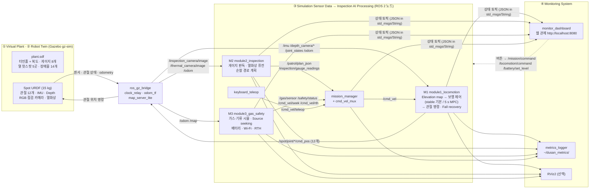
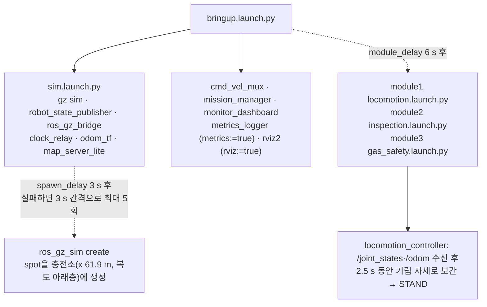
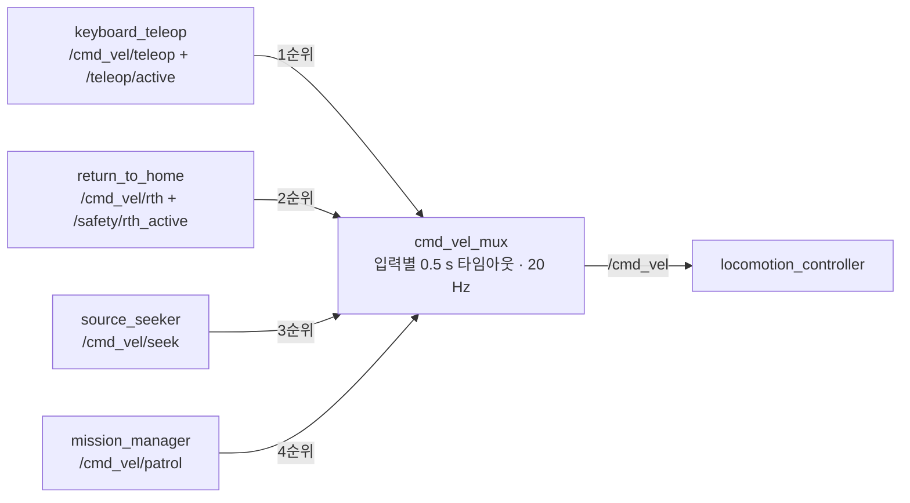
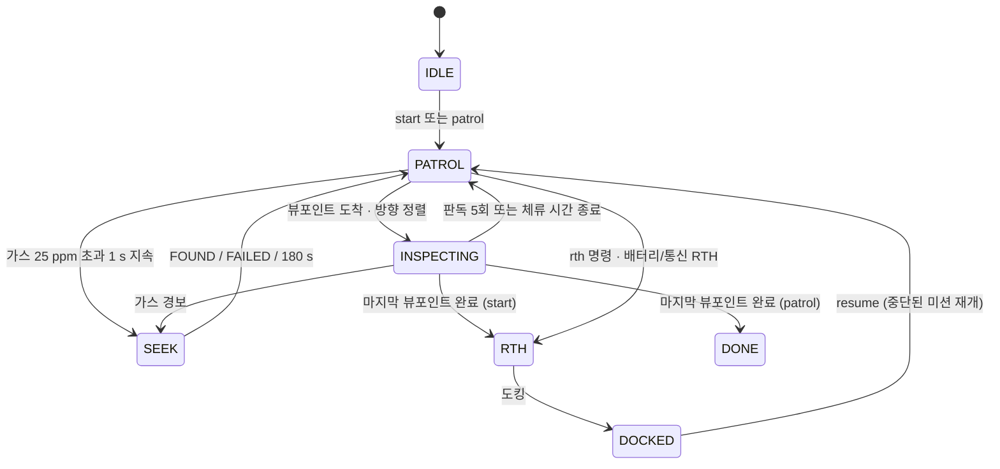

# DusanAI — 발전소 점검 4족 보행 로봇 디지털 트윈 (ROS 2 + Gazebo)

<a id="update"></a>
### Ubuntu 업데이트 방법 (이미 설치한 PC에 새 코드 넣기)

**1. Windows**: 저장소 폴더 전체를 USB로 다시 복사합니다. USB에 예전 `E:\DusanAI`가 있으면 먼저 지우세요(지운 파일이 남지 않게).

```powershell
robocopy "D:\individual\Project\Ros2\DusanAI" "E:\DusanAI" /E /XD Doosanenerbility .unity_cache __pycache__ .pytest_cache venv .venv /R:1 /W:1
```

**2. Ubuntu**: 예전 폴더를 통째로 바꾸고 다시 빌드합니다. 파일 몇 개만 덮어쓰지 마세요.

```bash
rm -rf ~/dusan_ws/src/DusanAI                       # 예전 폴더 삭제 (Ubuntu에서 고친 파일이 있으면 먼저 백업)
cp -r /media/$USER/<USB이름>/DusanAI ~/dusan_ws/src/
cd ~/dusan_ws/src/DusanAI
sudo apt install python3-pil fonts-noto-cjk         # 데모 HUD의 한글 글자 (처음 한 번)
bash scripts/build.sh                               # 이상하면 bash scripts/build.sh --clean
bash scripts/check_install.sh                       # 마지막 줄이 "0 FAIL"이어야 함
```

**2026-10-26 지도에 없는 장애물 회피**([아래](#obstacles-2026-10-26)): `dusan_common`(새 파일 `obstacle_layer.py`, `obstacle_sim.py`),
`plant_simulation`, `module3_gas_safety`를 다시 빌드해야 합니다. 위의 `bash scripts/build.sh`가 세 패키지를 모두 빌드합니다.
새 파일은 빌드해야 설치되므로 파일만 덮어쓰면 노드가 시작하지 못합니다.

**2026-10-26 미션 관리자가 공장에 들어서면 죽던 문제 수정**([FAQ Q9](#faq-q9)): Ubuntu(Lyrical) 실행에서 `mission_manager`가
공장 입구에서 죽고, `/mission/state`가 멈춰(대시보드에서 빨강) 미션이 섰습니다. 원인은 rclpy 로거 규칙입니다. 한 줄에서
심각도를 바꿔 가며 로그를 남기면 rclpy가 `ValueError: Logger severity cannot be changed between calls`를 냅니다. 이제
심각도마다 다른 줄에서 로그를 남깁니다. `plant_simulation`을 다시 빌드해야 합니다(위 `build.sh`).

**2026-10-26 MPC 모드 안정화**([아래](#mpc-2026-10-26)): `module1_locomotion`의 MPC 모드만 바뀌었습니다. 기본 보행 모드는
그대로 **stable**입니다. 이것도 위 `build.sh`로 함께 빌드됩니다.

**3. 실행**: 둘 중 하나를 고릅니다.

```bash
bash scripts/run_demo.sh            # 데모: 자동 미션 + 추적 카메라 + HUD (6.1절 "데모 모드")
# 또는 직접 운전
bash scripts/run_bringup.sh         # 터미널 1: 전체 시스템
bash scripts/run_teleop.sh          # 터미널 2: 키보드 조작
```

**새 코드인지 확인**: `run_teleop.sh` 상태 줄에 서 있을 때 `loco STAND/stand [stable]`, 걸을 때 `loco WALK/trot [stable]`이
보이면 새 코드입니다. `[stable]`이 없거나, `5`를 누르지 않았는데 `trot(auto)`·`crawl(auto)`가 보이면 예전 빌드입니다. 1–2단계를
다시 하세요. 대시보드 Robot 패널(`trot · stable`)과 데모 HUD(`보행: WALK · stable · trot`)에도 같은 값이 나옵니다.
장애물 회피가 들어간 빌드는 `ros2 topic echo /mission/state --field data`에 `obstacle` 항목이 있습니다. 로봇이 서 있는 동안
그 안의 `frames`가 늘어나면 terrain_mapper의 지도가 들어오고 있는 것입니다.

---

**4족 보행 로봇이 가상 발전소를 자율 점검(계기판·과열·가스 누출)하고, 그 상태를 웹 디지털 트윈 관제 화면에 실시간으로 보여 주는 ROS 2 + Gazebo 시뮬레이션 시스템입니다.**

Spot형 로봇이 Gazebo 가상 발전소(터빈홀, 그리고 계단·경사로·배관·잔해가 있는 48 m 복도)를 자율 보행합니다. 로봇은 아날로그 압력계를 읽고, 열화상으로 과열 배관을 찾고, 가스 농도 구배를 따라 누출원을 추적합니다. 배터리가 떨어지거나 통신 음영이 예상되면 스스로 충전소로 돌아옵니다.

> [!IMPORTANT]
> **검증 범위.** 이 저장소는 ROS가 없는 Windows PC에서 개발했습니다. 이 PC에서 실제로 실행해 확인한 것은 다섯 가지입니다.
> 1. 단위·폐루프·스텁 노드 테스트 (`python -m pytest`: **984 passed, 12 skipped**, 2026-10-26 점검)
> 2. 오프라인 평가 스크립트 6종 (`tools/eval_*.py` → `docs/results/*.json`)
> 3. ROS 없이 실제 미션 로직과 대시보드를 돌리는 **오프라인 대시보드 데모**
> 4. Gazebo 설정을 흉내 낸 **MuJoCo 물리 검증**(`tools/physics_check.py`)과 그 위의 파라미터 탐색(`tools/tune_locomotion.py`). 보행 제어 코드 전체를 관절 서보·접촉·미끄러짐이 있는 플랜트에서 돌립니다. Gazebo 결과는 아닙니다.
> 5. **실제 Gazebo(Harmonic, gz-sim 8 + DART)를 헤드리스로 돌린 보행 검증**(`tools/gazebo_check.py`). Ubuntu와 같은 로봇 플러그인(관절 서보 12개, 관절 상태, odometry, IMU)과 실제 제어기를 쓰고, 평지 시험 월드와 **실제 `plant.sdf`**에서 돌렸습니다. 렌더링(카메라 영상, GUI)과 ROS 노드·브리지는 이 도구에 없습니다([아래](#gazebo-2026-10-13)). 데모의 추적 카메라와 HUD 창은 이 PC의 Harmonic GUI에서 작은 시험 월드로 따로 확인했습니다. 지도에 없는 장애물 회피는 같은 하네스에 실제 미션 로직을 넣어 확인했습니다(`tools/obstacle_check.py`, [아래](#obstacles-2026-10-26)). MPC 모드 최종 검증도 이 두 도구로 했습니다([아래](#mpc-2026-10-26)).
>
> ROS 2 노드는 rclpy·메시지 대역(stub)으로만 시험했습니다. **GUI가 있는 Gazebo + ROS 2 전체 실행은 사용자의 Ubuntu PC에서 합니다.** 아래 화면 캡처도 오프라인 데모 화면입니다. Gazebo 실행 결과는 [7.4절](#results-template)의 절차와 표에 기록하세요.

<p align="center">
  
  
</p>
<p align="center"><sub>왼쪽: 관제 대시보드 순찰 화면 (오프라인 데모 캡처). 오른쪽: 가상 발전소 배치도 (<code>tools/generate_world.py</code>가 <code>simulation/config/world_layout.yaml</code>에서 생성)</sub></p>

### 빠른 시작

```powershell
# [Windows] USB(E:)로 복사. Unity 원본 에셋과 변환 캐시는 제외
robocopy "D:\individual\Project\Ros2\DusanAI" "E:\DusanAI" /E /XD Doosanenerbility .unity_cache __pycache__ .pytest_cache venv .venv /R:1 /W:1
```

```bash
# [Ubuntu 26.04 + ROS 2 Lyrical]  (24.04 + Jazzy는 각 명령 앞에 ROS_DISTRO=jazzy)
mkdir -p ~/dusan_ws/src
cp -r /media/$USER/<USB이름>/DusanAI ~/dusan_ws/src/
cd ~/dusan_ws/src/DusanAI
bash scripts/install_deps.sh --add-ros-repo     # ROS 2 + Gazebo + 의존성 (HUD용 python3-pil, fonts-noto-cjk 포함)
bash scripts/build.sh                           # colcon build (5개 패키지)
bash scripts/check_install.sh                   # 마지막 줄이 "0 FAIL"이어야 함
bash scripts/run_demo.sh                        # 데모 (= run_bringup.sh demo:=true), 직접 운전은 run_bringup.sh + run_teleop.sh
# 브라우저: http://localhost:8080
```

<a id="gazebo-2026-10-13"></a>
### Gazebo에서 몇 걸음 만에 넘어지던 문제 (2026-10-13, 수정 반영)

사용자 PC의 Gazebo에서 로봇이 몇 걸음 만에 넘어졌습니다. MuJoCo 검증은 통과한 설정이었지만, Gazebo(DART)의 단단한 접촉에서는
결과가 달랐습니다. 그래서 개발 PC에 **Gazebo Harmonic(gz-sim 8)**을 설치하고 실제 gz-sim으로 원인을 찾아 고쳤습니다. 아래 수정은
**모두 지금 저장소 코드에 들어 있습니다.**

| 바뀐 것 | 내용 |
|---|---|
| 기본 보행 모드 = **stable** | CHAMP 방식의 기구학 보행을 새로 넣고 기본값(`locomotion_mode: stable`)으로 정했습니다. 평지 시험(기립, trot, crawl, 회전, 텔레옵 60 s, 밀기, 지연·틱 누락, 정답 맵의 배관·경사로)에서 넘어지지 않았습니다(63/63, MPC는 57/66). MPC 모드는 텔레옵 `v`나 `mode:mpc`로 바꿀 수 있습니다 |
| 기본 보행 = **trot** | `gait_mode: trot`. 지형에 따라 4박자 walk로 바꾸는 자동 선택이 회전 중 넘어짐의 원인이었습니다(배관 우회 경로 auto 0/3 → trot 3/3). 자동 선택은 텔레옵 `5`(`gait:auto`)로 켤 수 있습니다 |
| 출발 직후 넘어짐 수정 | 깊이 카메라가 아직 보지 못한 몸 아래 칸을 측정한 발 높이(스윙 중이면 최대 7 cm 떠 있음)로 채워서 몸통 pitch 목표가 흔들렸습니다. 이제 지면 추정값 `ground_z`로 채웁니다(`controller._terrain_pitch`). 노드가 15 s 늦게 시작하는 경우 0/3 → 3/3 |
| MPC 모드 수정 | 몸통 목표가 실제 몸통보다 앞설 수 있는 거리를 줄였습니다. 이 리드가 마찰 한계를 넘는 힘을 요구해서 회전 중 지지발이 미끄러지고 넘어졌습니다 |
| 잔해 통로 + 경로 지형 비용 | 잔해 C-OBS3를 줄여 북쪽 벽 쪽에 1.26 m 통로를 남기고, 자율 경로(미션·귀환·순찰)가 배관·잔해를 돌아가게 했습니다([아래](#routes-2026-10-13)) |
| 검증 도구 | `tools/gazebo_check.py`: 헤드리스 gz-sim + 실제 제어기. 실제 `plant.sdf`, 깊이 카메라 → 지형 맵 경로 흉내, 키보드 운전자 모델 포함 ([module1 README §4.5–4.7](module1_locomotion/README.md#45-gazebo-헤드리스-검증-toolsgazebo_checkpy)) |

**지금 저장소 코드로 확인한 것** (Harmonic + DART, 기본값 그대로 = stable + trot, 깊이 카메라 맵, 키보드 운전 0.25 m/s, 시드 0–2.
`docs/results/gazebo_check.json`의 `final_default`, `routes_final`, `routes_final_more` 블록)

| 시나리오 | 결과 | 내용 |
|---|---|---|
| (a) 스폰 → 기립 → 10 s 서기 | **3/3** | 평지 시험 월드 |
| (e) 무작위 텔레옵 명령 60 s | **3/3** | 평지 시험 월드 |
| (i) trot 0.3 m/s 중 10 N·s 밀기 세 번 | **3/3** | 평지 시험 월드 |
| (k) 제어 노드가 스폰 15 s 뒤에 시작 | **3/3** | plant 도크. 다리를 편 채 제어기 없이 서 있다가 정상 기립한 뒤 걷기 |
| (o) 도크 → 배관 C-OBS1 북쪽 끝으로 돌아 → 팔레트 → 경사로 위층 | **3/3** | 74–78 s에 도착 |
| (j) 도크 → 0.10 m 배관을 **넘어** → 팔레트 → 경사로 위층 | 2/3 | 실패 1회는 배관 위(x 58.5)에서 넘어짐 |
| (l) 복도 전체: 도크 → 배관 우회 → 경사로 → 잔해 북쪽 통로 → 철판 μ 0.2 → 0.08 m 배관 → 홀 문 | **3/3** | 188–194 s, 웨이포인트 17/17 |
| (r) 잔해 1.6 m 앞에서 출발해 북쪽 통로로 | 2/6 (시드 0–5) | 실패 4회 모두 잔해에 닿기 전, 출발 직후 벽 쪽으로 약 50° 꺾는 구간 |
| (s) 철판 μ 0.2 곧게 | **3/3** | 슬립 모드 |
| (p) 잔해 곧게 / (q) 0.08 m 배관 곧게 | 0/3 / 0/3 | 블록은 넘지 못함. 배관 넘기는 아직 믿을 수 없음 |

**운전 요령** (텔레옵)
- 기본 보행이 trot이고 속도 배율은 0.5(전진 0.25 m/s)로 시작합니다. 그대로 두거나 `-`로 낮추세요. 배율 1.0(0.5 m/s)으로
  장애물에 다가가면 모든 설정에서 넘어졌습니다.
- `5`(지형에 따른 자동 보행)는 plant 월드에서 덜 안정적입니다. 눌렀다면 `3`으로 trot에 돌아오세요. `v`는 stable ↔ MPC
  전환입니다. 자주 넘어지면 상태 줄이 `[stable]`인지 확인하세요.
- C-OBS1 배관(도크 서쪽 약 3.4 m)은 북쪽 끝(벽 쪽, y ≈ +1.45)으로 돌아가세요(3/3). 꼭 넘어야 하면 수직으로 다가가 `w`만 누르고,
  네 다리가 다 넘을 때까지 방향키를 쓰지 마세요.
- C-OBS3 잔해(복도 위층 x 37–39)는 북쪽 벽 쪽 통로(y ≈ +1.1, 폭 1.26 m)로 지나가세요. x 42–44부터 비스듬히 천천히 옮기면 됩니다.
  잔해 바로 앞에서 벽 쪽으로 크게 꺾으면 넘어진 시험이 있었습니다.
- 자세한 내용은 [FAQ Q8](#faq-fall)에 있습니다.

**Gazebo 버전**: Jetty(gz-sim 10)와 Harmonic(gz-sim 8)은 둘 다 LTS입니다. 공식 짝은 ROS 2 Lyrical–Jetty, Jazzy–Harmonic이며,
짝을 섞지 마세요(`ros-<distro>-ros-gz`가 설치하는 Gazebo를 그대로 사용). 위 결과는 Harmonic에서 나왔고 Jetty에서는 직접 돌려 보지
못했습니다. 넘어지는 원인은 Gazebo 버전이 아니라 제어기였습니다(같은 DART 엔진).

**Ubuntu에 반영**: [맨 위 "Ubuntu 업데이트 방법"](#update)대로 폴더 전체를 다시 복사하고 다시 빌드하세요.

<a id="routes-2026-10-13"></a>
### 잔해 통로와 경로 지형 비용 (2026-10-13)

**월드**: C-OBS3 잔해의 범위를 y −1.3–1.3에서 **y −1.3–0.5**로 줄였습니다(`world_layout.yaml`). 블록 45개, 시드, 높이 2–6 cm는
그대로이고 블록의 y 위치만 바뀌었습니다(`plant.sdf`에서 바뀐 줄은 블록 45개의 visual·collision 자세 90줄뿐, 내비 맵은 바이트 단위로
같음). 블록은 y 0.41까지 있고 북쪽 벽면은 y 1.76이라 **1.26 m 통로**가 남습니다. 남쪽 1.7 m는 여전히 잔해입니다.

**경로 계획**: 내비 맵에서 자유 칸인 잔해(누운 배관, 잔해 지대, 철판, 낮은 단)를 **지형 비용**으로 더합니다
(`dusan_common/terrain_cost.py`). 미션 관리자(`mission.yaml`), 귀환(`safety.yaml`), 순찰 계획기(`patrol.yaml`)가 같은
`terrain_*` 파라미터를 씁니다.

| 파라미터 | 기본값 | 의미 |
|---|---|---|
| `terrain_cost_enabled` | true | 지형 비용 사용 |
| `terrain_w_pipe`, `terrain_w_rubble` | 25.0, 25.0 | 로봇 중심이 배관·잔해에서 0.12 m 안일 때 칸마다 더하는 비용 |
| `terrain_w_plate`, `terrain_w_platform` | 1.0, 2.0 | 철판, 낮은 단(작은 비용) |
| `terrain_margin`, `terrain_margin_fraction` | 0.25 m, 0.15 | 바깥 여유 폭(0.25 m 상한)과 그 비용 비율 |

- 돌아갈 길이 있으면 돌아갑니다: C-OBS1 배관 북쪽 끝, C-OBS3 잔해 북쪽 통로, 공장 출입구 배관 F-OBS3 북쪽 끝, 공장 잔해 F-OBS5,
  철판 F-OBS9.
- 돌아갈 길이 없으면 그대로 지나갑니다: C-OBS4 철판, C-OBS5 배관(복도를 가로지름). 비용은 유한해서 경로를 못 찾는 일은 없습니다.
- 경로를 다듬을 때도 비용을 봅니다. A* 경로보다 비싼 칸에 들어가는 지름길은 쓰지 않으므로 다듬은 뒤에도 배관 끝이나 잔해 모서리를
  가로지르지 않습니다.

| 경로 길이 | 비용 없음 | 지형 비용 |
|---|---|---|
| 순찰 폐회로 (도크 → 게이지 8개 → 도크, `patrol_eval.json`) | 145.88 m | **150.50 m (+3.2 %)** |
| 도크 → 복도 (52.5, 0.8), C-OBS1 우회 | 9.70 m | 10.53 m |
| 복도 (44, 0) → (34, 0), C-OBS3 통로 | 10.00 m | 10.21 m |
| 공장 (7, 0) → (2, 0), F-OBS5 우회 | 5.10 m | 7.23 m |

순찰 경로가 지나는 잔해는 C-OBS1, C-OBS3, C-OBS4, C-OBS5, F-OBS3, F-OBS9에서 **C-OBS4, C-OBS5**(돌아갈 길 없음)로 줄었습니다.

**Gazebo 확인 상세** (Harmonic, 기본값 stable + trot, 깊이 카메라 맵, 키보드 운전 0.25 m/s, `docs/results/gazebo_check.json`의
`routes_final`·`routes_final_more`. 요약은 [위 표](#gazebo-2026-10-13)):

| 시나리오 (`routes_final`, 시드 0–2) | 결과 | 내용 |
|---|---|---|
| (o) 도크 → 배관 북쪽 끝으로 돌아 → 팔레트 → 경사로 위층까지 (다시 확인) | **3/3** | 74–78 s에 도착 |
| (l) 복도 전체: 도크 → 배관 우회 → 경사로 → 잔해 **북쪽 통로** → 철판 μ 0.2 → 0.08 m 배관 넘기 → 홀 문(x 16.9) | **3/3** | 188–194 s에 17개 웨이포인트를 모두 지남. 통로 구간 y 0.91–1.15, 최대 roll 4.5°. 0.08 m 배관 위 최대 roll 8.6° |
| (r) 잔해 앞 1.6 m에서 출발해 북쪽 통로로 비켜 가기 | 2/3 (시드 3–5 추가: 0/3, 합계 2/6) | 실패 4회는 모두 잔해에 닿기 전, 출발점 북쪽 0.8–0.9 m(x 40.4–40.7)에서 넘어짐. 출발 직후 벽 쪽으로 약 50° 꺾으며 걷는 구간이고, 왼쪽 앞발 스윙 높이가 0.12 → 0.20 m로 커지고 지형 분류가 obstacle로 깜박임. 통로까지 간 2회는 모두 통과 |
| (p) 잔해 곧게 (참고, 시드 3–5) | 0/3 | 블록은 여전히 못 넘음 |
| (q) 0.08 m 배관 곧게 (참고) | 0/3 | 출발점에서 약 1.9 m 앞의 배관에서 넘어짐. 같은 배관을 (l)에서는 3/3 넘었으므로 배관 넘기는 아직 믿을 수 없음 |
| (s) 철판 μ 0.2 곧게 (참고) | 3/3 | |

복도 전체를 도크에서 홀 문까지 넘어지지 않고 간 것은 이번이 처음입니다(이전 `proposal_depth`에서는 세 시드 모두 잔해에서 멈춤).
(r)의 실패는 잔해나 통로가 아니라 출발 직후 벽 쪽으로 크게 꺾는 동작에서 생겼습니다. 계획기 경로는 x 44 근처부터 비스듬히 통로로
들어가므로 (l)과 같은 방식입니다.

<a id="obstacles-2026-10-26"></a>
### 지도에 없는 장애물 회피 (2026-10-26)

자율 주행이 내비 맵에 없는 물체(상자, 카트 등)를 스스로 피합니다. 전에는 경로 계획기가 정적 지도만 알았습니다. 그래서 경로 위
상자 앞에서 8 s 정체 → 후진 → 같은 경로 재계획을 4번 반복한 뒤 뷰포인트를 건너뛰었습니다. 이제 로봇의 깊이 카메라로 만든
elevation map(`/elevation_map/points`)에서 새 장애물을 찾습니다. 기본으로 켜져 있습니다. 핵심 코드는
`dusan_common/obstacle_layer.py`(ROS 없음)입니다.

**동작 순서** (앞 단계로 안 되면 다음 단계)

| 단계 | 조건 | 동작 |
|---|---|---|
| 1. 감속 / 정지 | 따라가는 경로 앞에 장애물 증거 | 자유 주행 거리 1.0 m 아래부터 감속, 0.35 m 아래에서 정지(회전도 0). 아직 확정되지 않은 증거는 0.5배까지만 감속(0.35 m 안이면 정지) |
| 2. 좌·우 우회 | 확정된 장애물이 2.5 m 안에서 경로를 막음 | 왼쪽·오른쪽을 따로 계획해 길이 + 지형 비용이 싼 쪽으로 돌아감. 장애물 너머 0.8 m 이상에서 원래 경로에 합류. 방향은 장애물마다 15 s 유지 |
| 3. 전역 재계획 | 쓸 만한 우회가 없음 | 지도 + 탐지한 장애물로 목표까지 다시 계획 (목표당 3회) |
| 4. 정체 처리 / 건너뛰기 | 돌아갈 길이 전혀 없음 | 지도 경로를 유지하고 장애물 앞에 섬. 기존 정체 로직이 판단: 8 s 무진전 → 후진 → 재계획, 4회 후 뷰포인트 건너뜀. 뒤에 기억된 장애물이 있으면 후진하지 않음 |

- 감속 거리는 pure pursuit가 실제로 가는 선(로봇 → 0.6 m 앞 목표점 → 경로)을 따라 잽니다.
- 그 선이 장애물 쪽 모서리나 지도의 배관·잔해를 깎으면 look-ahead를 0.3 m로 줄여 경로를 바짝 따릅니다.

**동작하는 곳**

| 노드 | 동작 |
|---|---|
| `mission_manager` (순찰, 자체 귀환) | 1–4단계 전체. 순찰 레그가 이미 막혀 있으면 처음부터 돌아가는 경로를 씀 |
| `return_to_home` (귀환) | 1–3단계. 속도 안전 필터와 후진도 탐지 장애물을 봄. 도크까지 직선이 비어 있을 때만 도킹을 시작 |
| `source_seeker` (가스 탐색) | 탐지 장애물을 국소 계획 지도에 합침(탐색 중 최대 1 Hz). 기존 장애물 우회가 그대로 피함 |

**인지 방식**
- 0.2 m 창(5×5 셀) 안의 높이 차가 0.22 m 이상인 곳을 증거로 봅니다. terrain_mapper의 `step_crit`와 같은 값입니다.
- 2프레임(0.4 s) 보이면 확정합니다. 5×5 창 전체가 다시 비어 보이면(최대 5프레임) 지우고, 60 s 동안 새 증거가 없어도 지웁니다.
- 지도의 벽·기계에서 0.30 m 안의 증거는 기존 구조물로 보고 무시합니다. 몸통·다리(0.55 m 안)도 무시합니다.
- 카메라가 보지 못하는 뒷면은 시선 방향으로 1.0 m 이어진다고 가정합니다. 끝이 보이지 않은 면도 같은 길이만큼 이어 붙입니다.
- 그 가정이 실제 틈을 막으면 0.3 m 가정으로 다시 계획합니다. 0.3 m 가정 경로가 길이 + 지형 비용으로 1.5배 이상 싸면 그때도 그쪽을 고릅니다.
- `/elevation_map/traversability`의 100(통과 불가)은 쓰지 않습니다. 새 물체가 없는 실제 경로에서 배관 옆면·경사로 가장자리·계단에
  오검출이 44셀 났습니다. step 방식은 0셀이었습니다.

**끄기**: `simulation/config/mission.yaml`, `module3_gas_safety/config/safety.yaml`, `seeker.yaml`에서 `obstacle_enabled: false`로
바꾸고 다시 실행합니다. 노드는 시작할 때만 이 값을 읽습니다. 끄면 elevation map을 구독하지 않고 이전과 똑같이 동작합니다. 단계만
끄려면 `obstacle_slowdown_enabled`, `obstacle_detour_enabled`, `obstacle_replan_enabled`를 씁니다.

**주요 파라미터** (`mission.yaml`·`safety.yaml`에 같은 이름과 값. `seeker.yaml`은 인지·메모리 키와 `obstacle_rebuild_period`만)

| 파라미터 | 기본값 | 의미 |
|---|---|---|
| `obstacle_enabled` | true | 전체 스위치. false = 이전 동작, 구독 안 함 |
| `obstacle_static_fallback` | true | 돌아갈 길이 없을 때 지도 경로 유지(정체 로직이 판단). false면 바로 건너뜀(`no path`) |
| `obstacle_source` | `elevation` | `elevation` = `/elevation_map/points` step 검사. `traversability` = 비용 ≥ `obstacle_cost_threshold`(100) |
| `obstacle_step_height`, `obstacle_step_window` | 0.22 m, 5 | terrain.yaml `step_crit`, `step_window`와 같게 유지(테스트로 확인) |
| `obstacle_confirm_hits`, `obstacle_max_hits` | 2, 5 | 확정에 필요한 프레임, 지우는 데 필요한 빈 프레임 |
| `obstacle_forget_time` | 60.0 s | 새 증거가 없으면 잊음 (0 = 잊지 않음) |
| `obstacle_ignore_radius`, `obstacle_static_tolerance` | 0.55 m, 0.30 m | 몸통·다리 무시 반경, 지도 장애물 근처 무시 거리 |
| `obstacle_shadow_depth` | 1.0 m | 보이지 않는 뒷면의 가정 깊이 (계획에만 씀) |
| `obstacle_idle_period` | 1.0 s | 주행하지 않을 때 프레임 처리 주기 (0 = 매 프레임) |
| `obstacle_slow_dist`, `obstacle_stop_dist`, `obstacle_unconfirmed_scale` | 1.0 m, 0.35 m, 0.5 | 감속 시작, 정지, 미확정 증거의 최저 속도 배율 |
| `obstacle_margin`, `obstacle_lookahead`, `obstacle_rejoin_gap` | 0.10 m, 2.5 m, 0.8 m | 탐지 장애물과의 추가 여유, 막힘 검사 거리, 합류 거리 |
| `obstacle_switch_ratio`, `obstacle_commit_time` | 1.5, 15.0 s | 방향 고정 기준(다른 쪽이 길이 + 지형 비용으로 1.5배 싸야 바꿈. 0.3 m 가정 경로를 고르는 기준도 같음)과 유지 시간 |
| `obstacle_max_detours`, `obstacle_max_replans` | 8, 3 | 목표당 우회, 전역 재계획 횟수 |
| `obstacle_frames` | `odom,map,world` | 받아들이는 frame_id. 다른 프레임은 버리고 셈 |
| `obstacle_rebuild_period` (탐색기) | 1.0 s | 탐색기 지도 재구성 최소 간격 |

전체 목록은 [DESIGN_SPEC §5](docs/DESIGN_SPEC.md)와 각 YAML의 주석에 있습니다. 설계와 실측은 [REPORT §7.8](docs/REPORT.md)입니다.

**상태 확인**: `/mission/state`와 `/safety/status`의 `obstacle` 객체에 확정 셀 수(`confirmed`), 속도 배율(`speed_scale`), 우회
방향(`detour`), 우회·재계획 횟수, 마지막 판단(`last`)이 나옵니다. 우회하면 `obstacle at 1.2 m - detour left (+0.6 m)` 같은
메시지가 미션 로그와 `/mission/state`의 `message`에 남습니다. 가스 탐색기는 `/gas/seek_status`의 `obstacles`(확정 셀 수)입니다.
문제 해결은 [FAQ Q12](#faq-obstacle)에 있습니다.

**Gazebo 확인** (Harmonic 헤드리스, 기본값 stable, 실제 `plant.sdf`에 지도에 없는 박스만 추가, 실제 제어기와 미션 로직,
깊이 카메라 → terrain_mapper 흉내, 시드 0–2. 도구는 [8.7절](#obstacle-check))

시나리오 이름은 `tools/obstacle_check.py` 기준입니다. 위 2026-10-13 표의 (r)(`gazebo_check.py`, 잔해 통로)과는 다른 시나리오입니다.

| 시나리오 | 결과 | 내용 |
|---|---|---|
| (t) 도크 → G08, 출발 때 보이는 0.6 m 박스 | **3/3** | 첫 계획부터 박스를 피함. 대조군보다 1.17배 시간, 최소 이격 0.62 m |
| (u) 팔레트 남쪽, 걷다가 약 1.2 m에서 발견 | **3/3** | 우회 1회, 1.16배, 0.61–0.64 m |
| (v) 위층 복도의 0.6 m 박스 | **3/3** | 우회 1–2회, 1.24배, 0.72–0.76 m |
| (w) 0.4 × 3.6 m 벽이 복도를 막음 | **3/3** | 우회·재계획 각 3회 → 정체 처리 → 뷰포인트 건너뜀 → DONE. 최소 0.62 m |
| (r) 도크 → G08, (x) 위층 복도, (z) 팔레트 남쪽: 박스 없는 대조군 | 각 **3/3** | 잘못된 우회 0. 각각 t, v, u의 시간 기준 |
| (y) 도크 → G08 → G07 45 m, 박스 없음 | **3/3** | 오검출 0, 감속 0 %, 평균 144 s. 처음에는 시드 0만 1/1, 2026-10-26 최종 점검에서 시드 0–2 |

- 넘어짐은 모든 stable 실행에서 0입니다. 이격은 로봇 중심에서 박스 표면까지입니다.
- **MPC 모드** (2026-10-26, 실측 MPC 지연 평균 약 29 ms, 시드 0–2): (r)(t)(u)(v)(w)(x)(z)는 **21/21**로 stable과 같습니다.
  45 m 경로 (y)는 **0/3**입니다(stable 3/3). 세 번 모두 G08을 지난 뒤 38–50 s에 넘어졌고, 걸은 거리로 보면 경사로나
  위층 복도(x 약 41–48)입니다. 자세한 표는 [아래 MPC 절](#mpc-2026-10-26)에 있습니다.

**한계**
- 카메라가 아래로 0.6 rad 숙여져 있어 높은 물체의 면은 약 1.0–1.45 m 앞에서만 보입니다. 멀리서 미리 피하지 못하고, 가까이
  가서 감속한 뒤 돌아갑니다.
- 높이 0.22 m 미만 물체는 장애물로 보지 않고 보행으로 넘습니다.
- 박스의 뒷면은 보이지 않아 가정합니다(1.0 m). 더 깊은 물체는 지나가면서 보이는 만큼만 반영됩니다.
  0.3 m 가정 경로를 고르면 깊은 박스의 뒷모서리와의 이격이 줄 수 있습니다(운동학 시뮬레이션 최악 0.33 m).
- 벽을 따라 걸을 때 벽의 옆면은 카메라에 보이지 않습니다. 해제 규칙(창 전체 관측)과 면 연장으로 보완했지만 근본 해결은 아닙니다.
- 치운 물체는 다시 완전히 보이거나 60 s가 지나야 지워집니다. 움직이는 사람은 멈춘 물체로 다룹니다.
- 귀환(`return_to_home`)은 완전히 막히면 건너뛸 목표가 없어 후진 → 재계획을 반복합니다.
- Ubuntu의 렌더링된 깊이 카메라와 ROS 실행에서는 아직 확인하지 못했습니다.

**Ubuntu에 반영**: [맨 위 "Ubuntu 업데이트 방법"](#update)대로 폴더 전체를 다시 복사하고 다시 빌드하세요.

<a id="mpc-2026-10-26"></a>
### MPC 모드 안정화와 최종 검증 (2026-10-26)

**결론: 기본 보행 모드는 계속 `stable`입니다.** MPC가 모든 시나리오에서 stable과 같거나 나아야 기본값을 바꾸기로 했습니다.
최종 검증에서 이 조건을 채우지 못했습니다. MPC는 텔레옵 `v`나 `mode:mpc`로 언제든 쓸 수 있습니다.

**무엇을 바꿨나** (모두 MPC 모드에만 적용. stable 모드 코드는 그대로)

| 차수 | 바꾼 것 (`config/locomotion.yaml`) | 이유 (Gazebo 기록) |
|---|---|---|
| 1차 | 지지발 앵커를 측정 발에서 2 cm 안으로 묶음(`mpc_stance_max_error` 0.02 m) | 실패한 실행마다 앵커 오차 p95가 7 cm를 넘었음. 미끄러진 발을 수백 N으로 끌어당겨 몸이 돌다 넘어짐 |
| 1차 | 지형 기준을 몸 밑 여러 점의 중앙값·Theil-Sen 기울기로(`mpc_terrain_robust` true) | 네 착지점만 보면 앞발 밑 0.10 m 배관이 12° 경사로처럼 보여 몸이 들렸다 떨어짐 |
| 1차 | heading hold(`mpc_heading_hold_gain` 1.0, 최대 0.2 rad/s) | 회전 명령이 없어도 배관 구간 4 m에서 yaw가 14–41° 틀어짐(hold 후 3°) |
| 1차 | 스윙 가드·리타깃 검사·배관 위 지지발 높이(`swing_guard_*`, `retarget_*`, `mpc_land_tau`, `mpc_contact_*`) | 내려오는 발이 배관 옆면에 300–450 N으로 박히거나, 배관 위에 내린 발이 3–8 cm 눌려 넘어짐 |
| 1차 | 횡방향 기준 혼합(`mpc_lateral_ref_blend` 0.5) | 회전 뒤 몸이 0.05–0.11 m/s로 옆으로 흘러 0.63 m 틈에 0.12 m 비켜 들어감 |
| 1차 | `kp_attitude` 0.5 → **0.0** | IMU P 보정이 IK roll을 최대 8.6° 키움. 0이면 0.08 m 배관 5/6(0.5는 2/6), 밀기 6/6(4/6) |
| 2차 | 지지 다리 수평 처짐 제한(`mpc_stance_rel_error` 0.02 m) | 앵커 오차 2 cm에 몸통 목표 리드가 더해져 최대 약 5 cm, 약 220 N(마찰 한계 이상)을 요구할 수 있었음 |
| 3차 | 제자리 회전 중심을 몸 뒤 0.15 m로(`mpc_turn_pivot_x` −0.15 m, `mpc_turn_pivot_fade` 0.10 m/s) | C-OBS1 북쪽 틈 출구에서 약 30° 제자리 좌회전 때 오른쪽 뒤 무릎이 벽에 걸림 |

- 3차 피벗은 무릎이 뒤로 굽은 다리 때문입니다. 원점 회전에서는 뒤 무릎이 반경 약 0.47 m로 돕니다. 피벗을 0.15 m 뒤로 옮기면
  뒤 무릎 약 0.33 m, 앞 몸통 모서리 약 0.46 m로 줄어 몸 전체가 원점 회전 원 안에 들어옵니다.
- 구현은 MPC 명령에 옆방향 속도 vy = wz × 0.15 m(회전 안쪽)를 더하는 방식입니다. 병진 명령이 커질수록 줄고 0.10 m/s 이상이면 꺼집니다.
- 3차 효과(고정 30 ms 지연, 깊이 맵, 같은 시드로 피벗 없이 비교): (o) 2/6 → **6/6**, (l) 0/3 → **6/6**, (j) 3/6 → 3/6.
  나머지(a d e i f k q r s)는 둘 다 3/3입니다.
- MPC 토크를 관절에 바로 쓰는 선택형 토크 모드를 개발하고 있습니다(진행 중, 아직 결과 없음).

**최종 결과** (`docs/results/gazebo_check.json`의 `mpc_final2` 대 `stable_regress2`, Harmonic + DART, 시드 0–2, MPC는 실측 지연.
stable의 (b)(c)(d)와 (f)(g)(h)는 이번에 다시 돌리지 않은 10-13 `stable`·`stable_map` 값)

| 시나리오 | 맵 | MPC | stable | 비고 |
|---|---|---|---|---|
| (a) 기립, (b) trot, (c) crawl, (d) 회전, (e) 텔레옵 60 s | 없음 | 각 **3/3** | 각 3/3 | |
| (i) 10 N·s 밀기 세 번 | 없음 | **3/3** | 3/3 | 10-13 MPC는 1/3 |
| (f) 0.08 m 배관, (g) 11.8° 오르막, (h) 내리막 | 정답 | 각 **3/3** | 각 3/3 | 10-13 MPC (f)는 1/3 |
| (k) 노드 15 s 늦게 시작, (s) 철판 μ 0.2 | 깊이 | 3/3 · 3/3 | 3/3 · 3/3 | |
| (q) 0.08 m 배관 곧게 | 깊이 | **3/3** | 0/3 | MPC가 나음 |
| (r) 잔해 북쪽 통로 | 깊이 | **3/3** | 2/3 | MPC가 나음 |
| (o) 배관 우회 → 경사로 위 | 깊이 | 2/3 | **3/3** | MPC s1: 경사로 x 48.5(68 s) |
| (l) 복도 전체 | 깊이 | 1/3 | **3/3** | MPC s0: 경사로 x 48.8(69 s), s1: C-OBS5 0.08 m 배관 x 21.7(192 s) |
| (j) 배관 넘어 → 경사로 위 | 깊이 | 1/3 | **2/3** | MPC s1: 경사로 x 48.2, s2: C-OBS1 배관 x 58.1(복구 후 완주했지만 넘어져서 실패) |

- 평지와 정답 맵(a–i, f g h)은 MPC **27/27**, stable 27/27입니다.
- plant 깊이 맵은 합계 **16/21**로 같습니다. 시나리오별로는 MPC가 (q)(r)에서 낫고, (o)(l)(j)에서 못합니다.
- 갭 출구(C-OBS1 북쪽 틈)에서는 넘어짐이 0회였습니다.
- **stable 퇴행 없음**: `stable_regress2`는 10-13 `final_default`·`routes_final`과 33회 실행 모두 통과 여부, 도착 시간, 진행 거리까지 같습니다.
- MPC 실측 지연(동시 실행 10개): 중앙값 22–25 ms, p95 30–35 ms, 최대 45–118 ms.

**장애물 회피 미션** (`tools/obstacle_check.py`, MPC, 실측 지연 평균 약 29 ms, 시드 0–2. stable 값은 같은 날 실행)

| 시나리오 | MPC | stable | 내용 (MPC / stable) |
|---|---|---|---|
| (r) 대조군 도크 → G08 | 3/3 | 3/3 | 20.5 s / 20.8 s |
| (t) 출발 때 보이는 박스 | 3/3 | 3/3 | 대조군 대비 1.19배, 최소 이격 0.63 m / 1.18배, 0.62 m |
| (u) 걷다가 발견한 박스 | 3/3 | 3/3 | 1.16배, 0.60 m / 1.16배, 0.61 m |
| (v) 위층 복도 박스 | 3/3 | 3/3 | 1.18배, 0.61 m / 1.24배, 0.72 m |
| (w) 복도를 막은 벽 | 3/3 | 3/3 | 정체 처리 후 DONE. 최소 이격 0.48 m / 0.62 m |
| (x)(z) 대조군 | 각 3/3 | 각 3/3 | |
| (y) 45 m 경로 | **0/3** | 3/3 | MPC는 G08을 지난 뒤 38–50 s에 넘어짐. 위치는 경사로나 위층 복도(x 약 41–48)로 추정 |

(r)(t)(u)(v)(w)(x)(z) 합계는 MPC 21/21, stable 21/21입니다. (y)까지 넣으면 MPC 21/24, stable 24/24입니다.

**남은 약점: 경사로(11.8°, 깊이 맵)와 MPC 지연**

공식 실행에서 경사로를 오른 8회 중 3회(j s1, o s1, l s0)가 x 48.2–48.8에서 넘어졌습니다. 경사로만 떼어 9회씩
(출발점 3곳 × 시드 3개) 돌린 진단입니다.

| 조건 | 결과 |
|---|---|
| 실측 지연, 부하 낮음 (평균 18–28 ms) | **9/9** |
| 고정 30 ms | 8/9 |
| 실측 지연, 부하 높음 (평균 37–50 ms, p95 45–85 ms) | **3/9** |
| 고정 30 ms + 정답 맵 | 9/9 |
| 고정 30 ms + `kp_attitude` 0.5 | 2/9 |
| 고정 30 ms + `mpc_stance_rel_error` 0 | 8/9 (효과 없음) |

- 넘어지는 과정: 뒤 스윙발이 경사면에 늦게 내려옵니다(명령보다 8–10 cm 높음, IK 도달 불가). 대각 지지 한쪽이 비고, 앞 지지발
  하나에 약 175 N이 걸립니다. 몸이 들리며 뒤로 젖혀지거나(pitch −14° → −38°) 옆으로 미끄러지다(최대 1.1 m/s) 구릅니다.
- 지연이 길수록 잦습니다. 정답 맵에서는 9/9라 깊이 맵 품질도 영향을 줍니다. 제어기 동작은 아직 바꾸지 않았습니다.
- 벽에 더 붙여 출발하는 어려운 갭 출구(스크래치 출발점 xb)는 MPC 5/9, stable 8/9입니다.

**MPC 모드를 쓸 때**: `/locomotion/state`의 `mpc_solve_ms`가 30 ms를 넘지 않는지 확인하세요. 경사로와 긴 자율 경로에서는
stable(`v`로 전환)을 권합니다. MPC는 0.08 m 배관 곧게 넘기(q)와 잔해 통로(r)에서 stable보다 나았습니다. 상세는
[module1 README §4.8](module1_locomotion/README.md#48-mpc-모드-안정화와-최종-검증-2026-10-26)과 [REPORT §4.10.7](docs/REPORT.md)에 있습니다.

## 목차

1. [개요: 디지털 트윈 데이터 흐름과 모듈](#overview)
2. [저장소 구조](#layout)
3. [요구 환경](#requirements)
4. [Windows → Ubuntu 이동](#transfer)
5. [설치 · 빌드 · 설치 확인](#install)
6. [실행](#run): [통합 실행](#run-bringup) · [데모 모드](#run-demo) · [시뮬레이터만](#run-sim) · [모듈별 단독 실행](#run-modules) · [키보드 조작](#teleop) · [관제 대시보드](#dashboard) · [RViz](#rviz) · [미션 시나리오](#scenarios) · [저사양 PC](#low-spec)
7. [결과 확인](#results): [대시보드](#results-dashboard) · [토픽](#results-topics) · [metrics](#results-metrics) · [Gazebo 결과 기록표](#results-template)
8. [Windows에서 할 수 있는 것](#windows)
9. [문제 해결 FAQ](#faq)
10. [문서 링크](#docs)

---

<a id="overview"></a>
## 1. 개요: 디지털 트윈 데이터 흐름과 모듈

과제가 요구하는 데이터 흐름(Virtual Plant → Robot Twin → Simulation Sensor Data → Inspection AI Processing → Monitoring System)을 그대로 ROS 2 토픽 흐름으로 구현했습니다.



- **Gazebo가 담당하는 것**: 물리(DART, 1 ms 스텝), 로봇 관절 서보, 센서 렌더링(Depth·RGB·Thermal), 발전소 3D 모델.
- **module3가 시뮬레이션하는 것**: 가스 확산·기류, 배터리, Wi-Fi 신호. 모두 ROS 노드 안의 수치 모델로 동작합니다. Gazebo의 초록색 가스 파티클은 시각 효과일 뿐입니다.
- **설계 원칙**
  - 공식 ROS 패키지만 사용합니다. Nav2, ros2_control, cv_bridge, 커스텀 메시지는 쓰지 않습니다.
  - 구조화된 데이터는 `std_msgs/String`에 JSON으로 실어 보냅니다.
  - 모든 알고리즘은 ROS 없이 import되는 순수 Python(numpy/OpenCV) 모듈입니다. ROS 노드(`*_node.py`)는 얇은 래퍼라서 Windows에서도 알고리즘을 테스트할 수 있습니다.
  - 모든 노드는 `use_sim_time`을 따릅니다. 그래서 RTF(실시간 배율)가 1보다 낮아도 동작은 같고 진행만 느려집니다.
  - 인터페이스 계약(토픽·프레임·JSON 필드)은 [docs/DESIGN_SPEC.md](docs/DESIGN_SPEC.md)에 있습니다.

### 모듈별 핵심 기능

| 모듈 | ROS 패키지 | 노드 (실행 파일) | 핵심 알고리즘 | 주요 출력 |
|---|---|---|---|---|
| **M1 Locomotion** | `module1_locomotion` | `terrain_mapper`, `locomotion_controller`, `keyboard_teleop` | 로봇 중심 2.5D elevation map(칼만 높이 융합) + 지형 인지 발 디딤 위치 계획 + 지형 분류에 따른 trot/crawl 자동 전환(텔레옵 `5`. 기본은 trot 고정, Gazebo 검증으로 선택). 보행 모드 두 가지: **stable**(기본, CHAMP 방식 기구학 보행, Gazebo 검증으로 선택)과 5.0 s(28 step) convex centroidal MPC(자체 ADMM QP 솔버, 텔레옵 `v`로 전환), 질량·무게중심 외란 관측기. 넘어짐 감지 → 자가 복구(최대 3회) → `gz` set_pose 보조 리셋. 미끄러운 철판: 레이아웃 마찰 사전정보 + 지지발 속도 기반 슬립 감지 → 슬립 모드(감속, 토크 피드포워드, MPC 마찰계수 하향). 키보드 텔레옵 | `/elevation_map/points`, `/terrain/info`, `/locomotion/state`, `/mpc/predicted_trajectory`, `/locomotion/fall_event` |
| **M2 Inspection AI** | `module2_inspection` | `gauge_reader`, `thermal_fusion`, `synthetic_thermal_camera`, `patrol_planner` | 저조도·흔들림 보정 → 다이얼 검출 → 바늘 각도 → 수치 변환(눈금 범위는 OCR로 교차 확인) + 시간 융합. 열화상↔RGB 평면 유도 호모그래피(+ECC) 정합과 과열(warning 60 °C / alarm 80 °C) 판정. 판독성 점수 기반 viewpoint 선정 + Held-Karp 최적 순찰 순서 | `/inspection/gauge_readings`, `/inspection/gauge_overlay`, `/inspection/thermal_alerts`, `/inspection/thermal_fusion`, `/patrol/plan_json` |
| **M3 Gas / Safety** | `module3_gas_safety` | `gas_dispersion_sim`, `source_seeker`, `battery_simulator`, `comm_simulator`, `return_to_home` | 2D 이류-확산 방정식 + 질량 보존 바람장(돌풍 포함). 4센서 배열 로그공간 경사 하강 source seeking(SEARCH → SURGE → CAST → GRADIENT → FOUND). 배터리 에너지 모델, Wi-Fi RSSI 맵과 통신 음영 예측. RTH 감독(배터리 20 % 미만 / 에너지 예비량 부족 / 음영 진입 예상) → 도킹 → 충전 | `/gas/concentration_grid`, `/gas/sensor`, `/gas/seek_status`, `/battery/state`, `/comm/rssi`, `/safety/status` |
| **통합** | `plant_simulation` | `map_server_lite`, `odom_tf`, `clock_relay`, `cmd_vel_mux`, `mission_manager`, `monitor_dashboard`, `metrics_logger`, `demo_hud`, `follow_camera` | Gazebo 월드 + Spot URDF, ros_gz_bridge 설정, 미션 상태기계(경로는 지형 비용 A*, 지도에 없는 장애물 회피), `/cmd_vel` 우선순위 mux, 웹 관제 대시보드, 실행 지표 기록, 데모 HUD·추적 카메라 | `/mission/state`, `/cmd_vel`, `/twin/markers`, `/demo/hud`, 웹 UI :8080, `~/dusan_metrics/` |
| **공용** | `dusan_common` | (라이브러리) | 로봇 기구학 모델, 레이아웃 로더, 격자 지도, A*(+ 지형 비용 `terrain_cost.py`), 지도에 없는 장애물 층(`obstacle_layer.py`), pure pursuit, 카메라 모델, ROS 헬퍼 | — |

### 과제 요구사항과 구현

오프라인 근거의 수치는 모두 `docs/results/*.json`에서 그대로 가져왔습니다. Gazebo에서 측정한 값이 아닙니다. 게이지·열화상은 합성 영상, 보행은 강체 모델과 MuJoCo 물리 플랜트, 가스·RTH는 module3 시뮬레이터로 평가했습니다.

| 요구 | 구현 | 오프라인 근거 |
|---|---|---|
| M1-1 지형 인지 / Elevation Map | `terrain_mapper` (`elevation_map.py`, `foothold_planner.py`, `terrain_classifier.py`) | 지형 분류 7/7, 보행 선택 7/7. 계단 위험 발판 25.0 % → 0.0 % (`terrain_eval.json`) |
| M1-2 MPC (5 s 예측) + 튜닝 | `locomotion_controller` (`mpc.py`, `qp.py`), 튜닝 도구 `tools/tune_locomotion.py` | 강체: 풀이 시간 mean 11.81 ms, p95 14.71 ms, 660회 모두 30 ms 미만. 질량 +20 %·무게중심 +4 cm에서도 넘어짐 없음 (`locomotion_eval.json`). MuJoCo: trot 0.4 m/s·crawl·회전·+3 kg 탑재 3/3 시드, 15 N·s 측면 밀기 2/3, 배관 + 단차 0/3 (`physics_check.json`). 자동 탐색은 채택 후보 없음 (`tuning.json`) |
| M1-3 Fall Recovery | `fall_recovery.py` (DAMP → TUCK → (ROCK) → SELF_RIGHT → PREPARE → STAND_UP → VERIFY) | MuJoCo: 옆으로 넘어진 경우 6/6 첫 시도 복구 (6.07 / 5.16 s). 등으로 떨어지면 실패 → 보조 리셋 (`physics_check.json`). Gazebo 미검증 |
| M1 시나리오: 미끄러운 철판 | `friction_map.py`, `slip_detector.py`, 제어기 슬립 모드 | MuJoCo, trot 명령 0.4 m/s: μ 0.15 철판 0/3 → 3/3, μ 0.2 철판 1/3 → 3/3 (`physics_check.json`의 `slippery`) |
| M2-1 게이지 판독 (오차 5 % 이내) | `gauge_reader` | 480 프레임 검출률 100 %, 오차 mean 0.111 %FS, p95 0.401 %FS (`gauge_eval.json`) |
| M2-2 열화상 퓨전 | `thermal_fusion` (+ `synthetic_thermal_camera`) | nominal precision 1.000, recall 0.9845 (`thermal_eval.json`) |
| M2-3 Viewpoint 순찰 경로 | `patrol_planner` (`viewpoint_planner.py`) | 순환 경로 150.50 m(지형 비용으로 배관·잔해 우회, 비용 없이는 145.88 m). 레이아웃 순서 164.49 m보다 8.5 % 짧음 (`patrol_eval.json`) |
| M3-1 가스·기류 시뮬레이션 | `gas_dispersion_sim` (`gas_model.py`, `config/gas_dispersion.yaml`) | 질량 수지 상대오차 3.1e-15, 10 Hz 한 스텝 0.56 ms (`gas_eval.json`) |
| M3-2 Source Seeking (경사 하강) | `source_seeker` (`source_seeking.py`) | 40회 성공률 100 %, 누출원 오차 mean 0.478 m (`gas_eval.json`) |
| M3-3 RTH (배터리 20 % / 통신 음영) | `battery_simulator`, `comm_simulator`, `return_to_home` | 배터리·통신 음영·에너지 예비 3개 시나리오 모두 도킹·충전 완료 (`gas_eval.json`) |

통합 환경(결과물 4)과 모델링 최소 조건(결과물 7)은 `simulation/config/world_layout.yaml`과 변환된 메쉬로 확인할 수 있습니다.

| 조건 | 구현 |
|---|---|
| 복도 45 m × 3.5 m, 높이 4 m | 내부 약 48.5 m × 3.6 m, 높이 4.0 m. 계단(디딤판 4개)과 11.8° 경사로로 0.88 m 아래층에 내려감 |
| 공장(터빈홀) 25 m × 18 m, 높이 7 m | 내부 24.9 m × 18 m, 높이 7.3 m |
| 험지 방해물: 복도 3개 이상, 공장 5개 이상 | 복도 5개(배관 2, 팔레트, 잔해, 미끄러운 철판), 공장 9개(팔레트 2, 배관 2, 잔해, 드럼 2, 낮은 단, 미끄러운 철판) |
| 로봇개 1, 공장기계 1 | Spot 1대(`simulation/urdf/spot.urdf.xacro`), 기계 2대(터빈, 가스 탱크 스키드) |
| 제공 에셋 사용 | `factory_inner_1`(터빈홀), `factory_hall`(복도), `fac_gastank`(터빈·가스 탱크), `obs_palette`(팔레트), `robot_spot`(로봇)을 `tools/convert_environment.py`, `tools/convert_spot.py`로 변환. 애니메이션 패키지는 쓰지 않음 (보행·넘어짐은 물리 엔진과 제어기가 만듦) |
| 세 모듈 통합 실행 | `bash scripts/run_bringup.sh` (= `ros2 launch plant_simulation bringup.launch.py`), [6.1절](#run-bringup) |

---

<a id="layout"></a>
## 2. 저장소 구조

```
DusanAI/                      ← Ubuntu에서는 ~/dusan_ws/src/DusanAI 에 둔다
├── README.md                 이 문서 (실행 가이드)
├── docs/
│   ├── REPORT.md             프로젝트 보고서 (알고리즘 · 결과 · 문제 해결)
│   ├── DESIGN_SPEC.md        인터페이스 계약 (토픽 · 프레임 · JSON · launch · entry point)
│   ├── SETUP_GUIDE.md        설치 상세 · 수동 설치 · 개발 환경
│   ├── images/               그림 (평가 그래프, 대시보드 캡처, 월드/로봇 미리보기)
│   └── results/              평가 결과 JSON 8개 (eval_*.py 6종 + physics_check + tuning)
├── dusan_common/             공용 Python 라이브러리 (ament_python)
├── module1_locomotion/       M1: 지형 인지, 보행 제어(stable 기본 / MPC), 넘어짐 복구, 키보드 텔레옵
├── module2_inspection/       M2: 게이지 판독, 열화상 퓨전, 합성 열화상 카메라, 순찰 경로
├── module3_gas_safety/       M3: 가스 확산, 누출원 탐색, 배터리, 통신, 자율 복귀
├── simulation/               ROS 패키지 "plant_simulation"
│   ├── worlds/plant.sdf      Gazebo 월드
│   ├── urdf/                 spot.urdf.xacro (+ 전개본 spot.urdf)
│   ├── models/               변환된 발전소·로봇 메쉬, 게이지·도크·밸브 모델
│   ├── maps/                 2D 항법 지도 plant_map.pgm/.yaml
│   ├── config/               world_layout.yaml(위치·정답의 단일 출처), ros_gz_bridge.yaml,
│   │                         gui.config, mission.yaml, mux.yaml, dashboard.yaml
│   ├── launch/               sim / bringup / dashboard .launch.py
│   ├── plant_simulation/     통합 노드 (mission, mux, dashboard, metrics, odom, map, clock, demo HUD, follow camera)
│   ├── web/                  관제 대시보드 (index.html, app.js, style.css)
│   └── rviz/plant.rviz       RViz 설정
├── scripts/                  Ubuntu 셸 도우미: install_deps, build, check_install, run_*
├── tools/                    Windows/Linux 오프라인 도구: 에셋 변환기, 월드 생성기,
│                             평가(eval_*.py), plot_metrics.py, tools/test/,
│                             physics_check.py + physics/ (MuJoCo 물리 검증), tune_locomotion.py,
│                             gazebo_check.py + gazebo_check/, obstacle_check.py (Gazebo 헤드리스 검증)
└── Doosanenerbility/         제공된 Unity 에셋 원본 (변환기 입력 전용, Ubuntu로 복사 불필요)
```

| 폴더 | 역할 | Ubuntu 실행에 필요? |
|---|---|---|
| `dusan_common/`, `module1_locomotion/`, `module2_inspection/`, `module3_gas_safety/`, `simulation/` | colcon으로 빌드하는 ROS 2 패키지 5개 | **필요** |
| `scripts/` | 설치·빌드·실행 스크립트 | **필요** |
| `docs/` | 문서·그림·평가 결과 | 권장 |
| `tools/` | 변환기·평가·`plot_metrics.py` (`tools/.unity_cache/`는 자동 생성 캐시) | `plot_metrics.py` 때문에 권장. 캐시는 불필요 |
| `Doosanenerbility/` | Unity 원본 에셋 (약 300 MB) | 불필요 (변환 결과는 `simulation/models/`에 커밋됨) |

> GitHub 저장소에는 `Doosanenerbility/`(과제 제공 원본 자료)를 올리지 않습니다. 저장소만으로 빌드·실행이 됩니다. 에셋을 다시 변환할 때만 제공받은 원본을 이 위치에 따로 넣으면 됩니다.

<p align="center"><br><sub>Unity 원본 Spot 리그(FBX)와 변환된 Gazebo 메쉬 비교 (<code>tools/convert_spot.py</code>)</sub></p>

---

<a id="requirements"></a>
## 3. 요구 환경

| 구분 | 권장 (주 대상) | 대안 |
|---|---|---|
| OS | **Ubuntu 26.04 LTS** | Ubuntu 24.04 LTS |
| ROS 2 | **Lyrical Luth** (`/opt/ros/lyrical`, 스크립트 기본값) | Jazzy Jalisco (`ROS_DISTRO=jazzy`) |
| Gazebo | **Jetty (gz-sim 10)**. `ros-lyrical-ros-gz`가 설치 | Harmonic (gz-sim 8). `ros-jazzy-ros-gz`가 설치 |
| Python | 3.12 이상, numpy, OpenCV 4.x, PyYAML (Ubuntu apt 패키지) | |

- Gazebo는 `ros-<distro>-ros-gz`가 의존하는 버전을 그대로 씁니다. packages.osrfoundation.org에서 다른 버전의 Gazebo를 따로 설치하지 마세요.
- **권장 사양**: CPU 4코어 이상(8스레드 권장), RAM 8 GB 이상. Gazebo와 약 17개의 Python 노드가 함께 돌아갑니다.
- **GPU 권장 사항**
  - OpenGL 3.3 이상을 지원하는 GPU와 드라이버가 필요합니다. Gazebo 카메라(ogre2 렌더러), 특히 **열화상 센서는 GPU가 필요**합니다.
  - NVIDIA는 독점 드라이버를 권장합니다 (Ubuntu의 "소프트웨어 & 업데이트 → 추가 드라이버"). Intel/AMD 내장 GPU는 Mesa 드라이버로 동작합니다.
  - 렌더러 확인: `glxinfo -B` (`sudo apt install mesa-utils`). `check_install.sh`도 OpenGL renderer를 출력합니다.
  - GPU가 없거나 VM이면 `thermal_source:=synthetic`(합성 열화상), `gui:=false headless_rendering:=true`(화면 없이 EGL 렌더링)를 쓰고, 최후의 수단으로 `export LIBGL_ALWAYS_SOFTWARE=1`(매우 느림)을 씁니다. 자세한 내용은 [6.8절](#low-spec)을 보세요.

---

<a id="transfer"></a>
## 4. Windows → Ubuntu 이동

### 4.1 무엇을 복사하나

저장소 폴더 전체를 복사하되 **`Doosanenerbility/`(Unity 원본, 약 300 MB)와 `tools/.unity_cache/`(변환 캐시, 약 240 MB)는 제외**합니다. Python 캐시(`__pycache__`)도 뺍니다. 그대로 두면 `setup.py`가 `launch/__pycache__`까지 설치할 수 있습니다. 제외하고 나면 약 45 MB입니다.

```powershell
# Windows PowerShell 또는 cmd. USB 드라이브가 E: 라고 가정
robocopy "D:\individual\Project\Ros2\DusanAI" "E:\DusanAI" /E /XD Doosanenerbility .unity_cache __pycache__ .pytest_cache venv .venv /R:1 /W:1
```

- `/E`: 하위 폴더 전체를 복사합니다.
- `/XD`: 이름이 일치하는 폴더를 어느 깊이에 있든 제외합니다.
- robocopy는 **종료 코드 0–7이 성공**이고 8 이상이 실패입니다. 1(파일 복사됨)은 정상입니다.
- 네트워크로 옮겨도 됩니다 (예: `scp -r`). 이때도 같은 폴더를 빼세요.

### 4.2 Ubuntu에서 둘 위치

```bash
mkdir -p ~/dusan_ws/src
cp -r /media/$USER/<USB이름>/DusanAI ~/dusan_ws/src/
cd ~/dusan_ws/src/DusanAI
```

- 저장소가 `<ws>/src/` 바로 아래에 있으면 스크립트가 `<ws>`(여기서는 `~/dusan_ws`)를 colcon 워크스페이스로 씁니다.
- 다른 곳(예: `~/DusanAI`)에 두면 `build.sh`가 `~/dusan_ws/src/DusanAI → <저장소>` 심볼릭 링크를 만듭니다.
- `DUSAN_WS=<경로>`로 워크스페이스를 직접 지정할 수 있습니다. 단 저장소 안쪽 경로는 안 됩니다.

### 4.3 실행 권한이 없어도 됩니다: 항상 `bash scripts/xxx.sh`

FAT32/exFAT USB는 Unix 실행 권한과 심볼릭 링크를 보존하지 않습니다. 그래서 `./scripts/build.sh`는 `Permission denied`가 날 수 있습니다. **스크립트는 언제나 `bash scripts/<이름>.sh`로 실행하세요.** 실행 권한이 필요 없습니다. Python 노드의 실행 파일은 colcon이 빌드할 때 새로 만들므로 이쪽도 권한 문제가 없습니다. (원하면 `chmod +x scripts/*.sh`.)

### 4.4 줄바꿈 (CRLF)

저장소의 텍스트 파일(.py .yaml .sh .xacro .sdf .urdf .md 등)은 LF가 기준입니다 (2026-10-12 릴리스 점검 때 CRLF 0개). Windows 편집기로 수정한 파일은 CRLF로 바뀌었을 수 있습니다. Python·YAML·xacro는 CRLF여도 동작하지만 셸 스크립트는 실패하므로, `build.sh`와 `check_install.sh`가 경고합니다. 변환 방법은 [FAQ](#faq-crlf)에 있습니다.

---

<a id="3-installation-ubuntu"></a>
<a id="install"></a>
## 5. 설치 · 빌드 · 설치 확인

모든 스크립트는 `ROS_DISTRO` 환경변수를 따릅니다. 기본값은 `lyrical`이고, 이미 ROS를 source한 터미널이라면 그 배포판을 씁니다. **Ubuntu 24.04에서는 명령 앞에 `ROS_DISTRO=jazzy`를 붙이거나 `export ROS_DISTRO=jazzy`를 먼저 실행하세요.**

### 5.1 의존성 설치: `scripts/install_deps.sh`

```bash
cd ~/dusan_ws/src/DusanAI
bash scripts/install_deps.sh --add-ros-repo                    # 처음: ROS 2 apt 저장소 등록 + 전체 설치 (26.04 + Lyrical)
bash scripts/install_deps.sh                                   # 저장소가 이미 설정된 경우
bash scripts/install_deps.sh --desktop                         # ros-<distro>-desktop(rqt 등)도 설치
ROS_DISTRO=jazzy bash scripts/install_deps.sh --add-ros-repo   # Ubuntu 24.04 + Jazzy
bash scripts/install_deps.sh --help
```

| 옵션 | 동작 |
|---|---|
| (없음) | `apt-get install`로 아래 패키지 설치 → `rosdep init`(필요 시) / `rosdep update` / `rosdep install --from-paths <저장소> --ignore-src -r -y` |
| `--add-ros-repo` | 먼저 `curl`, `software-properties-common`을 설치하고 `universe`를 켭니다. 그다음 github.com/ros-infrastructure/ros-apt-source의 최신 `ros2-apt-source` 패키지를 Ubuntu 코드네임에 맞춰 설치합니다 (packages.ros.org와 서명 키 설정). |
| `--desktop` | `ros-<distro>-desktop` 추가 |
| `-h`, `--help` | 사용법 출력 |

설치하는 패키지는 다음과 같습니다. apt 저장소에 없는 패키지는 경고와 함께 건너뜁니다.

- **ROS 2**: `ros-<distro>-ros-base`(`ros2 launch`/`ros2 run` 동사 포함), `-ros2launch`, `-ros2run`, `-ros-gz`(Gazebo + 브리지 + `gz` 명령), `-xacro`, `-robot-state-publisher`, `-rviz2`, `-tf2-ros`
- **Python·라이브러리**: `python3-numpy`, `libopenblas0-pthread`(MPC 풀이 속도에 중요), `python3-opencv`, `python3-yaml`
- **빌드·기타**: `python3-colcon-common-extensions`, `python3-rosdep`, `xterm`(텔레옵 창), `python3-pytest`, `python3-matplotlib`(`plot_metrics.py`)
- **데모 HUD 한글**: `python3-pil`(Pillow), `fonts-noto-cjk`(한글 글꼴). 없으면 HUD 글자가 영어(`GAS: X ppm`)로 나옵니다.

수동 설치 절차는 [docs/SETUP_GUIDE.md §3.2](docs/SETUP_GUIDE.md)에 있습니다.

### 5.2 빌드: `scripts/build.sh`

```bash
bash scripts/build.sh                        # colcon build --symlink-install (5개 패키지)
bash scripts/build.sh --clean                # build/ install/ log/ 삭제 후 빌드
bash scripts/build.sh --no-symlink           # 일반 설치 (setuptools가 --symlink-install을 거부할 때)
bash scripts/build.sh --test                 # 빌드 후 colcon test + colcon test-result
bash scripts/build.sh --parallel-workers 2   # 그 밖의 인자는 colcon build로 전달
DUSAN_WS=~/other_ws bash scripts/build.sh    # 다른 워크스페이스
```

- 빌드 대상은 `dusan_common module1_locomotion module2_inspection module3_gas_safety plant_simulation`입니다.
- 빌드 전에 저장소 안의 CRLF 파일을 검사해 경고합니다.
- `--symlink-install` 덕분에 Python·YAML 수정은 재빌드 없이 반영됩니다. 새 파일을 추가하거나 `setup.py`·entry point를 바꿨을 때는 다시 `bash scripts/build.sh`를 실행하세요.
- `run_*.sh` 스크립트는 ROS와 워크스페이스를 알아서 source합니다. `ros2` 명령을 직접 쓸 터미널에서는 먼저 아래를 실행하세요 (`~/.bashrc`에 넣어 두면 편합니다).

  ```bash
  source /opt/ros/lyrical/setup.bash      # 24.04: /opt/ros/jazzy/setup.bash
  source ~/dusan_ws/install/setup.bash
  ```

### 5.3 설치 확인: `scripts/check_install.sh`

```bash
bash scripts/check_install.sh                    # 24.04: ROS_DISTRO=jazzy bash scripts/check_install.sh
```

항목마다 PASS / WARN / FAIL을 출력합니다. **마지막 줄이 `0 FAIL, n WARN`이어야 합니다.** FAIL이 하나라도 있으면 종료 코드는 1입니다.

| 구역 | 검사 내용 |
|---|---|
| System | OS, 저장소·워크스페이스 경로 |
| ROS 2 | `/opt/ros/<distro>`, `ros2 colcon xacro python3` 명령, `ros2 launch`·`ros2 run` 동사 (없으면 FAIL), `ros2 topic`·`ros2 pkg` (없으면 WARN) |
| Gazebo | `gz` 명령, `gz sim --version` |
| ROS packages | ros_gz_sim, ros_gz_bridge, robot_state_publisher, xacro, rviz2, tf2_ros, rclpy, nav_msgs, sensor_msgs, visualization_msgs, launch_ros |
| Python modules | numpy, cv2, yaml (matplotlib, PIL, 한글 글꼴은 WARN) |
| Workspace | 5개 패키지, 모든 `setup.py` entry point의 실행 파일 21개(module1 3, module2 4, module3 5, plant_simulation 9, `clock_relay`·`demo_hud`·`follow_camera` 포함), 설치된 world/map/URDF/config/launch/rviz/web 파일, `xacro` 전개, `gz sdf -p`(URDF 변환), `gz sdf -k worlds/plant.sdf` |
| Runtime | 8080 포트 사용 여부, 디스플레이, OpenGL renderer, LF 줄바꿈 |

---

<a id="run"></a>
## 6. 실행

<a id="run-bringup"></a>
### 6.1 통합 실행 (전체 디지털 트윈)

```bash
bash scripts/run_bringup.sh                                    # = ros2 launch plant_simulation bringup.launch.py
bash scripts/run_bringup.sh rviz:=true                         # RViz도 실행
bash scripts/run_bringup.sh mission_autostart:=true            # 시뮬레이션 시간 25 s 뒤 전체 미션 자동 시작
bash scripts/run_bringup.sh teleop_terminal:=xterm             # 키보드 텔레옵 창을 xterm으로 띄움
bash scripts/run_bringup.sh thermal_source:=synthetic          # GPU 열화상 센서 대신 합성 열화상
bash scripts/run_bringup.sh gui:=false headless_rendering:=true   # 화면 없이 (서버 + EGL 렌더링)
bash scripts/run_demo.sh                                       # 데모 모드 (= demo:=true, 아래 "데모 모드")
```

`run_bringup.sh`는 ROS와 워크스페이스를 source한 뒤 받은 인자를 모두 `ros2 launch plant_simulation bringup.launch.py`에 그대로 넘깁니다. 직접 실행해도 결과는 같습니다.

```bash
ros2 launch plant_simulation bringup.launch.py rviz:=true thermal_source:=synthetic
```

**`bringup.launch.py` 인자 (전체)**

| 인자 | 기본값 | 설명 |
|---|---|---|
| `gui` | `true` | Gazebo GUI 창. `false`면 서버만 실행합니다 (`gz sim -s`). |
| `headless_rendering` | `false` | `gui:=false`일 때 카메라를 EGL로 렌더링합니다. 디스플레이가 없는 PC나 원격 접속에 씁니다. |
| `rviz` | `false` | `rviz/plant.rviz` 설정으로 RViz2를 실행합니다. |
| `thermal_source` | `gazebo` | `gazebo`: Gazebo 열화상 센서. `synthetic`: `synthetic_thermal_camera` 노드가 열화상을 만들고 URDF의 Gazebo 열화상 센서는 자동으로 꺼집니다 (`enable_thermal:=false`). |
| `mission_autostart` | `false` | `true`면 `autostart_delay` 뒤 전체 미션(`start`)을 자동 시작합니다. |
| `autostart_delay` | `25.0` | 자동 시작 대기 시간 (시뮬레이션 시간, s) |
| `dashboard_port` | `8080` | 웹 대시보드 포트. 사용 중이면 +1…+5 포트를 차례로 시도합니다. |
| `teleop_terminal` | `none` | 키보드 텔레옵 실행 방식: `none` / `xterm` / `gnome-terminal` / `konsole` / `gz` (`gz`는 터미널 없이 Gazebo 창 키 입력만 사용) |
| `metrics` | `true` | 실행 지표를 `~/dusan_metrics/<YYYYmmdd_HHMMSS>/`에 기록합니다. |
| `module_delay` | `6.0` | 시뮬레이션을 띄운 뒤 세 모듈 launch를 시작할 때까지의 대기 시간 (s) |
| `use_sim_time` | `true` | Gazebo `/clock`을 사용합니다. |
| `world` | `''` | 다른 SDF 월드 파일 (`''`이면 설치된 `plant.sdf`) |
| `layout_file` | `''` | 다른 `world_layout.yaml` (`''`이면 설치본) |
| `map_yaml` | `''` | 다른 항법 지도 YAML (`''`이면 레이아웃 기본값 `plant_map.yaml`) |
| `demo` | `false` | `true`면 미션 자동 시작, 추적 카메라, HUD를 모두 켭니다 (`run_demo.sh`) |
| `hud` | `true` | HUD 노드 `demo_hud` (`/demo/hud`, Gazebo "Robot HUD" 창) |
| `follow_camera` | `''` (= `demo`) | Gazebo GUI 추적 카메라. `gui:=false`면 켜지지 않습니다. |
| `follow_offset` | `-2.5,0.0,1.6` | 로봇 기준 추적 카메라 위치 (m, 뒤/옆/위) |

**시작 순서**



1. 로봇은 다리를 편 자세로 충전소에서 생성되고 스스로 일어섭니다.
2. 대시보드 Robot 패널에 `STAND`가 보이면 준비가 끝난 것입니다.
3. 브라우저에서 **http://localhost:8080**을 엽니다. 다른 PC에서는 `http://<우분투 IP>:8080`으로 접속합니다.

<a id="run-demo"></a>
#### 데모 모드: 참고 영상처럼 한 번에 실행 (`scripts/run_demo.sh`)

```bash
bash scripts/run_demo.sh                                   # = ros2 launch plant_simulation bringup.launch.py demo:=true
bash scripts/run_demo.sh autostart_delay:=15.0 follow_offset:="-3.0 0.0 1.8"
bash scripts/run_demo.sh thermal_source:=synthetic         # 다른 bringup 인자도 그대로 전달
```

**화면에 보이는 것**
- **추적 카메라**: Gazebo 3D 화면이 로봇 뒤 2.5 m, 위 1.6 m에서 로봇을 따라갑니다. 3D 화면을 클릭하고 Esc를 누르면 자유 시점이 됩니다.
- **Robot HUD 창**(3D 화면 왼쪽 위): 로봇 카메라 영상 위에 다음이 겹쳐 보입니다.
  - "현재 가스 농도: X ppm"과 ppm 막대(로그 눈금). 10 ppm 이상이면 주황, 25 ppm 이상이면 빨강입니다. 경보 중에는 빨간 테두리가
    깜빡이고 "가스 경보"가 뜹니다.
  - 배터리 %와 충전 여부
  - 임무 상태(예: `순찰 이동 → G03 (2/8)`, `가스 누출원 탐색`, `도크로 복귀`)
  - 보행 상태(예: `보행: WALK · stable · trot`)와 시뮬레이션 시간
  - 카메라 영상이 없으면 "카메라 신호 없음"이 뜹니다.
- **가스 누출**: 누출 밸브에서 초록색 반투명 가스가 바람 방향으로 퍼집니다.
- **자동 임무**: 실행 25 s(시뮬레이션 시간) 뒤 도크를 떠나 복도 → 공장 → 계기판을 순찰합니다. 가스 경보가 나면 누출원을 찾고,
  끝나면 도크로 돌아옵니다. 공장 출입구에서 이미 25 ppm을 넘을 수 있어서, 실제 순서는 복도 → 공장 입구(경보, 탐색) → 계기판 →
  복귀가 되기도 합니다.

**데모 관련 인자** (나머지는 위 bringup 인자 표와 같음)

| 인자 | 기본값 | 설명 |
|---|---|---|
| `demo` | `false` (`run_demo.sh`는 `true`) | 미션 자동 시작 + 추적 카메라 + HUD |
| `hud` | `true` | HUD 노드 `demo_hud` (`/demo/hud`) |
| `follow_camera` | `''` (= `demo`) | GUI 추적 카메라. `gui:=false`면 켜지지 않음 |
| `follow_offset` | `-2.5,0.0,1.6` | 로봇 기준 카메라 위치 (m, 뒤/옆/위) |
| `autostart_delay` | `25.0` | 미션 시작까지 시간 (s, 시뮬레이션 시간) |

- 평소 텔레옵에서 추적 카메라만 쓰려면 `bash scripts/run_bringup.sh follow_camera:=true`를 실행하세요.
- 이미 떠 있는 Gazebo에서 켜려면 `ros2 run plant_simulation follow_camera`를 실행하세요.
- HUD는 ROS에서 `ros2 run rqt_image_view rqt_image_view /demo/hud`로도 볼 수 있습니다(`install_deps.sh --desktop`).
- Gazebo 창에는 rgb8 사본 `/demo/hud_rgb`가 브리지를 거쳐 Gazebo 토픽 `/demo/hud`로 표시됩니다. Gazebo 이미지 창은 BGR 영상을
  표시하지 못합니다.
- 한글 HUD에는 `sudo apt install python3-pil fonts-noto-cjk`가 필요합니다(`install_deps.sh`가 설치). 없으면 영어로 "GAS: X ppm"이
  나오고, 노드 로그에 경고가 한 번 찍힙니다.
- 추적 카메라는 모든 Gazebo 버전에 있는 GUI 토픽 `/gui/track`을 쓰고, 확인이 안 되면 Harmonic의 `/gui/follow` 서비스로 다시
  시도합니다. 실패해도 launch를 멈추지 않습니다. 추적 카메라와 HUD 창은 개발 PC의 Harmonic GUI에서 확인했고, 로봇이 들어간 전체
  bringup과 Jetty에서는 돌려 보지 못했습니다.
- 데모 중에도 `bash scripts/run_teleop.sh`로 언제든 수동 조작으로 넘어갈 수 있습니다(`m` = 수동 오버라이드). 보행은 위
  ["Gazebo에서 몇 걸음 만에 넘어지던 문제"](#gazebo-2026-10-13)의 수정이 들어간 기본값(stable + trot)을 씁니다.

<a id="run-sim"></a>
### 6.2 시뮬레이터만 (자율 기능 없음)

Gazebo 월드, 로봇, 브리지, odom/TF, 지도 서버만 띄웁니다. 모듈을 하나씩 시험할 때 기반으로 씁니다.

```bash
bash scripts/run_sim.sh                                   # = ros2 launch plant_simulation sim.launch.py
bash scripts/run_sim.sh gui:=false headless_rendering:=true
bash scripts/run_sim.sh enable_thermal:=false             # Gazebo 열화상 센서 끄기 (합성 열화상을 쓸 때)
ros2 launch plant_simulation sim.launch.py verbosity:=4   # Gazebo 로그를 더 자세히
```

| 인자 | 기본값 | 설명 |
|---|---|---|
| `gui`, `headless_rendering`, `world`, `use_sim_time`, `layout_file`, `map_yaml` | bringup과 같음 | |
| `x`, `y`, `z`, `yaw` | `''` | 생성 자세 (`''`이면 `world_layout.yaml`의 `robot_spawn` = 61.9, 0.0, −0.32, π). **기본값 사용을 권장합니다.** `odom_tf`(`spawn_mode: auto`)는 첫 odometry가 원점 1 m 안에 있으면 Gazebo odometry를 "생성 위치 기준"으로 보고 레이아웃의 `robot_spawn`을 더합니다. 그래서 다른 곳, 특히 원점 근처에 생성하면 `/odom`이 틀어질 수 있습니다. |
| `spawn_delay` | `3.0` | 로봇 생성까지 대기 (s) |
| `spawn_attempts` | `5` | `ros_gz_sim create` 재시도 횟수 |
| `verbosity` | `3` | `gz sim -v` 로그 수준 |
| `enable_thermal` | `true` | xacro: Gazebo 열화상 카메라 |
| `enable_cameras` | `true` | xacro: Depth·점검 카메라 |
| `mesh_uri_prefix` | `''` | xacro: 로봇 메쉬 URI 접두사 (`''`이면 `package://plant_simulation/models/spot/meshes`). [FAQ](#faq-mesh) 참고 |
| `bridge` | `true` | ros_gz_bridge 실행 |
| `clock_relay` | `true` | 1 kHz Gazebo 시계를 `/clock` 200 Hz(시뮬레이션 시간 기준)로 줄여 다시 발행합니다. `false`면 브리지가 `/clock`을 직접 발행합니다. |
| `start_odom_tf`, `start_map_server` | `true` | `odom_tf`(`/odom` + TF), `map_server_lite`(`/map`) 실행 |

> `sim.launch.py`만 실행하면 `cmd_vel_mux`가 없습니다. 그래서 `/cmd_vel`을 직접 발행해야 로봇이 걷습니다. `bringup`에서는 mux가 `/cmd_vel`을 관리합니다.

<a id="run-modules"></a>
### 6.3 모듈별 단독 실행

**공통 전제**: 터미널 1에서 `bash scripts/run_sim.sh`를 실행해 둡니다. 새 터미널마다 [5.2절](#install)의 `source` 두 줄을 먼저 실행합니다.

다른 모듈의 속도 명령(`/cmd_vel/teleop`, `/cmd_vel/seek`, `/cmd_vel/rth`, `/cmd_vel/patrol`)으로 로봇을 움직이려면 **`cmd_vel_mux`와 module1이 함께 돌아야 합니다.** mux만 따로 띄우는 명령은 다음과 같습니다.

```bash
ros2 run plant_simulation cmd_vel_mux --ros-args \
  --params-file $(ros2 pkg prefix plant_simulation)/share/plant_simulation/config/mux.yaml -p use_sim_time:=true
```

#### Module 1: 지형 인지 + 보행 제어 (stable 기본 / MPC) (+ 텔레옵)

전제: 시뮬레이터. 노드는 `/joint_states`, `/imu`, `/odom`, `/depth_camera/*`를 사용합니다.

```bash
ros2 launch module1_locomotion locomotion.launch.py                          # terrain_mapper + locomotion_controller
ros2 launch module1_locomotion locomotion.launch.py teleop_terminal:=xterm   # + 텔레옵 창 (움직이려면 cmd_vel_mux 필요)
ros2 topic pub -r 20 /cmd_vel geometry_msgs/msg/Twist "{linear: {x: 0.3}}"   # mux 없이 직접 걷기 (Ctrl-C로 멈춤)
ros2 topic pub --once /locomotion/command std_msgs/msg/String "{data: 'gait:crawl'}"
ros2 topic echo /locomotion/state --field data
ros2 topic echo /terrain/info --field data
```

- 인자: `use_sim_time`(true), `start_terrain`(true), `start_controller`(true), `terrain_config`, `controller_config`, `teleop_config`(각 `config/*.yaml`), `layout_file`(''. 미끄러운 철판의 마찰 사전정보를 읽을 `world_layout.yaml`, ''이면 설치본), `teleop_terminal`(`none` / `xterm` / `gnome-terminal` / `konsole` / `gz` / `"tilix -e"` 같은 사용자 접두사), `teleop_mode`(`hold` / `latch`).
- mux 없이 텔레옵만 쓰고 싶다면 텔레옵 출력을 `/cmd_vel`로 바꿉니다: `bash scripts/run_teleop.sh -p cmd_vel_topic:=/cmd_vel`.
- `/locomotion/command` 명령: `stand` `sit` `walk` `gait:trot` `gait:crawl` `gait:auto` `recover` `estop` `release` `push` `push:<fx>,<fy>` `reset_pose`. 자세한 내용은 [module1 README](module1_locomotion/README.md)에 있습니다.

#### Module 2: 게이지 판독 + 열화상 퓨전 + 순찰 경로

전제: 시뮬레이터(카메라, `/odom`, `/map`). 로봇이 게이지를 바라봐야 판독되므로 module1 + mux + 텔레옵으로 로봇을 게이지 앞까지 옮기세요. 도크에서 가장 가까운 게이지는 복도 아래층의 G08입니다 (x 57.0 m).

```bash
ros2 launch module2_inspection inspection.launch.py                          # gauge_reader, thermal_fusion, patrol_planner
# (대안) 합성 열화상: 터미널 1의 시뮬레이터를 Gazebo 열화상 없이 다시 띄운 뒤 실행 (안 그러면 두 소스가 같은 토픽에 발행)
bash scripts/run_sim.sh enable_thermal:=false
ros2 launch module2_inspection inspection.launch.py thermal_source:=synthetic

ros2 topic pub --once --qos-durability transient_local /inspection/target std_msgs/msg/String "{data: G08}"  # 기대 게이지 알림 (평소엔 mission이 발행)
ros2 topic echo /inspection/gauge_readings --field data
ros2 topic echo /inspection/thermal_alerts --field data
ros2 topic echo /patrol/plan_json --once --field data --qos-durability transient_local
ros2 topic pub --once /patrol/replan std_msgs/msg/Empty "{}"                 # 순찰 경로 재계획
```

- 인자: `use_sim_time`(true), `thermal_source`(`gazebo` / `synthetic`), `map_yaml`(''), `layout_file`('').
- 이 launch의 `thermal_source:=synthetic`은 합성 카메라 노드만 추가할 뿐 Gazebo 센서를 끄지 못합니다. `bringup ... thermal_source:=synthetic`은 둘 다 처리합니다.
- 자세한 내용은 [module2 README](module2_inspection/README.md)와 [THERMAL_PATROL.md](module2_inspection/THERMAL_PATROL.md)에 있습니다.

#### Module 3: 가스 확산 + 누출원 탐색 + 배터리/통신/복귀

전제: 시뮬레이터(`/odom`, `/map`이 없으면 레이아웃에서 지도를 만듭니다). 탐색과 복귀 동작으로 로봇을 실제로 움직이려면 module1과 `cmd_vel_mux`가 필요합니다.

```bash
ros2 launch module3_gas_safety gas_safety.launch.py                           # 5개 노드
ros2 topic pub --once /gas/seek/enable std_msgs/msg/Bool "{data: true}"       # 누출원 탐색 시작
ros2 topic pub --once /battery/set_level std_msgs/msg/Float32 "{data: 19.0}"  # 배터리 테스트 → RTH
ros2 topic pub --once /mission/command std_msgs/msg/String "{data: rth}"      # 수동 복귀
ros2 topic echo /gas/seek_status --field data
ros2 topic echo /safety/status --field data
```

- 인자: `use_sim_time`(true), `map_yaml`(''), `layout_file`('').
- 자세한 내용은 [module3 README](module3_gas_safety/README.md)에 있습니다.

#### 대시보드만 (이미 실행 중인 시스템에 붙이기)

```bash
ros2 launch plant_simulation dashboard.launch.py                      # 인자: port(8080) use_sim_time(true) layout_file('') metrics(false)
ros2 launch plant_simulation dashboard.launch.py port:=8090 metrics:=true
```

<a id="teleop"></a>
### 6.4 키보드 조작

`keyboard_teleop` 노드를 띄우는 방법은 세 가지입니다.

```bash
bash scripts/run_teleop.sh                      # ① 지금 터미널에서 (진짜 TTY 필요)
bash scripts/run_teleop.sh -p mode:=latch       #    추가 --ros-args 파라미터 전달 가능
bash scripts/run_bringup.sh teleop_terminal:=xterm   # ② bringup이 xterm(gnome-terminal / konsole) 창을 띄움
bash scripts/run_bringup.sh teleop_terminal:=gz      # ③ 터미널 없이 Gazebo 창 키 입력만 사용
```

**포커스 방식 두 가지**

- **터미널 포커스**: 텔레옵이 실행 중인 터미널 창을 클릭한 뒤 키를 누릅니다. 도움말 패널과 실시간 상태 줄(모드, 속도 배율, 명령, 오버라이드/E-STOP, 보행 모드, 배터리, 미션 상태)이 표시됩니다. `/mission/state`(0.5 s마다 발행)가 5 s 넘게 오지 않으면 미션 상태가 `mission PATROL(stale 12s)`처럼 표시됩니다. 미션 관리자가 죽었거나 멈춘 상태입니다(2026-10-26 이전 빌드는 공장 입구의 로거 버그, [Q9](#faq-q9)). 이때 미션 키(`t` `p` `g` `h` `o`)를 누르면 받는 노드가 없다는 경고가 나옵니다([Q9](#faq-q9)).
- **Gazebo 창 포커스**: Gazebo 3D 화면을 한 번 클릭한 뒤 같은 키를 누릅니다. GUI의 KeyPublisher 플러그인이 Qt 키 코드를 `/keyboard/keypress`로 발행하고 브리지를 거쳐 텔레옵 노드가 받습니다. 텔레옵 노드는 ①②③ 중 하나로 실행 중이어야 하며, ①②로 띄운 경우에도 Gazebo 창 키는 함께 동작합니다. Gazebo 창의 ESC는 "정지"이고 텔레옵을 종료하지 않습니다.

**키 표** (영문자는 대소문자 구분 없음)

| 키 | 동작 | 발행 토픽 |
|---|---|---|
| `w` / `s` (↑ / ↓) | 전진 / 후진 | `/cmd_vel/teleop` |
| `a` / `d` (← / →) | 좌회전 / 우회전 | `/cmd_vel/teleop` |
| `q` / `e` | 왼쪽 / 오른쪽 게걸음 (strafe) | `/cmd_vel/teleop` |
| `x` | 정지 (속도 0) | `/cmd_vel/teleop` |
| `space` | E-STOP 토글 (`estop` ↔ `release`) | `/locomotion/command` |
| `+` / `-` (`=` / `_`) | 속도 배율 ±0.1 (범위 0.1–1.0, 초기 0.5) | — |
| `m` | 수동 오버라이드 토글. 다시 누를 때까지 텔레옵이 최우선이며, 키를 놓으면 로봇이 그 자리에 섭니다. | `/teleop/active` |
| `1` / `2` | 서기 `stand` / 앉기 `sit` | `/locomotion/command` |
| `3` / `4` / `5` | 보행 `gait:trot` / `gait:crawl` / `gait:auto`(지형에 따라 자동). **기본은 trot 고정**(`gait_mode: trot`)이라 처음부터 `3`을 누른 상태입니다. stable 모드의 crawl은 4박자 walk입니다. plant 월드에서는 trot이 가장 안전했고, `5`(auto)는 돌 때 walk로 바뀌어 넘어진 시험이 있었습니다([Q8](#faq-fall)) | `/locomotion/command` |
| `v` | 보행 모드 전환 `mode:toggle` (stable ↔ mpc). 걷는 중이면 안전한 보행 경계에서 멈춘 뒤 바꾸고 다시 걷습니다. 현재 모드는 상태 줄과 대시보드에 표시 | `/locomotion/command` |
| `r` | 자가 복구 재시작 `recover` | `/locomotion/command` |
| `f` | 밀기 테스트 `push` (넘어짐 시험, 기본 측면 150 N × 0.2 s) | `/locomotion/command` |
| `0` | 자세 리셋 `reset_pose` (`gz` set_pose로 현재 위치 +0.5 m에 똑바로 놓은 뒤 기립) | `/locomotion/command` |
| `t` | 전체 미션 시작 `start` | `/mission/command` |
| `p` | 순찰만 `patrol` | `/mission/command` |
| `g` | 가스 누출원 탐색 `seek` | `/mission/command` |
| `h` | 충전소 복귀 `rth` | `/mission/command` |
| `o` | 일시정지 / 재개 토글 (`pause` / `resume`) | `/mission/command` |
| `b` | 배터리 테스트: 19 %로 설정 | `/battery/set_level` |
| `n` | 배터리 100 %로 설정 | `/battery/set_level` |
| `?` | 도움말 | — |
| `ESC` / `Ctrl-C` | 텔레옵 종료 (종료할 때 속도 0과 `/teleop/active = false`를 보냅니다) | — |

- **속도**: 배율 1.0일 때 최대 전후 0.5 m/s, 좌우 0.3 m/s, 회전 0.8 rad/s입니다. 보행 모드별 제한은 제어기가 추가로 적용합니다.
- **`hold` 모드**(기본): 키를 누르고 있는 동안 움직이고, 마지막 키 입력 0.6 s 후 멈춥니다.
- **`latch` 모드**: 누를 때마다 목표 속도가 최대의 1/5씩 바뀌고, `x`를 누를 때까지 유지됩니다.

**속도 명령 우선순위** (`cmd_vel_mux`)



- 각 입력은 마지막 메시지 후 0.5 s가 지나면 무효입니다. 유효한 입력이 하나도 없으면 속도 0을 냅니다.
- 현재 선택된 소스는 `ros2 topic echo /cmd_vel_mux/active`나 대시보드 Robot 패널의 "Cmd source"에서 볼 수 있습니다.

<a id="dashboard"></a>
### 6.5 관제 대시보드 (http://localhost:8080)

`monitor_dashboard` 노드가 내장 HTTP 서버로 웹 UI를 제공합니다. 별도 설치는 필요 없습니다. 브라우저는 5 Hz로 상태를 받습니다(Server-Sent Events). 버튼을 누르면 브라우저가 `POST /api/command`를 보내고, 노드가 이를 해당 ROS 토픽에 발행합니다.

| 위치 | 버튼 | 보내는 명령 | 동작 |
|---|---|---|---|
| Mission | **Start mission** | `/mission/command` `start` | 전체 미션: 모든 게이지 순찰 → (가스 경보 시) 누출원 탐색 → 순찰 재개 → 충전소 복귀 |
| | **Patrol** | `patrol` | 순찰만. 끝나면 `DONE`이며 복귀하지 않습니다. 가스 경보가 나면 탐색은 합니다. |
| | **Gas seek** | `seek` | 즉시 가스 누출원 탐색 |
| | **RTH** | `rth` | 충전소 복귀 |
| | **Pause** / **Resume** | `pause` / `resume` | 일시정지. `PAUSED` 상태에서는 버튼이 Resume으로 바뀝니다. |
| | **Abort** | `abort` | 확인 창이 뜬 뒤 정지하고 남은 뷰포인트를 버립니다. |
| Robot | **Stand** / **Sit** | `/locomotion/command` `stand` / `sit` | 서기 / 앉기 |
| | **Recover** | `recover` | 자가 복구 재시작 |
| | **E-stop** / **Release** | `estop` / `release` | 비상 정지 (관절 고정) / 해제 후 기립 |
| Safety & power | **Set 19 %** / **Set 100 %** | `/battery/set_level` 19 / 100 | 배터리 테스트 |
| Twin map | 체크박스, **Fit plant**, **Follow robot** | — | Gas plume / RSSI / Patrol route / Labels / Zones 레이어, 전체 보기, 로봇 따라가기. 드래그로 이동, 휠로 확대, 더블클릭으로 확대 |

화면 구성은 다음과 같습니다.

- **Twin map**: 2D 지도, 로봇, 현재 경로, MPC 5 s 예측, 순찰 경로, 가스 농도, RSSI, 게이지·핫스팟 상태, 저마찰 철판(사선 해칭과 μ 라벨, 로봇이 올라서거나 앞에 있으면 주황 강조, **Low friction** 체크박스)
- **Robot**: 보행 모드·보행 방식, 몸통 높이, roll/pitch, 넘어짐/복구 횟수, MPC 풀이 시간, 안정 여유, 속도, 명령 소스, 위치, 지형(`▲ SLIPPERY` 태그, μ, 구역 id, 남은 거리), 마찰 추정 / MPC μ, 슬립 모드(ON/off, 원인, 미끄러지는 발, 감지 횟수)
- **Mission**: 상태, 목표, 진행률, 경과 시간, 재계획 횟수, 뷰포인트별 칩
- **Safety & power**: 배터리, RSSI, 예측 최소 RSSI, RTH 사유, 집까지 거리·에너지, 충전 여부
- **Gas**: 현재 농도, 경보, 최근 2분 그래프, 탐색 상태, 추정 위치·오차
- **Gauge readings**: 판독값, 상태, 신뢰도, 정답(`world_layout.yaml`), 오차 %FS
- **Camera views**: 게이지 오버레이, 열화상 퓨전
- **Event log**(슬립 모드 ON/OFF와 슬립 감지 포함), **Thermal alerts**, **Data links**(토픽별 수신 상태)

<p align="center">
  
  
</p>
<p align="center"><sub>오프라인 데모 캡처. 왼쪽: 미션 완료 후 도킹 (8/8 판독). 오른쪽: 게이지 오버레이·열화상 퓨전 화면, 가스 경보 → 탐색 이벤트, 열화상 경보 표. 데모의 카메라 영상과 열화상은 합성 이미지입니다.</sub></p>

- 다른 PC에서 접속하려면 `http://<우분투 IP>:8080`을 엽니다. 방화벽을 쓰고 있다면 `sudo ufw allow 8080/tcp`.
- **대시보드에는 인증이 없습니다.** 모든 인터페이스(0.0.0.0)에서 대기합니다. 신뢰할 수 없는 네트워크에서는 `simulation/config/dashboard.yaml`에서 `host: "127.0.0.1"`로 바꾼 뒤 다시 실행하세요 (`--no-symlink`로 빌드했다면 재빌드 필요). 명령은 `application/json` 요청만 받으므로 다른 사이트에서 보낸 요청은 막힙니다.

<a id="rviz"></a>
### 6.6 RViz

```bash
bash scripts/run_bringup.sh rviz:=true
# 또는 실행 중인 시스템에 따로:
ros2 run rviz2 rviz2 -d $(ros2 pkg prefix plant_simulation)/share/plant_simulation/rviz/plant.rviz --ros-args -p use_sim_time:=true
```

`plant.rviz`(Fixed Frame `map`)에 미리 구성된 디스플레이는 다음과 같습니다.

- 로봇·TF: RobotModel, TF, Odometry trail
- 지도: Plant map(`/map`), Traversability, Elevation cloud
- MPC: CoM 5 s 예측, footholds, GRF 화살표
- 순찰·주행: Patrol route·markers, Nav plan(`/nav/plan`)
- 가스·통신: Gas concentration, Seek path, Source estimate, RSSI map
- 기타: `/twin/markers`, Gauge overlay·Thermal fusion 이미지

<a id="scenarios"></a>
### 6.7 미션 시나리오 실행

모든 시나리오는 `bash scripts/run_bringup.sh`로 전체 시스템을 띄운 상태에서 실행합니다. 같은 명령을 대시보드 버튼, 텔레옵 키, `ros2 topic pub` 중 아무것으로나 보낼 수 있습니다.



<sub>`MANUAL`(텔레옵 오버라이드)과 `PAUSED`(일시정지)는 진행 중인 상태 위에 겹쳐지는 상태입니다. 해제하면 하던 일을 이어서 합니다.</sub>

| 시나리오 | 시작 방법 | 기대 동작 | 확인 포인트 |
|---|---|---|---|
| **전체 미션** | `run_bringup.sh mission_autostart:=true` 또는 `run_demo.sh`(추적 카메라·HUD 포함), 또는 **Start mission** / `t` / `ros2 topic pub --once /mission/command std_msgs/msg/String "{data: start}"` | `patrol_planner` 경로대로 게이지 8개 순회(오프라인 평가 순서: 도크 → G08 → G06 → G05 → G04 → G01 → G02 → G03 → G07, 지형 비용 경로). 터빈홀에서 가스가 25 ppm을 1 s 넘게 초과하면 `SEEK` → 끝나면 순찰 재개 → 마지막 게이지 후 `RTH` → `DOCKED` | Mission 8/8, 게이지 표 오차 %FS, 열화상 경보 (H02–H05는 warning/alarm 대상, H01은 45 °C라 normal), 가스 추정 위치, 최종 `DOCKED` |
| **순찰만** | **Patrol** / `p` / `"{data: patrol}"` | 게이지 8개 순회 후 그 자리에서 `DONE`. 가스 경보가 나면 탐색은 합니다. | Mission `DONE`, 게이지 표 |
| **가스 추적** | 전체 미션 중 자동, 또는 **Gas seek** / `g` / `"{data: seek}"` (module3 단독: `/gas/seek/enable`) | 탐색기 상태 `SEARCH → SURGE → (CAST) → GRADIENT → FOUND`. 미션 쪽 제한 시간은 180 s | Gas 패널 상태·추정 오차, 지도의 탐색 경로, `/gas/seek_status` |
| **복귀 (RTH)** | **RTH** / `h` / `"{data: rth}"` | `return_to_home`: `RTH_PLANNING → RTH_NAVIGATING → DOCKING → DOCKED`(앉음) → `CHARGING` → 95 % 또는 `resume`이면 `MONITOR`(기립) | Safety 패널 상태·RTH 사유, `/safety/status`. 미션 재개는 `resume` |
| **넘어짐 테스트** | IDLE 또는 일시정지 상태에서 `f` / `ros2 topic pub --once /locomotion/command std_msgs/msg/String "{data: push}"`. 더 세게 밀려면 `"{data: 'push:0,300'}"` (몸체 좌표 fx, fy [N], 0.2 s) | 넘어지면 `FALL_DETECTED → DAMP → TUCK → (ROCK) → SELF_RIGHT → PREPARE → STAND_UP → VERIFY`. 3회 실패하면 `gz` set_pose 보조 리셋. 수동으로는 **Recover** / `r`, 또는 `0`(`reset_pose`) | Robot 패널 "Falls / recovered", `/locomotion/fall_event`, metrics `falls`/`recoveries` |
| **배터리 테스트** | 순찰 중 도크에서 떨어진 곳에서 **Set 19 %** / `b` / `ros2 topic pub --once /battery/set_level std_msgs/msg/Float32 "{data: 19.0}"` | 20 % 미만이 1 s 지속되면 `battery_low` RTH → 도킹 → 충전 → 95 %에서 `MONITOR`. 미션은 `RTH → DOCKED`가 되고 남은 뷰포인트는 보존됩니다. | Safety 패널 RTH 사유 `battery_low`, metrics `rth.events`. 이어서 하려면 `resume`. `n` / **Set 100 %**를 누르면 충전을 건너뜁니다. |

**주의**

- **가스 추적**: 누출원은 터빈홀 (x −3.2, y 2.0)에 있습니다. 오프라인 평가(40회)도 터빈홀 안에서 출발했습니다. 도크(약 65 m 떨어진 복도 끝)에서 바로 `seek`를 누르면 180 s 안에 못 찾을 수 있습니다. 순찰 중 홀 안에서 누르거나 텔레옵으로 홀까지 옮긴 뒤 누르세요.
- **밀기**: `push`와 `reset_pose`는 `gz` 명령줄 도구를 호출합니다 (ros-gz가 설치). 오프라인 강체 평가에서는 측면 20 N·s까지 넘어지지 않았고 30 N·s부터 넘어졌습니다. 기본 push는 150 N × 0.2 s = 30 N·s입니다. Gazebo에서는 결과가 다를 수 있으니, 버티면 힘을 키우세요.
- **통신 음영**: 통신 음영 RTH(`comm_shadow_predicted`)는 앞으로 갈 경로의 RSSI가 −80 dBm 아래로 예측되면 자동으로 시작됩니다. 음영 구역은 터빈 피트(지도 좌하단)입니다.

<a id="low-spec"></a>
### 6.8 저사양 PC 옵션

| 옵션 | 효과 |
|---|---|
| `gui:=false` | Gazebo GUI(3D 창)를 띄우지 않고 서버만 실행합니다. 대시보드가 UI 역할을 합니다. |
| `gui:=false headless_rendering:=true` | 디스플레이 없이 카메라를 EGL로 렌더링합니다 (SSH 원격, 화면 없는 PC). |
| `thermal_source:=synthetic` | GPU 열화상 센서 대신 `synthetic_thermal_camera` 노드가 열화상을 만듭니다. 열화상이 실패할 때도 씁니다. |
| `rviz:=false` (기본) | RViz를 띄우지 않습니다. |
| `module_delay:=15.0` | 월드 로딩이 느린 PC에서 모듈 시작을 늦춥니다. |
| `export LIBGL_ALWAYS_SOFTWARE=1` | GPU 없는 VM에서 소프트웨어 렌더링 (매우 느림, 최후의 수단) |

```bash
bash scripts/run_bringup.sh gui:=false thermal_source:=synthetic            # 가장 가벼운 조합 (디스플레이 있음)
bash scripts/run_bringup.sh gui:=false headless_rendering:=true thermal_source:=synthetic   # 디스플레이 없음
```

모든 노드가 시뮬레이션 시간으로 동작하므로 RTF가 1보다 낮아도 결과는 같고 진행만 느려집니다. MPC가 30 ms 안에 풀리지 않을 때의 조정 방법은 [module1 README §5 튜닝 가이드](module1_locomotion/README.md)에 있습니다 (`mpc_rate` 20 → 10 Hz, `mpc_qp_max_iter` 등).

---

<a id="results"></a>
## 7. 결과 확인

<a id="results-dashboard"></a>
### 7.1 대시보드

http://localhost:8080에서 다음을 확인합니다.

- 로봇 위치와 상태
- 게이지 판독값과 정답 대비 오차 (%FS)
- 과열 경보
- 가스 농도 지도와 누출원 추정
- 배터리·RSSI·RTH 사유
- 넘어짐/복구 횟수, MPC 풀이 시간
- 이벤트 로그

**Data links** 패널에서 각 토픽이 실제로 들어오는지(live) 볼 수 있습니다.

<a id="results-topics"></a>
### 7.2 토픽 echo 예시

```bash
ros2 topic hz /clock                                    # ≈ 200 Hz × RTF (clock_relay가 시뮬레이션 시간 200 Hz로 발행)
ros2 topic echo /mission/state --field data             # {state, target, completed, pending, gas_alarm, message, obstacle: {confirmed, speed_scale, detour, ...}, ...}
ros2 topic echo /locomotion/state --field data          # {mode, gait, body_height, roll, pitch, fall_count, mpc_solve_ms, stability_margin, slip_mode, mpc_mu, ...}
ros2 topic echo /terrain/info --field data              # {class, recommended_gait, ahead_clear, slippery, friction_mu, friction_distance, ...}
ros2 topic echo /locomotion/fall_event --field data     # {event: fall|recovered|recovery_failed|recovery_retry|assisted_reset, t, x, y, roll, pitch}
ros2 topic echo /inspection/gauge_readings --field data # {readings: [{id, tag, value, unit, confidence, status, ...}]}
ros2 topic echo /inspection/thermal_alerts --field data # {hotspots: [{id, tag, max_temp_c, status, position, ...}]}
ros2 topic echo /gas/sensor                             # 로봇 코 위치 농도 [ppm]
ros2 topic echo /gas/seek_status --field data           # {state, concentration, estimate, error_m, path_length, elapsed}
ros2 topic echo /safety/status --field data             # {state, rth_active, reason, battery_pct, rssi_dbm, distance_home, obstacle, ...}
ros2 topic echo /battery/state --field percentage       # 0..1
ros2 topic echo /cmd_vel_mux/active                     # teleop | rth | seek | patrol | none
ros2 topic echo /patrol/plan_json --once --field data --qos-durability transient_local
ros2 run rqt_image_view rqt_image_view /inspection/gauge_overlay   # 설치돼 있으면 (install_deps.sh --desktop). 아니면 대시보드/RViz
```

<a id="results-metrics"></a>
### 7.3 metrics logger와 `tools/plot_metrics.py`

`bringup`은 기본(`metrics:=true`)으로 `metrics_logger`를 실행합니다. 로그에 `recording metrics to <폴더>`가 찍힙니다.

```
~/dusan_metrics/<YYYYmmdd_HHMMSS>/
├── events.csv           모든 이벤트 (모드 전환, 경보, 넘어짐, RTH ...)
├── pose.csv             위치·자세·속도·보행 모드·미션 상태 (2 Hz)
├── gauge_readings.csv   판독값 + world_layout.yaml 정답 + 오차 %FS
├── thermal.csv          열화상 검출별 TP/FP, 온도 오차
├── gas.csv              농도, 탐색 상태, 추정 위치·오차 (2 Hz)
├── battery.csv          배터리, RSSI, safety 상태, RTH (1 Hz)
└── summary.json         집계 지표 (10 s마다, 그리고 종료 시 갱신)
```

그래프와 요약표는 이렇게 만듭니다 (numpy + matplotlib 필요, `install_deps.sh`가 설치).

```bash
cd ~/dusan_ws/src/DusanAI
python3 tools/plot_metrics.py                                         # 가장 최근 세션
python3 tools/plot_metrics.py ~/dusan_metrics/20261012_153000         # 특정 세션
python3 tools/plot_metrics.py ~/dusan_metrics/20261012_153000 --out docs/images/gazebo_full_mission   # 보고서용 폴더로
```

`<세션>/figures/`(또는 `--out` 폴더)에 다음 파일이 생깁니다.

- `trajectory.png`: 지도 위 경로, 게이지, 핫스팟, 누출원 정답과 추정, RTH 지점
- `gauge_errors.png`: 게이지별 오차와 5 % 목표선
- `battery_comm.png`: 배터리와 RSSI 시계열, RTH 표시
- `gas.png`: 농도, 경보 임계값, 탐색 상태
- `locomotion.png`: roll/pitch, 속도, 넘어짐 표시
- `summary.md`: 핵심 수치 표

<a id="results-template"></a>
### 7.4 Gazebo 실행 결과 기록 (절차와 표 템플릿)

> 아래 표의 값은 **아직 비어 있습니다.** Ubuntu PC에서 Gazebo로 실행한 뒤 metrics에서 채워 넣으세요. 오프라인 데모의 수치(예: 데모의 가스 탐색 "0.1 s")는 단순화된 대역 모델에서 나온 값이라 Gazebo 결과로 쓰면 안 됩니다.

**절차**

1. 시나리오 하나를 세션 하나로 실행합니다. 깨끗한 수치를 얻으려면 시나리오마다 bringup을 새로 띄웁니다: `bash scripts/run_bringup.sh` (+ 필요한 인자).
2. 로그의 `recording metrics to ~/dusan_metrics/<세션>`을 메모합니다.
3. [6.7절](#scenarios)대로 시나리오를 실행합니다. Gazebo 창 오른쪽 아래 **World stats의 RTF**도 메모합니다.
4. 시나리오가 끝나면(예: `DOCKED`, `DONE`, 복구 완료) 실행 터미널에서 **Ctrl-C**로 종료합니다. 이때 `summary.json`이 마지막으로 갱신됩니다.
5. `python3 tools/plot_metrics.py ~/dusan_metrics/<세션> --out docs/images/gazebo_<시나리오>`로 그래프를 만듭니다.
6. 아래 명령으로 표에 넣을 값을 출력합니다.

```bash
S=$(ls -td ~/dusan_metrics/*/ | head -n 1)        # 가장 최근 세션 (또는 S=~/dusan_metrics/<세션>)
python3 - "$S/summary.json" <<'PY'
import json, sys
s = json.load(open(sys.argv[1], encoding="utf-8"))
def r(v, n=2):
    return "n/a" if v is None else (round(v, n) if isinstance(v, float) else v)
lo, g, th, gas, mi, b = (s[k] for k in ("locomotion", "gauges", "thermal", "gas", "mission", "battery"))
mpc = lo["mpc_solve_ms"]
dur, wall = s["duration_s"], s["wall_duration_s"]
rows = [
    ("세션 폴더", s["session_dir"]),
    ("시뮬레이션 시간 [s] / 평균 RTF", f'{r(dur, 1)} / {r(dur / wall) if dur and wall else "n/a"}'),
    ("주행 거리 [m]", r(s["distance_m"], 1)),
    ("미션 최종 상태 / 완료 / 누락", f'{mi["final_state"]} / {", ".join(mi["completed"]) or "-"} / {", ".join(mi["missed"]) or "-"}'),
    ("넘어짐 / 자가 복구 / 복구 실패 / 보조 리셋", f'{lo["falls"]} / {lo["recoveries"]} / {lo["recovery_failed"]} / {lo["assisted_resets"]}'),
    ("최대 roll / pitch [deg]", f'{r(lo["max_abs_roll_deg"])} / {r(lo["max_abs_pitch_deg"])}'),
    ("MPC 풀이 시간 mean / p95 / max [ms]", f'{r(mpc["mean"], 1)} / {r(mpc["p95"], 1)} / {r(mpc["max"], 1)}'),
    ("판독한 게이지 수", f'{len(g["gauges_read"])} / {g["gauges_total"]}'),
    ("게이지 오차 mean / p95 [%FS]", f'{r(g["mean_error_pct_fs"])} / {r(g["p95_error_pct_fs"])}'),
    ("5 %FS 이내 판독 비율", r(g["within_threshold_rate"], 3)),
    ("게이지 상태 판정 정답 수", g["status_correct_final"]),
    ("열화상 recall / precision", f'{r(th["recall"])} / {r(th["precision"])}'),
    ("가스 탐색 결과 / 누출원 오차 [m] / 경보→발견 [s]", f'{gas["result"]} / {r(gas["source_error_m"])} / {r(gas["alarm_to_find_s"], 1)}'),
    ("RTH 횟수 / 사유", f'{s["rth"]["count"]} / {", ".join(str(e["reason"]) for e in s["rth"]["events"]) or "-"}'),
    ("배터리 시작 / 최소 / 종료 [%]", f'{r(b["start_pct"], 1)} / {r(b["min_pct"], 1)} / {r(b["end_pct"], 1)}'),
    ("최소 RSSI [dBm]", r(s["comm"]["min_rssi_dbm"], 1)),
]
for k, v in rows:
    print(f"| {k} | {v} |")
PY
```

<sub>"평균 RTF"는 `duration_s / wall_duration_s`입니다. metrics_logger 시작부터 잰 벽시계 시간이라 Gazebo 로딩 시간만큼 실제보다 약간 낮게 나옵니다. 참고용으로만 쓰고, Gazebo World stats 값을 함께 적으세요.</sub>

**표 A. 실행 환경** (한 번만)

| 항목 | 값 |
|---|---|
| OS / ROS 2 / Gazebo (`gz sim --version`) | |
| CPU / RAM / GPU (드라이버) | |
| bringup 인자 | 예: `gui:=true thermal_source:=gazebo` |
| Gazebo World stats RTF | |
| `check_install.sh` 결과 | 예: `0 FAIL, 1 WARN` |

**표 B. 시나리오별 결과** (위 스크립트 출력에서 채움)

| 항목 | summary.json 키 | 전체 미션 | 순찰 | 가스 추적 | 복귀 | 넘어짐 테스트 | 배터리 테스트 |
|---|---|---|---|---|---|---|---|
| 세션 폴더 | `session_dir` | | | | | | |
| 시뮬레이션 시간 [s] / 평균 RTF | `duration_s`, `wall_duration_s` | | | | | | |
| 주행 거리 [m] | `distance_m` | | | | | | |
| 미션 최종 상태 / 완료 / 누락 | `mission.final_state`, `.completed`, `.missed` | | | | | | |
| **넘어짐 횟수** | `locomotion.falls` | | | | | | |
| 자가 복구 / 복구 실패 / 보조 리셋 | `locomotion.recoveries`, `.recovery_failed`, `.assisted_resets` | | | | | | |
| 최대 roll / pitch [deg] | `locomotion.max_abs_roll_deg`, `.max_abs_pitch_deg` | | | | | | |
| MPC 풀이 시간 mean / p95 / max [ms] | `locomotion.mpc_solve_ms` | | | | | | |
| 판독한 게이지 수 (/8) | `gauges.gauges_read` | | | | | | |
| **게이지 오차** mean / p95 [%FS] | `gauges.mean_error_pct_fs`, `.p95_error_pct_fs` | | | | | | |
| 5 %FS 이내 판독 비율 | `gauges.within_threshold_rate` | | | | | | |
| 게이지 상태 판정 정답 수 (/8) | `gauges.status_correct_final` | | | | | | |
| 열화상 recall / precision | `thermal.recall`, `.precision` | | | | | | |
| 가스 탐색 결과 / 누출원 오차 [m] / 경보→발견 [s] | `gas.result`, `.source_error_m`, `.alarm_to_find_s` | | | | | | |
| RTH 횟수 / 사유 | `rth.count`, `rth.events[].reason` | | | | | | |
| 배터리 시작 / 최소 / 종료 [%] | `battery.start_pct`, `.min_pct`, `.end_pct` | | | | | | |
| 최소 RSSI [dBm] | `comm.min_rssi_dbm` | | | | | | |
| 비고 (관찰한 문제 등) | — | | | | | | |

**표 C. 넘어짐 테스트 상세** (밀기마다 한 줄. 복구 시간 = `recovered` 행의 `t_sim` − `fall` 행의 `t_sim`, 확인: `grep ",fall," ~/dusan_metrics/<세션>/events.csv`)

| # | 명령 (`push` / `push:fx,fy`) | 위치 / 보행 | 넘어짐? | 복구 결과 (`recovered` / `recovery_failed` / `assisted_reset`) | 복구 시간 [s] |
|---|---|---|---|---|---|
| 1 | | | | | |
| 2 | | | | | |
| 3 | | | | | |

<sub>오프라인 참고값 (MuJoCo 물리 검증, `physics_check.json`): trot 0.4 m/s 중 `push:0,75`(15 N·s) → 3개 시드 중 2개 넘어짐 없음. 서 있을 때 `push:0,300`(60 N·s) → 옆으로 넘어진 뒤 3/3 자가 복구(평균 5.16 s). `push:0,500`(100 N·s) → 등으로 떨어져 자가 복구 실패, 보조 리셋. Gazebo(DART)에서는 다를 수 있습니다.</sub>

**Gazebo 첫 실행 체크리스트** (Windows에서 확인할 수 없었던 항목)

| 확인 항목 | 방법 | 결과 |
|---|---|---|
| 설치 점검 FAIL 0개 | `bash scripts/check_install.sh` | |
| 월드 SDF가 오류 없이 로드 | `check_install.sh`의 `gz sdf -k`, Gazebo 로그 | |
| 로봇과 발전소 메쉬가 보임 | Gazebo 창 (안 보이면 [FAQ](#faq-mesh)) | |
| 로봇이 스스로 일어섬 (`STAND`) | 대시보드 Robot 패널 | |
| 시계가 흐름 | `ros2 topic hz /clock` (≈ 200 Hz × RTF) | |
| 열화상 영상 수신 | 대시보드 Camera views / `ros2 topic hz /thermal_camera/image` (없으면 `thermal_source:=synthetic`) | |
| 새 빌드가 실행됨 | `run_teleop.sh` 상태 줄 `loco WALK/trot [stable]`, 대시보드 `trot · stable` | |
| 텔레옵으로 전진·회전 | `run_teleop.sh`, `w`/`a`/`d` | |
| 도크 → 배관 북쪽 끝 우회 → 경사로 위층까지 넘어지지 않음 | 텔레옵 배율 0.5, [운전 요령](#gazebo-2026-10-13) | |
| 데모: 추적 카메라, Robot HUD 창(한글), 초록 가스 | `run_demo.sh` | |
| 전체 미션 완료 후 도킹 | `mission_autostart:=true` | |
| 서 있을 때·걸을 때 무릎이 떨지 않음 (서보 안정성) | Gazebo 창, `/joint_states`. MuJoCo와 DART의 안정 여유가 다를 수 있음 | |
| 평지 trot 중 슬립 오감지 없음 | `/locomotion/state`의 `slip_events`가 0 | |
| 철판(C-OBS4, F-OBS9) 앞에서 슬립 모드가 켜짐 | `/terrain/info`의 `slippery`, `/locomotion/state`의 `slip_mode` | |

---

<a id="windows"></a>
## 8. Windows에서 할 수 있는 것 (ROS 없이)

모든 알고리즘은 ROS 없이 import되는 모듈이므로 Windows에서 테스트·평가·데모·에셋 작업을 할 수 있습니다. PowerShell 기준이며, 명령은 저장소 루트에서 실행합니다.

### 8.1 Python 환경과 단위 테스트

```powershell
cd D:\individual\Project\Ros2\DusanAI
py -3.12 -m venv $env:USERPROFILE\dusan_venv          # 저장소 밖에 만든다 (USB 복사 대상에서 제외)
$py = "$env:USERPROFILE\dusan_venv\Scripts\python.exe"
& $py -m pip install numpy opencv-python-headless pyyaml scipy matplotlib pytest xacro
& $py -m pip install mujoco                           # 선택: MuJoCo 물리 검증·튜닝 도구와 그 테스트 (8.2절)
& $py -m pytest -q                                    # 전체 (2026-10-26: 984 passed, 12 skipped)
& $py -m pytest module1_locomotion/test -q            # 패키지 하나만
```

- `pytest.ini`가 모든 패키지의 test 폴더와 `tools/test`를 지정하고, `conftest.py`가 각 패키지를 `sys.path`에 넣습니다. colcon 빌드는 필요 없습니다.
- 2026-10-26 점검의 skip 12개는 네 종류입니다(`pytest -rs`로 확인).

  | 이유 | 개수 | 테스트 |
  |---|---|---|
  | Windows에서 진짜 심볼릭 링크를 만들 수 없음(Git Bash `ln -s`, 권한) | 2 | `test_plant_dashboard.py`, `test_scripts.py` |
  | `GZ_PYTHON`(Gazebo 파이썬 바인딩, 8.6절)이 없음 | 5 | Gazebo 폐루프 4개(`test_gazebo_check.py`), 장애물 점검 1개(`test_obstacle_check.py`) |
  | 점검에 쓴 venv에 mujoco가 없음 | 2 | `test_physics_check.py`, `test_tune_locomotion.py`의 MuJoCo 실행 |
  | 점검에 쓴 venv에 xacro, urdf_parser_py가 없음 | 3 | `test_spot_assets.py` |

  위 `pip install`대로 xacro와 mujoco를 설치하면 아래 두 줄의 skip은 줄어듭니다.
- scipy와 mujoco는 테스트·개발 도구에서만 씁니다. ROS 패키지(런타임 코드)는 import하지 않으므로 Ubuntu에 설치할 필요가 없습니다.
- 노드 파일은 rclpy·메시지 대역으로 시험합니다. 실제 ROS 동작은 Ubuntu에서만 확인할 수 있습니다.
- 지도에 없는 장애물 회피의 테스트도 전체 테스트에 들어 있습니다.

  | 파일 | 내용 |
  |---|---|
  | `dusan_common/test/test_obstacle_layer.py` | 파라미터·클라우드 파싱·step 증거, 확정·해제·망각·고스트, 그림자, 우회 방향과 방향 고정, 감속기, 지형 비용 비교 |
  | `simulation/test/test_plant_obstacles.py` | 미션 수준: 가상 센서로 우회, 완전 차단 시 건너뛰기, 후진 가드, 자체 귀환, 실제 plant 지도(배관을 밟지 않음), 느린 계획에서 잠김 없음 |
  | `module3_gas_safety/test/test_m3_obstacles.py` | 귀환 우회와 도킹(접촉 0), 지도 대체 계획, 안전 필터, 탐색기 지도 병합·재경로 |
  | `tools/test/test_obstacle_perception.py` | 깊이 카메라 광선 투사 + terrain_mapper 파이프라인: 실제 경로 오검출 0, 박스 탐지 거리, 미션 인더루프 우회 |
  | `tools/test/test_obstacle_check.py` | 점검 도구(대조군 비교, `docs/results` 쓰기 거부, 시드별 시작 위치). Gazebo 실행 1개는 `GZ_PYTHON`이 없으면 skip |

  노드 스텁 테스트(`test_plant_nodes_stubbed.py`, `test_m3_nodes_stubbed.py`)는 세 노드의 구독, 프레임 거부, 비주행 시 프레임 솎기를 확인합니다.
- **rclpy 로거 규칙** (2026-10-26): rclpy는 로그를 부르는 줄(호출 위치)마다 심각도를 하나만 허용합니다. 노드 스텁 테스트의 가짜
  로거는 이제 이 규칙을 똑같이 검사합니다(`dusan_common/rclpy_logger_rules.py`의 `CallSiteRules`). 대상은
  `simulation/test/test_plant_nodes_stubbed.py`, `module2_inspection/test/test_gauge_node.py`,
  `module3_gas_safety/test/test_m3_nodes_stubbed.py`, `module1_locomotion/test/test_elevation_map.py`(`terrain_mapper`, `keyboard_teleop`)입니다.
  `test_mission_manager_logs_events_of_every_level_without_dying`이 공장 입구에서 미션 관리자가 죽던 경우를 재현합니다([Q9](#faq-q9)).

### 8.2 오프라인 평가 스크립트

각 스크립트는 `docs/results/*.json`과 `docs/images/*.png`를 **덮어씁니다.** 소요 시간은 개발 PC에서의 릴리스 점검 기준입니다.

```powershell
& $py tools\eval_locomotion.py    # MPC 추종, 밀기, 하중 외란, 풀이 시간      (49 s)
& $py tools\eval_gauge.py         # 합성 게이지 800 프레임 (멀티코어)        (58 s)
& $py tools\eval_terrain.py       # elevation map 정확도, 지형 분류, 발 디딤  (25 s)
& $py tools\eval_thermal.py       # 열화상 검출, 정합 오차                    (137 s)
& $py tools\eval_patrol.py        # viewpoint + 최적 순찰 경로                (3 s)
& $py tools\eval_gas.py           # 가스 확산, 탐색 40회, RTH 시나리오        (111 s)
```

| 평가 | 핵심 결과 (그대로 인용) | 파일 |
|---|---|---|
| `eval_locomotion` | 수평선 28 step = 5.0 s. 풀이 660회 mean 11.81 ms, p95 14.71 ms, 100 % 30 ms 미만. 넘어지지 않은 최대 충격량은 측면 20 N·s, 전방 30 N·s(밀기 12회 중 7회 넘어짐, QP 벽시계 상한 때문에 CPU 부하에 조금 의존). trot 추종 RMS vx 0.0120 m/s | `locomotion_eval.json`, `loco_*.png` |
| `eval_gauge` | 480 프레임 검출률 100 %. 오차 mean 0.111 %FS, p95 0.401 %FS, max 2.224 %FS. 5 %FS 이내 100 %. 배경 60 프레임에서 오검출 0 | `gauge_eval.json`, `gauge_*.png` |
| `eval_terrain` | 분류 7/7, 보행 7/7. 위험 발판(nominal → 계획) 계단 25.0 → 0.0 %, 잔해 40.7 → 8.8 %. 프레임 좌표계 판별 183/183 | `terrain_eval.json`, `terrain_*.png` |
| `eval_thermal` | nominal precision 1.000, recall 0.9845, F1 0.9922, ID 정확도 1.000. 최고온도 오차 median 0.14 K | `thermal_eval.json`, `thermal_*.png` |
| `eval_patrol` | 순환 경로 150.50 m. 레이아웃 순서 164.49 m보다 8.5 % 짧고, 무작위 평균 277.85 m보다 45.83 % 짧음. 게이지 8개 모두 도달. 지형 비용 없이는 145.88 m(+3.2 %), 지나는 잔해 6개 → 2개(C-OBS4, C-OBS5) | `patrol_eval.json`, `patrol_*.png` |
| `eval_gas` | 탐색 40회 성공률 100 %. 오차 mean 0.478 m, 평균 115.5 s, 장애물 접촉 0. RTH 3개 시나리오(배터리·통신 음영·에너지 예비) 모두 도킹 오차 0.11 m대로 완료 | `gas_eval.json`, `gas_*.png`, `rth_*.png` |

**보행 개발 도구 (MuJoCo, `pip install mujoco` 필요)**

보행 제어 코드 전체(MPC, 자동 보행 선택, 깊이 → elevation map, 넘어짐 복구, 슬립 감지)를 Gazebo 설정을 흉내 낸 MuJoCo 플랜트(gz식 PID 관절 서보, 1 ms 스텝, 같은 센서 주기와 MPC 지연)에서 돌립니다. 이 역시 Gazebo 결과는 아닙니다. 방법과 한계는 [module1 README §4](module1_locomotion/README.md#4-평가)에 있습니다.

```powershell
& $py tools\physics_check.py           # 시나리오 (a)~(k), 필수는 시드 0/1/2 → physics_check.json, physics_*.png (작업 54개, 작업 시간 합 약 23분, 병렬)
& $py tools\physics_check.py --quick   # 서기 + 짧은 trot만, 파일을 쓰지 않음
& $py tools\tune_locomotion.py         # MPC·보행 파라미터 자동 탐색 → tuning.json, tuning_*.png (약 24분, 12 워커)
& $py tools\tune_locomotion.py --quick # smoke 실행 (약 3분, 결과는 임시 폴더)
```

| 도구 | 핵심 결과 (그대로 인용) | 파일 |
|---|---|---|
| `physics_check` | 필수 시나리오 11개 중 9개가 시드 0/1/2 모두 통과: 서기, trot 0.4 m/s(vx 0.429), crawl 0.2 m/s, 회전 0.5 rad/s, +3 kg 탑재, 옆으로 넘어진 뒤 자가 복구 2종, μ 0.15·0.2 철판. 실패: 배관 + 단차 0/3, 15 N·s 측면 밀기 2/3. 원래 URDF(속도 모드 서보)로는 서기만 통과 | `physics_check.json`, `physics_*.png` |
| `physics_check` (철판) | μ 0.15: 처리 없음 0/3(넘어짐 7) → 사전정보 + 감지 3/3(넘어짐 0). μ 0.2: 1/3(넘어짐 6) → 3/3 | `physics_check.json`의 `slippery`, `physics_slippery.png` |
| `tune_locomotion` | 후보 129개, 81개 물리 평가. 강체 점수는 최대 0.697까지 좋아졌지만 held-out 물리 점수는 모두 1.0 이상 → 채택 없음, 기본값 유지. 1차 탐색 후보는 필수 시나리오를 9/11 → 5/11로 떨어뜨려 버림 | `tuning.json`, `tuning_*.png` |

`physics_check.py`는 `--quick` 외에는 `--out`을 주지 않으면 커밋된 `docs/results/physics_check.json`과 그림을 덮어씁니다.

자세한 분석은 [docs/REPORT.md](docs/REPORT.md)와 각 모듈 README에 있습니다.

### 8.3 오프라인 대시보드 데모

ROS·Gazebo 없이 **실제 `mission_logic`과 대시보드 서버**를 돌립니다. 나머지 모듈은 단순한 대역 모델로 대신합니다.

- 가스: 가우시안 플룸과 단순 탐색기
- 판독값: 정답 + 1 %FS 잡음
- 통신: 로그거리 RSSI
- 슬립: 철판(C-OBS4, F-OBS9)을 지날 때 module1 규칙을 흉내 낸 결정적 슬립 모드 표시(표시 전용, 로봇을 감속하지 않음)
- 그 밖에 배터리, 카메라 프레임

```powershell
$env:PYTHONPATH = "dusan_common;simulation"
& $py -m plant_simulation.dashboard_demo                   # http://localhost:8080 , Ctrl-C로 종료
& $py -m plant_simulation.dashboard_demo --no-autostart    # Start mission 버튼을 누를 때까지 대기
& $py -m plant_simulation.dashboard_demo --port 8090 --speed 8
# 헤드리스: 최대 속도로 미션 1회 실행 + metrics 세션 기록 → 그래프
& $py -m plant_simulation.dashboard_demo --headless --metrics-dir "$env:TEMP\dusan_metrics"
& $py tools\plot_metrics.py "$env:TEMP\dusan_metrics\<출력된 세션 폴더>"
```

옵션은 `--port`, `--host`, `--speed`(배속, 기본 4), `--no-autostart`, `--duration`(벽시계 s), `--headless`, `--sim-duration`, `--metrics-dir`입니다.

릴리스 점검에서 헤드리스 데모는 다음 결과를 냈습니다. 대역 모델 결과이므로 Gazebo 성능으로 인용하지 마세요.

- 미션 453.4 s, 주행 154.0 m, `DOCKED`로 종료 (2026-10-13 지형 비용 경로. 이전 437.6 s, 144.3 m)
- 게이지 8/8, 오차 mean 0.77 %FS, p95 1.76 %FS
- 열점 4/4(H02–H05), 넘어짐 0회
- 합성 열화상 검출 범위는 열화상 카메라 시야(±0.4 rad)와 7 m입니다(`thermal_eval.json`에서 재현율 1.0을 확인한 거리). 5 m로
  두면 북쪽 통로로 지나는 경로에서 남쪽 벽의 H05가 시야에 들어올 때 이미 5 m 밖이라 놓칩니다.

### 8.4 에셋 재변환 (입력이 바뀔 때만)

변환 결과는 커밋되어 있으므로 평소에는 실행할 필요가 없습니다. 이 단계에는 `Doosanenerbility/`가 필요합니다. 첫 실행 때 `tools/.unity_cache/`에 Unity 패키지를 풀어 둡니다.

| 명령 | 출력 | 시간(대략) |
|---|---|---|
| `& $py tools\convert_spot.py` | `simulation/models/spot/meshes/*.obj`, `conversion_report.json`, `simulation/urdf/spot.urdf`, `docs/images/spot_model_preview.png` | 4–7분 |
| `& $py tools\convert_spot.py --urdf-only` | xacro를 `spot.urdf`로 다시 전개 (`xacro` pip 패키지 필요) | 수 초 |
| `& $py tools\convert_spot.py --no-preview` | 미리보기 그림 생략 | |
| `& $py tools\convert_environment.py` | `simulation/models/{factory_hall,corridor,turbine_machine,gas_tank,pallet}/`, `simulation/config/generated/model_manifest.yaml`, `docs/images/world_model_*.png` | 1–2분 |
| `& $py tools\convert_environment.py --models pallet,gas_tank --max-tex 512` | 일부 모델만, 텍스처 512 px (`--max-tris N`: 삼각형 수 감축, `--no-preview`) | |

### 8.5 월드 재생성

`simulation/config/world_layout.yaml`은 게이지·핫스팟·장애물·누출원·AP·도크 위치와 정답의 **단일 출처**입니다. 레이아웃을 수정한 뒤 다음 순서로 작업합니다.

```powershell
& $py tools\generate_world.py              # plant.sdf, 게이지/도크/밸브/AP 모델, plant_map.pgm/.yaml, world_geometry.yaml, world_layout.png, nav_map.png
& $py tools\generate_world.py --no-images  # 그림 생략
& $py -m pytest tools/test -q              # 월드·로봇 에셋 테스트
```

이어서 평가를 다시 실행하고, Ubuntu로 다시 복사한 뒤 `bash scripts/build.sh`로 재빌드하세요.

### 8.6 Gazebo 헤드리스 보행 검증 (`tools/gazebo_check.py`)

실제 gz-sim(DART)을 화면 없이 돌려 보행 제어기를 Ubuntu와 같은 로봇 플러그인 위에서 시험합니다. Windows에서는 conda-forge의
Gazebo Harmonic 파이썬 바인딩을 씁니다(`gz-sim8`, `gz-transport13`, `gz-msgs10`, `gz-math7`, `gz-common5` 패키지와 numpy, pyyaml,
matplotlib). Ubuntu에서도 Harmonic의 파이썬 바인딩이 있으면 그대로 돌아갑니다. 도구는 Ionic·Jetty의 모듈 이름(`gz.sim9`, `gz.sim10`)도
시도하지만(`GZ_CHECK_RELEASE=jetty`) 시험해 보지 않았습니다.

```powershell
# conda 환경 C:\gzmamba\envs\gz 기준: gz DLL 경로를 PATH에 넣는다
$e = "C:\gzmamba\envs\gz"; $env:PATH = "$e;$e\Library\mingw-w64\bin;$e\Library\usr\bin;$e\Library\bin;$e\Scripts;$env:PATH"; $env:CONDA_PREFIX = $e
& "$e\python.exe" tools\gazebo_check.py --scenarios a b --seeds 0 --duration 9 --no-save        # 빠른 확인 (약 20 s)
& "$e\python.exe" tools\gazebo_check.py --mode stable --label stable --scenarios a b c d e i     # 평지 시나리오, 시드 0 1 2
& "$e\python.exe" tools\gazebo_check.py --label plant_depth --map depth --scenarios j k o        # 실제 plant.sdf, 깊이 카메라 맵
& "$e\python.exe" tools\gazebo_check.py --mode stable --map depth --label final_default --scenarios a e i k o j   # 기본값 최종 확인
& "$e\python.exe" tools\gazebo_check.py --mode stable --map depth --label routes_final --scenarios r l o q s   # 잔해 통로, 복도 전체 (약 10분)
& "$e\python.exe" tools\gazebo_check.py --mode stable --map depth --label stable_regress2 --scenarios a e i k o j l s q r   # stable 회귀 확인 (2026-10-26)
& "$e\python.exe" tools\gazebo_check.py --figures-only                                           # 그림 다시 그리기
```

MPC 최종 검증(`mpc_final2`, 2026-10-26)은 맵 설정마다 한 번씩, 세 번 돌린 결과를 한 라벨로 합친 것입니다(`config.groups`,
`config.map_by_scenario`). 한 번의 실행에는 맵 설정이 하나뿐이기 때문입니다. 실측 MPC 지연이 부풀지 않게 동시 실행을 약 10개로
제한했습니다.

```powershell
& "$e\python.exe" tools\gazebo_check.py --mode mpc --scenarios a b c d e i --out $env:TEMP\m_flat.json           # 맵 없음
& "$e\python.exe" tools\gazebo_check.py --mode mpc --map --scenarios f g h --out $env:TEMP\m_map.json             # 정답 맵
& "$e\python.exe" tools\gazebo_check.py --mode mpc --map depth --scenarios j o k l s q r --jobs 7 --out $env:TEMP\m_plant.json   # 깊이 맵
```

- 그림 도구(`tools/gazebo_check/plots.py`)는 합친 라벨 `mpc_final2`를 읽지 않습니다. 그림에는 반영되지 않습니다.

- 결과는 `docs/results/gazebo_check.json`(라벨별 블록), 그림은 `docs/images/gazebo_timelines.png`, `gazebo_sticks.png`, `gazebo_summary.png`, `gazebo_corridor.png`입니다. `--no-save` 또는 `--out <임시>.json`이면 커밋된 결과를 덮어쓰지 않습니다.
- `DynamicFactory ... descriptor set` 경고는 무시해도 됩니다. 이 월드의 물리는 렌더링 없이 실시간의 약 0.6–0.7배로 돕니다(결과는 시뮬레이션 시간 기준이라 영향 없음).
- 단위 테스트에서 폐루프까지 돌리려면 `GZ_PYTHON=<그 python.exe>`를 지정합니다(`tools/test/test_gazebo_check.py`).

<a id="obstacle-check"></a>
### 8.7 지도에 없는 장애물 Gazebo 점검 (`tools/obstacle_check.py`)

실제 plant 월드에 지도에 없는 박스를 넣고 미션을 그대로 돌립니다. 실제 gz-sim(DART), 실제 제어기, 실제 `MissionLogic`과 장애물
층, 깊이 카메라 광선 투사 → terrain_mapper 파이프라인으로 구성됩니다. 장애물 증거는 `mission_manager`와 같은 방식으로 만듭니다.
ground truth는 판정(박스 이격, 넘어짐)에만 씁니다. 8.6절과 같은 gz 파이썬 바인딩(Harmonic)이 필요합니다.

```powershell
# PATH 설정은 8.6절과 같음
& "$e\python.exe" tools\obstacle_check.py                                        # stable, r t u v w x z, 시드 0 1 2 (21회)
& "$e\python.exe" tools\obstacle_check.py --scenarios y --seeds 0                  # 45 m 전체 경로, 오검출 확인
& "$e\python.exe" tools\obstacle_check.py --modes stable mpc --seeds 0 1 --jobs 6  # 두 보행 모드
& "$e\python.exe" tools\obstacle_check.py --scenarios v x --seeds 0 --map depth    # 제어기도 깊이 지도를 씀
& "$e\python.exe" tools\obstacle_check.py --scenarios u --mission-params '{\"obstacle_enabled\": false}'   # 회피를 끄고 비교
& "$e\python.exe" tools\obstacle_check.py --summary-only --out <results.json>      # 저장된 결과의 표만 출력
```

Linux 셸에서는 `python tools/obstacle_check.py ... --mission-params '{"obstacle_enabled": false}'`처럼 씁니다(PowerShell 5.1은
JSON 안의 `"`를 `\"`로 써야 함).

아래 시나리오 이름은 이 도구 기준입니다. `gazebo_check.py`의 (r)(잔해 통로, 8.6절)과 다릅니다.

| 시나리오 | 내용 |
|---|---|
| `r` | 도크 → G08, 박스 없음 (t의 대조군) |
| `t` | 도크 → G08, 0.6 × 0.6 × 0.5 m 박스가 첫 레그 위 (기립 중에 보임) |
| `u` | G08 → V2(팔레트 남쪽), 0.5 × 0.5 × 0.5 m 박스 (걷다가 발견) |
| `v` | 위층 복도 → V1, 0.6 × 0.6 × 0.5 m 박스 |
| `w` | v와 같고 0.4 × 3.6 m 벽이 복도를 막음. 뷰포인트를 건너뛰고 DONE이 되어야 통과 |
| `x`, `z` | v, u의 박스 없는 대조군 |
| `y` | 도크 → G08 → G07 (45 m), 박스 없음: 오검출 확인 (기본 목록에 없음) |

- 실행마다 별도 프로세스(`GZ_PARTITION`)로 병렬로 돌립니다. `--jobs` 기본값은 논리 코어 수의 절반(최대 6)입니다.
- 결과 표: 시드별 통과, 도달 시간, 대조군 대비 시간, 대조군 대비 추가 이동 거리(우회 길이), 우회·재계획·정체 횟수, 박스 최소 이격,
  넘어짐.
- 결과는 `--out`(기본 `<임시 폴더>/obstacle_check/results.json`)에만 씁니다. `docs/results` 아래 경로는 거부합니다.
- 0이 아닌 시드(기본 1·2)는 시작 위치를 최대 ±4 cm, ±0.04 rad 흔듭니다(시드 0은 원래 위치). 미션 시작 시각과 제어 tick 위상도 시드마다
  조금씩 다릅니다. 물리가 결정적이라 이렇게 하지 않으면 시드가 달라도 결과가 같습니다.
- 개발 PC에서 여러 실행을 병렬로 돌릴 때 실행 하나에 벽시계 약 2.5–7분이 걸렸습니다(w 11–14분, y 약 22분).
- 지금 코드의 결과는 [위 표](#obstacles-2026-10-26)와 [REPORT §7.8.3](docs/REPORT.md)에 있습니다. MPC 모드 결과(`--modes mpc`,
  2026-10-26)는 [MPC 절](#mpc-2026-10-26)에 있습니다.

---

<a id="faq"></a>
## 9. 문제 해결 FAQ

<a id="faq-mesh"></a>
### Q1. Gazebo에서 로봇(또는 발전소)이 안 보인다 / `package://` 경로 문제

- **증상**: 로봇이 보이지 않는데 TF와 대시보드에서는 움직입니다. 충돌체는 기본 도형이라 물리는 정상입니다. 또는 건물·기계 메쉬가 없습니다.
- **원인**: 로봇 메쉬는 `package://plant_simulation/models/spot/meshes/*.obj`, 월드는 `model://<이름>` URI를 씁니다. Gazebo는 이 URI들을 `GZ_SIM_RESOURCE_PATH`에서 찾습니다. `sim.launch.py`가 `<share>/plant_simulation/models`, `<share>/plant_simulation/worlds`, 상위 share 폴더를 자동으로 추가하는데, 이 경로가 해석되지 않은 경우입니다.
- **해결**
  1. `bash scripts/build.sh`로 빌드했는지, `source ~/dusan_ws/install/setup.bash`가 됐는지 확인합니다. `check_install.sh`의 Workspace 항목도 봅니다.
  2. 경로를 직접 추가한 뒤 실행합니다.

     ```bash
     export GZ_SIM_RESOURCE_PATH=$(ros2 pkg prefix plant_simulation)/share:$(ros2 pkg prefix plant_simulation)/share/plant_simulation/models:$GZ_SIM_RESOURCE_PATH
     bash scripts/run_bringup.sh
     ```

  3. 로봇 메쉬만 안 보이면 `sim.launch.py`에서 절대 경로로 지정할 수 있습니다 (bringup은 이 인자를 넘기지 않습니다).

     ```bash
     ros2 launch plant_simulation sim.launch.py mesh_uri_prefix:=file://$(ros2 pkg prefix plant_simulation)/share/plant_simulation/models/spot/meshes
     ```

  4. 월드 자체 오류는 `gz sdf -k $(ros2 pkg prefix plant_simulation)/share/plant_simulation/worlds/plant.sdf`로 확인합니다.
  5. 로딩이 느려 로봇 생성이 실패하면 5회까지 자동 재시도합니다. 그래도 실패하면 `sim.launch.py spawn_delay:=10.0`.

### Q2. 열화상 카메라가 안 나온다 → `thermal_source:=synthetic`

- **증상**: Gazebo 로그에 thermal 관련 오류가 납니다. 대시보드 "Thermal fusion" 화면이 비어 있습니다. `ros2 topic hz /thermal_camera/image`에 메시지가 없거나, `thermal_fusion`이 "no thermal image" 경고를 냅니다.
- **원인**: Gazebo 열화상 센서는 ogre2 렌더러와 GPU가 필요합니다. VM, 오래된 드라이버, 헤드리스 환경에서 실패할 수 있습니다.
- **해결**
  - `bash scripts/run_bringup.sh thermal_source:=synthetic`: `synthetic_thermal_camera`가 레이아웃의 온도로 열화상을 렌더링해 같은 토픽(`/thermal_camera/image`)에 발행하고, URDF의 Gazebo 열화상 센서는 자동으로 꺼집니다.
  - 모듈 단독 실행이라면 `run_sim.sh enable_thermal:=false` + `inspection.launch.py thermal_source:=synthetic`.

<a id="faq-q3"></a>
### Q3. `ros-lyrical-...` 패키지가 없다 → Jazzy로

- **증상**: `E: Unable to locate package ros-lyrical-...`가 나거나, `install_deps.sh`가 `not available from the configured apt sources: ...`를 경고합니다.
- **해결**
  1. ROS 2 apt 저장소가 설정되지 않은 경우가 대부분입니다. `bash scripts/install_deps.sh --add-ros-repo`를 실행하세요.
  2. `apt-cache policy ros-lyrical-ros-base ros-lyrical-ros-gz`로 후보 버전이 있는지 확인합니다.
  3. 그래도 Lyrical 패키지(특히 `ros-lyrical-ros-gz`)를 받을 수 없다면 **Ubuntu 24.04 + ROS 2 Jazzy + Gazebo Harmonic**을 쓰세요. 이 조합도 지원합니다. Jazzy 바이너리는 24.04용이므로 26.04에는 apt로 설치되지 않습니다. 24.04 PC나 파티션을 준비하세요.

     ```bash
     export ROS_DISTRO=jazzy
     bash scripts/install_deps.sh --add-ros-repo
     bash scripts/build.sh && bash scripts/check_install.sh && bash scripts/run_bringup.sh
     ```

  4. `ros2: error: argument ...: invalid choice: 'launch'`가 나면 ROS 2 CLI 동사가 없는 것입니다. `sudo apt install ros-$ROS_DISTRO-ros-base`를 설치하거나 `install_deps.sh`를 다시 실행하세요.
- **Jetty와 Harmonic 중 무엇이 더 안정적인가**: 둘 다 LTS입니다(Harmonic 2023년, Jetty 2025년 출시). Harmonic이 더 오래 쓰여 사례가 많고 이 저장소의 Gazebo 헤드리스 검증도 Harmonic에서 했지만, Jetty가 불안정하다는 뜻은 아닙니다. 중요한 것은 짝입니다: Lyrical에는 Jetty, Jazzy에는 Harmonic(`ros-<distro>-ros-gz`가 설치하는 것). Jazzy에 Jetty를 섞으면 ros_gz를 비공식으로 맞춰야 해서 덜 검증된 조합이 됩니다.

<a id="faq-crlf"></a>
### Q4. CRLF 줄바꿈 문제

- **증상**: `/usr/bin/env: 'python3\r': No such file or directory`, `bash: $'\r': command not found`, YAML 파싱 오류가 나거나, `build.sh`/`check_install.sh`가 CRLF 경고를 냅니다.
- **해결**: 저장소 루트에서 아래를 실행한 뒤 `bash scripts/build.sh`로 다시 빌드합니다. 스크립트 자체가 CRLF가 되면 `bash scripts/...`도 실패하므로 이 명령을 직접 입력하세요.

  ```bash
  cd ~/dusan_ws/src/DusanAI
  find . \( -name '*.py' -o -name '*.yaml' -o -name '*.sh' -o -name '*.xacro' -o -name '*.sdf' -o -name '*.urdf' \
         -o -name '*.config' -o -name '*.rviz' -o -name '*.js' -o -name '*.html' -o -name '*.css' \) \
         -not -path './Doosanenerbility/*' -exec sed -i 's/\r$//' {} +
  ```

- Windows에서 편집할 때는 편집기를 LF·UTF-8로 설정하세요. YAML의 실수 파라미터는 반드시 소수점을 유지해야 합니다(`1` 대신 `1.0`). 그렇지 않으면 rclpy가 `InvalidParameterTypeException`을 냅니다.

### Q5. 빌드가 실패한다

| 메시지 | 해결 |
|---|---|
| `Package 'dusan_common' specified with --packages-select was not found` | 저장소가 `<ws>/src` 아래에 없습니다. `colcon`을 직접 부르지 말고 `bash scripts/build.sh`를 쓰세요 (링크를 만듭니다). `DUSAN_WS`도 확인합니다. |
| `workspace ... is the repository or inside it` | `DUSAN_WS`는 저장소 바깥이어야 합니다 (예: `DUSAN_WS=~/dusan_ws`). |
| `<ws>/src/DusanAI exists and is not this repository` | 예전 복사본이 있습니다. 지우거나 이름을 바꾸거나 다른 `DUSAN_WS`를 쓰세요. |
| setuptools가 `--symlink-install`(develop 모드)을 거부 | `bash scripts/build.sh --no-symlink` |
| 예전 빌드 잔재로 이상 동작 | `bash scripts/build.sh --clean` |
| 의존 패키지 누락 | `bash scripts/install_deps.sh` (`rosdep install`까지 수행) |
| 노드 시작 시 `ParameterException` / `InvalidParameterTypeException` | YAML 값의 타입이 바뀌었습니다 (`1.0` → `1`). |

### Q6. RTF(실시간 배율)가 낮다

- **확인**: Gazebo 창 오른쪽 아래 World stats의 RTF를 봅니다. 또는 `ros2 topic hz /clock`을 실행합니다. clock_relay가 시뮬레이션 시간 200 Hz로 발행하므로 대략 200 × RTF Hz가 나옵니다.
- **영향**: 모든 노드가 시뮬레이션 시간을 따르므로 동작 결과는 같고 진행만 느려집니다.
- **줄이는 방법**
  - `gui:=false`, `thermal_source:=synthetic`, RViz와 다른 무거운 프로그램 끄기
  - 대시보드 브라우저 탭은 하나만 열기
  - `libopenblas0-pthread` 설치 확인 (MPC 풀이 시간)
  - Gazebo 모델이 무겁다면(약 22만 삼각형, 조명 25개) Windows에서 `convert_environment.py --max-tris <N>`으로 메쉬를 줄이기
  - MPC 부하 조정은 [module1 튜닝 가이드](module1_locomotion/README.md)를 참고 (`mpc_rate`, `mpc_qp_max_iter`)
  - VM의 `LIBGL_ALWAYS_SOFTWARE=1`은 매우 느립니다. 가능하면 GPU가 있는 실제 PC를 쓰세요.

### Q7. 포트 충돌 (대시보드가 안 열린다)

- `monitor_dashboard`는 8080이 사용 중이면 8081…8085를 차례로 시도합니다. **실제 포트는 로그의 `digital twin dashboard: http://...:<포트>`에 나옵니다.**
- 직접 지정하려면 `bash scripts/run_bringup.sh dashboard_port:=8090`. 오프라인 데모는 `--port 8090`.
- 누가 쓰고 있는지는 `ss -ltnp | grep :8080`으로 확인합니다.
- 다른 PC에서 안 열리면 방화벽을 엽니다: `sudo ufw allow 8080/tcp`. Ubuntu 자신에서는 `http://127.0.0.1:8080`으로 시도해 보세요.
- 같은 네트워크에서 ROS 2를 쓰는 사람이 여럿이면 토픽이 섞일 수 있습니다. 모든 터미널에서 `export ROS_DOMAIN_ID=<0–101 중 하나>`를 설정하세요.

<a id="faq-fall"></a>
### Q8. 로봇이 넘어진다 / 일어나지 못한다

- **자동 복구**: 넘어짐을 감지하면(|roll| 또는 |pitch| > 55° 또는 몸통 높이 < 0.12 m가 0.3 s 지속) 자가 복구를 최대 3회 시도합니다. 모두 실패하면 `gz` set_pose로 보조 리셋합니다.
- **복구가 멈추지 않게**(2026-10-14): 보조 리셋까지 실패하면 FAILED가 되지만 그대로 머물지 않습니다. 로봇이 이미 다리로 서 있으면 복구로 보고 일어서기로 넘어가고, 아니면 5 s(`recovery_retry_time`) 뒤 3회 시도를 처음부터 다시 합니다. 직립 판정의 높이는 지도 기준과 발 기준(다리 기구학) 중 큰 값입니다. 미션 중에 FALLEN이 20 s(`recover_after`, `mission.yaml`) 넘게 이어지면 미션 관리자가 `recover`를 보내고, 일어서면 그 자리에서 경로를 다시 계획해 이어 갑니다.
- **수동 복구**: 대시보드 **Recover**, 텔레옵 `r`, 또는 `ros2 topic pub --once /locomotion/command std_msgs/msg/String "{data: recover}"`. 자세를 강제로 리셋하려면 텔레옵 `0` 또는 `"{data: reset_pose}"`.
- **자주 넘어진다면** (Gazebo Harmonic 헤드리스 검증 기준, [module1 README §4.5–4.7](module1_locomotion/README.md#45-gazebo-헤드리스-검증-toolsgazebo_checkpy))
  1. **새 빌드인지**: 텔레옵 상태 줄이 `loco WALK/trot [stable]`(대시보드 `trot · stable`)이어야 합니다. `[stable]`이 없거나
     `5`를 누르지 않았는데 `(auto)`가 붙으면 예전 빌드입니다. [Ubuntu 업데이트 방법](#update)대로 폴더 전체를 다시 복사하고
     `bash scripts/build.sh`. MPC 모드(`[mpc]`)에서 넘어지면 `v`로 stable로 바꾸세요.
  2. **출발 직후 1 m 안에서 제자리걸음하며 비틀거리다 넘어짐**: 깊이 카메라가 아직 보지 못한 몸 아래 칸 때문에 몸통 pitch 목표가
     흔들리던 제어기 버그입니다. 지금 코드에서는 고쳐졌습니다(`controller.py`의 `_terrain_pitch`가 빈 칸을 `ground_z`로 채움,
     [module1 README §4.7 ①](module1_locomotion/README.md#47-실제-plant-월드-검증-시나리오-js-수정과-남은-문제)). 그래도 생기면
     예전 빌드이거나 `~/dusan_ws/src/DusanAI`가 아닌 다른 복사본을 빌드한 것입니다(1번).
  3. **배관(C-OBS1 0.10 m, 도크 서쪽 3.4 m)에서 넘어짐**: 배관 북쪽 끝(벽 쪽 0.63 m 틈, y ≈ +1.45)으로 돌아가세요(검증 3/3).
     넘으면 기본값으로 2/3이었습니다. 꼭 넘어야 하면 수직으로 다가가 `w`만 누르고, 네 다리가 다 넘을 때까지 방향키를 쓰지 마세요.
     배관을 밟은 채 방향을 바꾸면 넘어집니다. 곧게 넘기만 할 때는 `4`(walk)와 `config/locomotion.yaml`의 `stable_walk_period: 1.8`,
     `stable_walk_max_vx: 0.15`가 11/12였지만(기본값 0/6), walk는 돌 때 약하므로 넘은 뒤 바로 `3`으로 돌아오세요.
  4. **돌거나 벽·장애물 근처에서 옆으로 넘어짐**: `5`(auto)로 지형 분류가 4박자 walk를 골랐을 때 방향을 고치면 약합니다. `3`으로
     trot에 돌아오세요(기본값이 trot, 같은 경로 auto 0/3 → trot 3/3).
  5. **잔해(C-OBS3, x 37–39)**: 곧게 넘기는 어느 설정에서도 통과하지 못했습니다(0/3). 북쪽 벽 쪽 통로(y ≈ +1.1, 폭 1.26 m)로
     지나가세요. x 42–44부터 비스듬히 옮기면 복도 전체 3/3이었고, 잔해 바로 앞에서 벽 쪽으로 크게 꺾으면 2/6이었습니다
     ([위](#routes-2026-10-13)). 자율 주행(미션·귀환·순찰)은 지형 비용으로 이 통로를 자동으로 씁니다.
  6. **속도**: 속도 배율은 0.5(전진 0.25 m/s)로 시작합니다. 올렸다면 `-`로 낮추세요. 0.5 m/s(배율 1.0)로 장애물에 다가가면 모든
     설정에서 넘어졌습니다.
  7. **튜닝 손잡이** (`module1_locomotion/config/locomotion.yaml`): stable 모드는 `stable_stance_max_error`(지지발 힘 제한, 0.015 m), `stable_step_height`, `stable_walk_period` / `stable_walk_max_vx`, `gait_mode`(기본 `trot`, `auto` = 지형에 따라 자동, 실행 중에는 텔레옵 `3`/`4`/`5`). MPC 모드는 `max_body_lead` 0.06 m, `max_body_lead_lateral` 0.015 m, `max_yaw_lead` 0.05 rad(늘리면 회전 중 지지발이 미끄러짐), 지지력 제한 `mpc_stance_max_error`·`mpc_stance_rel_error`(각 0.02 m), 제자리 회전 피벗 `mpc_turn_pivot_x`(−0.15 m, 0이면 원점 회전), 그리고 [module1 README §5 튜닝 가이드](module1_locomotion/README.md#5-튜닝-가이드).
  8. **PC 부하**: RTF가 1보다 낮아도 시뮬레이션 시간을 따르므로 괜찮습니다. `ros2 topic hz /joint_states`가 1000 Hz 근처면 Harmonic의 JointStatePublisher가 URDF의 `<update_rate>`를 무시한 것입니다(브리지 부하). MPC 모드라면 `/locomotion/state`의 `mpc_solve_ms`가 30 ms를 넘는지 봅니다(OpenBLAS 설치 확인). MPC는 경사로에서 지연에 민감합니다(평균 18–28 ms 9/9, 37–50 ms 3/9, [MPC 절](#mpc-2026-10-26)). 경사로에서는 `v`로 stable로 바꾸세요.
  9. **Gazebo 버전**: 원인은 버전이 아니었습니다. Lyrical–Jetty, Jazzy–Harmonic의 공식 짝만 맞추면 됩니다([Q3](#faq-q3)).
- **수동 조작 주의**: 경사로 남쪽 가장자리(복도 x ≈ 47.6–50.2 m)는 난간 없이 0.2–0.55 m 낙차가 있습니다. 항법 지도는 이곳을 막아 두지만 텔레옵으로는 떨어질 수 있습니다.

<a id="faq-q9"></a>
### Q9. 노드가 아무것도 안 한다 / 대시보드 데이터가 멈춰 있다

- **원인**: `/clock`이 없습니다. 브리지나 `clock_relay`가 죽었거나 Gazebo가 일시정지 상태입니다.
- **확인**: `ros2 topic hz /clock`. Gazebo 창 왼쪽 아래 ▶(재생)을 누릅니다.
- **우회**: `sim.launch.py clock_relay:=false`로 브리지가 `/clock`을 직접 발행하게 할 수 있습니다.
- **로봇이 명령에 반응하지 않을 때**: `ros2 topic echo /cmd_vel_mux/active`로 선택된 소스를 봅니다. 텔레옵 수동 오버라이드(`m`)나 E-STOP(space)이 켜져 있으면 텔레옵이 계속 선택됩니다.
- **`t`를 눌러도 미션이 시작되지 않을 때**: 텔레옵 상태 줄에 `mission ...(stale Ns)`가 보이면 `/mission/state`가 5 s 넘게 끊긴 것입니다. 미션 관리자가 죽었거나 멈췄습니다. 이때 미션 키를 누르면 텔레옵이 경고를 출력합니다. bringup 터미널에서 Traceback이나 `process has died`를 찾고 bringup을 다시 띄우세요.
- **대시보드에서 `/mission/state`가 빨강(stale)이고 미션이 멈췄을 때**: 미션 관리자가 죽은 것입니다. 2026-10-26 이전 빌드에서는
  공장에 들어설 때 자주 일어났습니다. bringup 터미널에 `ValueError: Logger severity cannot be changed between calls`가 있으면 이 경우입니다.
  - 원인: rclpy는 로그를 부르는 줄마다 심각도를 하나만 허용합니다. 미션 관리자는 모든 미션 이벤트를 한 줄에서 남겼습니다. info 이벤트
    뒤에 처음 warning 이벤트가 오자(공장 입구) rclpy가 예외를 냈고 노드가 죽었습니다.
  - 해결: [Ubuntu 업데이트 방법](#update)대로 새 코드로 바꾸세요. 지금 코드는 `_log_event`가 심각도마다 다른 줄에서 로그를 남깁니다.
    그리고 그 틱의 명령을 모두 발행한 뒤에 로그를 씁니다. 로그 문제가 명령 발행을 막지 않게 하기 위해서입니다.
  - 확인: 노드 스텁 테스트의 가짜 로거가 같은 규칙을 검사합니다(`dusan_common/rclpy_logger_rules.py`, [8.1절](#windows)).
- **미션 관리자의 오류 처리**(2026-10-14): 모든 콜백을 감싸서(`node_utils.guarded`) 예외가 나도 노드가 죽지 않습니다. 예외는 처음 한 번과 50회마다 Traceback으로 로그에 남습니다. 미션 단계(`MissionLogic.step`)가 3번 연속 실패하면 미션을 중단(abort)하고 `mission aborted after an internal error - press 't' to start again`을 남깁니다. 그 뒤 `t`로 새로 시작할 수 있습니다.

<a id="faq-slip"></a>
### Q10. 철판 위에서 로봇이 갑자기 느려진다 / 평지에서 느려진다 (슬립 모드)

- **정상 동작**: 미끄러운 철판(C-OBS4 μ 0.2, F-OBS9 μ 0.15)에 다가가면 `/terrain/info`가 `slippery: true`를 보내고 제어기가 **슬립 모드**로 들어갑니다. 속도가 0.2 m/s(횡 0.1 m/s, 회전 0.4 rad/s)로 제한되고, 토크 피드포워드가 켜지고, MPC 마찰계수가 낮아집니다. 사전정보로 켜졌다면 철판과의 겹침이 끝나고 1 s 뒤에, 온라인 감지로 켜졌다면 미끄러짐 없이 2 s 그리고 3 m를 지난 뒤에 풀립니다. 권장 보행은 crawl이 아니라 trot입니다(μ 0.15 위 crawl은 MuJoCo에서 넘어졌습니다).
- **확인**: `ros2 topic echo /locomotion/state --field data`의 `slip_mode`, `slip_source`(`terrain` = 레이아웃 사전정보, `detected` = 온라인 감지), `slip_events`.
- **평지에서도 켜지면** 온라인 감지의 오감지입니다. `config/locomotion.yaml`에서 `slip_speed_threshold`나 `slip_confirm_time`을 올리거나 `slip_max_force_ratio`를 낮추세요. 끄려면 `slip_detection: false`(레이아웃 사전정보는 계속 동작). 사전정보는 `config/terrain.yaml`의 `friction_prior: false`로 끕니다.
- **레이아웃에 없는 저마찰 구역**은 `world_layout.yaml`에 `friction_zones: [{id, rect, mu}]`로 넣으세요. 감지만으로는 μ 0.15에 빠르게 들어갈 때 3개 시드 중 2개만 통과했습니다. 자세한 내용은 [module1 README §3.8](module1_locomotion/README.md#38-미끄러운-철판-마찰-사전정보--슬립-감지).

### Q11. MuJoCo 물리 검증·튜닝 도구가 실행되지 않는다

- `ModuleNotFoundError: mujoco`: `pip install mujoco matplotlib`. 개발 PC(Windows 또는 Linux)용 도구이며 ROS가 필요 없습니다. Ubuntu의 ROS 실행에는 필요 없습니다.
- 오래 걸리면 `--jobs`로 병렬 작업 수를 정하고(기본: 코어 수 − 2, `physics_check`는 최대 8, `tune_locomotion`은 최대 12), 시나리오를 `--scenarios`로 줄이세요. 커밋된 결과를 덮어쓰지 않으려면 `--out <임시>.json --no-figures`를 붙입니다.
- MPC에 40 ms 벽시계 상한이 있어서, PC 부하에 따라 같은 시드라도 결과가 조금 다를 수 있습니다.

<a id="faq-obstacle"></a>
### Q12. 자율 주행 중 아무것도 없는 곳에서 느려지거나 멈춘다 / 장애물 앞에 서 있다

- **확인**: `ros2 topic echo /mission/state --field data`의 `obstacle`을 봅니다(귀환 중이면 `/safety/status`). `confirmed`가 0보다 크고
  `speed_scale`이 1보다 작으면 장애물 층이 감속시키는 중입니다. `last`에 마지막 판단(우회, 재계획, 우회 실패 이유)이 있습니다.
- **앞에 실제 물체가 있고 돌아갈 길이 없으면 정상입니다.** 재계획 3회 뒤 지도 경로를 유지하고, 기존 정체 로직이 뷰포인트를 건너뜁니다.
- **오검출이 의심되면**: `frames`가 늘어나는지(terrain_mapper 지도가 들어오는지), `rejected`가 늘어나는지(frame_id가 `obstacle_frames`에
  없음) 확인합니다. 회피를 끄려면 세 YAML에서 `obstacle_enabled: false`([위](#obstacles-2026-10-26))로 바꾸고 다시 실행합니다.
- **피하지 않고 지나간다**: 높이 0.22 m 미만 물체는 장애물로 보지 않습니다. 높은 물체도 약 1.0–1.45 m 앞에서야 보이므로, 가까이 가서
  감속한 뒤 돌아갑니다.

---

<a id="docs"></a>
## 10. 문서 링크

| 문서 | 내용 |
|---|---|
| [docs/REPORT.md](docs/REPORT.md) | 프로젝트 보고서: 아키텍처, 모듈별 알고리즘·구현·문제 해결, 평가 결과 분석, MPC 모드 최종 검증(§4.10.7), 디지털 트윈 관제 화면, 지도에 없는 장애물 회피(§7.8), Sim2Real 계획 |
| [docs/DESIGN_SPEC.md](docs/DESIGN_SPEC.md) | 인터페이스 계약: 프레임, 토픽·타입·JSON 필드, launch, entry point, 키 맵 |
| [docs/SETUP_GUIDE.md](docs/SETUP_GUIDE.md) | 설치 상세(수동 설치, 워크스페이스 규칙, 런타임 환경, 개발 환경, 문제 해결) |
| [module1_locomotion/README.md](module1_locomotion/README.md) | 기구학, 보행 스케줄, QP 솔버, 5 s MPC, stable 모드, 제어기, 넘어짐 복구, 미끄러운 철판(슬립 감지), 평가(강체·MuJoCo 물리 검증·**Gazebo 헤드리스 검증과 실제 plant 월드**·MPC 안정화 최종 검증), 파라미터 탐색 도구, 튜닝 가이드 |
| [module1_locomotion/TERRAIN_AND_TELEOP.md](module1_locomotion/TERRAIN_AND_TELEOP.md) | elevation map, 발 디딤 계획, 지형 분류(마찰 사전정보 `slippery` 포함), 키보드 텔레옵 |
| [module2_inspection/README.md](module2_inspection/README.md) | 게이지 판독 (검출, 바늘, OCR, 시간 융합, 벤치마크) |
| [module2_inspection/THERMAL_PATROL.md](module2_inspection/THERMAL_PATROL.md) | 열화상/RGB 퓨전, 합성 열화상 카메라, viewpoint 순찰 계획 |
| [module3_gas_safety/README.md](module3_gas_safety/README.md) | 가스 확산 모델, 누출원 탐색, 배터리, Wi-Fi, 자율 복귀(지도에 없는 장애물 대응 포함) |
| [simulation/models/README.md](simulation/models/README.md) | Gazebo 모델 목록과 원본 에셋 |
| [simulation/models/spot/README.md](simulation/models/spot/README.md) | Spot 로봇 변환 파이프라인과 검증 결과 |
