# DusanAI 프로젝트 보고서 — 디지털 트윈 기반 4족 보행 로봇 플랜트 점검 시스템 (ROS 2 + Gazebo)

| 항목 | 내용 |
|---|---|
| 대상 플랫폼 | Ubuntu 26.04 + ROS 2 Lyrical + Gazebo Jetty (gz-sim 10). Ubuntu 24.04 + Jazzy + Harmonic 도 지원 |
| 저장소 구조 | `module1_locomotion/`, `module2_inspection/`, `module3_gas_safety/`, `simulation/` (ROS 패키지 `plant_simulation`), `dusan_common/`, `docs/`, `tools/`, `scripts/` |
| 함께 볼 문서 | [README](../README.md) (개요·설치), [USAGE](USAGE.md) (실행·사용), [SETUP_GUIDE](SETUP_GUIDE.md), [DESIGN_SPEC](DESIGN_SPEC.md) (인터페이스 계약), 모듈별 README (부록 A) |
| 수치 출처 | `docs/results/*.json`: 오프라인 평가 6종(2026-10-12 릴리스 재실행본. `locomotion_eval.json`만 2026-10-13 최종 점검에서 다시 실행), MuJoCo 물리 검증 `physics_check.json`과 파라미터 탐색 `tuning.json`(2026-10-13), **Gazebo 헤드리스 검증 `gazebo_check.json`(2026-10-13, Gazebo Harmonic. MPC 최종 검증 `mpc_final2`와 stable 회귀 `stable_regress2`는 2026-10-26)**, Gazebo 넘어짐 복구 검증 `fall_check.json`(2026-11-11, 9개 케이스 × 시드 0–9), Gazebo 데모 미션 전체 `mission_check.json`(2026-11-12, 시드 10–14). 릴리스 테스트 요약, 오프라인 대시보드 데모의 `summary.json`. 지도에 없는 장애물의 Gazebo 점검(`tools/obstacle_check.py`, 2026-10-26)은 결과 JSON을 커밋하지 않았고 수치는 §7.8에 옮겼다. 배관 위·경사로 턱 복구 케이스(§4.4), 미션 이전 코드와의 비교(§4.10.8), Gazebo 렌더 프레임 게이지 판독(§5.1.5)도 결과 JSON 없이 수치만 옮겼다 |

> [!IMPORTANT]
> **검증 범위.** 이 보고서의 수치는 모두 ROS가 없는 Windows 개발 PC에서 나왔다.
> (1) 단위·폐루프·스텁 노드 테스트, (2) `tools/eval_*.py` 오프라인 평가, (3) 오프라인 대시보드 데모(`plant_simulation.dashboard_demo`),
> (4) Gazebo 설정을 흉내 낸 MuJoCo 플랜트에서 실제 보행 제어 코드를 돌린 물리 검증(`tools/physics_check.py`, §4.7)과 그 위의 파라미터 탐색(`tools/tune_locomotion.py`, §4.9),
> (5) **실제 Gazebo Harmonic(gz-sim 8 + DART)을 헤드리스로 돌린 보행·넘어짐 복구·미션 전체 검증**(`tools/gazebo_check.py`, `tools/fall_check.py`, `tools/mission_check.py`, §4.4, §4.10). 로봇의 gz 플러그인과 실제 제어기를 쓰고 실제 `plant.sdf`에서도 돌렸다. 렌더링(카메라 영상, GUI)과 ROS 노드·브리지는 없다.
> (6) Gazebo 센서 렌더링(ogre2)으로 만든 점검 카메라 프레임을 실제 `gauge_reader` 노드 코드로 읽은 판독 검증(§5.1.5).
> **GUI가 있는 Gazebo + ROS 2 전체 실행은 사용자의 Ubuntu PC에서 한다(주 대상은 Jetty).** 그 실측 수치는 아직 없다.
> ROS/Gazebo API를 쓰는 코드는 실제 API 문서를 대조하며 읽어서 검증했고, 오래 유지된 보수적인 API 형태만 사용했다.
> Gazebo 실측값을 채울 표 템플릿과 측정 절차는 [§8.4](#84-gazebo-실측-결과-기입용-템플릿과-측정-절차)에 있다.

---

## 목차

1. [개요](#1-개요)
2. [시스템 아키텍처](#2-시스템-아키텍처)
3. [가상 발전소 & 로봇 트윈 모델링](#3-가상-발전소--로봇-트윈-모델링)
4. [Module 1 — Locomotion](#4-module-1--locomotion)
5. [Module 2 — Inspection AI](#5-module-2--inspection-ai)
6. [Module 3 — Gas / Safety](#6-module-3--gas--safety)
7. [통합 시뮬레이션 & 디지털 트윈 관제](#7-통합-시뮬레이션--디지털-트윈-관제)
8. [평가 지표 종합 분석](#8-평가-지표-종합-분석)
9. [Sim2Real 고려사항](#9-sim2real-고려사항)
10. [한계 및 향후 과제](#10-한계-및-향후-과제)
- [부록 A. 요구사항 대응표](#부록-a-요구사항-대응표) · [부록 B. 파라미터 요약](#부록-b-파라미터-요약) · [부록 C. 참고문헌](#부록-c-참고문헌) · [부록 D. 재현 명령](#부록-d-재현-명령)

---

## 1. 개요

### 1.1 미션

지진으로 배관이 바닥에 흩어지고 계단·미끄러운 철판·팔레트가 놓인 가상 발전소(터빈 홀 + 48 m 서비스 복도)에서 Spot형 4족 보행 로봇이 스스로 움직인다. 로봇은 다음 일을 한다.

- 넘어지지 않고 험지를 통과한다. 넘어지면 스스로 일어난다.
- 아날로그 압력계 8개를 읽어 수치로 바꾼다.
- 열화상과 RGB 영상을 정합해 과열된 배관 이음매를 찾는다.
- 유독 가스의 농도 구배를 따라가 누출원을 찾는다.
- 배터리가 부족하거나 통신 음영 구역이 앞에 있으면 충전 스테이션으로 돌아간다.

이 모든 과정은 Gazebo에서 실행되고, 웹 관제 화면(디지털 트윈)에 실시간으로 반영된다.

### 1.2 목표

| 교육 목표 | 이 프로젝트의 구현 목표 |
|---|---|
| Locomotion Control | 깊이 카메라 기반 Elevation Map, 5초 호라이즌 볼록(convex) MPC, Trot/Crawl 자동 전환, Fall Recovery |
| Inspection AI | 흔들림·저조도에서도 풀스케일 대비 5 % 이내 오차의 게이지 판독, 열화상/RGB 호모그래피 퓨전, 판독성 기반 순찰 경로 |
| Gas / Safety | 질량 보존 바람장 위의 이류-확산 가스 모델, 경사 하강법 기반 후각 탐색, 배터리 20 %·통신 음영 예측·에너지 여유 RTH |
| Digital Twin | Virtual Plant → Robot Twin → Sensor Data → Inspection AI → Monitoring 데이터 흐름을 ROS 2 토픽으로 구성, 웹 관제 화면과 메트릭 로거 |
| Sim2Real | 이번 범위는 개념과 계획 수준이다. 이식에 필요한 요소(센서 노이즈, 액추에이터 한계, 외란 관측기)는 일부 구현했다 (§9) |

### 1.3 결과 요약 — 요구사항 ↔ 구현 ↔ 핵심 수치

수치는 대부분 오프라인 평가 결과다(`docs/results/*.json`). Gazebo GUI + ROS 2 실측이 아니다. M1-3 넘어짐 복구, 게이지 판독의 Gazebo 렌더 프레임, 데모 미션 전체, 지도에 없는 장애물 회피는 Gazebo Harmonic 헤드리스 값이다(§4.4, §5.1.5, §4.10.8, §7.8).

| 요구사항 | 구현 (패키지 / 핵심 파일) | 핵심 수치 | 상태 |
|---|---|---|---|
| M1-1 지형 인지: Depth로 Elevation Map 실시간 생성, 발 디딤 결정 | `module1_locomotion/elevation_map.py`, `foothold_planner.py`, `terrain_classifier.py`, 노드 `terrain_mapper` | 비가장자리 RMSE 0.20 cm(평지) ~ 1.73 cm(하행 계단). 지형 분류 7/7. 위험 디딤 비율(명목 → 계획): 계단 25.0 → 0.0 %, 잔해 40.7 → 8.8 %. 25k 점 통합 중앙값 3.86 ms | 구현·오프라인 검증 |
| M1-2 MPC: 외란에도 안정 보행, 5초간 발 위치·토크 예측, 튜닝 | `mpc.py` (13상태 단일 강체, 10×0.05 s + 18×0.25 s = 5.0 s), 자체 ADMM QP `qp.py`, `controller.py`, 튜닝 도구 `tools/tune_locomotion.py` | 강체: 트롯 속도 RMS 오차 vx 0.0120 m/s. 넘어지지 않는 최대 충격량 횡 20 N·s, 전방 30 N·s. +20 % 하중 시 높이 오차 −53.1 mm → 관측기 사용 시 +2.4 mm. 풀이 시간 중앙값 10.85 ms, p95 14.71 ms, 30 ms 미만 100 %. MuJoCo 물리: trot 0.4 m/s·crawl 0.2 m/s·회전·+3 kg 탑재 모두 3/3 시드, 15 N·s 측면 밀기 2/3, 배관 + 단차 0/3. 자동 탐색: 채택 후보 없음(기본값 유지) | 구현·오프라인·물리 검증 (일부 시나리오 실패) |
| M1-3 Fall Recovery | `fall_recovery.py` (DAMP → TUCK → [등 굴리기 ROCK] → SELF_RIGHT → PREPARE → STAND_UP → VERIFY, 배관 위에 누우면 SLIDE, 턱에 걸치면 BACK_OFF. 순간이동 없는 물리 복구가 기본, 3회 실패하면 5 s 쉬고 다시 시도) | Gazebo 헤드리스(`tools/fall_check.py`, 9개 케이스 × 시드 10개): 89/90 자기 다리로 복구, 순간이동 0, 미션 중 넘어짐 10/10 복구 후 미션 계속. 배관 위에 등을 대고 누움 13/13, 경사로 턱에 걸침 6/7. MuJoCo: 옆 / 60 N·s / 등 / 100 N·s 각 3/3 첫 시도 | 물리 복구 검증(Gazebo·MuJoCo). 배관 위·경사로 턱에서는 30–80 s 걸림 |
| M1 시나리오: 미끄러운 철판 → 보행 전환 | `friction_map.py`(레이아웃 마찰 사전정보 → `/terrain/info` `slippery`), `slip_detector.py`(온라인 슬립 감지), `controller.py` 슬립 모드 | MuJoCo 물리, trot 명령 0.4 m/s: μ 0.15 철판 0/3 → 3/3, μ 0.2 철판 1/3 → 3/3 (넘어짐 13 → 0) | 구현·물리 검증 |
| M2-1 게이지 판독 (오차 5 % 이내) | `gauge_reader.py`, `gauge_ocr.py`, `gauge_association.py` | 필수 조건 480프레임: 검출 100 %, 평균 0.111 %FS, p95 0.401 %FS, 최대 2.224 %FS, 5 %FS 이내 100 %. Gazebo 렌더 프레임 80장(게이지 8개 × 순찰 시점 10개): 검출 80/80, 평균 0.015 %FS, 최대 0.043 %FS, 상태 80/80 | 목표 충족 (합성 영상, Gazebo 렌더 프레임) |
| M2-2 열화상 퓨전 | `thermal_fusion.py`, `synthetic_thermal.py` | 정밀도 1.000, 재현율 0.9845, ID 정확도 1.000. 검출별 평면 정합 오차 중앙값 0.645 px, p95 5.451 px | 구현·오프라인 검증 |
| M2-3 Viewpoint 순찰 경로 | `viewpoint_planner.py` (판독성 점수 + Held-Karp + 지형 비용) | 폐회로 150.50 m(지형 비용으로 배관·잔해 우회, 비용 없이는 145.88 m). 배치 순서 대비 8.5 %, 무작위 평균 대비 45.83 % 짧음. 8/8 도달 | 구현·오프라인 검증 |
| M3-1 기류·가스 확산 | `gas_model.py` (질량 보존 바람장, 돌풍, 이류-확산) | 누출원 옆 1468.8 ppm, 동쪽 출입구 최대 34.3 ppm. 10 Hz 1스텝 0.56 ms. 질량 수지 오차 3.1e-15 | 구현·오프라인 검증 |
| M3-2 Source Seeking (경사 하강) | `source_seeking.py` | 40회 몬테카를로: 성공 100 %, 누출원 오차 평균 0.478 m, 평균 소요 115.5 s, 장애물 접촉 0 | 목표 충족 (성공 90 % 이상, 오차 1 m 미만) |
| M3-3 RTH (배터리 20 %, 통신 음영 예측) | `rth_logic.py`, `battery_model.py`, `comm_model.py` | 배터리 19.99 %에서 트리거, 도킹 오차 0.113 m. 음영 지점 5.03 m 전(−56.1 dBm)에서 트리거, 음영 진입 없음. 에너지 여유 트리거 후 11.09 % 잔량으로 도착 | 구현·오프라인 검증 |
| 통합 환경: 터빈룸 3D 맵 + 4족 URDF + 통합 실행 | `simulation/worlds/plant.sdf`, `urdf/spot.urdf.xacro`, `launch/bringup.launch.py`, `scripts/run_bringup.sh` | 복도 내부 48.56 × 3.55 m, 공장 외곽 25.19 × 18.65 m, 높이 7.3 m. 장애물 복도 5개·공장 9개. URDF 15.0 kg, 12 DOF | 구성 완료, Gazebo 구동은 Ubuntu에서 |
| 데모 미션 전체 (도크 → 게이지 8개 → 가스 누출원 → 도킹) | `mission_logic.py`, `debris_crossing.py`, 검증 도구 `tools/mission_check.py`(미션에 참여하는 노드의 실제 코드를 ROS 없이 연결) | Gazebo 헤드리스, 시드 10–14: 5/5 완료(DOCKED, 게이지 8/8, 누출원 FOUND), 넘어짐 2회(실행당 0.4회) 모두 자가 복구, 순간이동 0, 평균 573 s (§4.10.8) | Gazebo 헤드리스 검증, Ubuntu 미확인 |
| 관제 화면 연동 | `monitor_dashboard_node.py`, `simulation/web/`, 데모 HUD `demo_hud_node.py`, 추적 카메라 `follow_camera.py`, 점검 사진·보고서 `gauge_snapshot.py`·`inspection_report.py` | 오프라인 데모: 453.4 s 미션을 끝까지 진행해 8/8 판독 후 DOCKED (§7.6). 점검 보고서: Gazebo 렌더 프레임으로 게이지 8개 사진과 확정값 저장, 평균 오차 0.014 %FS (§7.9) | 데모로 검증 |
| 키보드 조작 | `keyboard_teleop.py`, `teleop_keys.py` | DESIGN_SPEC §7 키맵 전체, Gazebo KeyPublisher 입력도 지원. 미션 키(`t` 등)는 수락될 때까지 다시 보내고 결과를 터미널에 표시 (§7.4) | 구현·스텁 테스트 |
| 지도에 없는 장애물 회피 (추가 기능) | `dusan_common/obstacle_layer.py`, `mission_logic.py`, `rth_logic.py`, `source_seeking.py` | Gazebo 헤드리스 하네스(오프라인 평가 아님), stable 3 seed: 신규 박스 t·u·v·w 각 3/3, 대조군 r·x·z 오우회 0, 45 m 경로 오검출 0, 넘어짐 0 (§7.8) | 구현·Gazebo 헤드리스 검증, Ubuntu 미확인 |

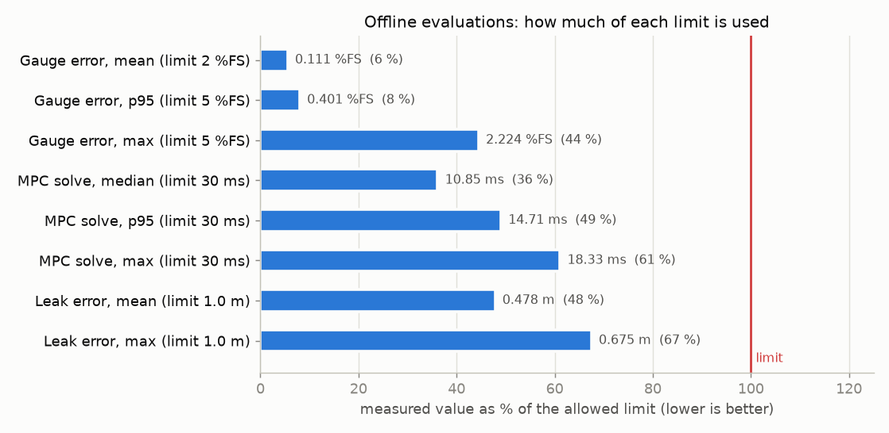

*그림 1-1. 정량 목표가 있는 지표에서 측정값이 허용 한계의 몇 %인지 보여 준다. 게이지 평균 오차 기준(2 %FS)은 평가 스크립트의 내부 목표이고, 미션 요구는 5 %다. 원자료: `gauge_eval.json`, `locomotion_eval.json`, `gas_eval.json`.*

### 1.4 검증 현황 (2026-10-12 릴리스 점검 + 2026-10-13 물리·Gazebo 검증과 최종 점검 + 2026-10-26 장애물 점검·MPC 최종 검증 + 2026-11-12 넘어짐 복구·미션 전체 검증)

| 점검 | 결과 | 비고 |
|---|---|---|
| 전체 pytest | **1167 passed, 3 skipped** (2026-11-12, `GZ_PYTHON` 지정. Gazebo 폐루프·넘어짐 복구·미션 구간 테스트 포함) | skip 3개는 심볼릭 링크 2개와 `urdf_parser_py` 없음 1개다. 2026-10-26에는 984 passed, 12 skipped였고, 이후 넘어짐 물리 복구, 미션 전체·배관 건너기, 미션 키 전달·노드 예외 보호·저메모리 프로필, 점검 사진·보고서, HUD 테스트가 더해졌다. 릴리스 점검(10-12)은 715 passed, 물리 검증 단계 후 775, Gazebo 검증 단계 후 805, 10-14 최종 점검 879 passed였다. 이후 지도에 없는 장애물 회피, MPC 안정화(피벗·지지력 제한·지형 추정 테스트), 튜닝 기록 검사 강화, rclpy 로거 규칙 테스트가 더해졌다. Gazebo 3개를 동시에 돌리는 부하 중에는 gz push 타이밍 테스트 1개가 벽시계 지연으로 실패할 수 있다(부하 없이 3/3 통과). `GZ_PYTHON`을 지정하지 않으면 Gazebo 테스트는 건너뛴다(`pytest -rs`로 확인) |
| MuJoCo 물리 검증 (`tools/physics_check.py`) | 필수 시나리오 11개 중 9개가 시드 0/1/2 모두 통과. (e) 배관 + 단차 0/3, (f) 측면 밀기 2/3 | 54개 작업, 작업 시간 합 약 23분. §4.7 |
| 파라미터 탐색 (`tools/tune_locomotion.py`) | 2회 실행(21.3분, 23.9분, 12 워커). 채택 후보 없음, 기본값 유지 | §4.9 |
| `py_compile` | .py 170개, 실패 0 (2026-10-13 최종 점검. 릴리스 점검 때 140개) | |
| CRLF 검사 | 2026-10-13 최종 점검: 텍스트 파일 321개(py, yaml, sh, xacro, sdf, urdf, rviz, config, html, js, css, md, xml, json) 중 CRLF 0 (릴리스 점검 때 205개 중 0) | USB 복사 후 `\r` 오류 방지. 이후 Windows에서 고친 파일이 CRLF일 수 있다. Python·YAML·xacro는 그대로 동작하고 `build.sh`·`check_install.sh`가 경고한다([USAGE FAQ Q4](USAGE.md#faq-crlf)) |
| launch/config 아래 `__pycache__` | 없음 | setup.py가 share/에 설치하지 않도록 |
| `bash -n scripts/*.sh` | 8/8 통과 (`run_demo.sh` 포함) | |
| `node --check simulation/web/app.js` | 통과 | 대시보드 스크립트 문법 |
| `check_install.sh` 실행 파일 목록 | `setup.py` console entry point 21개와 일치(plant_simulation 9개: `demo_hud`, `follow_camera` 포함). 각 모듈에 `main()` 있음 | `tools/test/test_scripts.py`가 계속 확인 |
| 오프라인 평가 6종 | 모두 exit 0 (locomotion 49 s(2026-10-13 재실행), gauge 58 s, terrain 25 s, thermal 137 s, patrol 3 s, gas 111 s) | 결과는 `docs/results/*.json`, `docs/images/` |
| 헤드리스 대시보드 데모 + `plot_metrics.py` | exit 0. CSV 6개, `summary.json`, 그림 5개, `summary.md` 생성 | §7.6 |
| `setup.py egg_info` / colcon 방식 install (패키지 5개) | 모두 exit 0, 경고 없음. entry_points가 각 setup.py와 일치 | |
| Gazebo 헤드리스 검증 (`tools/gazebo_check.py`, Harmonic) | 평지 시험 월드: stable 63/63, mpc 57/66(블라인드 지형 제외). 출발 직후 넘어짐(제어기 버그 ①)은 수정되어 저장소에 반영됐다. **지금 기본값(stable + trot, 깊이 맵)**: 기립·텔레옵 60 s·밀기·노드 15 s 늦게 시작 각 3/3, 도크 → 배관 우회 → 경사로 위 3/3, 배관을 넘는 같은 경로 2/3, 잔해 북쪽 통로로 복도 전체(도크 → 홀 문) 3/3, 잔해 앞 출발 통로 비켜 가기 2/6. 잔해 곧게·0.08 m 배관 곧게는 0/3 | §4.10 |
| MPC 모드 최종 검증 (`gazebo_check.json`의 `mpc_final2`, 2026-10-26, 실측 MPC 지연) | 평지·정답 맵 27/27(stable 27/27). plant 깊이 맵 16/21(stable 16/21): q·r은 MPC가 낫고(3/3 대 0/3, 3/3 대 2/3), o·l·j는 못함(2/3 대 3/3, 1/3 대 3/3, 1/3 대 2/3). 기본값은 stable 유지. stable 회귀 `stable_regress2`는 10-13 기록과 33회 모두 같음 | §4.10.7 |
| 지도에 없는 장애물 Gazebo 점검 (`tools/obstacle_check.py`, Harmonic) | stable: r t u v w x z × 시드 3개 21/21, 45 m 경로 y 3/3(10-26 최종 점검, 처음 1/1), 넘어짐 0. MPC: r t u v w x z 21/21, y 0/3 | §7.8.3. 결과 JSON은 커밋하지 않음 |
| Gazebo 넘어짐 복구 (`tools/fall_check.py`, Harmonic) | 9개 케이스 × 시드 0–9: 89/90 자기 다리로 복구, 순간이동 0(`fall_check.json`). 배관 위 누움·경사로 턱 케이스를 더한 11개 케이스 × 시드 10–12: 33/33 | §4.4 |
| Gazebo 데모 미션 전체 (`tools/mission_check.py`, Harmonic) | 도크 → 계기판 8개 → 가스 탐색 → 귀환·도킹. 지금 코드, 시드 10–14: **5/5 완료**, 넘어짐 2회(실행당 0.4회) 모두 자가 복구, 순간이동 0, 평균 573 s(`mission_check.json`). 보행 개선 전 코드는 시드 0–4에서 1/5 | §4.10.8 |
| Gazebo 렌더 프레임 게이지 판독 (Harmonic ogre2, 실제 `gauge_reader` 노드 코드) | 800×600 80/80 검출, 평균 0.015 %FS, 최대 0.043 %FS. 640×480 렌더 80/80, 평균 0.017 %FS | §5.1.5. 결과 JSON은 커밋하지 않음 |
| **Gazebo GUI + ROS 2 실행** | **미실행** (개발 PC에 ROS 없음) | Ubuntu PC에서 §8.4 절차로 측정 |

---

## 2. 시스템 아키텍처

### 2.1 디지털 트윈 4요소

| 요소 | 구현 | 데이터 |
|---|---|---|
| **Virtual Plant** (발전소 3D 환경) | `simulation/worlds/plant.sdf`. Unity 에셋을 변환한 터빈 홀·복도·기계, 계기판 8개, 열점 5개, 장애물 14개, 가스 누출 밸브, AP, 충전소. 모든 위치의 단일 출처는 `simulation/config/world_layout.yaml` | 정적 지오메트리, 열 온도(Thermal 시스템), 2-D 내비 맵 |
| **Robot Twin** (로봇 센서 시뮬레이션) | `simulation/urdf/spot.urdf.xacro`: 15 kg, 12 DOF, 관절 위치 서보 12개(PID 힘 모드). IMU 200 Hz, 깊이 카메라 212×120 10 Hz, 점검 카메라 800×600 10 Hz, 열화상 320×240 5 Hz, 오도메트리 50 Hz | `/imu`, `/joint_states`, `/depth_camera/points`, `/inspection_camera/image`, `/thermal_camera/image`, `/odom` |
| **Inspection Data** (설비 상태 점검) | module2(게이지, 열화상), module3(가스 농도, 누출원 추정) | `/inspection/gauge_readings`, `/inspection/thermal_alerts`, `/gas/*`, `~/dusan_metrics/<세션>/*.csv` |
| **Monitoring** (로봇 위치·작업 상태) | `monitor_dashboard` 웹 관제(http://localhost:8080, SSE), RViz(`rviz/plant.rviz`), `metrics_logger` | 트윈 맵, 로봇·미션·안전 패널, 게이지 표(정답 대비 오차), 열 경보, 카메라 뷰, 이벤트 로그 |

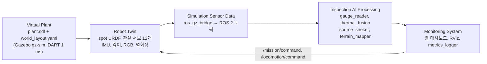

### 2.2 ROS 2 노드·토픽 그래프

각 패키지의 노드와 주요 토픽이다. 전체 계약(타입, QoS, JSON 필드)은 [DESIGN_SPEC §4](DESIGN_SPEC.md)에 있다.

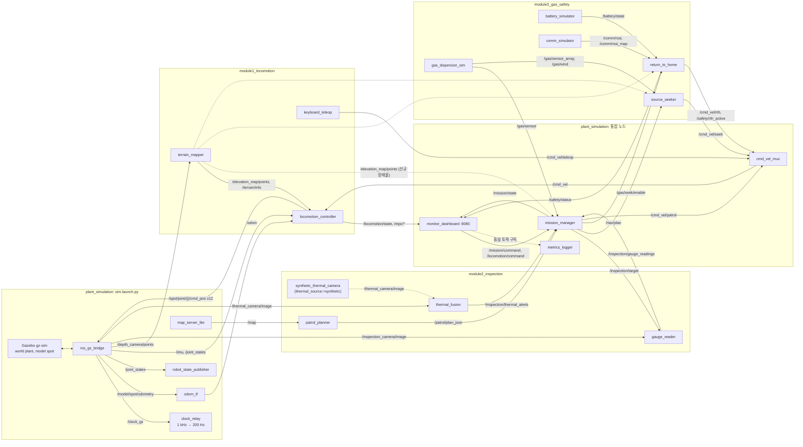

모든 노드가 `/odom`을 구독하는데, 그림이 복잡해져 일부 화살표는 생략했다. `terrain_mapper`에서 나가는 점선은 지도에 없는 장애물을 피하기 위한 구독이다(§7.8). JSON이 필요한 데이터는 사용자 정의 메시지 대신 `std_msgs/String`에 JSON으로 실어 보낸다(`dusan_common.ros_helpers.json_msg`). 그래서 cv_bridge, Nav2, ros2_control, 사용자 정의 메시지 패키지가 필요 없다.

### 2.3 패키지 구조

```
DusanAI/
├── dusan_common/          공용 라이브러리: robot_model(기구학·질량·센서), layout, grid_map, planning(A*),
│                          pure_pursuit, camera(핀홀), gauge_design(다이얼 정의), ros_helpers, terrain_cost,
│                          obstacle_layer(지도에 없는 장애물) + obstacle_sim(테스트용 가상 센서)
├── module1_locomotion/    elevation_map, foothold_planner, terrain_classifier, pointcloud_utils, friction_map,
│                          kinematics, gait, qp, mpc, controller, slip_detector, fall_recovery, gz_tools, teleop
├── module2_inspection/    gauge_reader/ocr/association/synth, thermal_fusion, synthetic_thermal,
│                          viewpoint_planner + 노드 4개
├── module3_gas_safety/    gas_model, source_seeking, battery_model, comm_model, rth_logic, sim_harness
│                          + 노드 5개, config/{gas_dispersion,seeker,safety}.yaml
├── simulation/            ROS 패키지 plant_simulation: worlds/plant.sdf, urdf/, models/, maps/, config/,
│                          launch/{sim,bringup,dashboard}.launch.py, web/, rviz/, 통합 노드 7개
├── tools/                 convert_spot.py, convert_environment.py, fbx_reader.py, unitypackage.py,
│                          generate_world.py, eval_*.py (6종), plot_metrics.py,
│                          physics_check.py + physics/ (MuJoCo 물리 검증), tune_locomotion.py (파라미터 탐색),
│                          gazebo_check.py + gazebo_check/, obstacle_check.py (Gazebo 헤드리스 검증)
├── scripts/               install_deps.sh, build.sh, check_install.sh, run_sim.sh, run_bringup.sh, run_teleop.sh
└── docs/                  REPORT.md, SETUP_GUIDE.md, DESIGN_SPEC.md, images/, results/
```

| 패키지 | 실행 파일 (console entry point) |
|---|---|
| `module1_locomotion` | `locomotion_controller`, `terrain_mapper`, `keyboard_teleop` |
| `module2_inspection` | `gauge_reader`, `thermal_fusion`, `synthetic_thermal_camera`, `patrol_planner` |
| `module3_gas_safety` | `gas_dispersion_sim`, `source_seeker`, `battery_simulator`, `comm_simulator`, `return_to_home` |
| `plant_simulation` | `map_server_lite`, `odom_tf`, `cmd_vel_mux`, `mission_manager`, `monitor_dashboard`, `metrics_logger`, `clock_relay` |

### 2.4 개발 방식: Windows 개발 + Ubuntu 실행

개발 PC(Windows)에는 ROS 2와 Gazebo가 없다. 저장소를 USB로 Ubuntu PC에 복사해 실행한다. 이 제약 때문에 구조를 다음과 같이 정했다.

1. **ROS-free 알고리즘 모듈 + 얇은 노드.** 알고리즘은 모두 numpy/OpenCV만 쓰는 모듈에 두고 Windows에서 pytest로 검증한다. `*_node.py`는 메시지를 변환해 알고리즘 모듈을 호출하는 역할만 한다. rclpy와 메시지 import는 노드 파일 안에만 있다.
2. **엄격한 rclpy 대역(stand-in)으로 노드 검증.** 실제 ROS가 없으면 가짜 rclpy/메시지 모듈로 노드를 import하고 콜백을 실행한다. 이 테스트로 파라미터 타입(정수를 double로 넘기는 문제), 토픽 이름과 타입, JSON 계약, 콜백이 예외를 밖으로 던지지 않는지를 확인한다.
3. **단일 출처.** 기구학·질량·센서 값은 `dusan_common/robot_model.py`, 월드 내용은 `world_layout.yaml`에서만 가져온다. URDF, 월드 생성기, 평가 스크립트, 노드가 같은 값을 읽는다.
4. **보수적 API.** 오래 유지된 API 형태만 쓴다. 예: `LaunchConfigurationEquals` 대신 `PythonExpression`, `get_logger().warning`, `ExternalShutdownException` 처리, steady clock 타이머, `ros_gz_sim/gz_sim.launch.py`가 없을 때 `gz sim` 직접 실행.
5. **오프라인 평가.** 모듈마다 `tools/eval_*.py`가 있어 ROS 없이 폐루프·몬테카를로 평가를 돌리고 그림과 JSON을 만든다.

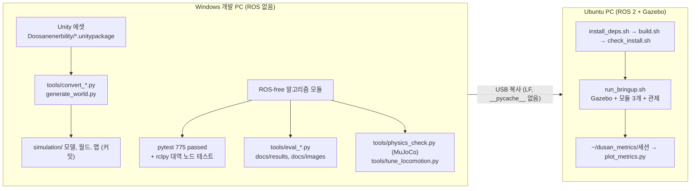

---

## 3. 가상 발전소 & 로봇 트윈 모델링

### 3.1 Unity 에셋 → 자체 FBX 파서 → OBJ 변환

제공된 Unity 패키지(`Doosanenerbility/`, 읽기만 하고 수정하지 않음)를 Blender나 Autodesk SDK 없이 numpy만으로 Gazebo 모델로 바꿨다.

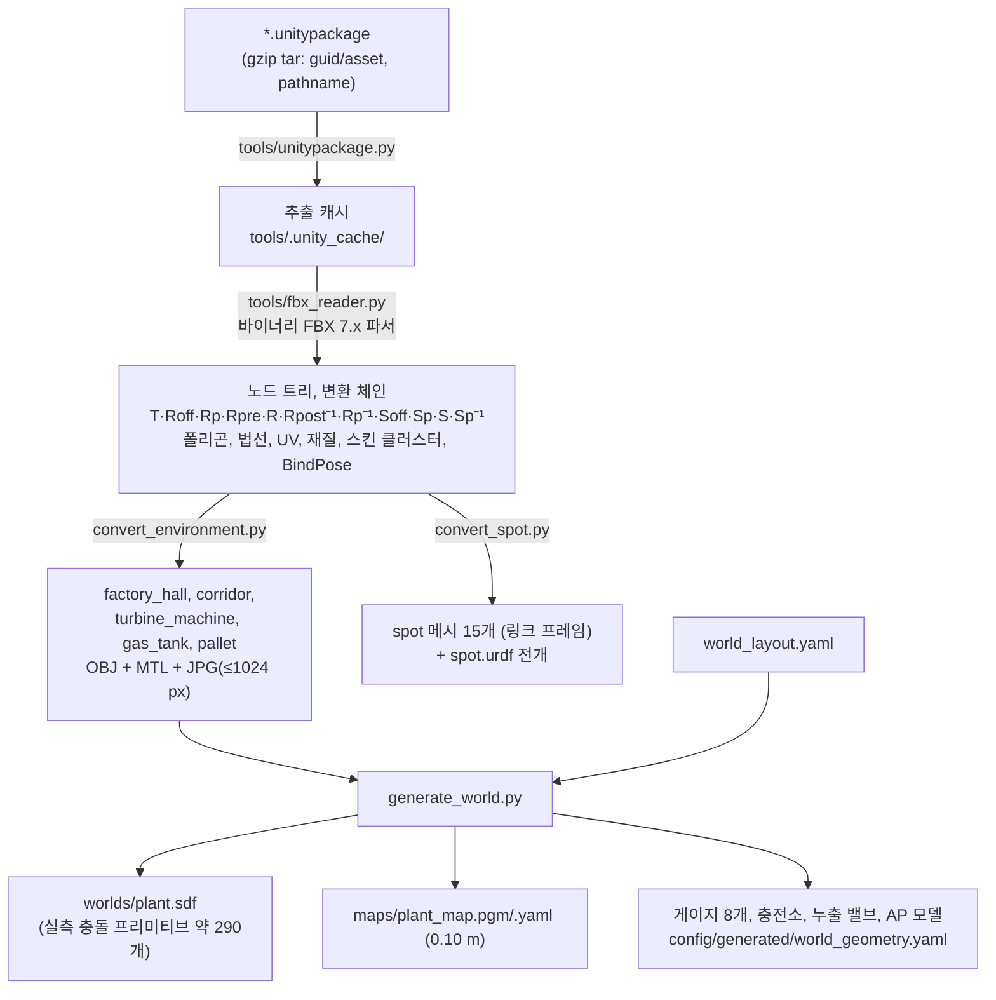

- **FBX 파서** (`tools/fbx_reader.py`): 바이너리 FBX 7.0~7.7(32/64비트 노드 헤더, zlib 압축 배열)을 읽는다. FBX 변환 체인 전체, 축 설정(GlobalSettings), 스킨 디포머(클러스터 Indexes/Weights/TransformLink)를 처리한다.
- **재질**: Unity 프리팹 MeshRenderer의 재질 슬롯 순서를 따른다(서브메시는 FBX 재질 인덱스의 첫 사용 순서로 정렬된다). 그다음 이름이 같은 `.mat`, FBX에 포함된 텍스처, FBX 확산색 순서로 대체한다. HDRP `_BaseColorMap`/`_MainTex`/`_BaseMap`의 GUID로 텍스처를 찾는다.
- **건물 셸 양면화**: 일부 벽은 바깥을 향하는데 Unity에서는 양면 HDRP 재질이라 보였던 것이다. ogre2는 뒷면을 컬링하므로 면을 뒤집어 복제했다.

| 제공 에셋 | 사용 | 결과 모델 |
|---|---|---|
| `map/factory_inner_1` (Factory_03.fbx, 36.7k 삼각형) | 사용 | `factory_hall` (터빈 홀 셸, 칸막이 벽, 메자닌) |
| `map/factory_hall` (Corridor_Wall_02.fbx, 10.5k) | 사용 | `corridor` (48.5 m 복도, 계단 + 11.8° 그레이팅 램프) |
| `object/fac_gastank` (Main_Machine_01/02) | 사용 | `turbine_machine`(3.28 × 8.37 × 3.08 m), `gas_tank`(배율 0.8, 104.6k 삼각형) |
| `object/obs_palette` | 사용 | `pallet` (1.22 × 1.40 × 0.18 m) |
| `object/robot_spot` (SpotHPRIG_Rigging_02.fbx) | 사용 | `spot` 메시 + URDF |
| `animation/spot_move`, `animation/spot_fall` | **미사용** | 이동·넘어짐·기립 모션은 Unity 애니메이션 클립 대신 제어기(보행 스케줄러, Fall Recovery 키프레임)가 물리 시뮬레이션 안에서 생성한다 |
| `effect/gas_spurt`, `effect/MapSetting_1` | **미사용** | 가스 시각 효과는 Gazebo ParticleEmitter(초록색 반투명 가스)와 절차적으로 만든 텍스처로 대체 |

| 공장 홀 | 복도 | 터빈 기계 | 가스 탱크 |
|---|---|---|---|
| 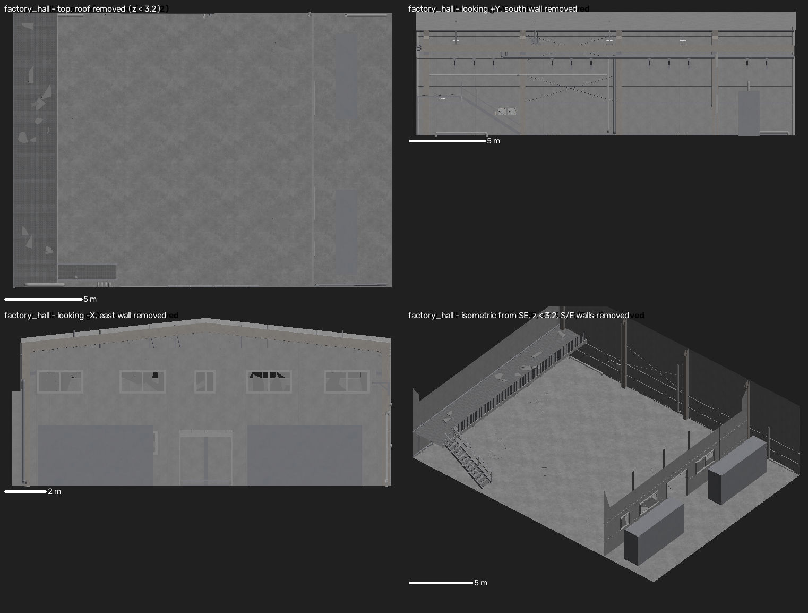 | 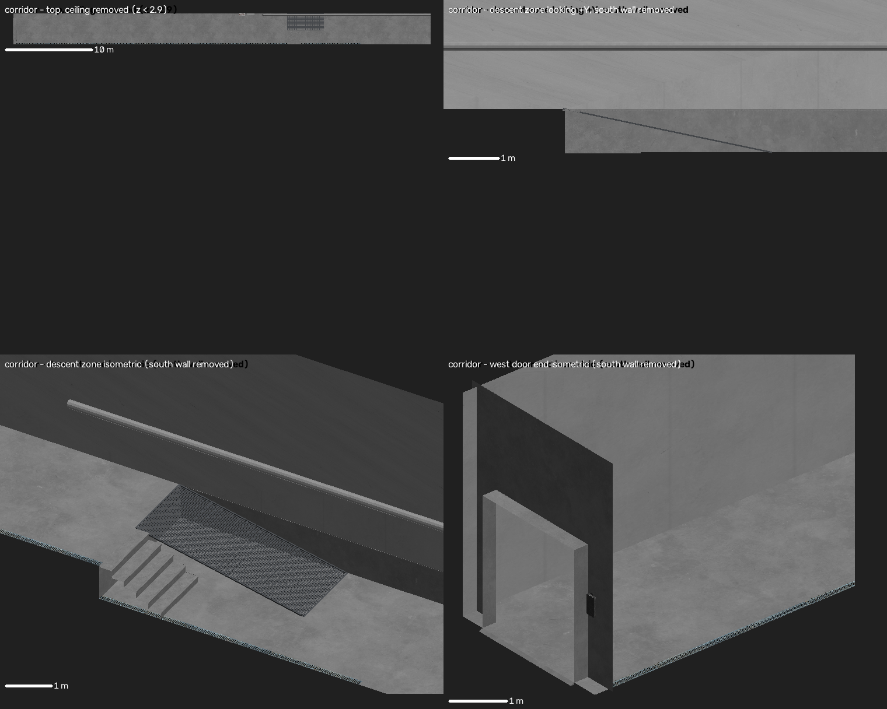 | 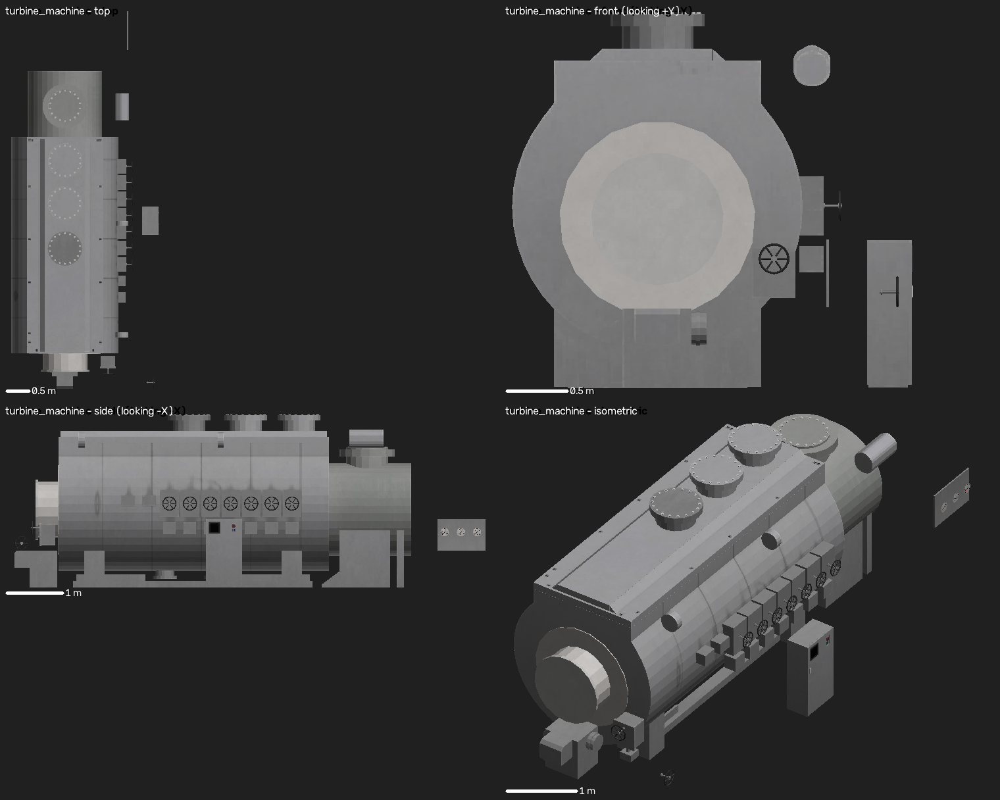 | 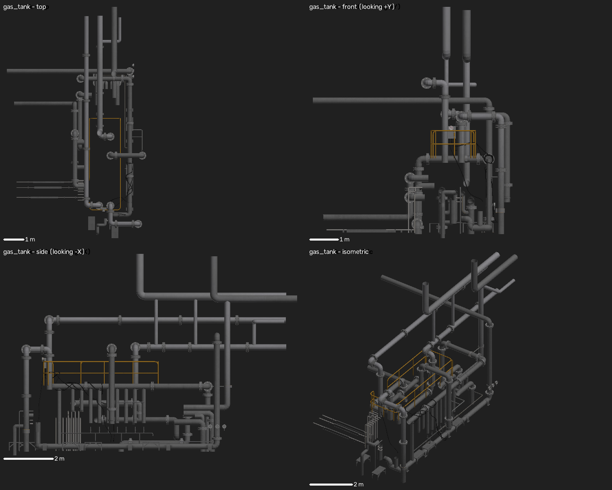 |

### 3.2 Spot 로봇 트윈: 리그 분할, 데시메이션, URDF 기구학

`tools/convert_spot.py`의 파이프라인 (상세: [simulation/models/spot/README.md](../simulation/models/spot/README.md)):

1. **바인드 포즈 사용.** FBX의 씬 포즈는 스키닝 이후 왼쪽 앞다리 뼈가 최대 14 mm 이동되어 있었다. 그래서 대칭인 `BindPose` 노드를 직접 파싱했다. 몸체 원점은 hip_x 뼈 4개의 중심인 (−0.00018, 0.01424, 0.36498)이다(G 프레임).
2. **스킨 클러스터로 분할.** 모든 정점이 가중치 1인 클러스터 하나에만 속하므로(강체 스키닝) 정점은 뼈의 링크로, 삼각형은 꼭짓점 다수결로 배정했다. 915,542개 중 두 링크에 걸친 삼각형은 83개다. 링크는 몸체, 카메라 페이로드, 라이다 페이로드, 다리별 hip/upper/lower다.
3. **휴지(rest) 각도 복원.** 앞다리 (±0.09°, 34.44°, −88.94°), 뒷다리 (∓0.04°, 60.12°, −94.33°). 각 링크 정점을 영각도 링크 프레임으로 옮겼다: `v_link = T_rest⁻¹ v_robot`.
4. **색 팔레트.** 4096² 알베도를 1024²로 줄이고 메디안 필터를 건 뒤, CIE-Lab 가중 k-means(k = 8), 유사색 병합(ΔE < 10)을 거쳐 노랑·진회색·회색·연회색·검정 5색으로 만들었다.
5. **QEM 데시메이션.** Garland–Heckbert 이차 오차 엣지 붕괴를 numpy로 배치·벡터화해 직접 구현했다. 링크 조건, 면 뒤집힘, 경계와 색 경계 제약을 검사한다. 976k 삼각형을 **73,750개**로 줄였다(몸통 18,995, 카메라 5,270, 라이다 1,500, 다리마다 3,000/5,000/4,000).
6. **검증.** 원본 → 변환 표면 거리 평균 0.20 mm, p95 0.68 mm. 분할 후 휴지 각도로 재조립하면 오차 0 mm. 뼈와 FK 관절 위치 차이는 3.7 mm 이내다. 최대 약 32 mm 오차는 힙 하우징 안쪽처럼 보이지 않는 내부 면에서만 생긴다.

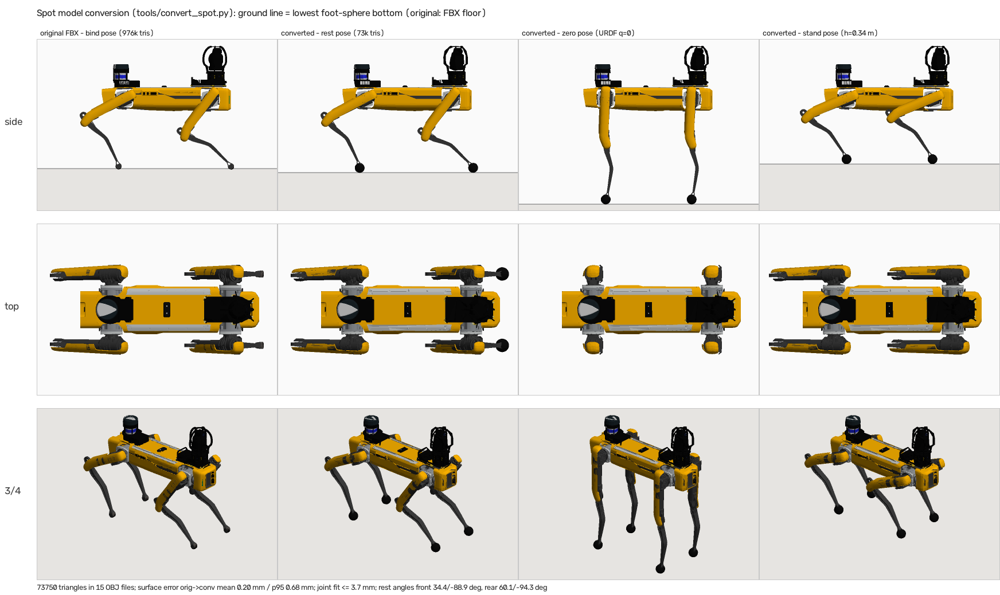

*그림 3-1. 원본 FBX(바인드 포즈, 976k 삼각형)와 변환 모델(휴지·영·스탠드 포즈)을 비교한 그림. 원본: `tools/convert_spot.py`.*

**URDF** (`simulation/urdf/spot.urdf.xacro`, 전개본 `spot.urdf`): 링크 24개, 조인트 23개(회전 조인트 12개), 총질량 **15.0 kg**(몸체 8, 다리마다 hip 0.6 + upper 0.9 + lower 0.25). `urdf_parser_py`로 로드했을 때 루트는 `base_link` 하나다.

| 조인트 | 하한 [rad] | 상한 [rad] | 토크 한계 [N·m] | 속도 [rad/s] |
|---|---|---|---|---|
| hip_x (축 +X) | −0.70 | 0.70 | 45 | 15 |
| hip_y (축 +Y) | −1.60 | 2.60 | 45 | 15 |
| knee (축 +Y) | −2.80 | −0.20 | 60 | 15 |

| 센서 | 장착 위치 (base_link 기준 x y z, roll pitch yaw) | 사양 |
|---|---|---|
| IMU | (0, 0, 0) | 200 Hz. 각속도 노이즈 σ 0.0002 rad/s, 가속도 노이즈 σ 0.017 m/s² |
| 깊이 카메라 | (0.34, 0, 0), pitch +0.60 (아래쪽) | 212×120, hfov 1.5, 0.1~4 m, 10 Hz, 포인트 클라우드 |
| 점검 카메라 (RGB) | (0.30, 0, 0.20), pitch −0.30 (위쪽) | 800×600, hfov 0.9, 10 Hz |
| 열화상 카메라 | (0.30, −0.05, 0.20), pitch −0.30 | 320×240, hfov 0.8, 5 Hz, L16 (K = 값 × 0.01) |

Gazebo 플러그인: JointPositionController 12개(PID 힘 모드, p 450 / d 3, 출력 힘은 조인트 effort ±45/45/60 N·m로 제한, `/spot/joint/<j>/cmd_pos`; MuJoCo 물리 검증 결과 속도 명령 모드에서 변경 — `docs/results/physics_check.json`), JointStatePublisher(200 Hz), OdometryPublisher(50 Hz, `/model/spot/odometry`). 발은 반지름 25 mm 구, 마찰 μ = 1.0이다.

**다리 기구학** (`module1_locomotion/kinematics.py`). hip_x 위치는 $h=(s_x 0.2245,\ s_y 0.044,\ 0)$, hip_y 측방 오프셋은 $a=s_y 0.090$, 대퇴 $L_1=0.2256$, 하퇴 $L_2=0.2997$이다.

$$
x' = -L_1\sin q_1 - L_2\sin(q_1+q_2),\qquad z' = -L_1\cos q_1 - L_2\cos(q_1+q_2)
$$

$$
p_{foot} = h + \begin{bmatrix} x' \\ a\cos q_0 - z'\sin q_0 \\ a\sin q_0 + z'\cos q_0 \end{bmatrix}
$$

역기구학은 해석적으로 푼다. 무릎이 뒤로 접히는 해를 쓴다: $q_2=-\arccos\frac{r^2-L_1^2-L_2^2}{2L_1L_2}$. 도달 범위 밖의 목표는 반경 방향으로 투영하고 조인트 한계로 클램프한다. 야코비안은 유한차분과 비교해 검증했고, URDF 조인트 원점으로 계산한 FK는 `robot_model` 공식과 1e-9 m 이내로 일치한다. 정역학 토크는 $\tau_i=-J_i(q)^T R^T f_i$다.

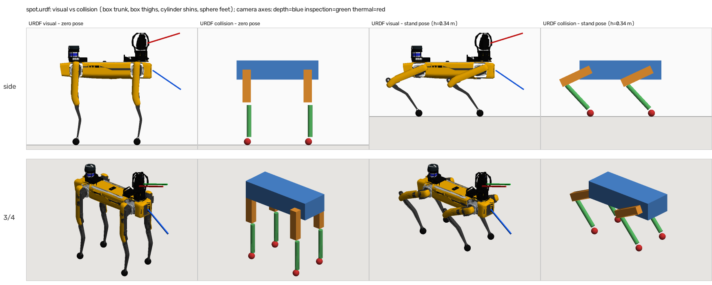

*그림 3-2. 비주얼과 충돌 형상, 카메라 축. `spot.urdf`에서 직접 렌더링했다.*

### 3.3 월드 구성

**크기 요건 충족** (치수는 메시에서 측정, `simulation/config/generated/world_geometry.yaml`, 테스트 `tools/test/test_world.py::test_requirement_dimensions`):

| 요건 | 최소 조건 | 구현 | 근거 |
|---|---|---|---|
| 복도 | 45 m × 3.5 m, 높이 4 m | 내부 **48.56 × 3.55 m**, 천장 4.0 m. 상층(z 0) → 계단·램프 → 하층(z −0.88 m) | `architecture.corridor.interior_size`, layout `corridor.height` |
| 공장 | 25 m × 18 m, 높이 7 m | 건물 외곽 **25.19 × 18.65 m**, 벽 안쪽 유효 공간 24.8 × 17.9 m, 내부 높이 **7.3 m** | `architecture.factory.mesh_bbox`, layout `factory.height` |
| 험지 방해물 | 복도 3개, 공장 5개 이상 | 복도 **5개**, 공장 **9개** (계단·램프는 별도) | layout `obstacles` |
| 로봇개 / 공장 기계 | 각 1 이상 | Spot 1대 / 터빈 1대 + 가스 탱크 스키드 1대 | layout `machines` |

**장애물** (`world_layout.yaml`, 지진 잔해 시나리오):

| ID | 종류 | 위치 | 사양 |
|---|---|---|---|
| C-OBS1 | 배관 | 복도 하층 (58.5, −0.2) | 길이 2.6 m, 직경 0.10 m |
| C-OBS2 | 팔레트 | 복도 하층 (55.0, 1.0) | 1단 |
| C-OBS3 | 잔해 | 복도 상층 x 37~39, y −1.3~0.5 | 블록 45개, 높이 2~6 cm. 북쪽 벽 쪽에 1.26 m 통로 |
| C-OBS4 | 미끄러운 철판 | 복도 x 30~32.5 m | μ = 0.2 |
| C-OBS5 | 배관 | 복도 (22.0, 0.0) | 2.8 m, 직경 0.08 m |
| F-OBS1 / F-OBS2 | 팔레트 | (8.0, 1.8) / (6.0, −6.8) | 1단 / 2단 |
| F-OBS3 | 배관 | (10.0, −0.3), 칸막이 출입구를 가로지름 | 3.0 m, 직경 0.12 m |
| F-OBS4 | 배관 | (0.0, 1.0) | 2.5 m, 직경 0.10 m |
| F-OBS5 | 잔해 | x 3~6, y −1.5~1.5 | 블록 70개, 높이 2~7 cm |
| F-OBS6 / F-OBS7 | 드럼 | (−1.0, 4.0) / (−0.35, 4.6) | 반지름 0.30 m, 높이 0.90 m |
| F-OBS8 | 단상 | x 7.8~9.3, y −5.2~−3.2 | 높이 0.10 m |
| F-OBS9 | 미끄러운 철판 | x 0~2, y −2.2~−0.7 | μ = 0.15 |

**계기판·열점·가스·AP·충전소 배치**:

| 대상 | ID와 위치 (x, y, z) [m] | 비고 |
|---|---|---|
| 압력계 8개 | G01 (−3.5, −2.55, 1.0) 0–10 bar 값 6.2 · G02 (−0.5, −2.55, 1.0) 0–16 bar 값 11.4 · G03 (3.0, −5.3, 0.9) 0–6 bar 값 2.3 · G04 (−3.4, 5.5, 1.2) 0–25 bar 값 18.5 · G05 (−3.4, 7.6, 1.0) 0–10 bar 값 3.7 · G06 (3.5, 6.1, 1.3) 0–4 bar 값 1.15 · G07 (26.0, 1.25, 1.1) 0–10 bar 값 4.8 · G08 (57.0, −1.25, 0.22) 0–1.6 MPa 값 0.92 | 다이얼 직경 0.30 m, 270° 눈금, 마지막 15 %가 적색 구간. 정답 상태: G02·G06은 warning, 나머지는 normal |
| 열점 5개 | H01 플랜지 (2.0, 6.4, 1.0) 318.15 K · H02 플랜지 (5.0, 6.4, 1.0) 372.15 K · H03 플랜지 (8.0, 6.4, 1.0) 341.15 K · H04 터빈 베어링 (2.85, −3.6, 0.8) 388.15 K · H05 복도 플랜지 (40.0, −1.55, 1.2) 358.15 K | 경고 333.15 K(60 °C), 경보 353.15 K(80 °C). 정답 상태: H01 normal, H03 warning, H02·H04·H05 alarm |
| 가스 누출 | LEAK-01 (−3.2, 2.0, 0.4), 가스 탱크 릴리프 밸브 | 기본풍 (0.40, −0.10) m/s, ParticleEmitter 초록색 반투명 가스(시각 효과 전용) |
| Wi-Fi AP 3개 | AP1 (61.0, 1.4, 2.0), AP2 (33.0, −1.4, 3.0), AP3 (11.5, 0.0, 4.5) | p0 −30 dBm, 경로손실 지수 n = 2.2, 벽당 12 dB |
| 통신 음영 구역 | S1 터빈 피트 (x −9.8~−6.0, y −8.8~−6.3) | 추가 감쇠 40 dB, 음영 기준 −80 dBm |
| 충전소 / 스폰 | 패드 (61.9, 0.0, −0.88), 도킹 yaw π, 허용 오차 0.35 m / 스폰 (61.9, 0, −0.32, π) | 복도 하층 동쪽 끝 |
| 고온 구역 | Z-HOT (x 2.7~4.5, y −5.5~−2.0) | 순찰 뷰포인트 점수에서 0.10 감점 |

물리 설정: DART, 1 ms 스텝, RTF 1. 월드 시스템: Physics, UserCommands(set_pose), SceneBroadcaster, Sensors(ogre2), Imu, Contact, ApplyLinkWrench, ParticleEmitter, Thermal. 조명 25개(그림자를 만드는 조명은 1개).

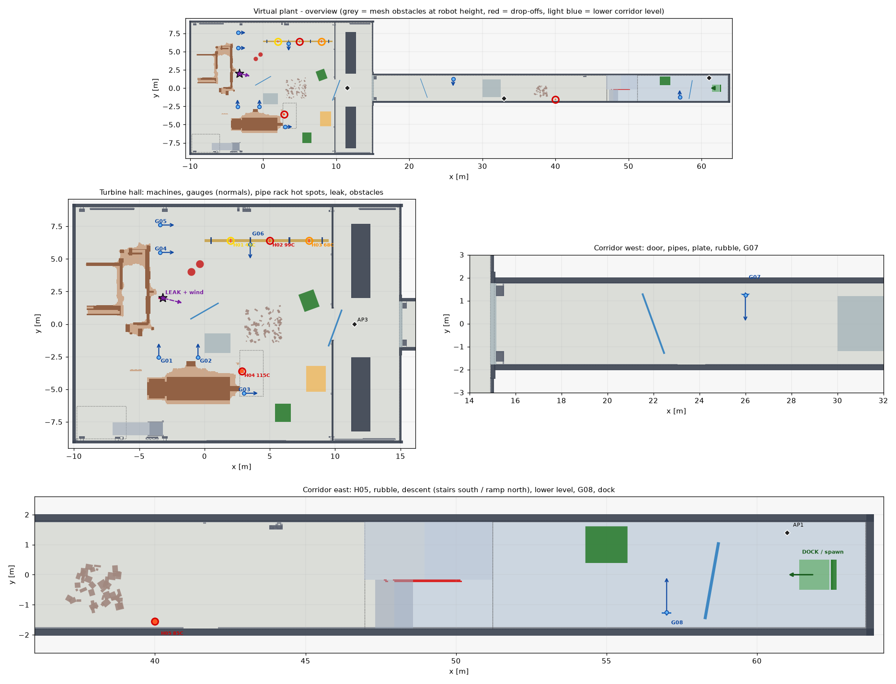

*그림 3-3. 가상 플랜트 배치. 터빈 홀(계기판 법선, 배관 랙 열점, 누출원, 장애물)과 복도(배관, 철판, 잔해, 계단·램프, 하층, 충전소). 원본: `tools/generate_world.py`.*

**메시 실측값 vs 레이아웃 초안**: 복도 하강부는 레이아웃 초안과 메시 실측이 달라서 실측값을 썼다. 계단은 4단(디딤판 z −0.187 / −0.365 / −0.543 / −0.722 m, 단 높이 약 0.18 m), 램프는 11.83°(초안 16°), 하강부 x 46.97~51.22 m다. 레이아웃에 없던 칸막이 벽(x 9.80~9.83 m, 출입구 y −1.24~1.21 m, 높이 2.69 m)도 메시에서 발견해 레이아웃과 대체(fallback) 맵 래스터라이저에 반영했다.

### 3.4 내비게이션 맵

`simulation/maps/plant_map.yaml/.pgm`: 해상도 0.10 m, 범위 [−10.6, −9.6, 64.2, 9.6], 748 × 192 셀, map_server 형식.

- **자유 공간**: 상층·하층 바닥, 계단, 램프, 배관·잔해·철판(다리로 넘을 수 있음), 문턱 판. 경로 계획기는 이 잔해를 지도와 따로 **지형 비용**으로 더해 돌아갈 길이 있으면 돌아간다(§4.10.6).
- **점유**: 벽, 문틀, 기둥, 드럼, 팔레트, 랙 지지대, 게이지 스탠드, 밸브, 낭떠러지(높이 차 0.22 m 초과인 램프 남쪽 가장자리).
- **기계**: 1.5 m보다 낮은 기계 부품 아래로는 경로를 내지 않는다. 로봇보다 좁은 틈은 닫는다. `gas_tank`는 실제로는 열린 배관 스키드여서 실측 외곽(약 11 m²)을 썼다. 레이아웃 바운딩 박스(53.6 m²)는 쓰지 않았다.
- 도크에서 도달할 수 있는 셀만 자유로 남긴다.

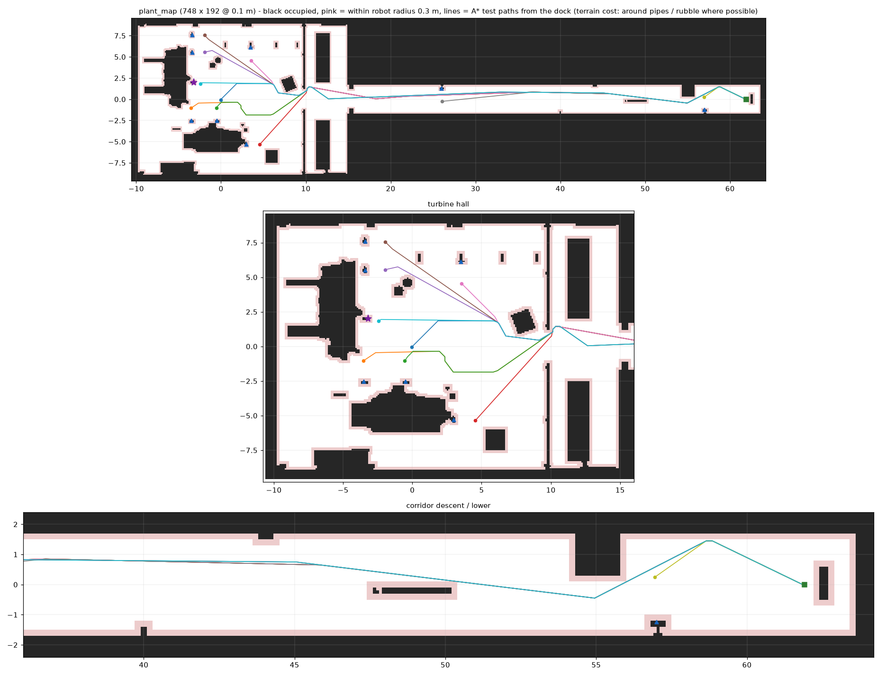

*그림 3-4. 생성된 2-D 내비게이션 맵.*

### 3.5 모델링 문제 해결

| 문제 | 원인 | 해결 |
|---|---|---|
| 앞다리 뼈 위치가 메시와 최대 14 mm 어긋남 | FBX 씬 포즈는 스키닝 이후 편집된 포즈 | `BindPose` 노드를 직접 파싱(파서에 바인드 포즈 API를 추가) |
| 스폰 자세(무릎 0)가 무릎 상한 −0.20 rad를 위반 | `robot_model` 조인트 한계 | 서보 `initial_position = −0.20`. 무릎이 약 17 ms 안에 한계로 안정되고, 발이 엉덩이 앞 약 6 cm에 놓이는 안정한 자세가 된다 |
| 메시의 발 볼(16.6 mm)과 충돌구(25 mm) 차이로 약 18 mm 떠 보임 | 하퇴 길이를 발 뼈 기준으로 잼 | 25 mm 구 비주얼을 추가해 보이는 것과 충돌하는 것을 일치시킴 |
| 월드 다이얼이 module2 예측보다 약 2 % 큼 | UV가 하우징 원(0.49)에 맞춰져 있었음 | `DIAL_UV_RADIUS = 0.5`, 텍스처 한 변 = `dial_diameter`로 통일하고 테스트로 고정 |
| 깊이 카메라가 그레이팅 램프 구멍으로 0.9 m 아래를 봄 | 다공판 메시 | 회전 박스 충돌 + 2.5 cm 아래 시각용 데크 |
| 가스 파티클이 깊이 영상에 찍힐 수 있음 | ParticleEmitter | `particle_scatter_ratio 0` |
| 가스 파티클 색 설정(`color_start`/`color_end`)이 무시됨 | Harmonic ogre2가 파티클 색 범위를 끔(`ParticleEmitter SetColorRange is currently disabled`) | 재질 diffuse 색을 초록으로 지정 |
| Linux에서 파일 대소문자 불일치 | Windows는 대소문자를 무시함 | `_exists_exact()` 테스트로 참조 94개를 정확히 대조 |
| `<include>`로는 기계 배율(0.8)을 줄 수 없음 | SDF 제약 | 기계는 `<mesh><scale>`을 쓰는 인라인 모델로, 충돌 박스는 낮은 높이 외곽에서 계산 |
| F-OBS3 배관이 칸막이 문설주를 관통 | 레이아웃 초안이 칸막이를 몰랐음 | 중심을 (10.0, −0.3)로 옮겨 출입구를 가로지르게 함 |

---

## 4. Module 1 — Locomotion

구성: `terrain_mapper`(지형 인지) → `/elevation_map/points`, `/terrain/info` → `locomotion_controller`(100 Hz 제어, MPC 20 Hz) → 관절 위치 명령 12개. 상세: [module1_locomotion/README.md](../module1_locomotion/README.md), [TERRAIN_AND_TELEOP.md](../module1_locomotion/TERRAIN_AND_TELEOP.md).

### 4.1 지형 인지 (Terrain Mapping)

#### 4.1.1 Elevation Map 알고리즘 흐름

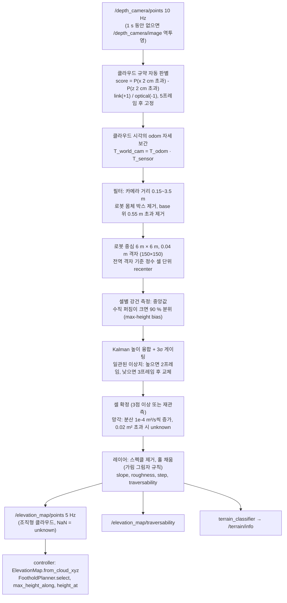

#### 4.1.2 Kalman 높이 융합

Fankhauser 등의 방식을 따라 광선 추적 없이 셀 단위로 융합한다. 깊이 노이즈는 거리 제곱에 비례한다고 본다.

$$
\sigma(r) = 0.003 + 0.0025\,r^2\ \text{[m]},\qquad
R = \frac{\sigma^2}{\min(n,4)} + 0.5\max(s_{IQR}^2-\sigma^2,0) + 10^{-6}
$$

이미 값이 있는 셀 $(h, P)$에 측정 $z$가 들어오면 다음과 같이 갱신한다.

$$
d^2=\frac{(z-h)^2}{P+R}\le 9 \;\Rightarrow\; K=\frac{P}{P+R},\quad h\leftarrow h+K(z-h),\quad P\leftarrow(1-K)P
$$

게이트를 벗어난 측정은 융합하지 않는다. 단, 일관된 이상치가 연속되면 셀을 교체한다. 높아지는 경우(새 장애물)는 2프레임, 낮아지는 경우(가림·스침 반사 방지)는 3프레임이 필요하다. 수직으로 퍼진 측정은 참값의 하한이므로 더 높은 값이 오면 즉시 올린다.

#### 4.1.3 레이어

| 레이어 | 정의 |
|---|---|
| `slope` [rad] | 3×3 Sobel 가중 최소제곱 평면의 $\arctan\lVert\nabla h\rVert$ (NaN 인식) |
| `roughness` [m] | 5×5 평면 적합 잔차의 표준편차. 기울기와 무관하므로 깨끗한 램프는 약 0 |
| `step` [m] | 5×5(0.2 m, 발 크기) 창의 최대 − 최소 |
| `traversability` [0..1] | 아래 식. step ≥ 0.22 m이거나, 평탄면(거칠기 0.02 미만)인데 0.70 rad보다 가파르면 0 |

$$
T = 1-\frac{w_s\min(\theta/0.70,1)+w_{st}\min(\Delta h/0.22,1)+w_r\min(\rho/0.05,1)}{w_s+w_{st}+w_r}
$$

**가림 그림자 규칙.** 셀마다 마지막으로 관측한 센서 위치를 기억한다. 구멍(미관측 셀)의 이웃을 센서 쪽 절반과 먼 쪽 절반으로 나눈다. 센서 쪽이 먼 쪽보다 5 cm(`shadow_fill_step`) 넘게 높으면, 그 구멍은 하행 계단 모서리 같은 경계 뒤의 그림자다. 이때는 먼 쪽(낮은 쪽) 중앙값으로 채운다. 단순 중앙값으로 채우면 위 디딤판 높이가 그림자로 번져 모서리가 아래 디딤판 쪽으로 약 4 cm 밀린다(§4.6 사례 6).

모든 창 적률은 분리 가능한 상관으로 계산했다. 150×150 맵 전체를 클라우드에서 재구성하는 데 8.40 / 11.35 ms(p10 / 중앙값)가 든다.

#### 4.1.4 발 디딤 선택 (Foothold Planner)

명목(Raibert) 착지점 반경 0.10 m 안의 모든 셀 중심과 명목점 자체를 후보로 삼아 비용이 가장 낮은 곳을 고른다.

$$
J = 1.0\,\theta + 20\,\rho + 8\,\Delta h_{foot} + 0.6\,e_{edge} + 4\,\lVert p-p_{nom}\rVert
$$

여기서 $\Delta h_{foot}$는 3×3(0.12 m) 창의 높이 차, $e_{edge}=1-d_{edge}/0.10$이다(4-이웃 점프가 4 cm를 넘는 셀이 가장자리). 다음 후보는 제외한다: traversability 0.25 미만, 발 창 step 5 cm 초과, 경사 0.60 rad 초과, 거칠기 4 cm 초과, 주변 최저 지형보다 0.25 m 넘게 높은 곳(드럼 위), 좁게 솟은 지형(배관 위). 통과하는 후보가 없으면 반경을 1.6배로 한 번 넓힌다. 그래도 없으면 `valid=False`를 반환한다. `max_height_along(p0, p1)`은 스윙 경로에서 가장 높은 지형을 돌려주며, 스윙 정점 높이를 정하는 데 쓴다.

#### 4.1.5 지형 분류 → 보행 추천

로봇 전방 0.3~1.5 m, 폭 ±0.3 m 회랑의 지표로 분류한다.

| 클래스 | 규칙 (위에서부터 처음 맞는 것) | 추천 보행 | ahead_clear |
|---|---|---|---|
| obstacle | step ≥ 0.22 m인 셀이 3개 이상, 또는 측정된 모서리가 0.22 m 초과 | crawl | false |
| stairs | 뒤에 디딤판(15 cm 이상 평탄)이 확인된 8~22 cm 단차 | crawl | true |
| unknown | 관측 비율 0.3 미만 (위 증거가 없을 때) | crawl | false |
| rough | 거칠기 1.2 cm 초과, 범프(누운 배관), 확인되지 않은 단차 | crawl | true |
| slope | 경사 6° 이상 (12° 이상이면 crawl) | trot / crawl | true |
| flat | 그 외 | trot | true |
| slippery | 레이아웃 마찰 구역(μ < 0.35)과 겹치고 위 판정이 flat / slope / unknown일 때 대체 (§4.8) | trot (`slippery_gait`) | 기하 판정 그대로 |

히스테리시스: trot → crawl은 crawl 투표 2회 연속이면 전환한다. crawl → trot은 임계값을 0.75배로 엄격하게 적용한 상태로 1.5 s 동안 trot 투표가 이어져야 한다. 경계에 걸친 지형에서 보행이 깜빡이지 않는다.

**지도에 없는 장애물 회피에도 쓴다** (2026-10-26). `/elevation_map/points`는 보행 제어기 말고도 `mission_manager`, `return_to_home`, `source_seeker`가 구독한다. 장애물 증거는 위 `step` 레이어와 같은 기준(5×5 창 최고 − 최저 ≥ 0.22 m)이다. `traversability` = 100은 기본으로 쓰지 않는다. 평탄면 경사 규칙 때문에 배관 옆면, 경사로 가장자리, 계단이 장애물로 잡혔기 때문이다(실제 경로 44셀 대 step 방식 0셀). 탐지 거리, 설계, Gazebo 결과는 §7.8에 있다.

### 4.2 MPC 기반 보행 제어기

#### 4.2.1 단일 강체 모델 (Di Carlo et al., IROS 2018)

질량 $m=15$ kg, 관성 $I_b=\mathrm{diag}(0.07, 0.32, 0.34)$ kg·m². 상태는 13차원이다(중력 상태 포함).

$$
x=[\,\phi\ \theta\ \psi\ \mid\ p_x\ p_y\ p_z\ \mid\ \omega_x\ \omega_y\ \omega_z\ \mid\ v_x\ v_y\ v_z\ \mid\ g\,]^T
$$

$$
\dot\Theta=R_z(\psi)^T\omega,\qquad \dot p=v,\qquad
\dot\omega=I_w^{-1}\sum_i r_i\times f_i+\alpha_{bias},\qquad
\dot v=\frac{1}{m}\sum_i f_i+\begin{bmatrix}0\\0\\g\end{bmatrix}+a_{bias}
$$

$I_w=R_z(\psi)I_bR_z(\psi)^T$이고 각 스텝의 기준 yaw $\psi_k$ 주위에서 선형화한다. 모멘트 팔 $r_i$는 이전 해의 예측 CoM 경로에서 잡는다. $M=\begin{bmatrix}A&B\\0&0\end{bmatrix}$가 $M^3=0$을 만족하므로 영차 유지 이산화를 닫힌 형태로 정확히 구할 수 있다.

$$
A_d=I+A\,\Delta t+\tfrac12A^2\Delta t^2,\qquad B_d=B\,\Delta t+\tfrac12AB\,\Delta t^2
$$

#### 4.2.2 5초 비균일 호라이즌

| 구간 | 스텝 수 | Δt | 누적 |
|---|---|---|---|
| 근거리 (정밀) | 10 | 0.05 s | 0.5 s |
| 원거리 (개략) | 18 | 0.25 s | 5.0 s |
| **합계** | **28** | | **5.0 s** |

원거리 스텝(0.25 s)은 트롯 입각기(0.2 s)보다 길다. 그래서 스텝마다 다리 $i$의 **접촉 비율** $c_{ik}$를 2.5 ms 격자로 계산해 쓴다. 스텝 힘은 시간 평균 GRF로 보고 $f_{min}c\le f_z\le f_{max}c$로 제한한다. 모멘트 팔은 접촉 가중 평균 착지점이다. $c<0.05$인 다리는 스윙 다리로 보고 변수에서 뺀다(힘이 정확히 0).

#### 4.2.3 QP 구성과 ADMM

응축(condensed) QP로 만든다. 활성 GRF 벡터 $U$에 대해 $x_k=\Phi_kx_0+\Gamma_kU$이다.

$$
\min_U\ \sum_k w_k(x_k-x_k^{ref})^TQ(x_k-x_k^{ref})+\sum_k w_k\,\alpha\,\lVert u_k-u_k^{nom}\rVert^2
$$

$$
\text{s.t.}\quad |f_x|\le\mu f_z,\quad |f_y|\le\mu f_z,\quad f_{min}c_{ik}\le f_z\le f_{max}c_{ik}
$$

$w_k=\Delta t_k/\Delta t_0$로 두어 비용을 시간 적분으로 만든다. $u^{nom}$은 중력을 보상하는 분배이고, 약한 정규화로 높이를 치우치게 하지 않으면서 내부 조임 힘만 억제한다. 변수는 약 250~300개다.

**자체 ADMM QP 솔버** (`qp.py`, OSQP 알고리즘을 numpy로 구현; Stellato et al. 2020). 문제 $\min\tfrac12x^TPx+q^Tx$ s.t. $l\le Ax\le u$를 다음 반복으로 푼다.

$$
\tilde x^{k+1}=(P+\sigma I+A^T\mathrm{diag}(\rho)A)^{-1}\big(\sigma x^k-q+A^T(\rho z^k-y^k)\big)
$$

$$
x^{k+1}=\alpha\tilde x^{k+1}+(1-\alpha)x^k,\quad
z^{k+1}=\Pi_{[l,u]}\big(\alpha A\tilde x^{k+1}+(1-\alpha)z^k+y^k/\rho\big),\quad
y^{k+1}=y^k+\rho\big(\alpha A\tilde x^{k+1}+(1-\alpha)z^k-z^{k+1}\big)
$$

과완화 $\alpha=1.6$을 쓴다. 그 밖에 수정 Ruiz 평형화와 비용 스케일링, 행별 ρ(등식 ×1e3), 잔차 균형 ρ 적응(5배 변할 때만 재분해), x와 y 웜스타트, 비정규화 잔차 기반 종료, 원시·쌍대 불가능 판정, 실시간 상한(40 ms), OSQP식 해 연마(polishing)를 구현했다. 테스트에서는 닫힌 해, OSQP 문서 예제, scipy와 비교한 랜덤 QP, 불가능 문제, 악조건 헤시안을 확인한다.

#### 4.2.4 5초간 발 위치·토크 예측

예측되는 모든 착지(4개 다리, 5 s 전체)를 한 번에 벡터화해 계산한다.

$$
p_{foot}=p_{hip}\!\left(t_{td}+\tfrac{T_{st}}{2}\right)+\left(\tfrac{T_{st}}{2}+k_{cp}\sqrt{h/g}\right)(v-v_{ref})\,e^{-t_{td}/\tau}+\frac{h}{2g}\,(v_{ref}\times\omega_{ref})
$$

순서대로 Raibert 항, 캡처 포인트 보정(점차 감쇠), 회전 보정이다. 엉덩이 기준 ±0.16 / ±0.14 m로 클램프한다. 첫 1.2 s의 착지는 `FootholdPlanner.select`로 지형에 맞게 다듬고, 나머지는 Elevation Map 높이만 반영한다. 이것이 `/mpc/footholds`에 나가는 "다음 5초 발 위치"다.

토크도 예측한다. 스텝마다 예측 착지점을 예측 몸체 프레임으로 옮겨 IK로 $q$를 구한 뒤 $\tau=-J(q)^TR^Tf/c$를 계산한다(접촉 중의 힘). 첫 1초의 최대 $|\tau|/\text{effort}$가 포화 인지 속도 스케일링에 쓰인다(0.85 초과 시 `speed_scale *= 0.9`, 최소 0.3).

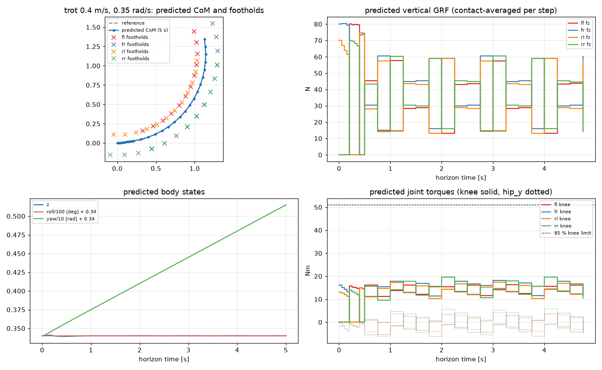

*그림 4-1. 트롯 0.4 m/s, 0.35 rad/s 명령에서 MPC 한 번의 예측. 5 s CoM 궤적과 다리별 착지점(다리당 12개), 접촉 평균 수직 GRF, 몸체 상태, 무릎·hip_y 예측 토크(85 % 한계선). 원본: `tools/eval_locomotion.py`.*

#### 4.2.5 외란 대응과 기타 구성

- **외란 관측기** (`AccelBiasObserver`): 일정한 선·각가속도 편향(하중, CoM 오프셋)을 1차 관측기로 추정해 아핀 열에 반영한다.
- **크롤 스웨이**: 3다리 지지 동안 CoM 기준을 지지 삼각형 중심 쪽으로 0.5만큼 옮긴다. 0.5 s Hann 창으로 평활하고(기준 궤적의 최대 가속도는 기본 duty 0.80에서 3.51 m/s², duty 0.75에서 3.73 m/s²로 모두 μg보다 작음), 크롤 시작 시 0.6 s에 걸쳐 서서히 적용한다.
- **스레드 구조**: MultiThreadedExecutor(스레드 4개). 100 Hz 제어 타이머는 독립 콜백 그룹에서 돈다. MPC는 워커 스레드에서 20 Hz로 풀고, BLAS는 1스레드로 고정한다. 0.3 s보다 오래된 예측은 쓰지 않는다. 비유한값, |roll|/|pitch| > 0.6 rad, 0.5 s 안에 높이 0.15 m 이상 벗어나는 예측은 거부한다.
- **토크 실현 방식**: 관절 위치 목표를 Gazebo JointPositionController(PID 힘 모드, p 450 / d 3, 출력은 effort로 제한)가 힘으로 바꾼다(DESIGN_SPEC §3). MPC 힘·토크는 몸체 궤적을 만드는 계획이고 모니터링과 속도 스케일링에 쓰인다. 선택적으로 입각 다리의 MPC 토크를 `τ / servo_kp`만큼 위치 목표에 더해 PD 서보의 처짐을 없앨 수 있다(`torque_feedforward`). 물리 검증에서 추종은 좋아졌지만 밀기 복구가 0/6이 되어 기본값은 0이고, 슬립 모드에서만 켠다(§4.7, §4.8).

#### 4.2.6 튜닝 파라미터

| 그룹 | 파라미터 | 값 | 튜닝 근거 |
|---|---|---|---|
| 루프 | `control_rate` / `mpc_rate` | 100 Hz / 20 Hz | MPC 최소 10 Hz 요구에 여유 |
| 비용 | `mpc_q_weights` [roll pitch yaw, px py pz, ωx ωy ωz, vx vy vz] | [30 30 10, 4 4 60, 0.5 0.5 0.5, 2 2 1] | 자세·높이 우선, 수평 위치는 약하게(속도 명령 추종) |
| 비용 | `mpc_r_weight` | 2e-4 | 내부 조임 힘 억제 |
| 제약 | `mpc_mu`, `mpc_f_min`, `mpc_f_max` | 0.5, 0, 250 N | 마찰 피라미드 |
| 착지 | `mpc_capture_gain`, `mpc_feedback_tau` | 0.6, 0.5 s | 푸시 회복 (0.8까지 올릴 수 있음) |
| 착지 | `mpc_max_foot_dx/dy` | 0.16 / 0.14 m | 다리 작업공간 (측방 밀기 회복에 여유) |
| 지형 | `mpc_terrain_horizon` | 1.2 s | foothold planner 적용 구간 |
| 크롤 | `mpc_sway_gain`, `mpc_sway_smooth`, `mpc_sway_ramp` | 0.5, 0.5 s, 0.6 s | gain 1이면 약 10 m/s²로 마찰 한계를 넘음 (§4.6) |
| QP | `mpc_qp_max_iter`, `mpc_qp_eps`, `mpc_qp_time_limit` | 250, 1e-3, 0.04 s | 평균 14.6회 반복으로 수렴 |
| 자세 | `kp_attitude`, `kd_attitude` | 0.0, 0 | kd 0.02는 50 Hz 리밋 사이클을 일으킴 (§4.6). PID 힘 모드 서보의 물리 검증에서 D항은 0으로 둠 (§4.7). kp는 2026-10-26에 0.5 → 0.0: Gazebo에서 IK roll을 최대 8.6° 키웠고, 0이면 0.08 m 배관 5/6(0.5는 2/6), 밀기 6/6(4/6), 경사로 진단 8/9(2/9) (§4.10.7) |
| MPC 지지·회전 (2026-10-26) | `mpc_stance_max_error`, `mpc_stance_rel_error`, `mpc_heading_hold_gain` / `_max`, `mpc_terrain_robust`, `mpc_lateral_ref_blend`, `mpc_turn_pivot_x`, `mpc_turn_pivot_fade` | 0.02 m, 0.02 m, 1.0 1/s / 0.2 rad/s, true, 0.5, −0.15 m, 0.10 m/s | Gazebo MPC 안정화 1–3차에서 정함 (§4.10.7) |
| 몸체 목표 | `body_target_mode`, `max_body_lead` (`max_body_lead_lateral`, `max_yaw_lead`) | integrated, trot 0.06 m (측방 0.015 m, yaw 0.05 rad), crawl 0.10 m (0.03 m, 0.20 rad) | 서보 지연이 있을 때 속도가 붕괴하는 문제 해결 (§4.6). 리드는 지지발에 대한 수평 힘 요구라서 Gazebo에서 예전 값(0.10 m, 0.03 m, 0.20 rad)은 회전 중 지지발을 미끄러뜨림 (§4.10) |
| crawl | `crawl_period`, `crawl_duty`, `crawl_retarget_until` | 1.20 s, 0.80, 0 | 보폭 0.24 m로 작업공간 안, 4다리 지지 구간, 스윙 중 착지점 고정 (§4.7) |
| 서보 | `torque_feedforward`, `servo_kp` | 0 (끔), 450 N·m/rad | `servo_kp`는 URDF `servo_p_gain`과 같아야 함 (테스트로 확인) |
| 미끄러운 바닥 | `slip_speed_threshold`, `slip_confirm_time`, `slip_max_vx`, `slip_torque_feedforward`, `slip_max_body_lead`, `slip_mu_min` | 0.08 m/s, 0.10 s, 0.2 m/s, 1.0, 0.015 m, 0.15 | MuJoCo 철판 실험으로 정함 (§4.8) |
| 포화 | `torque_scale_threshold` / `recover` | 0.85 / 0.70 | 포화 인지 속도 스케일링 |

이 값들은 `tools/tune_locomotion.py`의 자동 탐색(§4.9)으로 다시 검토했다. 채택 규칙과 회귀 가드를 통과한 후보가 없어서 그대로 두었다.

### 4.3 보행 모드 전환 (Trot / Crawl 자동)

| 보행 | 주기 | duty | 위상 오프셋 FL FR RL RR | 순서 | 속도 한계 vx / vy / ωz |
|---|---|---|---|---|---|
| stand | — | 1 | — | — | — |
| trot | 0.40 s | 0.50 | 0, .5, .5, 0 | 대각 쌍 | 0.6 m/s / 0.3 m/s / 0.9 rad/s |
| crawl | 1.20 s | 0.80 | 0, .5, .75, .25 | FL → RR → FR → RL (한 번에 한 다리, 박자 사이 4다리 지지) | 0.25 / 0.12 / 0.5 |

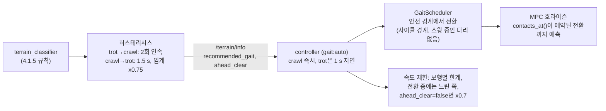

- 전환은 큐에 넣었다가 안전한 경계에서 실행한다. stand → 보행은 즉시, 보행 → stand는 스윙 중인 다리가 없을 때, 보행 → 보행은 사이클 경계에서 한다.
- `contacts_at(times)`는 예약된 전환까지 포함한 미래 접촉 스케줄을 예측한다. 이 값은 `update`를 차례로 호출한 결과와 같음을 테스트로 확인했다. 그래서 MPC가 전환 직후의 지지 패턴을 미리 안다.
- 스윙 궤적: 수평은 최소 저크 $10u^3-15u^4+6u^5$, 수직은 3차 베지어로 상승·유지·하강한다. 정점 높이는 $\max(\max(z_0,z_1)+h_{step},\ h_{obs}+r_{foot}+0.04)$이고 상한 0.25 m다. 장애물이 정점을 올리면 발을 먼저 들고 나서 전진한다.
- 수동 강제: `/locomotion/command`의 `gait:trot | gait:crawl | gait:auto` 또는 키보드 3/4/5.

### 4.4 Fall Recovery 상태기계

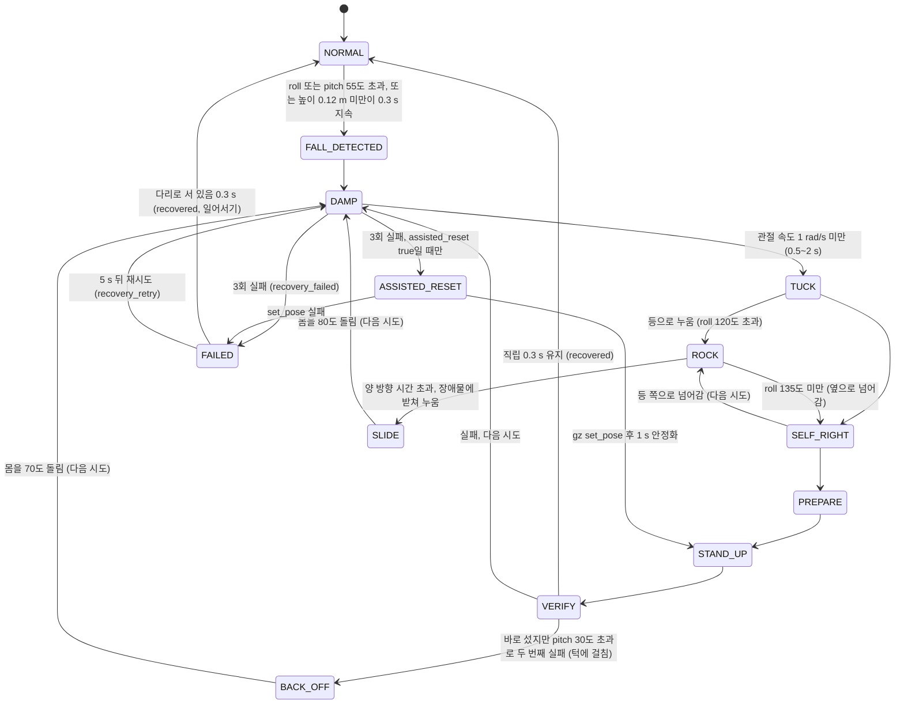

| 단계 | 관절 (hip_x, hip_y, knee) | 목적 |
|---|---|---|
| DAMP | 측정 관절값을 따라감 | 충격에 맞서지 않음 |
| TUCK (0.8 s) | (0, 1.25, −2.70) 모든 다리 | 몸을 작게 말아 자유롭게 구르게 함 |
| ROCK (시도당 최대 6 s) | 열기 0.6 s: 낮게 남을 쪽 다리를 곧게 펴서(hip_y 0, knee −0.25) 몸통 가장자리 바깥으로 기울이고(hip_x 0.7), 올라갈 쪽 다리는 접은 채 다리 평면을 바깥으로. 이어서 올라갈 쪽 다리를 등 너머로 넘겨 지면을 짚기(앞 hip_y −1.6 / knee −1.5, 뒤 2.6 / −0.2, 0.4 s) → 거두기(0.35 s) → 유지(0.5 s) 반복 | 등으로 누웠을 때 옆으로 넘김. 낮은 쪽 다리가 무게중심을 회전축 쪽으로 옮겨 넘어가는 데 필요한 roll을 약 58°에서 29°로 줄이고, 짚은 다리를 roll이 가장 클 때 떼면 몸이 넘어간다. 시간이 다 되면 다음 시도는 반대 방향(벽·오르막이 한쪽을 막는 경우) |
| SELF_RIGHT | 지면 쪽 다리: 앞 (−0.25 → 0.6, −1.5, −1.5), 뒤 (−0.25 → 0.6, 2.4, −0.6). 반대쪽 다리는 접음 | 지면 반력이 CoM의 위쪽에 작용하게 해서 배 쪽으로 굴림 |
| PREPARE (1.3 s) | 무릎 접기 + hip_x 가운데(0.35 s) → 무릎을 접은 채 hip_y 1.25(0.6 s) → (0, 1.20, −2.55)(0.35 s) | 배를 대고 발을 엉덩이 아래로. 편 다리를 땅에 댄 채 hip_y를 돌리면 45 N·m 한계에 걸려 다시 옆으로 넘어가므로 무릎부터 접는다 |
| STAND_UP (2.5 s) | 스탠드 자세까지 smoothstep 보간 | |
| VERIFY | 1.5 s 안에 roll·pitch 절댓값 25° 미만, 높이 0.22 m 초과가 0.3 s 유지 | 성공 시 `recovered` |
| SLIDE | 앞다리를 지지대로 세워(hip_y −1.6, knee −1.5) 바닥을 짚고 hip_x를 +0.6 → −0.6으로 함께 쓸기(0.8 s) → 들기 → 되돌리기, 뒷다리는 접음. 머리 방향이 80° 바뀌면 끝(최대 6회) | 배관 위에 등을 대고 누워(몸통 뒤쪽이 배관, 앞쪽이 바닥) ROCK이 배관을 받침점 삼아 제자리로 돌아오는 경우. 몸을 돌려 배관과 나란하게 하거나 배관 밖으로 비킨 뒤 다시 굴린다 |
| BACK_OFF | 낮은 쪽 다리는 접고, 높은 쪽 다리를 높은 바닥에 짚은 채(hip_y 0.9, knee −1.6) 옆으로 쓸기 → 들기 → 되돌리기. 머리 방향이 70° 바뀌면 끝(최대 6회), 다음 BACK_OFF는 반대 방향 | 경사로 가장자리 밖으로 떨어져 앞발은 경사로, 뒷발은 0.3 m 아래 통로에 걸친 경우. 몸을 돌려 턱에서 떨어뜨린 뒤 평평한 바닥에서 일어선다 |

- FAILED는 영구 상태가 아니다. 로봇이 이미 다리로 서 있으면 복구로 보고 일어서기로 넘어가고, 아니면 `recovery_retry_time`(5 s) 뒤에 다시 시도한다. 복구 중 직립 판정의 높이는 지도 기준 높이와 측정한 발 기준 높이(다리 기구학) 중 큰 값이다. 넘어지는 동안 몸 아래 지도 칸이 틀어질 수 있기 때문이다. 미션 관리자도 로봇이 FALLEN 상태로 20 s(`recover_after`) 넘게 머물면 `recover`를 보낸다(§7.2). 로봇이 일어서면 미션은 현재 위치에서 경로를 다시 계획해 이어 간다. 이렇게 고친 계기는 Ubuntu 실행에서 "넘어졌다 일어났는데 미션이 멈춤"이 보고된 것이다.
- 감지 임계값에는 히스테리시스가 있다(진입 55° / 0.12 m, 해제 50° / 0.14 m). 이벤트 `fall`, `recovered`, `recovery_failed`, `recovery_retry`, `assisted_reset`은 `/locomotion/fall_event`로 나가고, 카운터는 `/locomotion/state`에 실린다. 메트릭 로거가 이를 집계한다(§8.4).
- 보조 리셋과 푸시 시험은 `gz` CLI로 한다(`gz_tools.py`). `gz service -s /world/plant/set_pose ...`는 응답 확인 후 `reset_settle_time`만큼 기다린다. 푸시는 `/world/plant/wrench/persistent`로 걸고 `/world/plant/wrench/clear`로 해제한다. 모든 호출은 데몬 스레드에서 타임아웃을 걸고 실행하므로 제어 루프를 막지 않는다.
- **기본은 물리 복구**: 순간이동(`assisted_reset`)은 기본으로 꺼져 있다. 3회 시도가 실패하면 FAILED에서 5 s 힘을 뺀 뒤(걸쳐 있던 몸이 미끄러져 자세가 바뀜) 처음부터 다시 시도하고, 일어설 때까지 반복한다. 벽에 기대 30°를 넘는 기울기로 2 s 서 있어도(55°에 닿지 않음) 넘어짐으로 보고 복구한다.
- **Gazebo 검증** (`tools/fall_check.py`, 실제 gz-sim + DART 헤드리스, 시드 10개씩): 옆으로 누운 채 시작, 등을 대고 시작, trot 중 측면 밀기, 서서 측면·뒤로 밀기, 복도 벽 쪽으로 밀기, 경사로를 오르다 밀기, 경사로에 서서 밀기, 미션 중 밀기 9개 케이스에서 넘어진 90회 중 89회를 순간이동 없이 일으켜 세웠다(같은 도구로 잰 이전 키프레임은 12/45). 넘어짐 → STAND는 케이스 평균 6.8–15.3 s이고, 미션 중 넘어진 10회는 모두 일어선 뒤 경로를 다시 계획해 목표에 도착했다. 결과: `docs/results/fall_check.json`, [module1 README §4.9](../module1_locomotion/README.md#49-gazebo-넘어짐-복구-검증-toolsfall_checkpy).
- **물리 검증**: MuJoCo(§4.7)에서 옆으로 누운 상태로 시작(h1), 60 N·s 밀기로 옆으로 넘어짐(h2), 등을 대고 시작(h3), 100 N·s 밀기로 등으로 떨어짐(h4)이 3개 시드 모두 첫 시도에 STAND로 돌아왔다(6.4 / 6.3 / 7.5 / 7.7 s, 보조 리셋 0). 이전 ROCK 키프레임(다리를 편 채 hip_x를 같은 위상으로 흔듦)으로는 h3·h4가 실패했다.
- **배관 위·경사로 턱** (2026-11-12): C-OBS5 배관을 가로질러 등을 대고 누우면 ROCK이 배관을 받침점 삼아 제자리로 돌아와 서지 못했다(전체 미션 15회 중 미완료 2회의 원인). SLIDE를 넣은 뒤 `pipe_back` 케이스(배관 위에 누운 채 스폰)는 0/5 → 13/13(평균 37 s)이다. 경사로 남쪽 가장자리 밖으로 떨어져 앞발은 경사로, 뒷발은 통로에 걸친 경우는 BACK_OFF로 `ramp_edge` 케이스 6/7(평균 58 s)이다. 11개 케이스 × 시드 10–12는 33/33, 순간이동 0이었다.
- **한계**: 경사로 남쪽 가장자리 밖으로 떨어져 경사로 옆면에 등을 댄 채 누운 경우(Gazebo 1회)는 SELF_RIGHT의 발이 디딜 곳이 없어 100 s 동안 일어서지 못했다. 몸 앞쪽이 벽에 들린 앉은 자세나 몸 아래에 낀 다리는 FAILED에서 힘을 뺀 뒤의 다음 시도로 풀려서 30–60 s가 걸렸다. 경사면을 가로질러 다시 걷다가 또 넘어지는 경우도 있다(보행 쪽 약점).

### 4.5 결과 (오프라인 평가)

평가 플랜트(`tools/eval_locomotion.py`)는 15 kg 단일 강체(전체 관성, 하중·CoM 오프셋 선택 가능)에 이상적인 점 접촉을 준다. 입각 다리는 현재 스텝의 MPC 힘을 그대로 가하고, 착지점은 MPC 착지점을 쓰며, 스케줄은 같은 `GaitScheduler`가 만든다. 넘어짐 판정: |roll| 또는 |pitch| > 55°, 높이 < 0.12 m, 입각 다리가 0.1 s 넘게 도달 불가. 관절 서보, 토크 포화, 미끄러짐은 이 플랜트에 없다.

#### 4.5.1 속도 추종

| 시나리오 | 결과 |
|---|---|
| 트롯: 0.5 m/s 전진 → 0.25 m/s 횡이동 → 0.3 m/s + 0.6 rad/s 선회 | RMS 오차 vx 0.0120, vy 0.0083 m/s, ωz 0.00084 rad/s. 주기 평균 vx 0.0053, vy 0.0055 m/s. 높이 RMS 0.91 mm, 최대 roll 1.32°, pitch 0.64°. 최대 토크 비 0.299, 넘어짐 없음 |
| 크롤: 0.2 m/s, 이어서 0.1 m/s + 0.3 rad/s | 주기 평균 RMS vx 0.0060, vy 0.0103 m/s. 3~6 s 평균 속도 0.199 m/s(명령 0.200). ωz 0.0039 rad/s, 높이 1.67 mm. 최대 roll 1.76°, pitch 0.49°. 토크 비 0.304. 스웨이 진폭 ±2.48 cm. 6 s 시점 측방 오프셋 0.119 m (속도 명령 보행이라 측방 위치 피드백이 없음) |

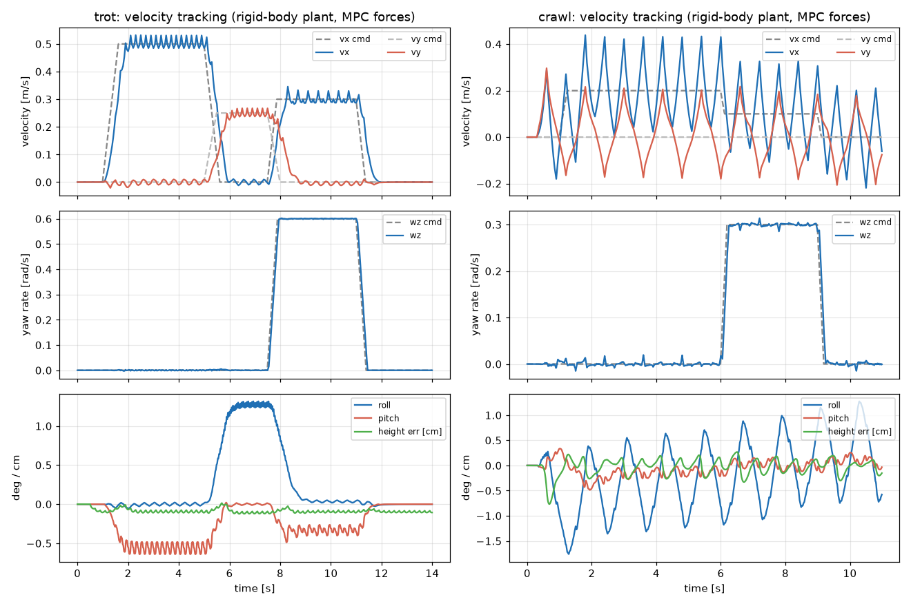

*그림 4-2. 트롯과 크롤의 속도 추종.*

#### 4.5.2 외란 (푸시) — 트롯 0.3 m/s 중 0.1 s 충격

| 방향 | 충격량 [N·s] | 넘어짐 | 최대 roll / pitch [°] | 회복 시간 [s] | 예측 최대 토크 비 |
|---|---|---|---|---|---|
| 횡 | 10 | 없음 | 3.22 / 0.56 | 0.58 | 0.32 |
| 횡 | 20 | 없음 | 13.24 / 0.78 | 1.07 | 0.79 |
| 횡 | 30 / 40 / 50 / 60 | **넘어짐** | — | — | 2.51 / 2.66 / 2.45 / 1.16 |
| 전방 | 10 | 없음 | 0.41 / 0.64 | 0.36 | 0.31 |
| 전방 | 20 | 없음 | 0.42 / 1.52 | 0.45 | 0.52 |
| 전방 | 30 | 없음 | 1.19 / 2.89 | 0.65 | 0.64 |
| 전방 | 40 / 50 / 60 | **넘어짐** | — | — | 3.13 / 2.58 / 1.43 |

전체 12회 중 7회 넘어짐. 넘어지지 않는 최대 충격량은 **횡 20 N·s, 전방 30 N·s**다.

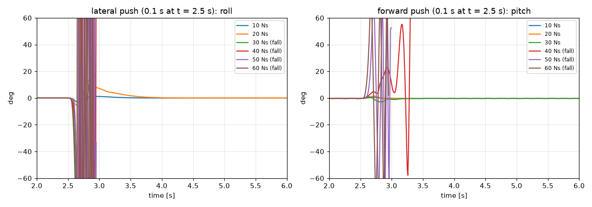
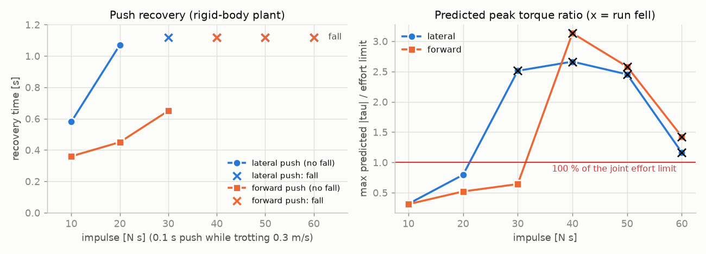

*그림 4-3. 위: 시간에 따른 roll/pitch 응답. 아래: 충격량별 회복 시간과 예측 최대 토크 비(이 보고서용으로 `locomotion_eval.json`에서 생성).*

**해석.** 횡 30 N·s 이상(속도 변화 약 2 m/s 이상)에서는 다음 착지 전에 입각 다리가 작업공간을 벗어난다. 전방은 40 N·s부터 넘어진다. 넘어지지 않은 실행의 계획 토크는 모두 effort 한계 안이었다(가장 큰 값은 횡 20 N·s 79 %, 전방 30 N·s 64 %). 한계를 넘는 값(116~313 %)은 넘어지는 실행에서만 나왔다. 그래도 평가 플랜트에는 관절 서보, 토크 포화, 미끄러짐이 없으므로 Gazebo(서보 effort 한계 있음)에서는 넘어지지 않는 한계가 이보다 낮게 나올 수 있다. 이 값은 상한 추정으로 읽어야 한다. 실제로 서보와 접촉이 있는 MuJoCo에서는 trot 0.4 m/s 중 횡 15 N·s도 3개 시드 중 2개만 버텼다(§4.7).

> [!NOTE]
> **CPU 부하의 영향.** ADMM 루프에는 벽시계 상한(`mpc_qp_time_limit` 0.04 s)이 있다. PC가 바쁘면 한 번의 풀이에서 도는 반복 수가 줄 수 있으므로, 강체 밀기 결과(특히 넘어짐 경계 근처의 충격량과 넘어지는 실행의 토크 비)는 CPU 부하에 따라 조금 달라질 수 있다. 이 절의 수치는 커밋된 실행(`docs/results/locomotion_eval.json`, 2026-10-13 최종 점검, 실행 49 s, 풀이 p95 14.71 ms)의 값이다. 같은 날 한 번 더 돌린 실행에서도 넘어지지 않는 최대 충격량(횡 20 N·s, 전방 30 N·s)과 넘어짐 횟수(12회 중 7회)는 같았다.

#### 4.5.3 하중 변화 (모델은 15 kg 유지)

| 경우 | 질량 | 정상상태 높이 오차 | 정상상태 pitch | vx RMS 오차 | 넘어짐 |
|---|---|---|---|---|---|
| 명목 | 15 kg | −0.98 mm | −0.34° | 0.0085 m/s | 없음 |
| 질량 +20 % | 18 kg | **−53.1 mm** | −0.39° | 0.0089 | 없음 |
| 질량 +20 % + 관측기 | 18 kg | **+2.4 mm** | −0.74° | 0.0090 | 없음 |
| CoM +4 cm 전방, +20 % | 18 kg | −50.3 mm | **+9.99°** | 0.2421 | 없음 |
| CoM +4 cm 전방, +20 % + 관측기 | 18 kg | +3.0 mm | **+0.50°** | 0.0483 | 없음 |

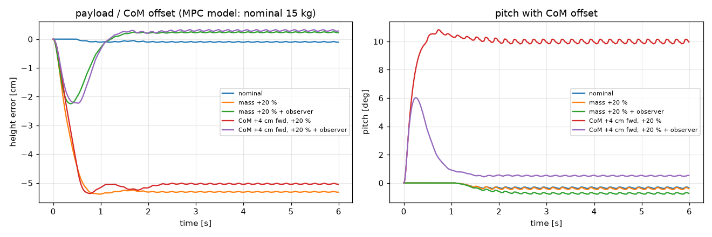

*그림 4-4. 하중·CoM 오프셋 실험. 가속도 편향 관측기를 쓰면 높이 처짐은 약 1/22(질량 +20 %), pitch 기울기는 약 1/20(CoM +4 cm)으로 줄었다.*

#### 4.5.4 MPC 풀이 시간 (660회)

| 통계 | 값 |
|---|---|
| 평균 / 중앙값 | 11.81 ms / 10.85 ms |
| p95 / 최대 | 14.71 ms / 18.33 ms |
| 30 ms 미만 비율 | **100 %** |
| 풀이 스레드 CPU 시간 평균 | 11.65 ms |
| 평균 QP 반복 | 14.6회 |
| 상태 | 모두 `solved` |

측정 범위는 QP 구성, ADMM, 연마, 착지점, 토크 계산까지 전부이고 OpenBLAS 1스레드다. 벽시계 시간은 PC 부하에 따라 달라진다. 이전 실행들에서는 공유 PC 부하 때문에 중앙값이 18~27 ms까지 나왔다. 그래서 부하에 덜 민감한 스레드 CPU 시간을 함께 기록한다.

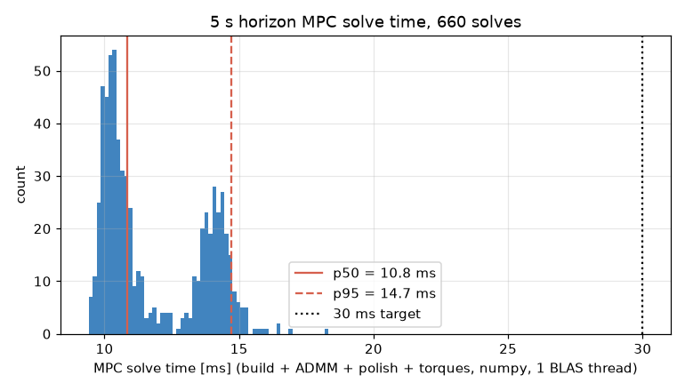

#### 4.5.5 크롤 정적 안정 여유

안정 여유는 CoM 투영점에서 지지 다각형 경계까지의 거리다.

| duty | 구분 | 최소 | 평균 | 2 cm 초과 비율 |
|---|---|---|---|---|
| 0.75 (사양) | 기준 궤적(스웨이 적용) | 0.38 mm | 24.1 mm | 75.0 % |
| 0.75 | 폐루프 | −17.2 mm | 33.8 mm | 78.4 % |
| 0.75 | 스웨이 없음 | — | 0.0 mm | — |
| 0.80 | 기준 궤적 | 9.1 mm | 44.2 mm | 84.2 % |
| 0.80 | 폐루프 | **1.0 mm** | **47.7 mm** | **86.9 %** |

duty 0.75에서는 연속한 지지 삼각형이 대각선 하나만 공유한다. 그래서 다리가 바뀌는 순간 여유가 구조적으로 0 근처가 된다. 스웨이가 없으면 사이클 내내 0이다. duty 0.80은 4다리 지지 구간이 생겨 폐루프에서도 여유가 양수로 유지된다. MuJoCo 물리 검증에서 duty 0.75는 다리 교대 순간에 넘어졌으므로 기본값을 `crawl_duty: 0.80`으로 정했다(§4.7).

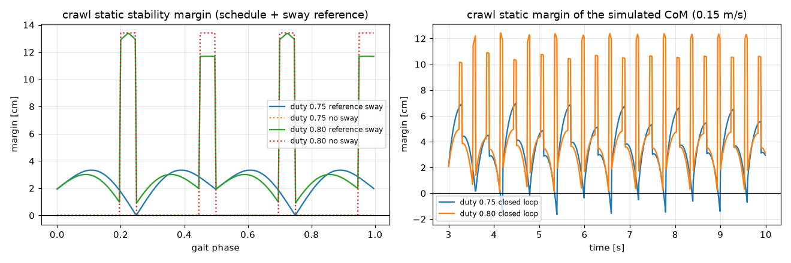

#### 4.5.6 지형 인지 결과 (`tools/eval_terrain.py`)

실제 깊이 카메라 모델로 장면 7개를 5 mm 정답 높이장에 광선 투사했다. 노이즈 $2\,\text{mm}+2\,\text{mm/m}^2\cdot r^2$, 근거리 가짜 반사 0.2 %, 결측 1 %, 오도메트리 노이즈 3 mm / 0.2°를 넣고 Gazebo 형식 PointCloud2로 노드 파이프라인을 그대로 실행했다.

| 장면 | RMSE 전체 / 비가장자리 | 커버리지 | 분류 / 보행 (결정 시점) |
|---|---|---|---|
| 평지 | 0.20 / 0.20 cm | 1.00 | flat / trot |
| 흩어진 배관 (d 8~12 cm) | 2.31 / 0.52 cm | 0.98 | rough / crawl |
| 잔해 (2~7 cm) | 1.47 / 0.34 cm | 1.00 | rough / crawl |
| 계단 상행 (0.17 m × 5) | 3.55 / 0.95 cm | 0.86 | stairs / crawl |
| 계단 하행 | 4.60 / 1.73 cm | 1.00 | stairs / crawl |
| 램프 16° | 0.53 / 0.43 cm | 0.98 | slope / crawl |
| 장애물 0.6 m | 7.70 / 4.82 cm | 0.77 | obstacle / crawl (윗면은 보이지 않아 하한값) |

- 분류 **7/7**, 보행 **7/7** 정답.
- 클라우드 규약 판별: link·optical 모두 183/183 프레임 정답.
- 위험 디딤(발 중심 5 cm 안에 3 cm 넘는 단차가 있는 착지점) 비율, 명목 → 계획: 계단 상행 25.0 → **0.0 %**, 하행 26.3 → **0.8 %**, 배관 29.0 → **3.1 %**, 잔해 40.7 → **8.8 %**. 유효 착지 비율은 각각 100 / 100 / 99.8 / 99.9 %다. 착지점 하나 선택에 0.30 ms 걸린다.
- 처리 시간(p10 / 중앙값): 25k 점 클라우드 통합 3.19 / 3.86 ms, 레이어 4.83 / 5.72 ms, 분류 0.72 / 0.79 ms, 제어기 측 재구성 8.40 / 11.35 ms. 10 Hz 카메라 / 5 Hz 발행 주기에 비해 충분히 짧다.
- 기법별 기여(ablation): 가림 그림자 채움은 하행 계단의 위험 계획 디딤을 7.1 → 0.8 %로, 5 cm 넘는 가짜 셀을 100 → 19개로 줄였다. 배관 장면 RMSE는 1.14 → 0.52 cm. max-height bias는 계단 비가장자리 RMSE를 1.53 → 0.95 cm로 줄였다. 높은 이상치 2프레임 확인 규칙은 잔해 장면에서 5 cm 넘는 가짜 셀을 2 → 0개로 만들었다.

| 지형 맵 | 착지점 |
|---|---|
| 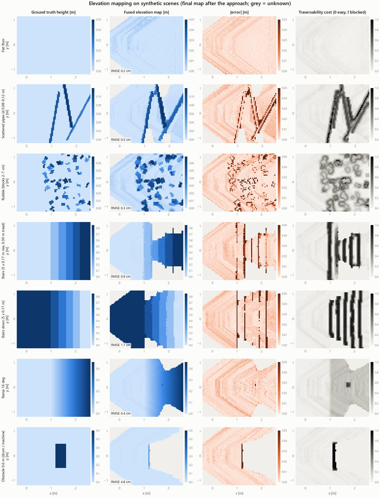 | 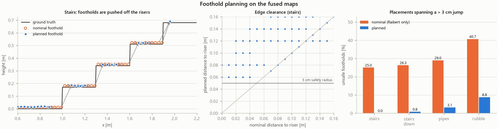 |
| 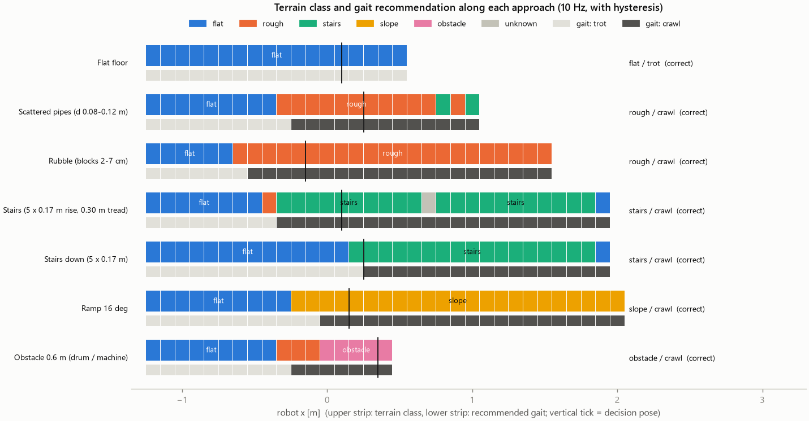 | 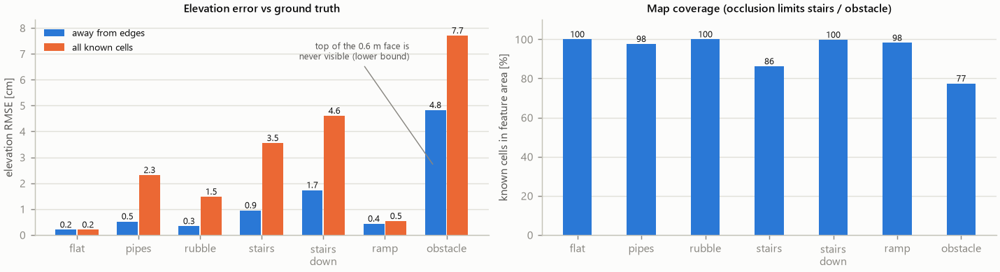 |

*그림 4-5. 지형 맵(정답·맵·오차·통과성), 착지점 재배치, 접근 경로를 따른 분류, 정확도.*

### 4.6 문제 해결 사례

| # | 증상 | 원인 분석 | 해결 | 검증 |
|---|---|---|---|---|
| 1 | **크롤이 폐루프에서 무너짐**: 측방 명령이 없는데 y가 3 m까지 표류, 속도는 명령의 절반, 풀이 시간 125 ms까지 증가 | `mpc.py`에 양의 피드백 루프 두 개. (a) 착지 보정이 의도한 측방 스웨이를 속도 오차로 취급해 착지점이 스웨이를 증폭. (b) 착지 경로를 "측정 위치 − 예측 스웨이"에 고정해서 느린 몸체를 따라 뒤로 밀림. 기존 테스트는 크롤을 2.5 s만 돌려 이를 놓침 | (a) 스웨이 적용 기준 대비 속도 오차를 사용. (b) 한 보행 주기 동안의 측정 위치 평균으로 경로를 고정(주기적 스웨이는 상쇄되고, 느린 몸체에는 앞선 경로가 주어짐). 스웨이 목표를 중심의 0.5로 줄이고 0.5 s 평활 (필요 가속도 약 10 → 3.7 m/s², 당시 duty 0.75) | 크롤 평균 속도 0.199 m/s(명령 0.2), 회귀 테스트 추가 |
| 2 | **서보 지연이 있으면 보행 속도가 붕괴** (0.5 m/s 트롯 명령에 지연 30 ms → 0.31 m/s, 60 ms → 0.08 m/s) | MPC를 풀 때마다 몸체 목표가 측정 자세로 재고정됨(초당 20회). 서보가 늦으면 목표가 계속 뒤로 끌려감 | `body_target_mode: integrated`: 수평 위치와 heading은 MPC 예측 속도를 적분한 내부 상태로 둠(측정 대비 최대 0.10 m / 0.20 rad 앞섬). 높이·roll·pitch는 MPC의 지형 기준 사용. 이전 방식은 `prediction` 모드로 남김 | 지연 0 / 30 / 60 ms에서 0.50 / 0.55 / 0.53 m/s (테스트) |
| 3 | **자세 제어 미분 게인이 몸체 떨림을 유발** | 서보가 강하면 몸체가 IK 자세를 5~8 ms 지연으로 따라가므로, D항이 이전 보정에 `kd/τ` 게인으로 작용. kd 0.02에서 50 Hz, ±0.115 rad 리밋 사이클 (안정성 계산 + 폐루프 시뮬레이션으로 확인). 기존 테스트 플랜트는 보정 전 자세를 따라가서 루프가 닫히지 않았음 | `kd_attitude` 0.02 → **0.005**. 실제로 IK에 보낸 자세(`body_ik`)를 저장해 루프를 닫는 테스트 작성. 이후 PID 힘 모드 서보로 바꾼 물리 검증에서 D항을 **0**으로 둠(kp 0.5) | 지연 0.5~100 ms 전 범위에서 안정 (테스트 5건) |
| 4 | 넘어진 뒤 MPC 리셋이 진행 중인 풀이에 덮어써짐 | 워커 스레드의 풀이가 끝날 때 웜스타트를 저장해서 리셋 직후 옛 상태가 복원됨 | `_MPCWorker.request_reset()`: 진행 중인 풀이가 끝난 뒤 리셋. 세대 카운터로 이전 동작의 결과를 폐기 | 회귀 테스트 |
| 5 | NaN 샘플 하나로 제어가 영구히 망가짐 | 높이 적분기와 MPC 웜스타트에 NaN이 고착 | 비유한 목표면 이전 관절 목표 유지, 적분기 보호, 비유한 예측은 웜스타트로 저장하지 않음. 노드 콜백 예외도 차단(rclpy에서는 콜백 예외가 `spin()`을 멈춤) | 회귀 테스트 |
| 6 | **하행 계단에서 계획 디딤의 7.1 %가 위험** (상행은 0 %) | 홀 채움에 이웃 중앙값을 써서 하행 모서리 뒤 그림자에 위 디딤판 높이가 번짐. 모서리가 아래 디딤판 쪽으로 약 4 cm 이동해 가장자리 여유가 무력화됨. 로봇은 미션마다 도크로 내려오므로 중요함 | 셀별 관측 센서 위치를 기록해 가림 그림자 규칙 적용(§4.1.3). "항상 최저 이웃" 규칙은 상행 계단을 악화시켜 쓰지 않음 | 7.1 → 0.8 %, 상행은 0 % 유지 |
| 7 | 계단·장애물 바로 앞에서 분류가 `unknown`으로 떨어짐 | 계단 뒤는 원래 가려져 관측 비율이 낮음 | 확인된 단차나 명확한 장애물 증거를 `unknown`보다 우선 | 분류 7/7 |
| 8 | 텔레옵을 Ctrl-C로 끄면 수동 오버라이드가 남음 | rclpy 시그널 핸들러가 정리 코드보다 먼저 컨텍스트를 종료해 마지막 0 twist와 `/teleop/active=false`가 안 나감 | `SignalHandlerOptions.NO`로 초기화. mux와 미션에 1.5 s 하트비트 만료(`flag_timeout`) 추가 | 테스트 |
| 9 | 0.2 s 푸시가 실제로는 약 1 s 동안 걸림 | `gz topic` CLI는 실행할 때마다 시작·탐색 지연(0.3~1 s)이 있음 | 해제 프로세스를 적용 프로세스 시작 후 `push_duration`에 *시작*. 둘 다 같은 지연을 가지므로 힘 지속시간이 맞음. 종료 후 해제를 한 번 더 무조건 전송 | 단위 테스트 |
| 10 | YAML에 `6`처럼 정수가 들어가면 double 파라미터 선언이 실패 | rclpy는 double 파라미터에 정수 override를 거부 | 동적 타입으로 재선언 후 변환. 모든 YAML 실수에 소수점 유지, 테스트로 강제 | 테스트 |

### 4.7 MuJoCo 물리 검증 (`tools/physics_check.py`)

§4.5의 강체 평가에는 관절 서보, 토크 포화, 접촉, 미끄러짐이 없다. 개발 PC에는 Gazebo가 없으므로 Gazebo 설정을 흉내 낸 MuJoCo 플랜트를 만들고, 그 위에서 **실제 ROS-free 제어 코드 전체**(MPC, 자동 보행 선택, 깊이 → elevation map → 지형 분류, 넘어짐 복구, 슬립 감지)를 시뮬레이션 시간으로 돌렸다. MuJoCo는 개발·검증 도구에서만 쓰고 런타임 패키지는 import하지 않는다. 상세: [module1 README §4.2](../module1_locomotion/README.md#42-mujoco-물리-검증-toolsphysics_checkpy).

| 항목 | 설정 (Gazebo 대응) |
|---|---|
| 로봇 | `spot.urdf`를 MJCF로 변환(관성, 충돌 도형, 관절 범위·감쇠·마찰, 발 μ 1.0) |
| 관절 서보 | gz JointPositionController를 URDF 설정대로 재현: PID 힘 모드, p 450 / d 3 / i 0, 출력은 effort 45 / 45 / 60 N·m로 제한, 1 ms마다 계산 |
| 적분·접촉 | gz 스텝 1 ms를 MuJoCo 10 서브스텝(0.1 ms)으로 적분. 타원 마찰 원뿔, `impratio` 10, `solref` 2 ms. 마찰은 DART처럼 두 면 중 작은 값 |
| 센서·지연 | 관절 상태·IMU 200 Hz, 오도메트리 50 Hz(10샘플 이동 평균), MPC 결과는 10 / 20 / 30 ms 뒤 도착(시드 고정) |
| 지각 | 깊이 카메라 광선 투사 → `ElevationMap` → `TerrainClassifier` (노드와 같은 파이프라인) |

**결과** (`docs/results/physics_check.json`, 2026-10-13, 필수 시나리오는 시드 0/1/2, best effort는 시드 0). "이전"은 원래 module1과 원래 URDF(속도 모드 서보)다.

| 시나리오 | 이전 | 현재 | 핵심 수치 (현재) |
|---|---|---|---|
| (a) 기립 + 5 s 서기 | 3/3 | **3/3** | 높이 0.339 m, pitch 최대 0.19°, 드리프트 2.2 mm |
| (b) trot 0.4 m/s | 0/3 | **3/3** | vx 0.429 m/s, roll / pitch 최대 3.2 / 4.2°, 무릎 토크 최대 79 %, MPC 평균 23.7 ms |
| (c) crawl 0.2 m/s | 0/3 | **3/3** | vx 0.193 m/s, roll 최대 2.0°, 토크 포화 0 |
| (d) 제자리 회전 0.5 rad/s | 0/3 | **3/3** | wz 0.490 rad/s |
| (e) 배관 0.10 m + 단차 0.10 m, 자동 보행 | 0/3 | **0/3** | 최대 x 1.61 m (목표 5.4 m), 넘어짐 8회 |
| (f) trot 중 15 N·s 측면 밀기 (75 N × 0.2 s) | 0/3 | **2/3** | 시드 0 넘어짐. 시드 0–5로 넓히면 3/6 |
| (g) +3 kg 탑재 | 0/3 | **3/3** | 서기 높이 0.338 m, vx 0.414 m/s |
| (h1) 옆으로 누운 상태에서 시작 → 자가 복구 | 0/3 | **3/3** | 첫 시도 성공, 넘어짐 → STAND 6.07 s |
| (h2) 60 N·s 밀기로 넘어짐 → 자가 복구 | 0/3 (당시 100 N·s) | **3/3** | 첫 시도 성공, 5.16 s, 보조 리셋 0 |
| (k) μ 0.15 / 0.2 철판, 배포 설정 | 0/3 / 1/3 (처리 없음) | **3/3 / 3/3** | §4.8 |
| (h3) 등을 대고 시작 / (h4) 100 N·s 밀기 (best effort) | 0/1 / – | 0/1 / 0/1 | 시도 6 / 5회 실패 → 보조 리셋 |
| (i) μ 0.15 철판 trot / crawl 강제 (best effort) | 0/1 / 0/1 | 0/1 / 0/1 | trot은 넘어지지 않았지만 x 5.82 m까지, crawl은 넘어짐 2회 |
| (j) 0.17 m 계단 / 16° 경사로 (best effort) | 0/1 / 0/1 | 0/1 / 0/1 | 계단은 최대 x 1.13 m(목표 6.3 m 미도달), 넘어짐 6회. 경사로는 x 1.5 m에서 넘어짐, 넘어짐 4회 |

필수 11개 중 9개가 모든 시드에서 통과했다. (h2)는 공정한 비교를 위해 밝혀 둔다. 100 N·s를 맞으면 로봇이 약 2 m 날아가 등으로 떨어지므로, 필수 (h2)는 확실히 옆으로 넘어지는 60 N·s로 바꾸고 100 N·s는 best effort (h4)로 남겼다.

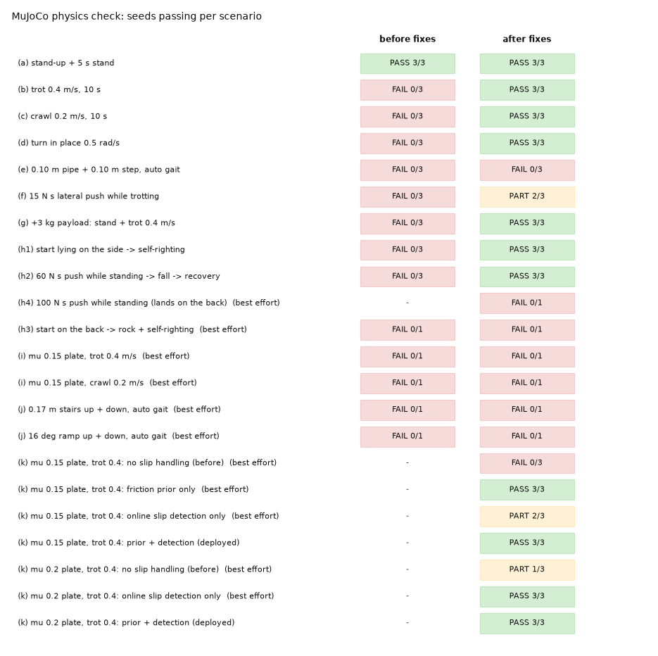

*그림 4-6. MuJoCo 물리 검증의 시나리오별 통과 시드 수(이전 대비). 원본: `tools/physics_check.py`.*

| 시간 이력 | 몸통 경로 |
|---|---|
| 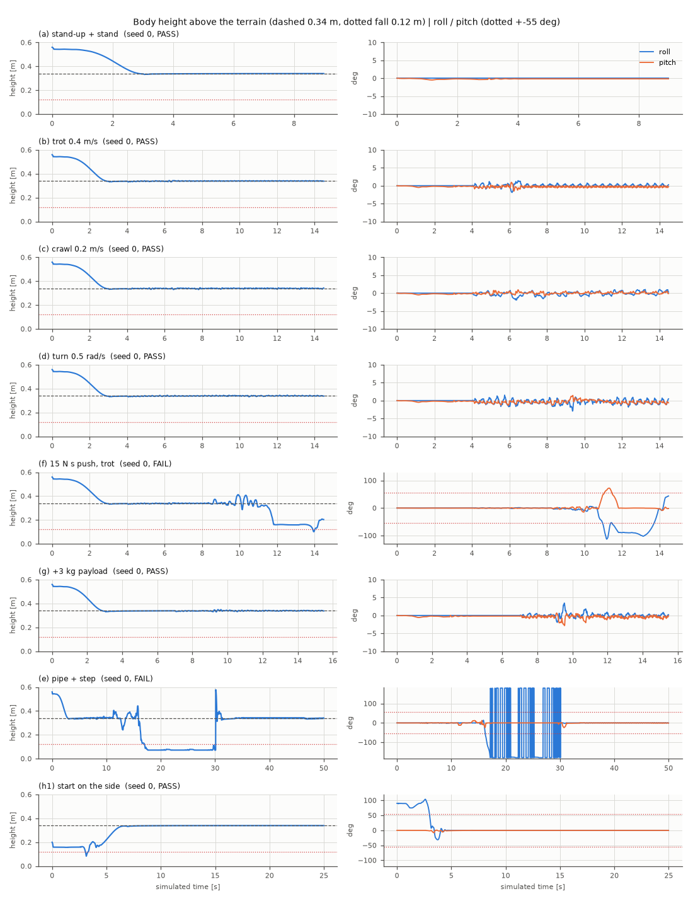 | 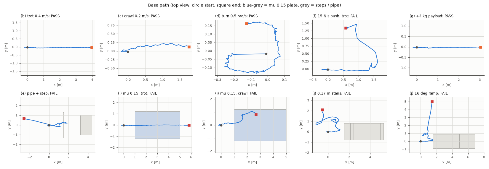 |
| 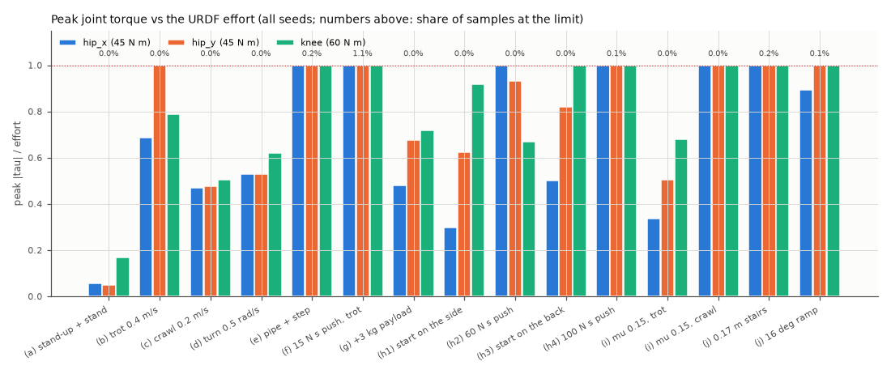 | 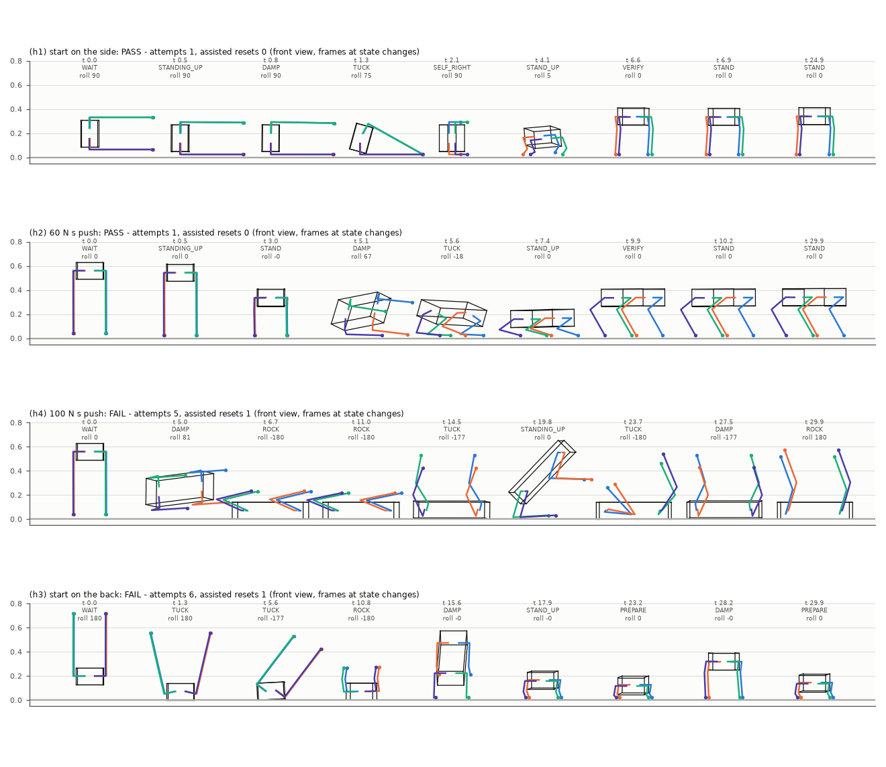 |

*그림 4-7. 몸통 높이·roll·pitch 시간 이력, 위에서 본 경로, 관절별 최대 토크 대 URDF effort, 넘어짐 복구 이력. 스틱 그림은 [physics_sticks.png](images/physics_sticks.png).*

**물리 검증으로 바꾼 것**

| 문제 (MuJoCo에서 관찰) | 원인 | 조치 |
|---|---|---|
| 모든 보행 시나리오에서 넘어짐 | URDF 서보가 속도 모드였다. 100 Hz 목표를 1 ms 안에 따라가려 해서 서 있는 네 다리가 사실상 강체로 고정된 채 10 ms마다 튐 | JointPositionController를 PID 힘 모드(p 450, d 3, 출력은 effort로 제한)로 변경. URDF·Gazebo 공통. d가 크면 목표가 바뀔 때마다 힘이 튀고, 가벼운 정강이(무릎 유효 관성 0.0056 kg·m²) 때문에 1 ms 스텝에서 발산함(d 6은 기립 중 발산) |
| crawl이 다리 교대 순간 넘어짐 | 1.6 s 주기는 0.2 m/s에서 보폭 0.32 m로 작업공간 한계(±0.16 m)에 걸림. duty 0.75는 4다리 지지 구간이 없음 | crawl 1.2 s / duty 0.80 |
| crawl 착지점이 계획에서 최대 13 cm 벗어남 | 접지 0.96 s라 착지 보정 이득이 약 0.6 s. 서보 순응에 의한 속도 출렁임이 MPC 갱신마다 착지점을 옮김 | crawl 스윙 중 착지점 재조정 끔(`crawl_retarget_until` 0) |
| 서보 처짐에 의한 지지발 미끄러짐 | PD 서보는 하중에 비례해 처짐 | 토크 피드포워드(`torque_feedforward`) 구현. 추종은 좋아지지만 밀기 복구가 0/6이 되어 기본값 0, 슬립 모드에서만 사용 |

**이 검증이 보여 주는 것과 보여 주지 않는 것.** 실제 제어 코드가 PID 관절 서보(effort 한계), 접촉, Gazebo와 같은 센서 주기, MPC 지연, 깊이 기반 지각이 들어간 폐루프에서 서기·trot·crawl·회전·탑재·옆으로 넘어진 뒤 복구·미끄러운 철판 통과를 해낸다는 것, 그리고 원래 URDF의 속도 모드 서보가 구조적으로 보행을 깨뜨린다는 것을 보여 준다. 그러나 Gazebo 결과는 아니다. MuJoCo는 0.1 ms 서브스텝과 부드러운 접촉을, DART는 1 ms 단일 스텝과 LCP 접촉을 쓰므로 서보 안정 여유, 착지 충격, 미끄러짐이 다를 수 있다. ros_gz_bridge, ROS 실행기, Gazebo가 렌더링한 깊이 영상, 실제 CPU 부하도 포함하지 않는다. 지형은 월드 전체가 아니라 단순화한 조각이고, 시드 3개는 결과가 갈리는 밀기에서 표본이 작다.

**남은 실패.** (e) 걷는 도중 trot → crawl 전환 때 계획 지지 여유가 −0.05 m까지 떨어진다(처음부터 crawl로 걷는 (c)는 통과). (f) 착지 순간 몸통이 뜨고, 옆으로 크게 내딛는 발이 IK 자세와 실제 자세의 차이(약 5°) 때문에 일찍 지면을 친다(약 400 N). (h3)(h4) ROCK 키프레임(hip_x ±0.7 rad)으로는 평평한 등 위에서 구르지 못한다. (j) 계단·경사로는 원인 분석이 남아 있다.

### 4.8 미끄러운 철판 대응 (마찰 사전정보 + 온라인 슬립 감지)

철판(F-OBS9 μ 0.15, C-OBS4 μ 0.2)은 두께가 1 cm라 깊이 데이터로는 바닥과 같아서 `flat`으로 분류됐다. 로봇은 trot 0.4 m/s로 들어갔고 `mpc_mu`는 0.5로 고정이었다. MuJoCo에서 μ 0.15 철판은 3개 시드 모두 넘어졌다. 이제 두 경로가 같은 **슬립 모드**를 켠다. 상세: [module1 README §3.8](../module1_locomotion/README.md#38-미끄러운-철판-마찰-사전정보--슬립-감지), [TERRAIN_AND_TELEOP.md §5.1](../module1_locomotion/TERRAIN_AND_TELEOP.md#51-마찰-사전정보와-slippery-클래스).

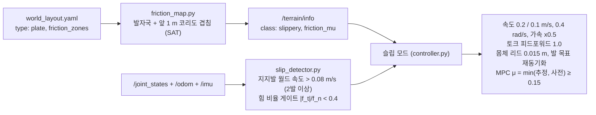

- **마찰 사전정보**(`friction_map.py`, terrain_mapper): 로봇 발자국(뒤 0.35 m)과 앞 1.0 m 코리도가 μ < 0.35 구역과 겹치면 `/terrain/info`가 `class: slippery`와 `friction_mu`를 보낸다. 겹치면 즉시 켜고 겹침이 끝난 뒤 1 s 유지한다. `flat`·`slope`·`unknown`만 `slippery`로 바꾸고 `rough`·`stairs`·`obstacle`은 자기 클래스(crawl)를 유지한다.
- **온라인 슬립 감지**(`slip_detector.py`): 측정 관절의 다리 FK와 오도메트리 자세로 지지발 월드 위치를 구하고, 착지 0.03 s 뒤부터 0.06 s 구간의 수평 속도를 본다. 지지발 2개 이상이 0.08 m/s를 넘으면 한 표가 되고, 증거가 0.1 s 쌓이면 감지한다. 서보 법칙 $\tau=k_p(q_{cmd}-q)$와 $f=-J^{-T}\tau$로 추정한 접선/법선 힘 비율이 0.4 이상이면 표를 버린다(평지에서 밀릴 때 0.7–1.5, 철판에서 0.15–0.45). 해제는 표 없이 2 s **그리고** 몸체 이동 3 m가 지나야 한다.
- **권장 보행은 crawl이 아니라 trot**이다. μ 0.15 철판 위 crawl은 시험한 모든 변형에서 넘어졌다. crawl sway에 필요한 횡가속도(2–3.6 m/s²)가 μg = 1.5 m/s²보다 크기 때문이다. 슬립 모드의 느린 trot은 통과했다.

**결과** (MuJoCo 시나리오 (k): 철판 x 1–5 m, trot 명령 0.4 m/s, 자동 보행, 목표 x = 6 m, 시드 0/1/2; JSON `slippery` 항목)

| μ | 처리 | 통과 | 넘어짐 | 철판 위 몸통 속도 | 지지발 미끄러짐 거리 | 미끄러짐 속도 p95 | 감지 지연 / 사전 모드 |
|---|---|---|---|---|---|---|---|
| 0.15 | 없음 (이전) | 0/3 | 7 | 0.05 m/s | 6.3 m | 1.14 m/s | – |
| 0.15 | 사전정보만 | **3/3** | 0 | 0.19 m/s | 5.1 m | 0.36 m/s | 진입 2.6 s 전 |
| 0.15 | 감지만 | 2/3 | 1 | 0.16 m/s | 5.5 m | 0.45 m/s | 진입 후 1.35 s |
| 0.15 | 사전 + 감지 (배포) | **3/3** | 0 | 0.19 m/s | 5.1 m | 0.36 m/s | 진입 2.6 s 전 |
| 0.2 | 없음 (이전) | 1/3 | 6 | 0.16 m/s | 4.4 m | 0.74 m/s | – |
| 0.2 | 감지만 | **3/3** | 0 | 0.27 m/s | 3.8 m | 0.50 m/s | 진입 후 1.54 s |
| 0.2 | 사전 + 감지 (배포) | **3/3** | 0 | 0.19 m/s | 3.9 m | 0.35 m/s | 진입 2.6 s 전 |

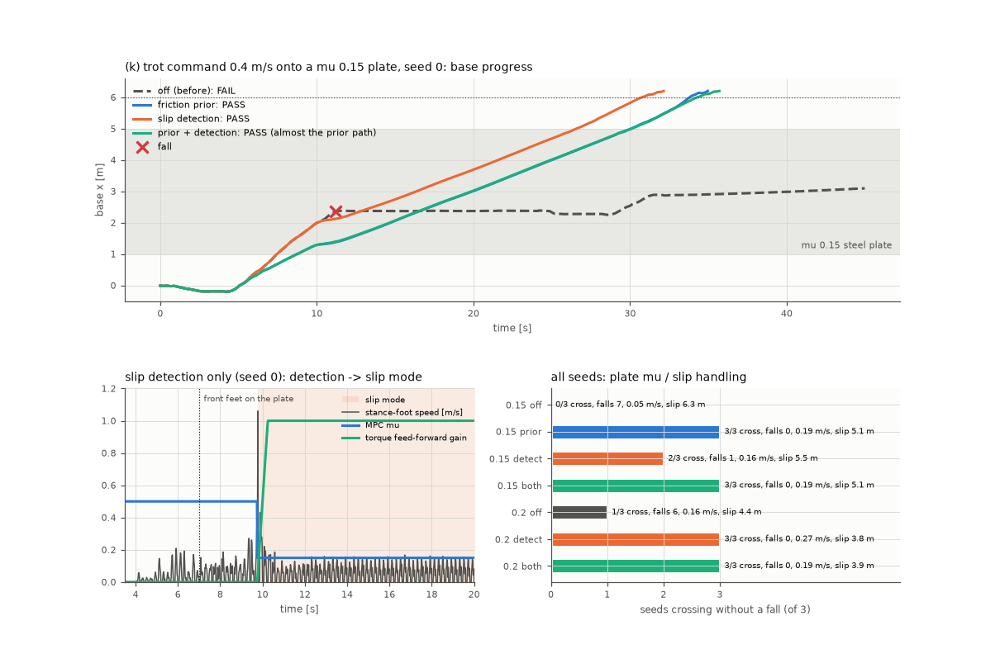

*그림 4-8. μ 0.15 철판, 처리 전후의 몸통 진행(시드 0), 감지 → 슬립 모드 전환, 모든 시드 요약. 원본: `tools/physics_check.py`.*

**한계.** 사전정보 없이 μ 0.15에 0.4 m/s로 들어가면 감지만으로는 2/3이다. 알려진 저마찰 구역은 레이아웃의 `friction_zones`에 넣어야 한다. 평지에서 감지 증거의 최대치는 0.09 s로 확인 기준 0.1 s에 가깝다. Gazebo 첫 실행에서 평지 trot 중 `slip_events`가 0인지 확인해야 한다. μ 추정은 대략적이다(피드포워드가 꺼져 있으면 0.33–0.46, 켜져 있으면 약 0.17; 실제 0.15). 그래서 MPC μ의 하한을 0.15로 두었다.

### 4.9 MPC 파라미터 자동 탐색 (`tools/tune_locomotion.py`)

MPC 가중치와 보행 파라미터 16개(Q 7개, R, `mpc_capture_gain`, `mpc_feedback_tau`, `mpc_max_foot_dy`, `trot_period`, `trot_duty`, `step_height`, `kp_attitude`, `kd_attitude`)를 재현 가능하게 탐색하는 도구다. 상세: [module1 README §4.4](../module1_locomotion/README.md#44-mpc-파라미터-탐색-도구-toolstune_locomotionpy).

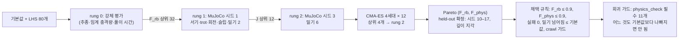

점수는 같은 데이터에서 기본값을 1로 둔 비율이다(작을수록 좋음). f_rb = 0.35 추적 + 0.10 자세 + 0.40 밀기 + 0.15 풀이 시간, f_phys = 0.10 서기 + 0.25 trot + 0.15 회전 + 0.35 밀기 + 0.15 슬립, J = (F_rb + F_phys) / 2.

**결과: 기본값을 바꾸지 않았다.** (`docs/results/tuning.json`)

- **1차 탐색**에서 고른 `9d34b63849`는 held-out 채택 규칙을 통과했다(F_rb 0.765, F_phys 0.872, 밀기 넘어짐 2/8, 기본값 5/8). 하지만 physics_check 전체로 돌리자 필수 시나리오가 9/11 → 5/11로 떨어졌다((d) 2/3, (h2) 2/3, (k) 두 철판 0/3). `trot_period` 0.32와 `trot_duty` 0.539만으로도 슬립 모드 trot이 철판 앞에서 넘어졌다. 그래서 회전·슬립 에피소드와 회귀 가드를 추가했고 이 후보는 채택하지 않았다.
- **2차 탐색**(23.9분, 12 워커, 후보 129개 중 81개 물리 평가, 17개 rung 2)에서도 채택 후보가 없다.
- **탐색 뒤 바뀐 기본값**: `tuning.json`의 `later_changes`에 따로 적었다. 지금은 `kp_attitude` 0.5 → 0.0 하나다(2026-10-26, Gazebo MPC 안정화 근거, §4.10.7). 탐색 실행 자체의 기록(`defaults`, `decision`, 점수)은 그대로 두었다. 테스트 `test_recorded_tuning_result_matches_the_code_defaults`는 나머지 파라미터가 기록과 같은지, 바꾼 값이 기록의 최종값에서 출발하는지, 날짜와 근거(40자 초과)가 붙어 있는지 확인한다.

| 후보 (held-out) | F_rb | F_phys | 밀기 넘어짐 | 강체 trot 오차 / 임계 충격량 측면·전방 | 불채택 사유 |
|---|---|---|---|---|---|
| 기본값 | 1.000 | 1.000 | 5/8 | 0.0109 / 18 · 30 N·s | – |
| `a05eb35ff7` (CMA-ES) | **0.697** | 1.016 | 5/8 | 0.0055 / 32 · 42 N·s | F_phys > 0.9 |
| `9526e631ff` (LHS) | 0.810 | 1.058 | 5/8 | 0.0090 / 26 · 42 N·s | F_phys > 0.9 |
| `987224181f` (CMA-ES) | 0.719 | 1.608 | 7/8 | 0.0061 / 36 · 39 N·s | F_phys, trot 실패, 밀기 넘어짐 증가 |
| `aed26ccc22` (LHS) | 0.837 | 1.557 | 7/8 | 0.0082 / 26 · 42 N·s | F_phys, 보행 실패 3, crawl 가드 실패 |

**해석.** 강체 개선은 실제다(결정론적 평가에서 추종 오차 절반, 임계 충격량 1.4–1.8배). 그러나 물리로 이어지지 않았다. 최선 후보도 trot 지지발 미끄러짐 p95가 0.073 → 0.107 m/s로 늘고 밀기 최대 roll이 5.1° → 8.3°로 커졌다. 선택 편향도 크다. `987224181f`는 탐색 데이터에서 J 0.747이었지만 held-out에서 1.163이었다. 밀기는 시드에 따라 결과가 갈려서 6회로는 작은 차이를 구분할 수 없다. 강체 모델만으로 튜닝하면 실제 서보·접촉에서 나빠질 수 있다는 것이 이 실험의 결론이고, held-out 확정과 회귀 가드가 그 위험을 막았다.

| Pareto와 확정 | 민감도 | 진행 |
|---|---|---|
| 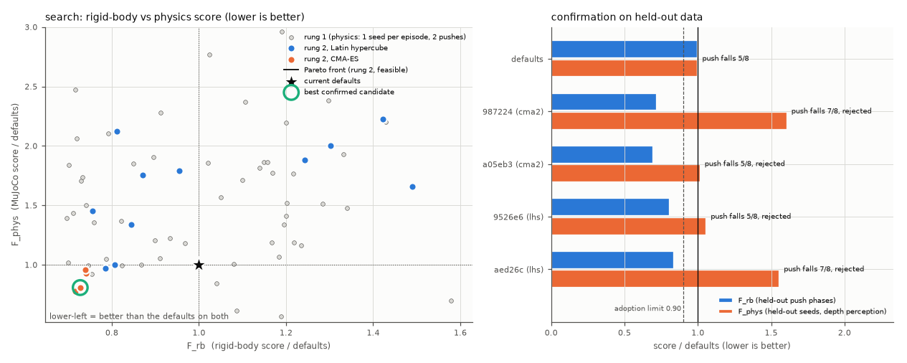 | 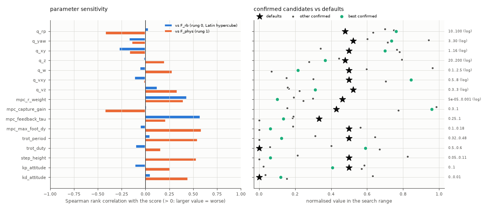 | 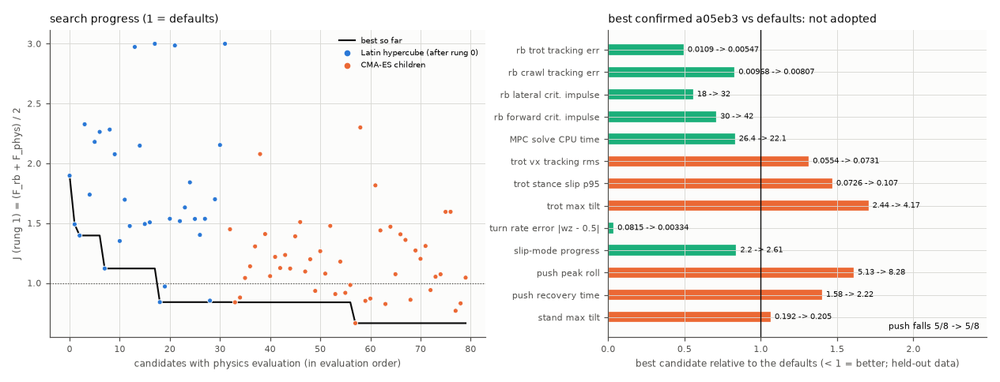 |

*그림 4-9. 탐색 점수(강체 대 물리)와 held-out 확정, 파라미터 민감도(순위 상관), 세대별 진행. 원본: `tools/tune_locomotion.py`.*

---

### 4.10 Gazebo 실측 검증 (이 PC, Gazebo Harmonic 헤드리스)

사용자의 Ubuntu PC에서 Gazebo를 실행하자 로봇이 몇 걸음 만에 넘어졌다. MuJoCo 물리 검증(§4.7)은 통과한 설정이었다. 그래서
개발 PC(Windows)에 conda-forge의 **Gazebo Harmonic(gz-sim 8, DART)**을 설치하고, 실제 gz-sim을 헤드리스로 돌리는 하네스
`tools/gazebo_check.py`로 원인을 찾았다. 자세한 설정과 표는 [module1 README §4.5–4.8](../module1_locomotion/README.md#45-gazebo-헤드리스-검증-toolsgazebo_checkpy)에 있다.

#### 4.10.1 하네스

- gz-sim 서버를 파이썬 바인딩(`TestFixture`)으로 한 프로세스에서 돌린다. 물리 설정과 월드 시스템은 `plant.sdf`와 같고, 로봇은
  launch가 스폰하는 URDF에서 카메라만 끈 것이다. 로봇 자신의 gz 플러그인(관절 위치 제어 12개, 관절 상태, odometry, IMU)이 실제로
  동작하고, ROS 브리지 대신 gz-transport로 같은 토픽을 주고받는다.
- 실제 ROS-free 제어기(`LocomotionController`)를 시뮬레이션 시간 100 Hz로 돌린다. 명령 지연, MPC 결과 지연, RTF, 제어 틱 누락을
  흉내 낼 수 있다.
- 월드는 평평한 시험 월드(배관·경사로 지형 포함)와 **실제 `simulation/worlds/plant.sdf`**(충돌체 263개 그대로, 렌더링 요소만 제거)다.
- plant 월드에서는 깊이 카메라를 충돌체 광선 투사로 흉내 내고, 그 영상을 `terrain_mapper`와 같은 코드(elevation map + 지형 분류)로
  처리해 제어기에 넘긴다(`--map depth`). 정답 맵(`--map truth`)과 맵 없음도 비교한다. 운전자는 키보드 텔레옵 hold 모드(0.25 m/s,
  0.4 rad/s, 키를 떼도 0.6 s 유지)를 흉내 낸 모델이고, Gazebo 화면을 보는 사람처럼 웨이포인트를 따라간다.

#### 4.10.2 첫 번째 원인: MPC 몸통 목표의 리드가 마찰 한계를 넘었다

관절 서보 이득 p 450이면 지지 다리 하나의 발끝 강성이 약 4.5 kN/m다. MPC 모드의 몸통 목표는 실제 몸통보다 최대 0.10 m(측방 0.03 m,
yaw 0.20 rad) 앞설 수 있었는데, 회전 중 yaw가 12° 뒤처지면 발마다 약 250 N을 요구했다. 마찰 한계는 약 130 N이다. Gazebo 기록에서
지지발이 미끄러졌고(속도 p95 0.5 m/s, 최대 2–4 m/s), 몸통이 명령(0.64 rad/s)보다 훨씬 빠른 최대 4 rad/s로 돌다가 앞다리가 들리며
뒤로 넘어졌다. MuJoCo의 부드러운 접촉에서는 이 미끄러짐이 작아서 드러나지 않았다. trot 한계를 0.06 m, 0.015 m, 0.05 rad로 줄이자
(crawl은 sway 때문에 예전 값 유지) 무작위 텔레옵 60 s가 1/3 → 3/3, MPC 결과 50 ms 지연에서 0/3 → 3/3이 됐다. 100 ms 지연에서는
여전히 0/3이었다.

#### 4.10.3 기본 보행 모드를 stable로 바꿈

MPC를 풀지 않는 CHAMP 방식 기구학 보행(`stable_gait.py`)을 추가했다. 몸체 프레임 발 궤적, Raibert 착지점(+ 속도 오차 피드백),
Bezier 스윙, IMU 수평 유지 PI, 중력 피드포워드, 그리고 **지지력 제한**(지지발 목표를 측정 발 위치에서 1.5 cm 안에 묶음 = 약 70 N)이
핵심이다. 지지력 제한이 없으면 텔레옵 0/3이었다. 같은 시나리오·시드에서 비교한 결과(평지 시험 월드, 넘어지지 않고 기준을 통과한 수):

| 조건 | stable | mpc |
|---|---|---|
| 기립 / trot 0.35 / crawl 0.2 / 회전 0.5 / 텔레옵 60 s | 모두 3/3 | 모두 3/3 |
| 10 N·s 밀기 세 번 | **3/3** | 1/3 |
| 지연 0 · 20 ms · RTF 0.5 (trot, 회전, 텔레옵) | 모두 3/3 | 모두 3/3 |
| 제어 틱 30 % 누락: trot / 회전 / 텔레옵 | **3/3** · 3/3 · 3/3 | 0/3 · 3/3 · 3/3 |
| MPC 결과 100 ms 지연 (텔레옵) | 해당 없음 | 1/3 |
| 정답 맵: 0.08 m 배관 / 11.8° 오르막 / 내리막 | **3/3** · 3/3 · 3/3 | 1/3 · 3/3 · 3/3 |
| 맵 없음: 같은 지형 | 0/3 · 0/3 · 0/3 | 0/3 · 0/3 · 0/3 |

블라인드 지형을 뺀 합계는 stable 63/63, mpc 57/66이다. 텔레옵 추종 오차도 stable이 작았다(vx RMS 0.058 대 0.084 m/s). 그래서
`locomotion_mode` 기본값을 `stable`로 정했고, MPC 모드는 `mode:mpc`/`mode:toggle`(텔레옵 `v`)로 바꿀 수 있다. MuJoCo에서는 반대로
stable이 지지발 미끄러짐 때문에 거의 전진하지 못한다. `tools/physics_check.py`는 MPC 모드 검증 도구로 본다. 보행 기본값도
§4.10.4의 plant 월드 결과에 따라 지형 자동 선택(`auto`)에서 **trot 고정**(`gait_mode: trot`)으로 바꿨다. 자동 선택은 텔레옵 `5`
(`gait:auto`)로 켤 수 있다.

#### 4.10.4 실제 plant 월드: 도크에서 출발해 배관·팔레트를 지나 경사로 위까지

스폰 위치(도크, 복도 아래층 z −0.88)에서 키보드 운전자가 (j) 배관 C-OBS1(지름 0.10 m)을 넘어, 또는 (o) 배관 북쪽 끝을 돌아
팔레트 남쪽을 지나 경사로(11.8°)로 위층까지 간다. (k)는 제어 노드가 스폰 15 s 뒤에 뜨는 경우, (n)은 그 배관만 곧게 넘는 경우,
(m)은 0.5 m/s, (q)·(s)는 0.08 m 배관과 μ 0.2 철판을 곧게, (p)는 잔해, (l)은 복도 전체다. 넘어지지 않고 웨이포인트를 모두 지난 수:

| 시나리오 | 수정 전 코드, 깊이 맵 | 수정 전 코드, 정답 맵 | 수정 전 코드, 맵 없음 | ① + trot만, 깊이 맵 | ① + walk 1.8 s, 깊이 맵 |
|---|---|---|---|---|---|
| (k) 노드 15 s 늦게 시작 | 0/3 | 3/3 | – | **3/3** | 3/3 |
| (n) 0.10 m 배관 곧게 | 1/6 | 5/6 | 0/6 | 2/6 | **11/12** |
| (j) 배관 넘어 경사로 위까지 | 0/3 | 2/3 | 0/3 | 2/3 | 0/3 |
| (o) 배관 돌아 경사로 위까지 | 0/3 | 3/3 | 0/3 (넘어지지 않음, 경사로 못 오름) | **3/3** | 0/3 |
| (m) (j)를 0.5 m/s로 | 0/3 | – | – | 0/3 | 0/3 |
| (q) 0.08 m 배관 / (s) 철판 μ 0.2 | – | – | – | 0/3 / **3/3** | **3/3** / – |
| (p) 잔해 곧게 | – | – | – | 0/3 | 0/3 |
| (l) 복도 전체 | – | – | – | 0/3 (잔해에서) | – |

MPC 모드(수정 전 코드, 깊이 맵)는 (j)·(o) 모두 0/3이었다. "수정 전 코드"는 ① 수정과 trot 기본값이 들어가기 전이고, "① + …" 열은
하네스 프로세스에서 ①을 덮어써 검증한 결과다(`proposal_*` 블록). ①을 저장소에 반영한 직후 보행 auto와 trot을 비교하니
(`fix1_depth_auto` / `fix1_depth_trot`) (o) 0/3 / 3/3, (j) 1/3 / 2/3이어서 trot을 기본값으로 정했다. 반영한 코드를 그대로 다시
돌린 결과가 아래 표다.

**지금 저장소 코드 그대로** (stable + trot 기본값, ① 반영, 깊이 맵, `gazebo_check.json`의 `final_default`(시드 0–2)):

| 시나리오 | 결과 | 비고 |
|---|---|---|
| (a) 기립 + 10 s 서기 / (e) 무작위 텔레옵 60 s / (i) 10 N·s 밀기 세 번 (평지) | **3/3** · **3/3** · **3/3** | |
| (k) 노드 15 s 늦게 시작 (plant 도크) | **3/3** | |
| (o) 배관 북쪽 끝 우회 → 경사로 위 | **3/3** | 74–78 s에 도착 |
| (j) 배관 넘어 → 경사로 위 | 2/3 | 실패 1회는 배관 위(x 58.5, 19.5 s)에서 넘어짐 |

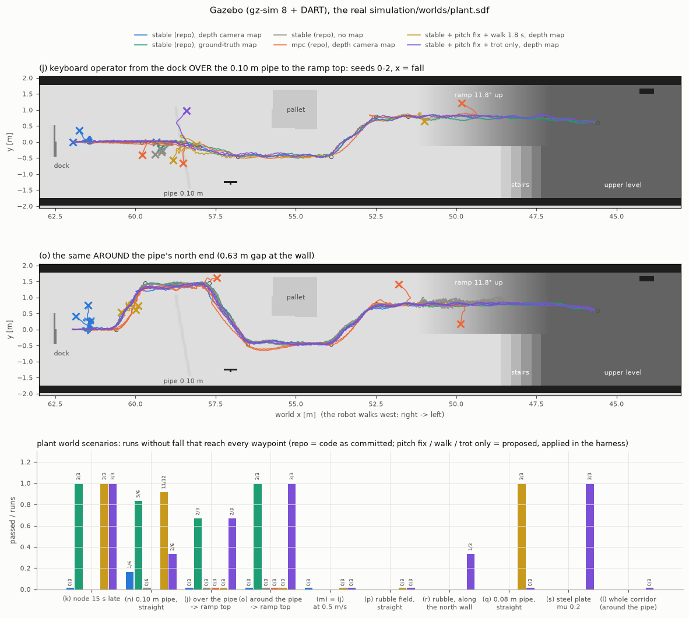

*그림 4-10. 위: (j) 배관을 넘는 경로, 가운데: (o) 배관을 돌아가는 경로(시드 0–2, x = 넘어짐). 아래: 시나리오·조건별 통과 수. 원자료: `gazebo_check.json`의 `plant_*`, `proposal_*` 블록.*

확인한 것:
1. **스폰과 시작 순서는 문제없다.** 다리를 편 채 스폰된 로봇은 제어기 없이 30 s 동안 바닥 위 0.544 m, 기울기 0°로 서 있고, 노드가
   15 s 늦게 떠도 정상 기립한다. 스폰 높이, 초기 관절 자세, launch 순서는 바꾸지 않았다.
2. **① 출발 직후 넘어짐 (제어기 버그, 깊이 맵에서만, 수정 반영).** 앞을 보는 깊이 카메라는 스폰 직후 몸 아래를 본 적이 없어 뒷발
   자리가 맵에서 비어 있다. 수정 전 `controller._terrain_pitch`는 빈 쌍의 높이를 측정 발 높이로 대신했는데, 스윙 중인 발이면 최대 7 cm
   떠 있어서 몸통 목표 pitch가 걸음마다 ±5–15° 흔들리고 로봇이 제자리에서 비틀거리다 넘어졌다. 지금 코드는 빈 높이를 지지발 기준 지면
   추정값 `ground_z`로 채우고, (k)가 0/3 → 3/3이 됐다. MPC 모드도 같은 함수를 쓴다.
3. **② 0.10 m 둥근 배관은 믿을 수 없다.** 한 걸음에 0.25–0.36 m를 건너야 하는데 스윙이 0.16 s(trot), 0.24 s(walk)로 짧아 서보가
   발 궤적을 따라가지 못하고, 발이 배관 위나 옆면에 내려앉아 미끄러진다. walk 주기를 1.8 s, 최고 속도를 0.15 m/s로 하면 곧게 넘기는
   11/12, 0.08 m 배관 3/3까지 좋아지지만, 배관을 밟은 채 방향을 고치거나 앞다리가 넘은 뒤 trot으로 돌아가면 여전히 넘어진다((j) 0/3).
4. **③ 4박자 walk는 돌 때 약하다.** 벽이나 배관 끝이 보이면 지형 분류가 walk를 고르는데, 그 상태에서 방향을 고치다 옆으로 넘어졌다
   ((o) 0/3). trot만 쓰면 같은 경로가 3/3이다. 그래서 보행 기본값을 trot 고정으로 바꿨다(§4.10.3).
5. **잔해(2–6 cm 블록)는 어느 설정으로도 통과하지 못했다.** 블록 모서리를 밟고 관절 토크가 한계에 닿으며 넘어진다. 복도 전체 (l)은
   세 시드 모두 여기서 멈췄다(웨이포인트 17개 중 11개). 잔해를 줄여 북쪽 통로를 남긴 뒤에는 (l) 3/3이다(§4.10.6).

권장 운전: 기본값 그대로(stable 모드, trot 고정, 속도 배율 0.5 = 0.25 m/s). `5`(auto)를 눌렀다면 `3`으로 돌아오고, 배율을 올렸다면
`-`로 낮춘다. C-OBS1은 북쪽 끝으로 돌아간다. 배관을 넘어야 하면 수직으로 다가가 `w`만 누르고 네 다리가 넘을 때까지 방향을 고치지
않는다. 잔해는 북쪽 통로로 지나간다(§4.10.6).

#### 4.10.5 한계

- 이 결과는 **Windows의 Harmonic(gz-sim 8)**이다. 사용자 환경의 Jetty(gz-sim 10)는 같은 DART 엔진이지만 직접 돌려 보지 못했다.
- 렌더링(카메라 영상, GUI)과 ROS 노드·브리지는 하네스에 없다. 깊이 카메라는 충돌체 광선 투사로 흉내 냈다(Gazebo는 visual 메시를
  렌더링한다). 렌더링 지연과 로봇 자신의 다리가 영상에 들어가는 효과는 빠져 있다.
- Harmonic의 JointStatePublisher는 URDF의 `<update_rate>`를 무시하고 1 kHz로 발행한다(플러그인 DLL에서 확인). Ubuntu에서
  `/joint_states`가 1 kHz면 브리지와 노드에 부하가 걸린다.
- 운전자 모델은 한 가지 방식이다. 0.10 m 배관 넘기, 잔해, walk 회전은 제어기 쪽 작업(장애물을 넘는 다리만 느린 스윙, 뒷다리가 넘을
  때까지 walk 유지, 배관 위 회전 제한)이 더 필요하다.
- MPC 모드의 결과는 MPC 풀이 지연에 좌우된다. 특히 경사로에서 평균 37–50 ms면 3/9로 떨어진다(§4.10.7). 하네스의 지연은 개발 PC에서
  잰 값이다.

#### 4.10.6 잔해 통로와 경로 지형 비용

잔해는 넘지 못하므로 월드와 경로 계획을 바꿨다. C-OBS3의 범위를 y −1.3~1.3에서 −1.3~0.5로 줄였다(블록 45개, 시드, 높이 그대로).
블록은 y 0.41까지라 북쪽 벽면(y 1.76)과 사이에 1.26 m 통로가 남는다. `plant.sdf`에서는 블록 45개의 y 자세(visual·collision 90줄)만
바뀌었고 내비 맵은 같다.

경로 계획기 세 곳(미션 관리자, 귀환, 순찰 계획기)은 `dusan_common/terrain_cost.py`의 지형 비용을 A*와 경로 다듬기에 더한다. 로봇 중심이
배관·잔해에서 0.12 m 안이면 칸마다 25, 철판 1, 낮은 단 2이고, 바깥 0.25 m 여유 폭에는 그 0.15배를 준다. 여유 폭은 0.25 m를 넘지
않는다(C-OBS1 북쪽 끝의 통과 띠가 약 0.3 m). 다듬기는 A* 경로보다 비싼 칸에 들어가는 지름길을 버린다. 비용이 유한하므로 돌아갈
길이 없는 C-OBS4 철판과 C-OBS5 배관은 그대로 지난다. 순찰 폐회로는 145.88 → 150.50 m(+3.2 %)가 되고, 지나는 잔해는 6개에서 2개로
줄었다(§5.3).

같은 하네스(stable 기본값, 깊이 맵, 키보드 운전 0.25 m/s)의 결과(`gazebo_check.json`의 `routes_final`, `routes_final_more`):

| 시나리오 | 결과 | 비고 |
|---|---|---|
| (o) 배관 북쪽 끝 우회 → 경사로 위 (재확인) | **3/3** | 74–78 s |
| (l) 복도 전체: 배관 우회 → 경사로 → 잔해 북쪽 통로 → 철판 → 0.08 m 배관 → 홀 문 | **3/3** | 188–194 s, 웨이포인트 17/17. 통로에서 최대 roll 4.5°, 배관 위 8.6° |
| (r) 잔해 1.6 m 앞에서 출발해 북쪽 통로로 | 2/3 (시드 3–5 추가 0/3) | 실패 4회 모두 잔해에 닿기 전, 출발 직후 벽 쪽으로 약 50° 꺾는 구간에서 넘어짐 |
| (p) 잔해 곧게 / (q) 0.08 m 배관 곧게 / (s) 철판 | 0/3 / 0/3 / 3/3 | 참고 |

복도 전체를 도크에서 홀 문까지 넘어지지 않고 간 것은 처음이다. (r)의 실패는 통로가 아니라 벽을 향해 걸으며 크게 도는 동작에서
생겼다(앞으로 거의 나가지 못하고 앞발 스윙 정점이 0.12 → 0.20 m로 커지며 지형 분류가 obstacle로 깜박임). (q)가 0/3인데 (l)에서
같은 배관을 3/3 넘은 것도 배관 넘기가 아직 믿을 수 없다는 뜻이다.

#### 4.10.7 MPC 모드 안정화와 최종 검증 (2026-10-26)

10-13 비교(§4.10.3)에서 MPC는 밀기 1/3, 정답 맵 배관 1/3이었고 plant 깊이 맵에서는 (j)(o) 0/3이었다. 같은 하네스로 MPC 모드를
세 차례 고쳤다. stable 모드 코드는 바꾸지 않았다. 1–3차 검증은 MPC 결과 지연을 30 ms로 고정했고(`--mpc-latency 0.03`),
최종 검증은 실측 지연으로 했다.

**차수별 변경** (값은 `config/locomotion.yaml`, 근거는 Gazebo 실행 기록)

| 차수 | 변경 | 원인 (Gazebo) |
|---|---|---|
| 1차 | 지지발 앵커를 측정 발에서 최대 2 cm로 제한(`mpc_stance_max_error`) | 서보가 앵커 오차를 수평 힘으로 바꾼다(발끝 약 4.5 kN/m). 미끄러진 발이 옛 앵커를 유지해 수백 N으로 끌려갔다. 실패한 실행은 모두 앵커 오차 p95 > 7 cm, 통과한 실행은 ≤ 3.3 cm |
| 1차 | 강건한 지형 기준(`mpc_terrain_robust`): 몸 밑 좌·중·우 세 줄 표본의 중앙값 높이, 앞뒤 열 중앙값의 Theil-Sen 기울기(모든 쌍 기울기의 중앙값) | 네 착지점만 쓰면 앞발 밑 0.10 m 배관이 12° 경사로가 되어 몸이 5 cm 들렸다가 0.15 s 안에 떨어졌다. 배관과 깊이 맵의 벽 모서리는 열의 약 2/9 이하라 무시된다 |
| 1차 | heading hold(`mpc_heading_hold_gain` 1.0 1/s, 최대 0.2 rad/s, 회전 명령이 없을 때만) | MPC 기준 yaw가 풀이마다 측정 yaw에 다시 고정되어 yaw 충격이 그대로 남았다. 회전 명령 없이 배관 구간 4 m에서 14–41°, hold 후 3° |
| 1차 | 스윙 가드(`swing_guard_clearance` 0.02 m), 리타깃 검사(`retarget_check_radius` 0.05 m, `retarget_jump_until` 0.3), 지지발 높이(`mpc_land_tau`, `mpc_contact_lift`, `mpc_contact_map_tol`) | 서보가 스윙 명령보다 약 30 ms 늦어 발이 배관 옆면에 300–450 N으로 박혔다. 배관 위에 내린 발이 계획 높이를 유지해 3–8 cm 눌렸고 50 ms 안에 몸이 넘어갔다 |
| 1차 | 횡방향 기준 혼합(`mpc_lateral_ref_blend` 0.5) | 회전 뒤 적분 목표가 몸의 바깥쪽 흐름(0.05–0.11 m/s)을 따라가 0.63 m 틈에 0.12 m 비켜 들어갔다. 0.5에서 ±0.03 m/s |
| 1차 | `kp_attitude` 0.5 → 0.0 | 약 30 ms MPC 지연에서 IMU P 보정이 IK roll을 최대 8.6° 키웠다. 0이면 0.08 m 배관 (f) 5/6(0.5는 2/6), 밀기 (i) 6/6(4/6) |
| 2차 | 지지 다리 수평 처짐 제한(`mpc_stance_rel_error` 0.02 m, 정적 처짐을 뺀 값) | 처짐 = 앵커 오차 2 cm + 몸통 목표 리드(측방 1.5 cm, yaw 약 1.3 cm, 전방 최대 6 cm). 최대 약 5 cm, 약 220 N으로 마찰 한계를 넘었다 |
| 3차 | 제자리 회전 피벗(`mpc_turn_pivot_x` −0.15 m, `mpc_turn_pivot_fade` 0.10 m/s) | C-OBS1 북쪽 틈 출구(파이프 끝과 벽 y 1.76 사이 0.63 m)에서 약 30° 제자리 좌회전 때 오른쪽 뒤 무릎이 벽에 걸려 끼거나 넘어졌다 |

- 피벗: 무릎이 뒤로 굽어 뒤 무릎이 원점에서 약 0.43 m 뒤에 있다. 원점 회전이면 뒤 무릎 회전 반경이 약 0.47 m다. 0.15 m 뒤를
  중심으로 돌면 뒤 무릎 약 0.33 m, 앞 몸통 모서리 약 0.46 m로 몸 전체가 원점 회전 원 안에 든다. MPC 명령에 vy = wz × 0.15 m를
  더해 구현했다. 병진 명령(원래 명령과 정형된 명령 중 큰 값)이 0.10 m/s에 이르면 0이 된다. 그래서 배관에 걸려 느려진 걸음에는
  적용되지 않는다.
- 3차 A/B(고정 30 ms, 깊이 맵, 같은 시드, 2차 코드는 `mpc_turn_pivot_x` 0으로 재현): (o) 2/6 → **6/6**, (l) 0/3 → **6/6**,
  (j) 3/6 → 3/6(낙하는 피벗이 꺼진 배관·경사로 직진 구간). a d e i f k q r s는 둘 다 3/3. 갭 출구만 떼어 낸 스크래치 출발점
  xa/xb/xc × 9시드는 15/27 → 21/27이다.
- MPC 토크를 관절에 바로 쓰는 선택형 토크 모드를 개발 중이다(진행 중, 결과 없음).

**최종 검증 명령** (맵 설정마다 한 번, 세 결과를 `mpc_final2` 한 라벨로 합침. 실측 지연이 부풀지 않게 동시 실행 약 10개)

```
python tools/gazebo_check.py --mode mpc --scenarios a b c d e i
python tools/gazebo_check.py --mode mpc --map --scenarios f g h
python tools/gazebo_check.py --mode mpc --map depth --scenarios j o k l s q r
python tools/gazebo_check.py --mode stable --map depth --label stable_regress2 --scenarios a e i k o j l s q r
```

**최종 결과** (`mpc_final2` 대 stable, 시드 0–2. stable의 b c d와 f g h는 이번에 다시 돌리지 않은 10-13 `stable`·`stable_map`)

| 시나리오 | 맵 | MPC | stable | 비고 |
|---|---|---|---|---|
| (a) 기립 / (b) trot / (c) crawl / (d) 회전 / (e) 텔레옵 60 s | 없음 | 각 3/3 | 각 3/3 | |
| (i) 10 N·s 밀기 세 번 | 없음 | **3/3** | 3/3 | 10-13 MPC 1/3 |
| (f) 0.08 m 배관 / (g) 11.8° 오르막 / (h) 내리막 | 정답 | 각 3/3 | 각 3/3 | 10-13 MPC (f) 1/3 |
| (k) 노드 15 s 늦게 시작 / (s) 철판 μ 0.2 | 깊이 | 3/3 · 3/3 | 3/3 · 3/3 | |
| (q) 0.08 m 배관 곧게 | 깊이 | **3/3** | 0/3 | MPC가 나음 |
| (r) 잔해 북쪽 통로 | 깊이 | **3/3** | 2/3 | MPC가 나음 |
| (o) 배관 우회 → 경사로 위 | 깊이 | 2/3 | **3/3** | MPC s1: 경사로 x 48.5(68 s) |
| (l) 복도 전체 | 깊이 | 1/3 | **3/3** | MPC s0: 경사로 x 48.8(69 s), s1: C-OBS5 0.08 m 배관 x 21.7(192 s) |
| (j) 배관 넘어 → 경사로 위 | 깊이 | 1/3 | **2/3** | MPC s1: 경사로 x 48.2, s2: C-OBS1 배관 x 58.1(복구 후 완주, 넘어짐이라 실패). stable s1: 배관 x 58.4 |

- 합계: 평지·정답 맵 MPC 27/27, stable 27/27. plant 깊이 맵 MPC 16/21, stable 16/21.
- 갭 출구에서는 넘어짐이 0회였다. 남은 낙하는 경사로 3회, C-OBS1 배관 1회, C-OBS5 배관 1회다.
- `stable_regress2`는 `final_default`·`routes_final`과 33회 실행 모두 통과 여부, 도착 시간, 진행 거리까지 같았다. stable 퇴행은 없다.
- MPC 실측 지연(동시 실행 10개): 중앙값 22–25 ms, p95 30–35 ms, 최대 45–118 ms.
- 장애물 회피 미션(§7.8.3)에서 MPC는 r t u v w x z 21/21로 stable과 같고, 45 m 경로 y는 0/3(stable 3/3)이다.

**경사로 약점** (11.8°, 경사로 x 51.2 → 47.0). 공식 실행에서 경사로를 오른 8회 중 3회(j s1, o s1, l s0)가 x 48.2–48.8에서
넘어졌다. 경사로만 떼어 출발점 3곳 × 시드 3개로 진단했다(스크래치 실행, 깊이 맵).

| 조건 | 결과 |
|---|---|
| 실측 지연, 부하 낮음 (평균 18–28 ms) | 9/9 |
| 고정 30 ms | 8/9 |
| 실측 지연, 부하 높음 (평균 37–50 ms, p95 45–85 ms) | 3/9 |
| 고정 30 ms + 정답 맵 | 9/9 |
| 고정 30 ms + `kp_attitude` 0.5 | 2/9 |
| 고정 30 ms + `mpc_stance_rel_error` 0 | 8/9 (효과 없음) |

넘어지는 과정은 이렇다. 경사면에서 뒤 스윙발이 제때 내려오지 못한다(명령보다 8–10 cm 높음, IK 도달 불가 틱, 고관절 외전 약
0.57 rad). 대각 지지 한쪽이 비고 앞 지지발 하나에 약 175 N이 걸린다. 몸이 들리며 뒤로 젖혀지거나(pitch −14° → −38°), 그 전에
옆으로 최대 1.1 m/s 미끄러지다 roll이 커져 넘어진다. 지연이 길수록 잦고, 정답 맵에서는 9/9라 깊이 맵 품질도 영향을 준다.
`kp_attitude` 0.5가 2/9로 더 나빠 0.0이 맞다는 것도 확인했다.

해결 후보(미검증): 지연 보상(예측 상태에서 MPC 시작), 경사에서 스윙 타이밍과 착지 보장(늦은 착지 때 지지 전환 지연), 경사를
인식하면 속도 제한. 스크래치 경사로 시나리오를 그대로 회귀 시험으로 쓸 수 있다.

**결론.** 기본값은 stable로 둔다. MPC는 q(0.08 m 배관 곧게)와 r(잔해 통로)에서 stable보다 낫지만, 경사로가 있는 o·l·j와
45 m 경로 y에서 낮아 "모든 시나리오에서 stable 이상" 조건을 채우지 못했다. 벽에 더 붙어 출발하는 갭 출구(스크래치 xb)도
MPC 5/9, stable 8/9로 남았다. MPC 지연은 개발 PC에서 Gazebo 10개를 동시에 돌린 조건이라, 실제 로봇 PC에서는 경사로 결과가
달라질 수 있다. MPC를 쓰려면 `/locomotion/state`의 `mpc_solve_ms`가 30 ms를 넘지 않는지 확인한다.

#### 4.10.8 데모 미션 전체 (`tools/mission_check.py`, 2026-11-11)

같은 하네스에 미션에 참여하는 노드의 실제 코드(미션 관리자, 순찰 계획기, 가스 확산·탐색기, 배터리, 통신, 귀환, cmd_vel 먹스)를
ROS 없이 연결해, 도크 출발 → 계기판 8개 → 가스 누출원 탐색 → 귀환·도킹을 끝까지 돌렸다. 계기판 판독기는 정답 자세의 가시성으로
대신했다. 완료 = DOCKED + 계기판 8/8 + 누출원 FOUND + 순간이동 0.

이전 코드(시드 0–4)는 1/5만 완료했고 32번 넘어졌다(실행당 6.4회). 넘어진 곳은 C-OBS5 배관 18회, 가스 탐색 중 F-OBS5 잔해 10회,
도크 출발 2회, F-OBS3 배관 끝(칸막이 출입구) 2회였다. 원인과 수정은 아래와 같다.

| 위치 | 원인 | 수정 |
|---|---|---|
| C-OBS5 (0.08 m, 복도를 가로지름) | A* 경로가 배관 앞뒤에서 40–45° 꺾여 발이 배관 옆일 때 돌았다. 곧게 건너도 0.16 s 스윙의 0.3 m 걸음이 서보 지연으로 배관 위에 내려섰고, 스윙 중 foothold 선택이 배관 반대편으로 바뀌면 1.5 cm/주기로 옮겨 가다 배관 위에서 스윙이 끝났다 | 건너는 구간을 배관에 직각인 직선으로 계획하고 배관 앞에서 먼저 방향을 맞춘 뒤 0.25 m/s, 옆걸음·회전 없이 건넘(`dusan_common/debris_crossing.py`). 범프 근처 trot 주기 0.5 s, 스윙 후반 foothold 점프 무시, 장애물 스윙은 수평 이동을 앞당기고 늦게 내림 |
| F-OBS5 잔해 | 가스 탐색기는 지도에서 잔해를 빈 곳으로 보고 곧장 가로질렀다. 탐색이 시간 초과된 두 시드는 두 번째 탐색이 통신 음영 귀환을 일으켜 계기판 3개에서 끝났다 | 탐색기 지도에 잔해·배관을 장애물로 넣음(`debris_blocked_kinds`). 막으면 통로가 끊기는 배관은 그대로 둠 |
| 도크 출발 | 카메라가 아직 몸 아래·뒤를 보지 못해 foothold planner가 뒷발을 보이는 셀로 0.16 m 앞으로 당겼다 | 맵에 없는 착지 셀은 공칭 착지점 유지(`foothold_keep_unseen`) |
| F-OBS3 끝 | 배관 끝을 돌아 문으로 들어가며 0.6 m에 약 100°를 0.37 m/s, 0.6 rad/s로 꺾었다 | 건너지 않는 배관 0.45 m 안에서는 같은 곡선을 0.25 m/s, 0.35 rad/s 이하로 감 |

결과(Harmonic, 시드마다 스폰·명령 시각이 조금 다름):

| | 완료 | 넘어짐 | 순간이동 | 미션 시간 |
|---|---|---|---|---|
| 이전, 시드 0–4 | 1/5 | 32 (6.4/회) | 0 | 841 s (완료 1회) |
| **이후, 시드 0–4** | **5/5** | **3 (0.6/회)** | 0 | 평균 616 s |
| 이후, 시드 5–9 | 4/5 | 6 (1.2/회) | 0 | 평균 634 s |

- 완료한 실행은 모두 계기판 8/8, 누출원 FOUND였다. 미완료 1회(시드 8)는 C-OBS5를 건너다 배관 위에 등을 대고 누워 240 s 동안
  일어나지 못했다(등 굴리기가 배관을 받침점 삼아 제자리로 돌아옴).
- 남은 넘어짐 9회: C-OBS5 5회(가는 서쪽 2, 돌아오는 동쪽 3), F-OBS3 3회(그중 1회는 탐색 중 출입구), 누출원 옆 탐색 중
  제자리 회전 1회. 시드 8을 빼고 모두 다시 일어나 미션을 이어 갔다. C-OBS5는 19번 건너 14번 넘어지지 않았다(이전 10번 중 1번).
- 회귀: 지도에 없는 박스(`tools/obstacle_check.py`) 21/21로 이전과 같다. 키보드 운전 시나리오(`tools/gazebo_check.py`, 깊이 맵,
  시드 0·1)는 15/20(이전 16/20)이다. 잔해 통로 r과 0.08 m 배관 곧게 q는 좋아졌고, 텔레옵으로 배관을 곧게 넘는 j(1/2 → 0/2)와
  복도 전체 l(2/2 → 0/2)은 나빠졌다. 미션은 이 동작(배관을 비스듬히, 방향을 고치며 넘기)을 쓰지 않는다. 상세: module1 README §4.10.

**추가 개선 (2026-11-12).** 배관 위에 누운 자세 빠져나오기(SLIDE, §4.4), 배관을 경사로로 읽지 않는 지형 pitch, 가스 탐색 스텝의
배관 건너기 governor를 넣었다. 몸통 pitch 목표가 공칭 착지점 한 점의 맵 높이를 쓰던 탓에, 앞 착지점 두 곳이 C-OBS5 위에 오면 10°
오르막으로 읽어 몸통이 17°까지 들렸고 앞발 하나가 지지 구간에 허공에 떠 옆으로 넘어졌다. 이제 착지점 앞뒤 ±0.12 m 맵 높이의
하위 20 %를 지지 높이로 쓴다(`stable_terrain_pitch_window`). 탐색기는 칸막이 출입구의 F-OBS3 위에서 0.8 rad/s로 돌다 넘어졌는데,
순찰과 같은 governor(배관 앞에서 직각 정렬, 넘는 동안 0.25 m/s 직진)를 거치게 했다.

| 전체 미션, 시드 10–14 | 완료 | 넘어짐 | 탐색 중 넘어짐 | 순간이동 | 미션 시간 |
|---|---|---|---|---|---|
| 이전 | 4/5 | 6 (1.2/회) | 4 | 0 | 평균 633 s |
| **이후** | **5/5** | **2 (0.4/회)** | **0** | 0 | 평균 573 s |

- 이후 결과는 `docs/results/mission_check.json`에 있다. 남은 넘어짐 2회(시드 13)는 C-OBS5 건너기 1회와 순찰 중 F-OBS3 끝 1회이고,
  둘 다 스스로 일어나 미션을 이어 갔다. 완료한 실행은 모두 계기판 8/8, 누출원 FOUND, 도킹이었다.
- C-OBS5 구간 실행(방향마다 시드 20개, 깊이 10 Hz): 넘어지지 않고 통과 서쪽 7/10·동쪽 5/10(넘어진 건너기 40 %) → 서쪽 16/20·동쪽
  16/20(20 %). 건너기 속도를 0.15 m/s로 낮추거나 crawl로 건너면 나아지지 않았다(9/20, 12/20).
- 회귀: 키보드 운전 시나리오(`tools/gazebo_check.py`, 깊이 맵, 시드 0) 9/10(이전 8/10), 지도에 없는 박스(`tools/obstacle_check.py`)
  21/21(이전과 같음), 넘어짐 복구 11개 케이스 × 시드 10–12 33/33.

## 5. Module 2 — Inspection AI

상세: [module2_inspection/README.md](../module2_inspection/README.md), [THERMAL_PATROL.md](../module2_inspection/THERMAL_PATROL.md).

### 5.1 아날로그 게이지 판독

#### 5.1.1 파이프라인

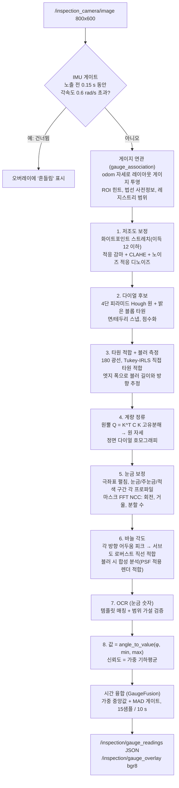

- **다이얼 정의** (`dusan_common.gauge_design`): 최솟값 225°, 최댓값 −45°, 시계방향 270°, 6시 방향에 90° 간격, 마지막 15 %가 적색 구간. 같은 정의로 Gazebo 텍스처를 만들고 판독기를 보정한다.
- **원 자세 복원**: 시선 원뿔 $Q=K^TCK$의 고유값 $l_1\ge l_2>0>l_3$에서 원을 자르는 평면 법선은 고유기저에서 $(\sqrt{l_1-l_2},0,\pm\sqrt{l_2-l_3})$이다. 두 해 중 하나는 자세로 예측한 다이얼 법선이나 허브 검사로 고른다. 이렇게 40° 경사에서도 정면 다이얼로 정류한다.
- **눈금 보정**: 어두움 맵 $D=(I_{face}-I)/(I_{face}-I_{ink})$에 각도별 면 기준을 써서 조명 기울기와 글레어를 제거한다. 가려진 섹터는 마스크한다. 마스크 FFT NCC(Padfield 2012)의 피크로 회전, 적색 구간 방향으로 거울 여부, 최적 템플릿으로 주눈금 분할 수를 정한다. NCC가 낮으면 둥근 방해물(표지판, 조명)로 보고 거부한다.
- **바늘**: 허브, 꼬리, 숫자, 하단 간격을 피한 고리(0.09~0.22)의 각 방향 어두움 피크로 거친 각도를 잡는다. 반경별 어두움 중심에 Tukey 직선을 적합해 정밀 각도를 얻는다. 블러가 2.5 px를 넘으면 바늘 없는 다이얼과 바늘 다각형을 추정 PSF(L 길이 모션 커널과 가우시안의 합성곱)로 흐려서 $O\approx a+bS-cB(\theta)$를 적합한다.
- **시간 융합**: 가중 중앙값 $m$을 구하고 $|v-m|\le3\max(1.4826\,\mathrm{MAD},0.004\,FS)$ 게이트를 통과한 값의 신뢰도 가중 평균을 낸다. 시뮬레이션 리셋(시계 역행) 시 이력을 지운다.

#### 5.1.2 OCR

라벨은 `cv2.FONT_HERSHEY_SIMPLEX`로 찍힌다. 그런데 Gazebo 텍스처는 Windows의 OpenCV 5(TrueType 렌더)로 만들고 판독은 Ubuntu의 OpenCV 4.x(고전 Hershey 획)로 한다. 그래서 템플릿 뱅크에 세 가지 소스를 넣었다: 런타임 `putText` 글리프, 공개 Hershey 획 글리프(굵기 3종), 내장 OpenCV-5 숫자 비트맵.

- **문자 경로** (라벨 7 px 이상): 주눈금마다 패치를 정립해 분할한 뒤 글리프 NCC를 계산한다. RANSAC으로 $label_k=v_{min}+k\cdot step$를 적합하고, 그 step이 범위에 맞는 표준 주눈금 간격인지 확인한다.
- **가설 경로** (라벨 4 px 이상): 표준 범위(EN 837-1 계열)마다 라벨을 렌더링해 상관을 본다(합성 분석). 바늘에 가린 최악 라벨 하나는 제외한다.
- 운용 원칙: 자세로 ID가 정해진 게이지는 레지스트리 범위를 쓰고, OCR은 교차 확인용이다(불일치하면 `registry(ocr_disagrees)`로 경고). ID를 모르는 다이얼만 OCR 범위로 읽는다.

#### 5.1.3 흔들림·저조도 대응 요약

| 제약 | 대응 |
|---|---|
| 카메라 흔들림 / 선회 | IMU 게이트(0.6 rad/s), 미션의 4 s 정지 판독(dwell), 블러 길이·방향 추정, 블러 3 px 초과 시 50 % 레벨 교차로 재적합, 블러 반경 비율 0.35 초과 시 거부, PSF 합성 바늘 적합, 시간 융합(MAD) |
| 저조도 | 화이트포인트 스트레치, 적응 감마(밝기 평균을 0.42로), LAB L채널 CLAHE, Immerkær 노이즈 추정 기반 디노이즈. 측광 측정은 선형 스트레치 영상에서 수행 |
| 경사 시야 | 원뿔 기반 계량 정류(최대 약 40°), 자세 법선 사전정보 |
| 오인식 방지 | NCC 하한, 면 대비 하한, 신뢰도 0.3 미만 거부. 판독이 어려운 프레임은 추정하지 않고 거부함 |
| CPU 예산 (Gazebo와 공존) | 예측 ROI 우선 탐색, 전체 프레임 탐색은 자세 없음 / 대상 미발견 시에만(최소 0.5 s 간격, 평소 2 s), 처리 5 Hz(대기 중 2 Hz), OpenCV 2스레드 |

#### 5.1.4 결과 (`tools/eval_gauge.py`, 합성 영상 800프레임, 15 worker)

필수 조건 격자는 조건마다 80프레임씩 6개 조건, 거리 0.9~2.5 m, 레이아웃 게이지 8개(실제 범위·단위)다. 레지스트리 범위를 알고, ROI 사전정보 없이 전체 프레임을 탐색하는 모드로 평가했다.

| 조건 | 검출 | 평균 %FS | 중앙값 | p95 | 최대 | OCR 범위 판독률 |
|---|---|---|---|---|---|---|
| normal | 80/80 | 0.018 | 0.012 | 0.048 | 0.097 | 48.8 % |
| low light (조도 0.1~0.3, 감마 1~1.6) | 80/80 | 0.109 | 0.077 | 0.371 | 0.446 | 18.8 % |
| motion blur (4~15 px) | 80/80 | 0.283 | 0.169 | 0.759 | 2.224 | 3.8 % |
| oblique (25~42°) | 80/80 | 0.027 | 0.018 | 0.080 | 0.200 | 38.8 % |
| noise (σ 6~14 + 샷 노이즈, JPEG) | 80/80 | 0.046 | 0.025 | 0.140 | 0.234 | 38.8 % |
| combined (어둠 + 블러 + 노이즈 + 경사) | 80/80 | 0.185 | 0.138 | 0.495 | 0.792 | 0.0 % |
| **필수 격자 전체 (480)** | **100 %** | **0.111** | **0.046** | **0.401** | **2.224** | — |
| occluded (추가 60) | 59/60 | 0.051 | 0.014 | 0.104 | 1.559 | 45.0 % |

- 목표 평균 2 %FS 미만, p95 5 %FS 미만을 **모두 충족**. RMSE 0.223 %FS. 2 %FS 이내 99.79 %, 5 %FS 이내 **100 %**.
- 가림 포함 540프레임: 검출 99.81 %, 평균 0.105 %FS, p95 0.399 %FS.
- 오검출: 둥근 방해물이 있는 배경 60프레임에서 **0건**.
- OCR(범위 모름): 540개 중 146개 판독, 145개 정답(정밀도 0.993). 오류 1건은 5 px 라벨에서 0–25를 0–2.5로 읽은 것이다. 라벨 높이가 7.8 mm라서 0.9~1.1 m에서 6.6 px(판독률 64.4 %), 1.8 m를 넘으면 3.4 px 이하(0 %)가 된다. 이것이 레지스트리 범위를 우선하는 이유다.
- 운용 범위(스윕): 조도 0.05배까지 100 % 판독, 0.035배·0.025배에서 70 %, 0.018배에서 30 %. 모션 블러 12 px까지 100 %, 18 px까지 90 % 이상, 22 px 60 %, 35 px 30 %. **스윕 전체에서 채택된 판독의 최대 오차는 4.39 %FS**이고, 5 %FS를 넘은 채택 판독은 없었다(어려운 프레임은 거부됨).
- 지연(순차 처리, 개발 PC): 전체 프레임 중앙값 155 ms(p90 190 ms), 자세 힌트 ROI 중앙값 81 ms(p90 101 ms).
- 파이프라인 예: G04, 정답 18.5 bar, 판독 18.495 bar, 오차 0.020 %FS, 신뢰도 0.93.

| 조건별 오차 | 예시 (조건당 2장, 원본 + 오버레이) |
|---|---|
| 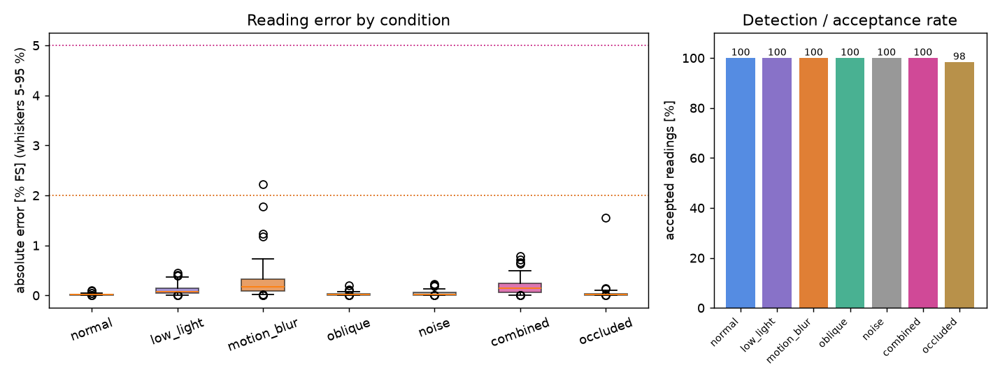 | 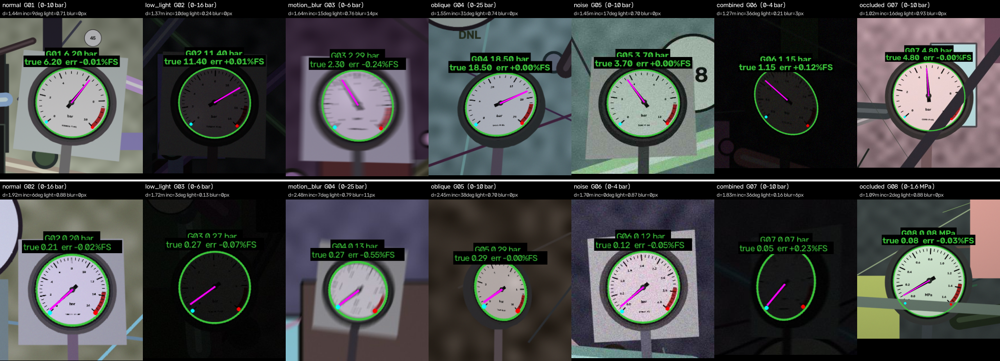 |
| 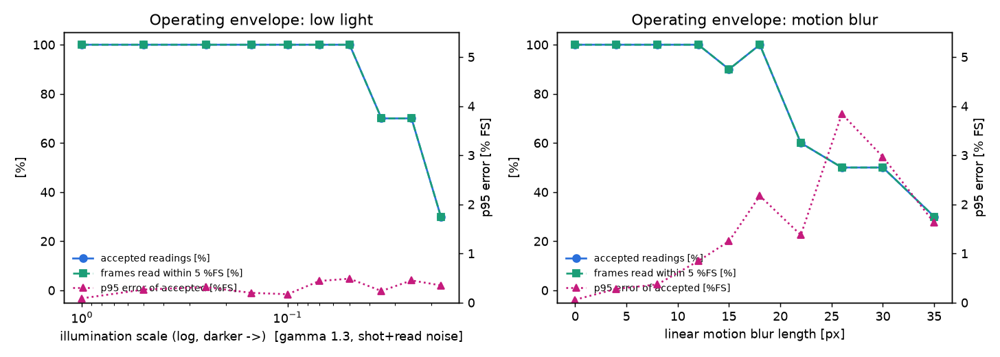 | 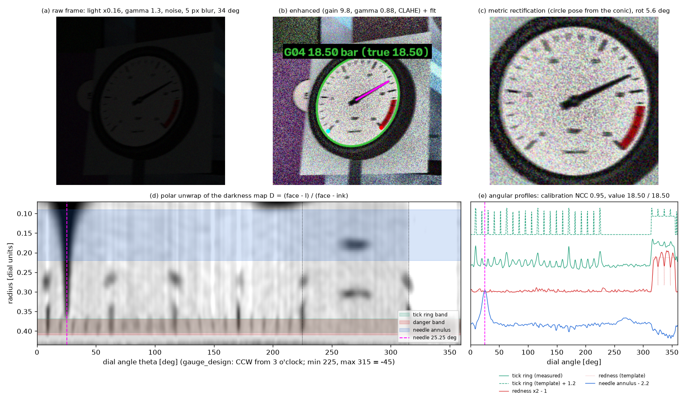 |
| 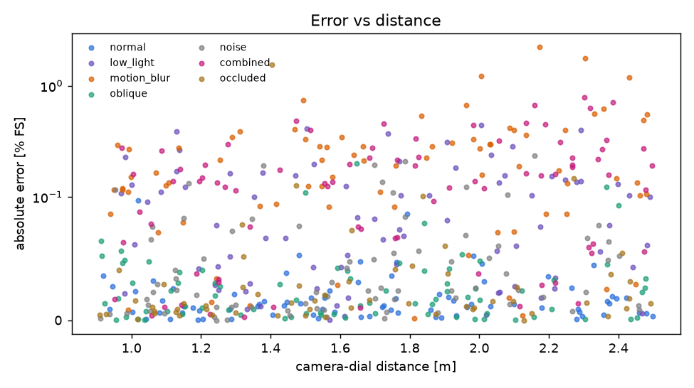 | 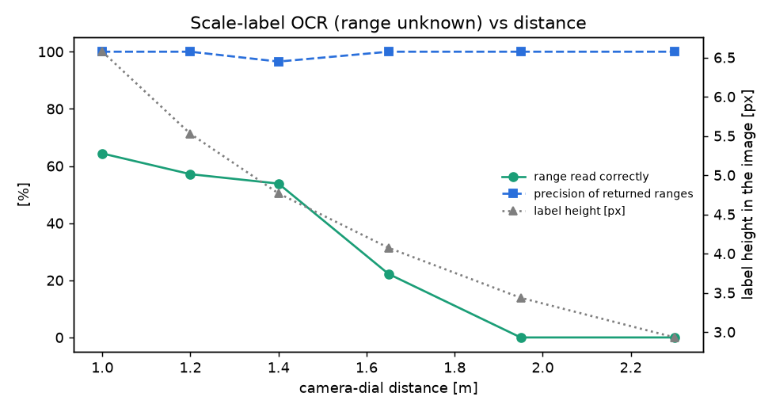 |

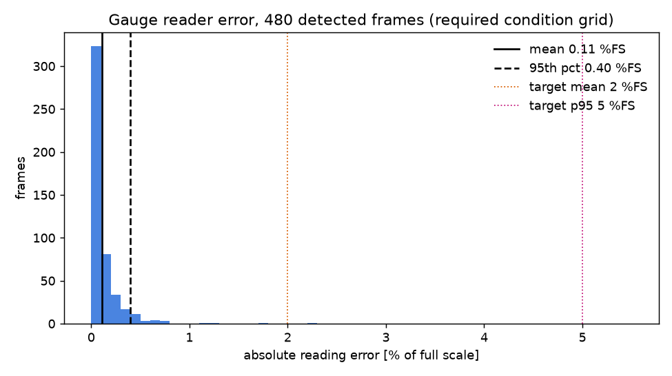

*그림 5-1. 게이지 판독 평가: 조건별 오차, 예시 프레임, 조도·블러 스윕, 파이프라인 중간 결과(보정 → 타원 → 정류 → 극좌표 → 각 프로파일), 거리별 오차·OCR 판독률, 오차 히스토그램.*

#### 5.1.5 Gazebo 렌더 프레임 판독

합성 영상 대신 Gazebo가 그린 영상으로도 확인했다. `plant.sdf`에 순찰 뷰포인트의 점검 카메라 자세로 고정 카메라를 두고 Gazebo Harmonic
센서 렌더링(ogre2, 월드 조명·그림자 포함)으로 프레임을 받았다. 시점은 게이지마다 정위치 1개와 미션 허용 오차 안의 흔들림
9개(위치 ±0.15 m, yaw ±0.10 rad, roll·pitch ±2°, 높이 ±2 cm)다. 거리는 1.25–1.81 m, 입사각은 29° 이하다. 프레임은 실제 `gauge_reader` 노드
코드(rclpy 스텁)에 오도메트리 자세와 함께 한 장씩 넣었다(시간 융합 없음).

| 프레임 | 장수 | 검출 | 평균 %FS | p95 | 최대 | 상태 정답 |
|---|---|---|---|---|---|---|
| 800×600 (기본) | 80 | 80/80 | 0.015 | 0.030 | 0.043 | 80/80 |
| 640×480 렌더 (저메모리 프로필 해상도) | 80 | 80/80 | 0.017 | 0.040 | 0.049 | 80/80 |
| 640×480, 그림자 끔 (저메모리 프로필 그대로) | 40 | 40/40 | 0.018 (중앙값 0.015) | 0.035 | 0.040 | 40/40 |

- 자세 힌트 없이(전체 프레임 탐색) 읽어도 800×600 80/80, 평균 0.015 %FS로 같았다.
- 뷰포인트보다 먼 2.5–6.1 m에서는 51장 중 48장을 읽었고 최대 오차는 0.26 %FS였다.
- 걷는 로봇의 흔들림, 카메라 노이즈, ROS 전송은 들어 있지 않다. 이 조건은 §5.1.4의 합성 영상 평가와 미션의 4 s 정지 판독이 맡는다.

> [!NOTE]
> 벤치마크 영상은 판독기가 보정하는 것과 같은 다이얼 디자인을 렌더링한다. 디지털 트윈에서는 이것이 실제 상황이다. 다만 Gazebo의 PBR 셰이딩, 로봇 그림자, 텍스처 필터링 차이는 측광 열화(기울기, 글레어, 감마, 블러, 노이즈)로만 근사했다. Gazebo 실측 오차는 이보다 클 수 있으므로 §8.4 표 8-2에 기록한다.

### 5.2 열화상 + 실화상 퓨전

#### 5.2.1 호모그래피 유도

두 카메라 모두 pitch −0.30 rad(위로 17.2°)다. 열화상 광학 프레임에서 본 RGB 광학 프레임의 상대 자세는 $R=I$, $t=(0.05,0,0)$ m로, 수평 기선 5 cm다. 열화상 광학 프레임의 평면 $n^TX+d=0$ 위의 점은 $-n^TX/d=1$을 만족한다.

$$
X_{rgb}=RX+t\left(-\frac{n^TX}{d}\right)=\left(R-\frac{t\,n^T}{d}\right)X
\quad\Rightarrow\quad
H=K_{rgb}\left(R-\frac{t\,n^T}{d}\right)K_{th}^{-1},\qquad x_{rgb}\sim Hx_{th}
$$

깊이 $Z$인 점을 깊이 $d$의 평면으로 사상할 때 시차 오차는 수평 방향으로만 생긴다(에피폴이 무한대에 있음).

$$
e=f_{rgb}\,b\left|\frac{1}{Z}-\frac{1}{d}\right|=41.4\ \text{px}\cdot\left|\frac{1}{Z}-\frac{1}{d}\right|\qquad(f_{rgb}=828.06\ \text{px},\ b=0.05\ \text{m})
$$

**평면 선택**은 다음 우선순위를 따른다. ① 레이아웃 열점과 연관된 가장 뜨거운 블롭을 지나는 평면(열점에서 정확). ② 시야 안 레이아웃 열 객체의 가중 중앙값 깊이(수직 평면). ③ 자세가 없으면 2 m. DESIGN_SPEC의 "깊이 영상 중앙값"은 쓰지 않았다. 깊이 카메라는 0.6 rad 아래(지형), 열화상은 0.3 rad 위(배관·기계)를 보므로 시야가 거의 겹치지 않아 중앙값이 바닥 깊이가 되기 때문이다. 레이아웃 연관이 된 검출에는 **각자의 평면**으로 계산한 호모그래피를 박스와 피크 마커에 적용한다.

**ECC 미세 정합**: 소벨 엣지 영상끼리 정렬한다(열화상과 가시광 강도는 무관하지만 윤곽은 일치함). 변환은 병진만 쓰고 에피폴라 제약으로 수평 성분만 남긴다. 상관 0.2 이상, 이동 30 px 이하, 수직 8 px 이하일 때만 채택한다. 평면이 이미 열점을 지나면 ECC를 건너뛴다(정확한 평면에는 노이즈만 더함).

#### 5.2.2 검출·위치추정·시각화

1. L16 → Kelvin 변환(`mono16`, `16UC1`, `L16`, `mono8`, `32FC1` 모두 처리). 값이 0인 픽셀은 무효로 본다.
2. $T\ge$ 경고 온도로 분할하고 8-연결 성분을 구한다. 블롭마다 최대·평균 온도, 온도 가중 중심, 박스를 계산한다.
3. 블롭 중심을 지나는 광선을 레이아웃 열점과 비교한다. 거리 $< 0.3 + 0.04s +$ 크기이면 ID를 부여한다. 30 m 밖은 후보에서 제외한다(먼 거리에서는 허용 오차가 플랜지 간격 3 m에 가까워져 잘못된 ID가 붙을 수 있음).
4. 시간 확인: 연속 3프레임에서 검출돼야 발행한다(1프레임 누락은 허용).
5. 시야 안에 있는데 경고 온도 미만인 레이아웃 열점은 ROI에서 재서 `normal`로 보고한다(8 m 이내).
6. 시각화(`/inspection/thermal_fusion`): INFERNO 컬러맵(20~120 °C 고정)을 따뜻한 영역에만 알파 블렌딩한다. 경고·경보 등온선, `H02 99.1C ALARM` 같은 라벨 박스, 온도 스케일 바를 그린다.

**합성 열화상 카메라** (`synthetic_thermal.py`, `thermal_source:=synthetic`): GPU 열화상 센서를 쓸 수 없을 때의 대체품이자 벤치마크 영상 소스다. 출력 계약은 Gazebo 센서와 같다(320×240, mono16, K×100, 5 Hz). 벽·바닥·박스는 해석적 광선 투사, 배관·플랜지·베어링은 z-버퍼 스플래팅으로 그린다. 전도·복사 헤일로, 방향 방사율, NETD 0.05 K 노이즈, 열 고정 패턴 노이즈, PSF를 모델링했다.

#### 5.2.3 결과 (`tools/eval_thermal.py`)

로봇 자세 150개(열점에서 1.2~7 m 거리 120개 + 무작위 음성 30개), 자세당 3프레임, 센서 조건 3가지로 평가했다.

| 센서 조건 | 정밀도 | 재현율 | F1 | ID 정확도 | 최고온도 오차 중앙값 / p95 | 상태 정확도 | 음성 프레임 오경보 |
|---|---|---|---|---|---|---|---|
| nominal (NETD 0.05 K) | 1.000 | 0.9845 (TP 127, FN 2) | 0.9922 | 1.000 | 0.14 / 4.07 K | 1.000 | 0 % |
| noisy (NETD 0.4 K, 열 FPN 0.3 K) | 1.000 | 0.9845 | 0.9922 | 1.000 | 1.072 / 3.485 K | 1.000 | 0 % |
| defocused (PSF σ 1.6 px) | 1.000 | 0.9612 단일 / 0.9535 3프레임 확인 | 0.9802 | 1.000 | 0.749 / 11.128 K | 1.000 | 0 % |

- 열점별(nominal): H02 37/37, H03 35/37, H04 30/30, H05 25/25. 놓친 2건은 H03(68 °C, 경고 기준보다 8 K 높음)이 10~19 픽셀만 보인 경우로, PSF 때문에 임계 아래로 내려갔다. 대상 열점의 재현율은 거리 구간(1~7 m) 전체에서 1.0이다.
- 경고 미만 열점(H01, 45 °C)이 보일 때 ROI에서 `normal`로 보고된 비율은 81.8 %(27/33)다.
- 최고온도 오차가 큰 곳은 얇은 플랜지 H02(폭 0.10 m)를 비스듬히 본 경우다. 측정 스폿이 PSF보다 작아지는 열화상의 일반적인 한계이고, 디포커스에서 가장 나쁘다.

**정합 오차** (열점 표면점 45,146개, RGB 픽셀):

| 깊이 전략 | 중앙값 | p95 |
|---|---|---|
| 고정 2 m 정면 평면 | 8.20 | 17.19 |
| 레이아웃 중앙값 (수직 평면) | 1.04 | 15.32 |
| 레이아웃 중앙값 + ECC | 2.40 | 8.50 |
| 매칭 열점을 지나는 평면 | 0.59 | 20.23 |
| 파이프라인 오버레이 | 0.68 | 20.22 |
| **검출별 평면 (박스·피크)** | **0.645** | **5.451** |

고정 평면의 측정 오차는 이론 곡선 $41.4\,\text{px}\,|1/Z-1/d|$와 일치한다(그림 5-2 thermal_registration). 이것이 호모그래피 유도가 맞다는 근거다. 단일 평면의 p95가 큰 것은 같은 프레임 안에서 깊이가 다른 *다른* 열점 때문이다. 그래서 박스에는 검출별 평면을 쓴다. ECC는 150회 중 128회(85.3 %) 채택됐다. 처리 시간: 합성 열화상 렌더 중앙값 40.1 ms, 퓨전 중앙값 2.0 ms(p95 36.8 ms). 5 Hz 예산(200 ms) 안이다.

| 열점별 열화상 / RGB / 퓨전 | 퓨전 예시 (H04 경보) |
|---|---|
| 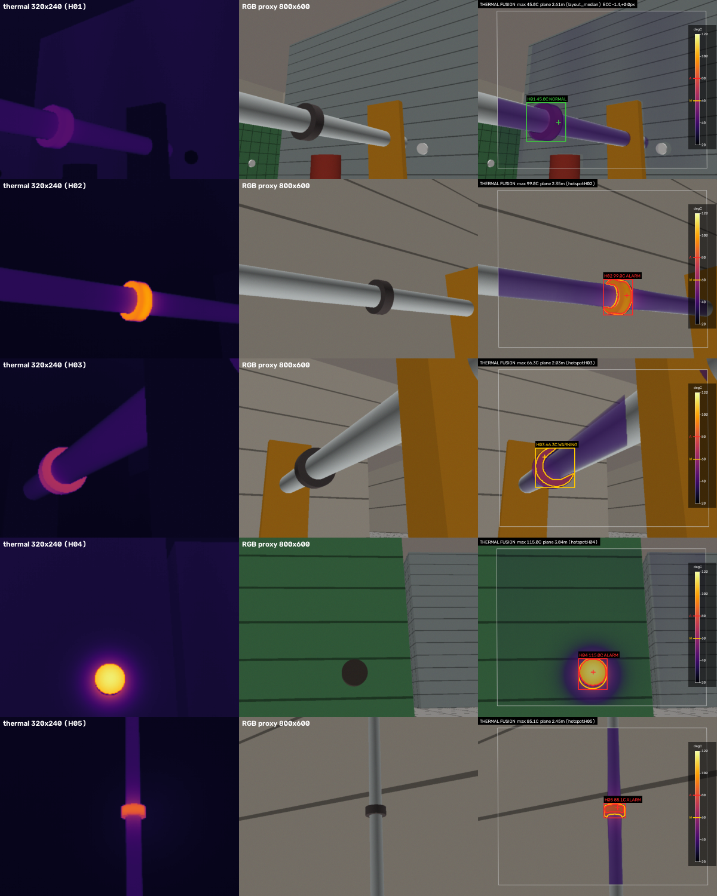 | 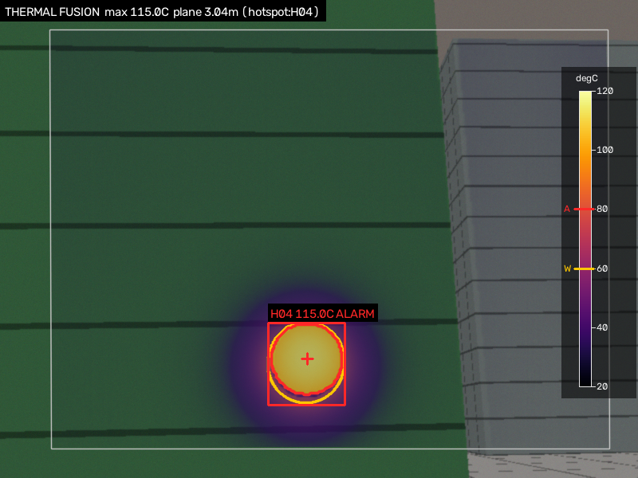 |
| 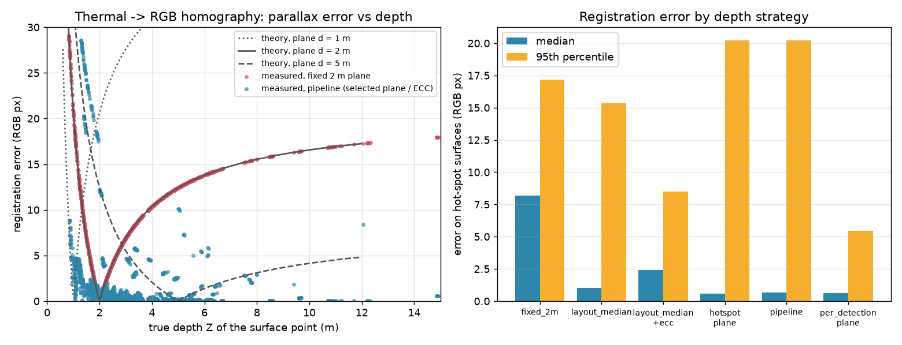 |  |

*그림 5-2. 열화상 퓨전. H04 베어링 115.0 °C 경보, 평면은 H04를 지나는 3.04 m. 정합 오차 대 이론 곡선, 검출 성능.*

### 5.3 Viewpoint 기반 최적 순찰 경로

#### 5.3.1 후보와 판독성 점수

게이지마다(중심 $g$, 법선 $n$, 다이얼 0.30 m) 카메라-다이얼 수평 거리 $r=0.9\ldots2.2$ m(0.1 m 간격)와 법선 기준 방위 $\varphi=-40\ldots+40°$(5° 간격)로 후보 14 × 17 = **238개**를 만든다. 카메라는 base보다 0.30 m 앞에 있다. 카메라 높이는 바닥 높이를 따라간다(복도 하층 −0.88 m).

**필수 조건**(하나라도 어기면 점수 0): 로봇 반지름 0.30 m로 자유, 도크와 연결된 자유 공간, 2-D 맵 위 가시선(마지막 0.35 m 게이지 스탠드는 무시), 다이얼 전체가 이미지 안(여백 12 px), 입사각 60° 이하.

$$
S=\frac{0.35\,f_{px}+0.25\,f_{inc}+0.25\,f_{vert}+0.15\,f_{clr}}{0.35+0.25+0.25+0.15}-0.10\cdot\mathbb{1}[\text{Z-HOT}]
$$

| 항 | 정의 |
|---|---|
| $f_{px}$ | smoothstep((D_px − 60) / (170 − 60)), D_px = 투영된 테두리의 장축 픽셀 |
| $f_{inc}$ | (cos θ − cos 60°) / (1 − cos 60°), θ = 다이얼 법선과 카메라 방향의 3-D 각 |
| $f_{vert}$ | 1 − (v_c / c_y)², 다이얼 중심의 주점 대비 수직 편차 (카메라 pitch −0.30 때문에 높거나 낮은 다이얼은 위아래로 벗어남) |
| $f_{clr}$ | clip((clearance − 0.30) / (0.8 − 0.30)) |

#### 5.3.2 방문 순서: Held-Karp

노드는 도크와 최적 뷰포인트들이다. 간선 비용은 `dusan_common.planning.plan()`(8-연결 A*, 여유 비용, 가시선 평활)의 경로 길이다. 36쌍을 계산하고 캐시한다. 부분집합 동적계획법으로 정확한 최적해를 구한다.

$$
C(\{j\},j)=D(0,j),\qquad C(S\cup\{k\},k)=\min_{j\in S}\big[C(S,j)+D(j,k)\big]
$$

$$
\text{폐회로}=\min_j\big[C(\text{ALL},j)+D(j,0)\big],\qquad \text{개방 경로}=\min_j C(\text{ALL},j)
$$

시간 $O(2^{n-1}(n-1)^2)$이다. 노드 13개(도크 + 게이지 12개)까지는 정확해를 구하고, 그보다 크면 최근접 이웃 + 2-opt로 대체한다. 무작위 대칭·비대칭 문제에서 전수 탐색과 비교해 검증했다.

#### 5.3.3 결과 (`tools/eval_patrol.py`)

| 게이지 | base x, y [m] | yaw [°] | 점수 | 카메라-다이얼 거리 [m] | 다이얼 직경 [px] | 입사각 [°] | 유효 후보 |
|---|---|---|---|---|---|---|---|
| G01 | −3.06, −0.91 | −105 | 0.958 | 1.474 | 168.4 | 23.41 | 187 |
| G02 | −0.50, −0.85 | −90 | 0.974 | 1.474 | 168.6 | 18.19 | 238 |
| G03 | 4.60, −5.30 | 180 | 0.980 | 1.349 | 184.2 | 15.48 | 228 |
| G04 | −1.70, 5.50 | 180 | 0.909 | 1.548 | 162.1 | 25.24 | 178 |
| G05 | −1.70, 7.60 | 180 | 0.974 | 1.474 | 168.6 | 18.19 | 221 |
| G06 | 3.50, 4.30 | 90 | 0.860 | 1.682 | 149.9 | 26.87 | 170 |
| G07 | 26.00, −0.45 | 90 | 0.950 | 1.508 | 165.3 | 21.80 | 221 |
| G08 | 57.00, 0.45 | −90 | 0.950 | 1.508 | 165.3 | 21.80 | 197 |

| 경로 | Held-Karp 최적 | 배치 순서 G01..G08 | 무작위 평균 (2000회) | 배치 순서 대비 단축 | 무작위 대비 단축 |
|---|---|---|---|---|---|
| 폐회로: 도크 → G08 → G06 → G05 → G04 → G01 → G02 → G03 → G07 → 도크 | **150.50 m** | 164.49 m | 277.85 m | 8.5 % | 45.83 % |
| 개방: 도크 → G08 → G07 → … → G03 | **88.92 m** | 158.75 m | 225.46 m | 43.99 % | 60.56 % |

- 8개 게이지 모두 도달 가능(`unreachable` 없음).
- 경로 구간의 A*에는 지형 비용(§4.10.6)이 들어간다. 비용이 없으면 폐회로는 145.88 m이고 C-OBS1, C-OBS3, C-OBS4, C-OBS5, F-OBS3, F-OBS9를 지난다. 비용을 쓰면 4.62 m(+3.2 %) 길어지고 돌아갈 길이 없는 C-OBS4, C-OBS5만 지난다(`patrol_eval.json`의 `terrain_cost`).
- 계획 시간: A* 포함 4.54 s(비용 없이 1.07 s), A* 캐시 사용 시 0.32 s. 노드는 워커 스레드에서 계획하고 latched로 발행한다.
- 탐욕적 최근접 이웃은 151.51 m로 최적보다 1.01 m 길다. Held-Karp는 어떤 배치에서든 최적을 *보장*한다.


*그림 5-3. 최적 순찰 경로(번호 = 방문 순서, 화살표 = 뷰포인트 yaw), 경로 길이 비교(`patrol_eval.json`에서 생성), 게이지별 후보 점수장.*

### 5.4 Module 2 문제 해결

| 문제 | 해결 |
|---|---|
| 합성 렌더와 연관 모듈이 다이얼을 2 % 크게 가정 (`dial_diameter/0.98`) | 월드 생성기, 합성기, 연관 모듈 모두 "텍스처 한 변 = `dial_diameter`"로 통일하고 테스트로 고정 (§3.5) |
| OpenCV 5(Windows) 텍스처와 OpenCV 4(Ubuntu) 판독기의 글꼴 차이 | 템플릿 뱅크에 세 글꼴 소스, OpenCV 버전 교차 판독 테스트. 값 자체는 레지스트리 범위로 계산 |
| 열화상 정합에 깊이 영상 중앙값을 쓸 수 없음 (시야 불일치) | 레이아웃 + 자세 기반 평면 선택, 검출별 평면, 에피폴라 제약 ECC (사양과 다른 점을 문서화) |
| 31 m 밖 베어링 H04가 잘못된 ID를 받을 위험 | 30 m 매칭 거리 제한. 먼 블롭은 ID 없이 보고 |
| Gazebo 일시정지나 `/clock` 없음 상태에서 순찰 계획이 발행되지 않아 미션이 20 s 뒤 대체 뷰포인트로 감 | 계획 타이머를 steady clock으로 |
| Jazzy 이후 launch 종료 시 `ExternalShutdownException` 트레이스백, exit 1 | 노드 4개 모두 `KeyboardInterrupt`와 `ExternalShutdownException` 처리 |
| 미션이 latched로 보낸 `/inspection/target`을 늦게 뜬 노드가 놓침 | transient-local과 volatile 이중 구독 |
| 두 열화상 소스(Gazebo + 합성)가 같은 토픽에 발행 | `bringup thermal_source:=synthetic`이 xacro `enable_thermal:=false`도 함께 전달. 합성 노드는 자기가 보낸 프레임의 CRC32를 비교해 다른 발행자가 있으면 경고 |
| 알 수 없는 게이지 ID로 워커 스레드가 죽어 계획이 발행되지 않음 | `unreachable`에 넣고 경고만 출력 |

---

## 6. Module 3 — Gas / Safety

상세: [module3_gas_safety/README.md](../module3_gas_safety/README.md).

### 6.1 기류·확산 모델 (`gas_model.py`)

터빈 홀과 복도의 바닥 근처 층을 깊이 평균한 2-D 영역으로 본다.

$$
\frac{\partial c}{\partial t}+\nabla\cdot(\mathbf{u}c)=\nabla\cdot(K\nabla c)+S(x,y)-k\,c
$$

- $c$ [ppm]. $\mathbf{u}$는 발산이 0이고 장애물을 통과하는 법선 흐름이 없는 바람장이다. $K=0.03$ m²/s이고, 1차 풍상 차분이 수치 확산 약 $|u|h/2\approx0.05$ m²/s를 더한다.
- $S$: 누출원(−3.2, 2.0) 주변의 가우시안 발생원(σ 0.25 m), 총 유량 $Q=170$ ppm·m²/s.
- $k=0.012$ s⁻¹: 7.3 m 높이 홀로의 수직 혼입과 지붕 배기를 대신하는 1차 소실항이다. 2-D 모델에 수직 차원이 없어서 필요하다.

**격자**: 0.25 m 유한체적 MAC 격자, 299 × 77 셀. 5×5 하위 샘플 중 15 % 넘게 점유된 셀은 고체로 본다(0.1 m 두께 벽이 가스를 새지 않게 하기 위함).

**질량 보존 바람장** (Sherman 1978 진단 모델). 초기 추정 $\mathbf{u}^*$는 공장에서 (0.40, −0.10) m/s, 복도에서 (0.20, 0) m/s의 채널 흐름이다. 유입 벤트는 법선 속도를 지정하고, 출구(복도 끝, 동쪽·남쪽 루버)는 $p=0$이다. 이 추정을 L2 의미에서 가장 가까운 무발산장으로 투영한다(Helmholtz–Hodge).

$$
\mathbf{u}=\mathbf{u}^*-\nabla p,\qquad \nabla^2p=\nabla\cdot\mathbf{u}^*\quad(\text{벽 Neumann},\ \text{출구 } p=0)
$$

이 식을 적흑(red-black) SOR로 푼다(1500회 반복, max|div W0| = 7.0e-7 s⁻¹).

**돌풍**: 투영이 선형이므로 기본장 $W_0$와 90° 회전장 $W_{90}$을 한 번씩만 투영해 둔다.

$$
\mathbf{u}(t)=s(t)\big[\cos\theta(t)\,W_0+\sin\theta(t)\,W_{90}\big]+\sum_k a_k(t)E_k
$$

$s(t)=1+0.15\sin(2\pi t/47+\phi_s)+n_s(t)$, $\theta(t)=8°\sin(2\pi t/83+\phi_\theta)+n_\theta(t)$이고 $n_s, n_\theta, a_k$는 Ornstein–Uhlenbeck 과정이다. 와류 $E_k=\nabla\times\psi_k$는 벽에서 0으로 줄어드는 유선함수에서 만들어서 이산적으로도 무발산이다. 그래서 바람장은 매 순간 질량 보존을 만족한다.

**수치해법**: 1차 풍상 이류 + 중앙 확산 유속, 전진 오일러, 정확한 지수 감쇠. 서브스텝은 양수성 조건으로 제한한다.

$$
\Delta t\le\frac{0.9}{\max_c\big[\sum_{out}|u_f|/h+n_{open}K/h^2\big]}
$$

이 조건에서 음의 농도가 생기지 않는다. 출구로 나간 가스를 장부에 기록하면 `질량 + 유출 + 감쇠 = 방출`이 반올림 오차 수준(상대 3.1e-15)으로 닫힌다.

**보정 확인**: 균일풍 2-D 플룸의 해석해 $c(x,0)\approx Q/\sqrt{4\pi K_{eff}ux}\cdot e^{-kx/u}$는 출입구(풍하 약 18 m)에서 약 37 ppm이다. 시뮬레이션 정상상태 출입구 최댓값 34.3 ppm과 맞는다.

**센서 모델**: 1차 지연 $y\leftarrow y+(1-e^{-\Delta t/\tau})(c-y)$, τ = 1 s. 가산 노이즈 0.3 ppm, 승산 노이즈 3 %, 0.1 ppm 양자화. 4센서 배열은 몸체 (±0.30, ±0.15) m 위치이고, 풍속계(지연 0.5 s)도 있다.


*그림 6-1. 정상상태 플룸과 바람 화살표.*

### 6.2 Source Seeking (경사 하강법)


- **SEARCH**: 벽에서 벽까지 최대 20 m인 커버리지 후보 레그 16개를 새로움(미방문 1 m 셀), 횡풍 성분, 풍상 성분, 길이, 역방향 벌점으로 점수화한다.
- **SURGE**: 풍상으로 이동하면서 구배의 횡풍 성분으로 플룸 축을 향한다. $d=\mathrm{unit}(u_{up}+w(\hat g-(\hat g\cdot u_{up})u_{up}))$.
- **CAST**: 마지막 검출 지점 주위에서 진폭을 1 → 6 m로 키우며 횡풍 지그재그를 한다.
- **GRADIENT**: $f=-\ln(c+c_0)$에 대한 경사 하강. 로그 공간이라 스텝 크기가 플룸의 절대 세기와 무관하다.

$$
d_k=\mathrm{unit}(w_g\hat g+\beta u_{up}),\quad m_k=\mu m_{k-1}+(1-\mu)d_k\ (\mu=0.5),\quad x_{k+1}=x_k+\alpha_k\,\mathrm{unit}(m_k)
$$

각 스텝 후 0.8 s 머물며 Armijo 유사 검사를 한다: $l_{k+1}\ge l_k+c_1\alpha_k(g\cdot d)-\varepsilon$, $\varepsilon=\max(0.1, 1.5\sigma_{resid})$(노이즈 인식). 개선되면 α ×1.3(최대 1.6 m), 거부되면 같은 방향으로 α ×0.5 백트래킹(최대 3회).

**융합 구배 추정** (로그 공간 $l=\ln(c+c_0)$):
1. 센서 배열: 4센서 최소제곱 평면 $l_i=a+g_b\cdot o_i$, 공분산 $\sigma_l^2[(A^TA)^{-1}]$.
2. 슬라이딩 창: 최근 20 s의 코 센서 샘플(센서 지연 τ만큼 위치 보정)에 시간 드리프트 항을 둔 가중 최소제곱. $l_i=a+g\cdot(p_i-p_0)+b(t_i-t)$, $w_i=e^{-age_i/\tau_w}e^{-|p_i-p_0|^2/2\sigma_w^2}$. 드리프트 항이 돌풍에 의한 세기 변화를 흡수한다.
3. 정보 형태로 융합: $g=(I_a+I_w+I_p)^{-1}(I_ag_a+I_wg_w)$, 신뢰도 $SNR=|g|/\sqrt{\hat g^T\mathrm{Cov}\,\hat g}$.

**FOUND 판정**: 600 ppm 이상(또는 평탄한 정점)에서 시작한다. 정점 근처에서는 시간차 측정을 믿을 수 없으므로 *동시* 배열 차분의 평균(2 s 정지)으로 국소 최대를 확인한다(Rprop 유사 이동). 추정 위치는 0.25 m 빈의 상위 8개를 가중 평균한 중심이다.

**장애물 인식**: 스텝 직선이 여유 0.35 m를 어기면, 장애물 *뒤*에서 여유 0.45 m가 확보되는 첫 지점을 목표로 국소 A*(±8 m 창)로 우회한다. 문과 벽 틈을 통과할 수 있다. 우회 경로가 min(20 m, 직선×6 + 2 m)보다 길면 거부한다. 로봇이 본 지도에 없는 장애물도 이 국소 계획 지도에 합친다(§7.8).

### 6.3 배터리·통신 모델

$$
P=25+15+\{45\ \text{stand}\mid 8\ \text{sit}\}+110|v|+20|\omega_z|\ \text{[W]},\qquad
I=\frac{OCV-\sqrt{OCV^2-4RP}}{2R},\quad \frac{dSoC}{dt}=-\frac{IV}{3600E_{cap}}
$$

14s Li-ion(NMC OCV 표), R = 0.08 Ω, 200 Wh. 도크에서 0.5 %/s 정전류로 80 %까지, 이후 CV 테이퍼로 충전한다.

$$
RSSI_i(x,y)=p_{0,i}-10n\log_{10}\max(d,1\text{ m})-A_{wall}N_i(x,y),\qquad RSSI=\max_iRSSI_i-\sum_{zones}A_{zone}
$$

n = 2.2, 벽 경계 하나당 12 dB(내비 맵 광선 투사), 음영 구역 S1 −40 dB. 2.5 m² 미만 점유 블롭(팔레트·드럼·기둥)은 RF가 투과한다고 본다. AP가 2~4.5 m 높이에 있어서다(`rf_min_obstacle_area_m2`).

### 6.4 RTH (Return-to-Home)


| 트리거 (우선순위 순) | 조건 |
|---|---|
| `manual` | `/mission/command` `rth` 또는 `dock` |
| `battery_low` | **배터리 20 % 미만이 1 s 지속** |
| `energy_reserve` | $1.3\,E_{home}+3\,\% > SoC$가 2 s 지속(도크에서 1 m 넘게 떨어져 있을 때). $E_{home}$은 측지 거리(팽창 내비 맵 Dijkstra 장)를 0.3 m/s로 걷는 에너지 + 도킹 30 s |
| `comm_shadow_predicted` | **`/nav/plan`의 앞쪽 5 m 구간 또는 4 s 속도 외삽 위치의 RSSI 맵 최솟값이 −80 dBm 미만.** 도달 가능한 위치만 셈(장애물 안의 계획 점은 버리고, 외삽은 첫 점유 셀에서 멈춤) |
| `comm_lost` (선택) | 측정 RSSI −80 dBm 미만이 2 s 넘게 지속 |

주행: A*(0.3 m 팽창) + 0.1 m 추가 여유로 평활한다. 경로를 조밀화한 뒤 pure pursuit를 쓰고 벽 근처에서 속도 안전 필터를 건다. `pause`/`resume`/`abort` 명령을 처리하며, 자동 트리거 조건이 지금 성립하면 `abort`를 거부한다. 지도에 없는 장애물은 감속·우회·재계획으로 피하고, 도크까지 직선이 비어 있을 때만 DOCKING에 들어간다. 도킹 중 10 s(`stuck_time_s`) 동안 진전이 없으면 다시 계획한다(§7.8).

### 6.5 결과 (`tools/eval_gas.py`)

**(a) 플룸** (기본풍 600 s 정상상태)

| 항목 | 값 |
|---|---|
| 누출원 0.75 m 이내 최고 농도 | 1468.8 ppm (목표 500~2000 ppm 규모) |
| 동쪽 출입구 최대 / 평균 | 34.3 / 17.3 ppm (목표 약 20~80 ppm) |
| 복도 중심선 x = 16 / 20 / 30 / 45 / 60 m | 19.98 / 13.94 / 6.59 / 2.46 / 1.06 ppm |
| 풍속 평균 / 최대 | 0.247 / 1.298 m/s (최대는 출입구 제트) |
| 10 Hz 1스텝 비용 | 0.56 ms (평균 서브스텝 1.25) |
| 질량 수지 상대 오차 | 3.1e-15 |
| 모델 생성 / 600 s 스핀업 (벽시계) | 0.63 s / 1.56 s |

**(b) 몬테카를로 Source Seeking** (40회. 시작 위치는 동쪽 홀 85 %, 출입구·복도 입구 15 %. 돌풍·와류 독립 실현. 센서 지연 1 s, 노이즈 0.3 ppm + 3 %. 0.35 m/s 홀로노믹 로봇. 시간 초과 300 s. 성공 = FOUND이고 오차 1 m 미만)

| 지표 | 값 | 목표 |
|---|---|---|
| 성공률 / FOUND 비율 | **100 % (40/40)** / 100 % | 90 % 이상 |
| 누출원 오차 평균 / 중앙값 / p90 / 최대 | **0.478** / 0.476 / 0.568 / 0.675 m | 평균 1.0 m 미만 |
| 소요 시간 평균 / 중앙값 / p90 | 115.5 / 111.2 / 174.8 s | |
| 경로 길이 평균 | 22.9 m | |
| 장애물 접촉 (전체) | 0 | |
| CAST가 필요했던 시행 / 플룸 밖에서 시작 | 7 / 8 | |
| 시작 영역별: 메인 홀 (20) / 칸막이 벽 뒤 동쪽 구역 (14) / 출입구 (6) | 성공 100 / 100 / 100 %, 평균 87.7 / 143.4 / 143.2 s, 오차 0.474 / 0.474 / 0.503 m | |
| 기법 제거: 장애물 우회(국소 A*) 없음 | 성공 95 % (동쪽 구역 92.9 %, 출입구 83.3 %), 오차 0.482 m, 평균 125.3 s | 벽 뒤에서 우회가 필요함을 보여 줌 |


*그림 6-2. 몬테카를로 시행 중 8개의 경로, 40회 전체의 오차·소요 시간 분포(`gas_eval.json`에서 생성), 한 시행의 농도·상태 타임라인.*

**(c) RTH 시나리오** (pure pursuit 미션 로봇, 배터리 + 도크 시뮬레이션, RSSI 점 모델, 감독기 10 Hz). 세 시나리오 모두 충전 후 MONITOR 복귀까지 완료했다.

| 시나리오 | 트리거 | 트리거 시점 상태 | 이후 진행 | 결과 |
|---|---|---|---|---|
| `battery_drop` (홀 순찰 중) | `battery_low`, t = 79.3 s, **19.99 %** | (5.88, −0.87), 도크까지 측지 거리 56.33 m | 56.06 m 주행 → DOCKING 217.7 s → DOCKED 224.5 s (`sit`) → CHARGING 226.6 s → MONITOR 405.1 s (`stand`) | 최저 배터리 17.40 %, **도킹 오차 0.113 m**, 접촉 0, 재계획 0 |
| `comm_shadow_ahead` (미션 경로가 차폐 피트 S1로 향함) | `comm_shadow_predicted`, t = 26.7 s | RSSI **−56.1 dBm**(아직 연결됨), 경로상 첫 음영점까지 **5.03 m**, S1 구역까지 5.01 m, 배터리 74.54 % | 65.28 m 주행 → DOCKED 197.8 s → MONITOR 270.2 s | **음영 구역에 들어가지 않음**, 도킹 오차 0.116 m |
| `energy_reserve` (노후 50 Wh 팩, 서쪽 홀 루프) | `energy_reserve`, t = 236.6 s, **22.83 %** | $E_{home}$ = 15.33 % → 15.33 × 1.3 + 3 = 22.93 % > 22.83 %, 도크까지 63.66 m (20 % 임계보다 높은 상태) | 63.02 m 주행 → DOCKED 402.0 s → MONITOR 595.3 s | 도착 시 **11.09 %**, 도킹 오차 0.112 m |

RSSI 맵 전체 범위 중 −80 dBm 미만은 3.2 %(벽·외부·피트 S1)다.


*그림 6-3. 세 RTH 시나리오의 배터리·에너지·RSSI 타임라인과 RSSI 맵 위 궤적(점 = 트리거 위치).*

### 6.6 Module 3 문제 해결

| 문제 | 원인 | 해결 |
|---|---|---|
| `/clock`이 돌기 전에 enable되면 탐색이 즉시 FAILED | 노드 시간 0에 enable된 뒤 시뮬레이션 시간이 500 s로 점프 | 실행의 시간 기준을 첫 측정 시점으로. 시뮬레이션 리셋(시간 역행) 시 재기준 |
| FOUND 후에도 탐색기가 0 명령을 계속 보내 mux가 순찰로 돌아가지 못함 | 우선순위가 높은 소스가 계속 "신선"함 | 0 Twist를 한 번만 보내고 침묵 → mux가 0.5 s 후 순찰로 복귀 |
| 벽 근처에서 통신 음영 오탐으로 RTH 발생 | 속도 외삽이 외벽 뒤의 약한 RSSI를 예측 | 외삽은 첫 장애물에서 중단, 장애물 안의 계획 점은 무시 (이 수정이 없으면 실패하는 테스트 추가) |
| 문자 그대로의 RF 모델로는 홀 자유 면적의 12 %가 음영 → 순찰이 반복 중단 (G05 뷰포인트 −92 dBm) | 팔레트·드럼 블롭마다 12 dB 감쇠 | 2.5 m² 미만 블롭은 RF 투과 처리. 홀 음영 1.9 %, 모든 뷰포인트 −76 dBm 이상 (테스트) |
| 한 제어 주기에 들어온 `/mission/command` 2개 중 하나 유실 | 마지막 값만 보관 | 명령 큐 |
| 성긴 평활 경로(정점 간격 1.5 m)에서 pure pursuit가 제자리 회전 | 공용 `PurePursuit`가 정점 중에서만 전방 목표를 고름 (공용 코드 버그) | RTH와 미션이 경로를 0.1 m로 조밀화해 우회 |
| 출구 없는 공간의 벤트 때문에 Poisson 문제가 불일치 | 국소 폐공간 | 출구 없는 공간의 벤트를 닫고, 벤트·출구의 방향 필터 적용 |

---

## 7. 통합 시뮬레이션 & 디지털 트윈 관제

### 7.1 실행 구조


주요 인자: `gui`, `headless_rendering`, `rviz`, `thermal_source`(gazebo | synthetic), `mission_autostart`, `autostart_delay`(25 s), `dashboard_port`(8080), `teleop_terminal`, `metrics`(true), `module_delay`(6 s), `demo`(false), `hud`(true), `follow_camera`('' = demo), `follow_offset`(-2.5,0.0,1.6), `low_memory`(false), `respawn`(true). 전체 목록은 [USAGE §1](USAGE.md#run-bringup)에 있다.

**8 GB 노트북** (`low_memory:=true`, 스크립트는 `--low-memory`): 점검 카메라 640×480 5 Hz, 열화상 2 Hz, 그림자 끔(월드 사본), 카메라 패널을 뺀 GUI 배치, RViz 끔, HUD 3 Hz, `MALLOC_ARENA_MAX=2`와 BLAS 스레드 1개. 깊이 카메라는 보행 검증 조건인 10 Hz를 유지한다. 같은 PC에서 잰 Gazebo 서버 메모리는 약 140 MiB 줄었고(전용 840 → 775 MiB, 공유 GPU 240 → 165 MiB), GUI와 노드까지 합친 절감은 약 0.35–0.75 GB로 추정한다. 이 해상도·그림자 설정에서도 게이지 판독은 그대로다(§5.1.5).

**노드 재시작** (`respawn:=true`): 상태를 잃어도 되는 노드(`mission_manager`, `cmd_vel_mux`, 대시보드, HUD, 브리지, 가스·통신·탐색·복귀 노드 등)는 죽으면 3 s 뒤 다시 뜬다. 다시 뜬 `mission_manager`는 IDLE에서 로봇을 세워 두고 `t`로 새로 시작한다. 배터리 시뮬레이터, `metrics_logger`, `odom_tf`는 재시작하면 충전량·기록 폴더·좌표 기준이 바뀌므로 재시작하지 않는다. module3 노드의 콜백도 예외를 로그로만 남기고 계속 돈다(NaN·잘못된 JSON 입력 무시).

**데모 모드** (`bash scripts/run_demo.sh` = `demo:=true`): 미션 자동 시작에 두 가지를 더한다. `follow_camera`는 gz CLI로 GUI 카메라가 로봇 뒤 2.5 m, 위 1.6 m에서 따라가게 한다(`/gui/track`, 안 되면 Harmonic의 `/gui/follow`, 실패해도 launch는 계속). `demo_hud`는 점검 카메라 영상에 가스 농도(10 / 25 ppm 색 구분, 경보 시 깜빡이는 테두리), 배터리, 임무, 보행 상태를 겹쳐 `/demo/hud`(bgr8)와 `/demo/hud_rgb`(rgb8)로 발행하고, 브리지가 rgb8 사본을 Gazebo GUI의 "Robot HUD" 창(gz 토픽 `/demo/hud`)으로 보낸다. 한글은 Pillow + 한글 글꼴(`python3-pil`, `fonts-noto-cjk`)이 있을 때 쓰고, 없으면 영어로 쓴다. HUD 아래쪽에는 지금 하는 일("G04 계기판 판독 중 (6/8)" 등)이 문장으로 나오고, 판독 완료(값·상태와 점검 사진), 누출원 발견, 복귀 시작은 몇 초간 배너로, 넘어지면 복구 4단계(넘어짐 감지 → 자세 뒤집기 → 일어서기 → 복구 완료) 패널이, 도킹하면 결과 패널(판독 수·평균 오차, 누출원, 넘어짐/자가 복구, 소요 시간, 결과 폴더)이 뜬다. Gazebo GUI는 추적 오프셋을 로봇의 롤·피치까지 포함해 돌리므로, `follow_camera`는 로봇이 넘어지면(30° 초과 또는 넘어짐 보고) 카메라를 그 자리에 세우고 일어선 뒤 1 s 지나 다시 따라가게 한다(이 처리가 없으면 뒤집힌 로봇에서 카메라가 바닥 아래로 내려간다). 누출 밸브의 가스 파티클은 초록색 반투명이다(Harmonic의 ogre2는 파티클 색 범위를 무시하고 재질 diffuse 색으로 칠하므로 재질 색을 초록으로 정함). 추적 카메라와 HUD 창은 개발 PC의 Harmonic GUI(작은 시험 월드)에서 확인했고, 로봇이 들어간 전체 bringup에서는 확인하지 못했다.

### 7.2 미션 상태기계


- 기본 활동(IDLE, PATROL, INSPECTING, SEEK, RTH, DOCKED, DONE) 위에 **오버레이** 두 가지(MANUAL: `/teleop/active` 하트비트, PAUSED: `pause` ~ `resume`)가 얹힌다. 오버레이 중에는 단계 타이머가 멈추므로 정지 판독 도중 일시정지해도 깔끔하게 이어진다.
- 순찰 레그는 `patrol_planner`가 미리 계산한 경로를 따른다. 경로에서 1.2 m 넘게 벗어나면 A*로 재계획한다. 8 s 동안 진전이 없으면 후진 후 재계획하고, 뷰포인트당 4회를 넘기면 그 뷰포인트를 건너뛴다.
- 지도에 없는 장애물: 감속/정지 → 좌·우 우회 → 지도 + 탐지 장애물로 재계획(목표당 3회) → 지도 경로를 유지하고 위 정체 로직에 맡긴다(§7.8).
- RTH 요청 후 8 s 안에 `return_to_home`이 응답(`rth_active`)하지 않으면 미션이 직접 도크로 간다(`self_rth_fallback`).
- 넘어짐: `/locomotion/state`의 mode가 STAND / WALK가 아니면(FALLEN, RECOVERING, STANDING_UP, SIT) 순찰은 `hold`에서 멈춰 기다린다. 다시 STAND가 되면 그 자리에서 경로를 다시 계획해 이어 간다. 점검 중에 넘어지면 판독 타이머를 멈추고, 일어선 뒤 뷰포인트에 다시 다가가 판독을 처음부터 한다(전에는 누워 있는 동안 타이머가 끝나 계기판을 건너뛰었다). 넘어져 있는 동안 울린 가스 경보는 일어선 뒤 추적한다. FALLEN이 20 s(`recover_after`) 넘게 이어지면 `recover`를 보내고 20 s마다 반복한다. 모듈 1의 자체 재시도(§4.4)가 듣지 않을 때를 위한 안전장치다. `/locomotion/state`가 3 s(`loco_state_timeout`) 넘게 끊기면 마지막 FALLEN으로는 `recover`를 보내지 않는다.
- 넘어진 뒤 다시 서 있기만 하는 경우를 막는 장치(2026-11 현장 보고 "넘어졌다 일어났는데 순찰을 안 함"):
  - 기운 카메라가 만든 가짜 장애물(일어서며 보이는 자기 다리 등). `terrain_mapper`는 넘어진 동안 깊이 영상을 지도에 넣지 않고, 일어서면 지도를 넘어지기 2 s 전 상태로 되돌린다(`MapFallGuard`). 이 지도는 다시 보지 않은 칸을 약 200 s 기억해서, 미션 쪽만 지우면 1–2 s 뒤 같은 칸이 다시 확정됐다. 미션의 장애물 메모리도 넘어진 동안 프레임을 합치지 않고, 넘어지기 2 s 전부터 처음 본 칸은 일어설 때 지운다.
  - 텔레옵 비상정지가 남는 경우. 텔레옵 `space`로 건 비상정지를 대시보드에서 풀면 보행 제어기만 풀리고, 텔레옵은 0 속도를 계속 보내 명령 선택기에서 이겼다(로봇은 서 있고 상태는 '순찰 · 이동', 정체 로직이 계기판을 하나씩 건너뜀). 이제 텔레옵은 보행 제어기의 ESTOP 상태를 따라가고, 미션은 `/cmd_vel_mux/active`가 텔레옵이면 정체로 세지 않고 정지 사유로 알린다.
  - 배관 건너기 구역 안에서 다른 방향으로 일어서면 제자리에서 건너는 방향으로 돈 뒤 넘는다(전에는 배관을 따라 직진해 벽에 막힘).
  - 미션이 로봇을 움직이지 않는 이유는 `/mission/state`의 `hold_reason`으로 나가고 대시보드와 HUD에 표시된다.
- `/patrol/plan_json`이 없으면 각 게이지 정면 1.4 m의 대체 뷰포인트를 쓴다.


### 7.3 cmd_vel 우선순위

| 우선순위 | 소스 | 조건 |
|---|---|---|
| 1 (최고) | `/cmd_vel/teleop` | 신선(0.5 s)하거나 `/teleop/active` true(수동 오버라이드. 명령이 오래되면 0 속도) |
| 2 | `/cmd_vel/rth` | `/safety/rth_active` true인 동안 (명령이 오래되면 0) |
| 3 | `/cmd_vel/seek` | 신선 0.5 s |
| 4 | `/cmd_vel/patrol` | 신선 0.5 s |
| — | 출력 `/cmd_vel` 20 Hz | 신선한 소스가 없으면 0. 선속도 1.0 m/s, 각속도 1.5 rad/s로 클램프하고 NaN 거부 |

두 플래그는 하트비트다(텔레옵 0.5 s, RTH 0.2 s). 1.5 s 동안 다시 오지 않으면 false로 본다(`flag_timeout`). 그래서 강제 종료된 텔레옵이 로봇을 수동 모드에 묶어 두지 못한다.

### 7.4 키보드 조작

`bash scripts/run_teleop.sh`(실제 TTY 필요). Gazebo 창에서 같은 키를 쓸 수도 있다(KeyPublisher → `/keyboard/keypress`).

| 키 | 기능 | 키 | 기능 |
|---|---|---|---|
| w / s | 전진 / 후진 | a / d | 좌 / 우 선회 |
| q / e | 좌 / 우 횡이동 | x | 정지(0 속도) |
| space | E-STOP 토글 | + / − | 속도 배율 (0.1~1.0) |
| 1 / 2 | stand / sit | 3 / 4 / 5 | trot(기본) / crawl / auto-gait |
| r | 복구(recover) | f | 푸시 시험(넘어짐 유도) |
| 0 | 자세 리셋 (gz set_pose) | m | 수동 오버라이드 토글 |
| p / g / h | 순찰 / 가스 탐색 / 귀환 | t | 전체 미션 시작 |
| o | 일시정지 / 재개 | b / n | 배터리 19 % 시험 / 100 % |
| ? | 도움말 | ESC / Ctrl-C | 종료 |
| v | 보행 모드 전환 stable ↔ mpc (`mode:toggle`, §4.10.3) | | |

모드는 두 가지다. hold(기본)는 키 반복이 끊기고 0.6 s 뒤 정지한다. latch는 누를 때마다 목표 속도가 단계적으로 바뀐다. 최대 속도는 배율 1.0에서 0.5 m/s, 0.3 m/s, 0.8 rad/s이고, 제어기가 보행별로 다시 제한한다. 상태 줄의 미션 상태는 `/mission/state`가 5 s 끊기면 `mission X(stale Ns)`로 바뀐다(§7.7).

미션 키(`t p g h o`)는 확실히 전달되게 했다. `/mission/command`는 저장되지 않는 토픽이라 미션 관리자가 뜨기 전에 누른 키는 사라졌다. 이제 미션 관리자가 명령마다 번호를 매겨 `/mission/state`의 `cmd_seq`와 `recent_commands`(최근 5개, 수락 여부, 메시지)로 알리고, 텔레옵은 응답이 올 때까지 2 s 간격으로 최대 3번 다시 보낸다(미션 관리자가 아직 없으면 60 s까지 기다렸다가 보냄). 결과는 터미널에 `mission: 'start' accepted - ...` 또는 `REJECTED - <이유>`로 나온다. 순찰 계획이 오기 전에 누른 `start`는 최대 30 s(`start_plan_wait`) 계획을 기다린 뒤 출발한다. 텔레옵이 없으면 Gazebo 창에서 누른 미션 키를 미션 관리자가 직접 받는다(`gazebo_mission_keys`).

### 7.5 관제 화면 (오프라인 데모 캡처)

아래 캡처는 **오프라인 대시보드 데모**(`python -m plant_simulation.dashboard_demo`)에서 찍은 것이다. Gazebo가 아니다. 웹 UI, 대시보드 서버, 집계기(`dashboard_state.py`), 미션 상태기계는 실제 코드다. 반면 로봇 움직임, 게이지 판독, 열 경보, 가스장, 카메라 영상은 데모의 간이 합성 모델이 만든 것이다(§7.6 참고). Gazebo로 실행하면 같은 화면이 실제 토픽으로 채워진다.


*그림 7-1. 순찰 중인 관제 화면. 상단 바에는 미션·로봇 명령 버튼(Start mission, Patrol, Gas seek, RTH, Pause, Abort / Stand, Sit, Recover, E-stop, Release)과 sim time, 상태 배지(PATROL)가 있다. **트윈 맵**에는 내비 맵 위에 로봇, 현재 경로(파랑), 순찰 경로(점선), 게이지 글리프(초록 = NORMAL, 주황 = WARNING, 빨강 = ALARM, 빈 원 = 미판독), 열점, 가스 플룸(주황, 선형 0~100 ppm), AP와 누출원(truth)이 그려진다. 하단 패널: ROBOT(WALK, trot auto, 몸체 높이 0.343 m, roll/pitch, 넘어짐/복구 0/0, MPC 풀이 시간), MISSION(목표 G03, 진행 2/8, 경과, 재계획), SAFETY & POWER(배터리 91 %, MONITOR, RSSI −57.7 dBm, 예측 최소 RSSI −61.7 dBm, 도크까지 38.3 m).*


*그림 7-2. GAUGE READINGS 표. 게이지별 판독값, 상태, 신뢰도, 레이아웃 정답(GROUND TRUTH), **오차 %FS**, 판독 경과 시간. 캡처 시점에는 3/8 판독, 평균 오차 0.57 %FS다(데모 판독은 정답 + 1 %FS 노이즈의 합성값). 아래 CAMERA VIEWS에 게이지 오버레이(바늘과 수치)와 열화상 퓨전 영상이 나온다.*


*그림 7-3. CAMERA VIEWS(G01 6.06 bar 오버레이), THERMAL ALERTS(H04 116.5 °C ALARM, H05 85.0 °C ALARM, 정답 온도 비교), 가스 패널(탐색기 상태, 추정 오차 0.14 m, 추정 위치, 플룸 최대), **EVENT LOG**(gas 26.2 ppm above 25 ppm → state PATROL → SEEK → seeker FOUND → state SEEK → PATROL 순서로 기록된 미션 흐름), **DATA LINKS**(토픽 17개의 수신 상태 health).*


*그림 7-4. 미션 완료 후 DOCKED. 8/8 게이지 완료(G08, G07, G03, G02, G01, G04, G05, G06), 메시지 "mission complete - docked (8 read, 0 missed)". 로봇은 STAND, 복도 하층, 충전 중(100 %). 트윈 맵에 누출원 truth와 추정치(estimate 0.14 m)가 함께 표시된다.*

대시보드 구현: 표준 라이브러리 `ThreadingHTTPServer`에 Server-Sent Events(5 Hz)를 쓰고, `/api/state`, `/api/static`, `/api/health`, 맵·가스·RSSI PNG, 카메라 JPEG, `POST /api/command`를 제공한다. `POST /api/command`는 `application/json`만 받아 크로스사이트 요청을 막는다. 8080이 사용 중이면 8081~8085를 시도한다. 미끄러운 철판 처리(§4.8)의 상태도 보여 준다. 트윈 맵에는 저마찰 철판을 μ 라벨과 함께 그리고, Robot 패널에는 지형의 `slippery` 여부·μ·구역, 마찰 추정과 MPC μ, 슬립 모드(원인, 미끄러지는 발, 감지 횟수)를 표시하며, 이벤트 로그에 슬립 모드 ON/OFF와 감지를 남긴다. 오프라인 데모의 슬립 값은 표시 전용 합성값이다. RViz(`rviz:=true`)에서는 로봇 모델, 내비 맵, Elevation Map과 통과성, MPC 5 s 궤적·착지점·GRF 화살표, 순찰 경로, 가스 격자, 탐색 경로, RSSI 맵, `/twin/markers`를 볼 수 있다.

### 7.6 오프라인 데모 결과 (릴리스 점검 헤드리스 실행)

`python -m plant_simulation.dashboard_demo --headless --metrics-dir <dir>`로 미션 전체를 기록하고 `tools/plot_metrics.py`로 요약했다.

| 지표 | 값 | 출처 성격 |
|---|---|---|
| 실행 | 456.8 s 시뮬레이션 시간을 약 2 s 벽시계에 실행, 154.0 m 주행 (2026-10-13 지형 비용 경로, 이전 437.6 s·144.3 m) | 운동학 로봇 |
| 미션 결과 | **DOCKED**, 8개 완료(G08, G07, G03, G02, G01, G04, G05, G06), 누락 0. 미션 시간 453.4 s | **실제 `mission_logic`** |
| 상태 흐름 | IDLE → PATROL ↔ INSPECTING ×8 → (가스 경보) SEEK → PATROL … → RTH → DOCKED | **실제** |
| 게이지 | 8/8 판독, 오차 평균 0.77 %FS, p95 1.76 %FS, 5 %FS 이내 100 %, 최종 상태 8/8 정답 | 합성 (정답 + 1 %FS 노이즈). 지표 계산 파이프라인 검증용 |
| 열화상 | 재현율 1.00, 정밀도 1.00 (H02~H05). 합성 검출 범위는 열화상 시야(±0.4 rad)와 7 m | 합성 |
| 보행·배터리 | 넘어짐 0, MPC 12.0 / 16.1 ms (평균 / p95), 안전 RTH 이벤트 없음, 배터리 92.0 → 81.6 %, 최소 RSSI −64.2 dBm | MPC 시간은 합성 난수, 배터리·RSSI는 간이 모델 |
| 가스 | 오차 0.50 m, 경보 → 발견 18.3 s | **데모용 간이 탐색기 값이다. Module 3 결과로 인용하면 안 된다** (Module 3 결과는 §6.5) |

이 데모가 보여 주는 것은 **미션 상태기계 → 대시보드 → 메트릭 기록 → 보고서 그림**으로 이어지는 통합 파이프라인이 끝까지 동작한다는 점이다. 각 모듈의 알고리즘 성능은 §4~§6의 오프라인 평가와 §8.4의 Gazebo 실측으로 평가한다.

### 7.7 통합 문제 해결

| 문제 | 해결 |
|---|---|
| gz가 1 ms 물리 스텝마다 `/clock`을 발행해 모든 Python 노드에 1000 msg/s가 몰림 | `clock_relay`: 브리지 출력을 `/clock_gz`로 리맵하고 시뮬레이션 시간 기준 200 Hz로 데시메이트(역행은 즉시 전달, 일시정지 중에는 0.5 s마다 재전송) |
| 관절 상태가 1 kHz로 컨트롤러에 들어옴 | JointStatePublisher `update_rate` 200 Hz (제어 100 Hz의 2배) |
| gz 오도메트리가 버전에 따라 월드 기준이거나 스폰 기준 | `odom_tf`가 첫 샘플로 자동 판별하고 레이아웃 스폰 오프셋을 더함(`spawn_mode` 강제 가능) |
| `/odom` 수신 전에 `start`하면 모든 뷰포인트를 "경로 없음"으로 건너뛰고 바로 RTH | `hold` 단계에서 대기, odom이 신선해지면 재계획 |
| 미션 중 넘어졌다 일어났는데 그대로 멈춤 (Ubuntu 실행 보고) | 넘어진 직후 몸 아래 지도 칸이 틀어져 직립 확인에 실패하고, 보조 리셋(gz set_pose)까지 실패하면 복구가 FAILED에 머물렀다. 로봇은 서 있는데 mode는 계속 FALLEN이라 미션이 무한 대기했다. 고친 내용: 직립 판정에 발 기준 높이 사용, FAILED에서 서 있으면 복구로 처리, 아니면 5 s 뒤 재시도, 미션은 FALLEN 20 s마다 `recover` 전송. Gazebo 헤드리스 하네스(실제 컨트롤러 + `mission_logic`)에서 순찰 중 밀어 넘어뜨리고 순간이동 실패까지 강제한 경우에도 미션을 이어 감 |
| 위치에 z가 null인 열점 메시지가 마커 타이머를 죽여 대시보드 전체가 정지 (타이머 예외는 `rclpy.spin`을 멈춤) | 입력 검증 + 업데이트 단위 예외 격리. 웹 UI는 패널별로 독립 렌더 |
| RViz에 오래된 마커가 남음 | MarkerArray마다 DELETEALL로 시작 |
| 발행자 QoS(latched / volatile)가 섞여 있음 | `subscribe_latched` / `subscribe_any` 이중 구독. 판독과 경보는 중복 집계를 막기 위해 reliable 유지 |
| 강제 종료된 텔레옵이 수동 모드를 영구 유지 | 하트비트 + `flag_timeout` 1.5 s (mux, 미션 모두) |
| USB 복사 후 `\r` 오류, `launch/__pycache__`가 share에 설치됨 | `build.sh`의 CRLF 경고, 테스트에 `sys.dont_write_bytecode`, 릴리스 점검(§1.4)에 포함 |
| 정수와 double 파라미터 불일치로 노드 시작 실패 | YAML 실수에 소수점 유지, YAML과 선언 타입 일치 테스트 (모든 패키지) |
| Wayland에서 Gazebo GUI 문제, `gz_sim.launch.py` 부재 | `QT_QPA_PLATFORM=xcb` 강제, `gz sim` 직접 실행 대체 경로 |
| Windows 경로 260자 제한으로 메시 경로 설치 실패 (릴리스 점검 중) | 짧은 임시 경로로 확인. Linux에서는 생기지 않는 문제 |
| 미션 관리자 콜백의 예외 하나로 노드가 죽어 `/mission/state`가 멈추고 `t`가 무반응 (Ubuntu 실행 보고, 2026-10-14) | 모든 콜백을 `node_utils.guarded`로 감쌌다. 예외는 로그(처음과 50회마다 Traceback)만 남기고 노드는 계속 돈다. `MissionLogic.step`이 3회 연속 실패하면 미션을 abort해서 `t`로 새로 시작할 수 있게 했다 |
| 미션 관리자가 죽었는지 텔레옵 화면에서 알 수 없음 (2026-10-14) | `/mission/state`(0.5 s마다 재발행)가 5 s 끊기면 텔레옵 상태 줄에 `mission X(stale Ns)`를 표시한다. 그 상태에서 미션 키(`t p g h o`)를 누르면 받는 노드가 없다는 경고를 출력한다 |
| 미션 관리자가 공장에 들어서면 죽음. `/mission/state`가 멈춰 대시보드에서 빨강, 미션 정지 (Ubuntu·Lyrical 실행 보고, 2026-10-26) | 원인: rclpy는 로그 호출 위치(파일·줄)마다 심각도를 하나만 허용하고, 바뀌면 `ValueError: Logger severity cannot be changed between calls`를 낸다. 미션 관리자는 모든 미션 이벤트를 한 줄에서 심각도만 바꿔 남겼고, info 이벤트 뒤 첫 warning(공장 입구)에서 죽었다. 수정: `_log_event`가 심각도마다 다른 줄에서 로그를 남기고, 그 틱의 명령을 모두 발행한 뒤에 로그를 쓴다. 재발 방지: `dusan_common/rclpy_logger_rules.py`의 `CallSiteRules`로 노드 스텁 테스트의 가짜 로거가 같은 규칙을 검사한다(plant 노드, 게이지 노드, M3 노드, `terrain_mapper`·`keyboard_teleop`). 회귀 테스트 `test_mission_manager_logs_events_of_every_level_without_dying` |
| 8 GB 노트북에서 `t`를 눌러도 미션이 시작되지 않는 경우가 남음 (Ubuntu 실행 보고) | `/mission/command`는 저장되지 않는 토픽이라 미션 관리자가 뜨기 전이나 다시 뜨는 중에 누른 키는 사라지고, 사용자는 결과를 알 수 없었다. 수락 확인·재전송과 터미널 표시, 순찰 계획 대기, 텔레옵 없이 Gazebo 창 키, 노드 재시작을 넣었고(§7.4, §7.1), 메모리 부담을 줄이는 `low_memory` 프로필을 더했다. 실제 노트북에서의 확인은 남아 있다 |

<a id="obstacle-avoidance"></a>
### 7.8 지도에 없는 장애물 회피 (2026-10-26)

경로 계획기(미션 순찰·자체 귀환, `return_to_home`, 가스 탐색기의 국소 계획)는 정적 내비 맵만 알았다. 지도에 없는 상자가 경로에 있으면 미션은 8 s 정체 → 후진 → 같은 지도로 재계획을 4회 반복하고 뷰포인트를 건너뛰었다. 이제 로봇 자신의 깊이 카메라로 만든 elevation map에서 새 장애물을 찾아 피한다. 지도와 무관하게 동작한다. 지도가 없으면 모든 장애물을 새것으로 본다. 기본으로 켜져 있고, `obstacle_enabled: false`면 구독도 하지 않아 이전 동작과 같다.

#### 7.8.1 설계


- 핵심 코드는 `dusan_common/obstacle_layer.py`다. ROS 없이 numpy만 쓴다. 노드는 메시지를 변환해 넘기기만 한다.
- 새 토픽은 없다. 세 노드가 `/elevation_map/points`를 BEST_EFFORT depth 1로 구독해 항상 최신 프레임만 받는다.
- 상태는 `/mission/state`와 `/safety/status`의 `obstacle` 객체로 내보낸다. 우회 경로는 `/nav/plan`에 보인다.
- TF 조회가 없다. 클라우드 프레임 `odom`이 `/odom` 자세 프레임과 같다(map = odom). `obstacle_frames`에 없는 frame_id는 버리고 센다.

**증거와 메모리**

| 단계 | 규칙 | 이유 |
|---|---|---|
| 증거 | 5×5 셀(0.2 m) 창의 최고 − 최저 ≥ 0.22 m | terrain.yaml `step_crit`·`step_window`와 같은 값(테스트로 확인). traversability = 100은 기본으로 쓰지 않음(§7.8.2) |
| 확정 | 증거 2프레임(5 Hz에서 0.4 s) | 고스트 제거. 탐지 거리가 짧아 3프레임은 늦음 |
| 해제 | 빈 관측마다 1씩 감소(최대 5). 5×5 창 전체가 관측된 셀만 해제에 씀 | 벽을 따라 걸을 때 벽면이 지워지지 않게(§7.8.4) |
| 망각 | 새 증거 없이 60 s | 치운 물체, 남은 고스트 |
| 무시 | base_link 0.55 m 안, 3.5 m 밖, 지도 장애물 0.30 m 안 | 몸통·다리, 기존 벽·기계 |
| 스펙클 | 3×3 안에 확정 셀 2개 이상 | 고립 셀로 멈추지 않게. 미확정 증거(감속기)에도 적용 |

**보이지 않는 뒷면** (계획에만 쓰는 층)
- 깊이 카메라는 앞면만 본다. 지나가는 상자의 옆면과 뒷면은 시야 밖이거나 무시 반경 안이다.
- 그래서 확정된 셀 묶음을 처음 본 위치에서 멀어지는 시선 방향으로 1.0 m(`obstacle_shadow_depth`) 늘린다.
- 장애물을 본 뒤 비어 보인 셀에서 그림자는 멈춘다. 끝이 관측되지 않은 면은 면 방향으로도 같은 길이를 이어 붙인다.
- 이 그림자가 실제 틈을 막으면 0.3 m 등방 그림자('near' 층)로 다시 계획한다.
- near 경로가 길이 + 지형 비용으로 1.5배(`obstacle_switch_ratio`) 이상 싸면 그쪽을 고른다.

**대응 단계**

| 단계 | 조건 | 동작 |
|---|---|---|
| (a) 감속 / 정지 | 따라가는 선 위 자유 주행 거리 < 1.0 m / < 0.35 m | 속도 배율을 선형으로 낮추고, 0.35 m 미만이면 회전까지 0. 미확정 증거는 0.5배까지만 낮춤(0.35 m 안은 정지) |
| (b) 좌·우 우회 | 확정 장애물이 2.5 m 안에서 경로를 막음 | 창 안에서 좌·우를 따로 A*(반대쪽을 막는 '컷'). 길이 + 지형 비용이 싼 쪽. 장애물 너머 0.8 m 이상에서 합류. 방향은 장애물마다 15 s 고정, 목표당 8회 |
| (c) 전역 재계획 | 쓸 만한 우회가 없음 | 지도 + 탐지 장애물로 A*(전체 그림자 → near). 목표당 3회 |
| (d) 지도 경로 유지 | (c)도 경로 없음 | 장애물 앞에서 멈추고 기존 정체 로직에 맡김(미션: 8 s 무진전 → 후진 → 재계획, 4회 후 건너뜀). 뒤에 기억된 장애물이 있으면 후진하지 않음 |

- 탐지 장애물과는 robot_radius + 0.1 m(`obstacle_margin`)를 두고, 지도 벽과는 이전처럼 robot_radius만 둔다. 모두 r + 0.1 m로 두면 C-OBS1 북쪽 0.63 m 틈이 막혀 경로가 파이프를 밟았다.
- 막힘 검사는 r + 0.05 m로 한다. 막 만든 경로가 곧바로 막힘으로 보이지 않게 하는 히스테리시스다.
- 감속기는 pure pursuit가 실제로 가는 선(로봇 → 0.6 m 앞 목표점 → 경로) 위에서 거리를 잰다. 그 선이 장애물 쪽 모서리나 지도의 배관·잔해를 깎으면 look-ahead를 0.3 m로 줄인다.
- 따라가는 우회 경로는 합류점까지 계획에 쓴 층으로 계속 검사한다. 나중에 확정된 면이 있으면 우회를 다듬는다.
- A*는 탐색 전에 연결 성분 레이블로 도달할 수 있는지 먼저 본다. 경로가 없는 요청은 바로 거절한다.
- 회피 코드에서 예외가 나면 그 tick은 이전 동작을 하고 `errors`에 센다. 회피 오류로 주행이 멈추지 않는다.

**노드별 적용**

| 노드 | 적용 | 비고 |
|---|---|---|
| `mission_manager` | (a)~(d), 순찰 레그 검증 | 레그가 이미 막혀 있으면 처음부터 돌아가는 경로로 계획 |
| `return_to_home` | (a)~(c), 재계획 순서는 전체 그림자 → near → 지도만 | 속도 안전 필터와 후진도 탐지 장애물을 봄. 도크까지 직선이 비어야 DOCKING. 도킹 중에도 감속·정지하고, 10 s 무진전이면 재계획 |
| `source_seeker` | 메모리만 | near 층을 내비 격자에 합침(탐색 중 최대 1 Hz, `obstacle_rebuild_period`). 기존 국소 A* 우회와 척력이 그대로 피함. 진행 중 경로가 막히면 다시 계획 |

- 주행하지 않을 때는 프레임을 1 Hz로만 처리한다(`obstacle_idle_period` 1.0 s). 대상은 미션 비주행 상태, RTH의 MONITOR·DOCKED·CHARGING, 탐색기 비활성이다.
- 주요 파라미터는 부록 B와 [USAGE §8.3](USAGE.md#obstacle-avoidance), 전체 목록은 [DESIGN_SPEC §5](DESIGN_SPEC.md)와 각 YAML 주석에 있다.

#### 7.8.2 인지 실측

측정 환경은 `tools/gazebo_check`의 깊이 카메라 광선 투사(실제 `plant.sdf` 충돌체), `TerrainMapperSim`(terrain.yaml 값), `plant_map.yaml`이다. 렌더링 영상이 아니라 광선 투사다.

| 항목 | 값 |
|---|---|
| 카메라 | base_link 앞 0.34 m, 바닥 위 약 0.34 m, 아래로 0.6 rad, hfov 1.5 rad, 212×120. 맨 위 광선이 수평보다 0.115 rad 아래 |
| 높은 면이 step 0.22 m로 처음 보이는 거리 | 로봇 중심에서 가장 가까운 증거 셀까지 약 1.2 m(테스트 허용 범위 1.0~1.45 m). 박스 높이 0.25~1.0 m에서 같음 |
| 확정(2프레임) 거리 | 0.4 m/s로 다가갈 때 0.85 m 이상 남은 상태에서 확정 |
| 2~2.5 m 앞 | 깜박이는 가는 선만 보임 |
| 박스가 보이는 모양 | 앞면을 따라 약 0.2 m 깊이의 띠. 뒤는 미관측 |
| 바닥 관측 범위 | 앞 0.5~3 m (6 m 지도 창의 절반) |

**오검출: 새 물체가 없는 실제 경로** (도크 → G08 → C-OBS1 북쪽 틈 → 팔레트 → 경사로 → 위층 복도, 236프레임)

| 증거 소스 | 신규 장애물로 확정된 셀 | 그중 경로 0.35 m 안 |
|---|---|---|
| `traversability` = 100 | 44 | 3 |
| step ≥ 0.22 m (채택) | **0** | 0 |

- traversability 100에는 "평탄면인데 경사 ≥ 0.70 rad" 규칙도 들어 있다(§4.1.3). 0.10 m 배관 C-OBS1의 옆면, 경사로 남쪽 가장자리, 계단에서 오검출이 났다. 경로 가까운 3셀은 쓸데없는 우회를 만든다.
- step 방식은 확정 1·2·3프레임, 지도 허용 거리 0.20·0.30 m의 모든 조합에서 0이었다. 같은 설정에서 (43.0, 0.72)의 박스는 82~84셀로 확정됐다.
- `tools/test/test_obstacle_perception.py`가 경로 오검출 0, traversability 소스의 오검출, 박스 탐지 거리를 재현한다.
- traversability 소스는 다른 로봇·발행자를 위해 `obstacle_source: traversability`로 고를 수 있다.

**비용** (개발 PC, Intel Core Ultra 7 255H)

| 항목 | 값 |
|---|---|
| step 필터 (150×150) | 0.6 ms/프레임 |
| 클라우드 변환 + 메모리 갱신 | 약 4~6 ms/프레임 |
| 전체 지도 A* (plant_map) | 13 ms (6 m 구간), 77 ms (30 m 구간) |
| 경로가 없는 A* (막힌 복도) | 664 ms → 약 20 ms (연결성 사전 확인) |

#### 7.8.3 Gazebo 신규 박스 실험 (`tools/obstacle_check.py`)

사용법은 [USAGE §12](USAGE.md#obstacle-check)에 있다. 실험 조건은 다음과 같다.

- 시뮬레이터: Gazebo Harmonic 헤드리스, 실제 `plant.sdf` + DART 1 ms
- 제어: 실제 제어기(stable 기본값), 실제 `MissionLogic`과 장애물 층
- 인지: 깊이 카메라 광선 투사 → terrain_mapper → `EvidenceFrame`(노드와 같은 코드)
- 박스: Gazebo 월드에만 넣고 `plant_map.yaml`에는 없다.
- ground truth: 판정(박스 이격, 넘어짐)에만 쓴다.
- 시드: 시드 1·2는 시작 위치를 최대 ±4 cm, ±0.04 rad 흔들었다(시드 0은 원래 위치). 미션 시작 시각과 tick 위상도 시드마다 조금씩 다르다.
- 결과 JSON: 커밋하지 않았다. 도구가 `docs/results`에 쓰지 않는다.

시나리오 이름은 `tools/obstacle_check.py` 기준이다. §4.10의 `gazebo_check.py` (r)(잔해 통로)과는 다르다.

| 시나리오 | 내용 |
|---|---|
| t | 도크 → G08. 0.6×0.6×0.5 m 박스가 A* 레그 위에 있고 기립 중에 보임 |
| u | G08 → V2(팔레트 남쪽). 0.5×0.5×0.5 m 박스를 걷다가 약 1.2 m에서 발견 |
| v | 위층 복도(폭 3.6 m) → V1. 0.6×0.6×0.5 m 박스 |
| w | v와 같고 0.4×3.6×0.6 m 벽이 복도를 막음 |
| r, z, x | t, u, v의 박스 없는 대조군 |
| y | 도크 → G08 → G07, 45 m(C-OBS1 틈, 팔레트, 경사로, 위층 복도), 박스 없음 |

stable, 시드 0·1·2:

| 시나리오 | 결과 | 도달 시간 (대조군 대비) | 추가 이동 | 박스 최소 이격 | 우회 / 비고 |
|---|---|---|---|---|---|
| t | **3/3** | 24.4 s (1.17배) | +1.05 m | 0.62 m | 0회. 첫 계획이 박스를 피함 |
| u | **3/3** | 20.0 s (1.16배) | +0.63 m | 0.61~0.64 m | 1회 |
| v | **3/3** | 27.6 s (1.24배) | +1.33~1.62 m | 0.72~0.76 m | 1~2회 |
| w | **3/3** | – | – | 0.62~0.63 m | 우회 3 · 재계획 3 → 정체 로직이 V1을 건너뜀 → DONE |
| r / x / z | 각 **3/3** | – | – | – | 오우회 0, 재계획 0 |
| y | **3/3** | 평균 144 s (주행 42.3 m) | – | – | 우회 0, 오검출 0, 감속 tick 0 %. 처음에는 시드 0만 1/1(146 s), 2026-10-26 최종 점검에서 시드 0–2 |

- 넘어짐은 모든 stable 실행에서 0이다.
- 이격은 로봇 중심에서 박스 표면까지다. 통과 기준은 0.40 m(w는 0.45 m)다.
- 도달 시간과 추가 이동은 박스 없는 대조군(t ↔ r, u ↔ z, v ↔ x)과 비교했다.
- t는 출발 때 이미 박스가 보여서 첫 계획이 박스를 피했다. 우회 단계가 필요 없었다.
- w에서는 제어 tick의 82~85 %가 감속 또는 정지 상태였다. 로봇은 벽 앞에서 기다렸고, 정체 로직이 V1을 건너뛰고 미션을 끝냈다.
- y에서는 C-OBS1 틈, 팔레트, 경사로, 계단 옆을 지나도 감속이 한 번도 없었다.

MPC 모드, 시드 0·1·2 (2026-10-26, MPC 안정화 최종 코드, 실측 MPC 지연 평균 약 29 ms). stable 열은 같은 날 실행이다(위 표와 소수
둘째 자리가 다른 것은 실행이 다르기 때문).

| 시나리오 | MPC | stable | MPC 내용 | stable 내용 |
|---|---|---|---|---|
| r | 3/3 | 3/3 | 20.5 s | 20.8 s |
| t | 3/3 | 3/3 | 1.19배, 최소 이격 0.63 m | 1.18배, 0.62 m |
| u | 3/3 | 3/3 | 1.16배, 0.60 m | 1.16배, 0.61 m |
| v | 3/3 | 3/3 | 1.18배, 0.61 m | 1.24배, 0.72 m |
| w | 3/3 | 3/3 | 정체 처리 후 DONE, 최소 이격 0.48 m | 0.62 m |
| x / z | 각 3/3 | 각 3/3 | | |
| y | **0/3** | 3/3 | G08을 지난 뒤 38.4·40.3·50.1 s에 넘어짐. 걸은 거리로 추정한 위치는 경사로나 위층 복도(x 약 41–48) | 넘어짐 0 |

- r t u v w x z 합계는 MPC 21/21, stable 21/21이다. y까지 넣으면 MPC 21/24, stable 24/24다.
- MPC의 y 실패는 장애물 층이 아니라 보행 문제다. 우회 0, 재계획 0이었고, 넘어진 위치는 §4.10.7의 경사로 약점과 겹친다.
  npz 기록이 없어 위치는 추정이다.
- w에서 MPC의 최소 이격 0.48 m는 stable(0.62 m)보다 가깝지만 통과 기준 0.45 m보다는 멀다.

#### 7.8.4 검토에서 찾아 고친 문제

구현 뒤 별도 검토(정확성, 통합, 동작)와 Gazebo 실행에서 찾은 문제다. 모두 재현한 뒤 고치고 회귀 테스트를 더했다. "결과"의 운동학 수치는 수정 단계에서 측정한 값이다.

| 문제 | 수정 | 결과 |
|---|---|---|
| 뒷면을 앞면 + 0.3 m로만 가정해 우회가 보이지 않는 뒷모서리를 스침 | 시선 방향 1.0 m 그림자, near 대체 층, 합류점까지 재검사 | 깊이 파이프라인 1.0 m 깊이 박스 이격 0.15 → 0.64 m. 박스 6개 순찰 최소 0.305 → 0.473 m |
| `return_to_home`이 도크 1 m 안에서 장애물을 무시하고 박스로 밀고 들어감 | 직선이 비어야 DOCKING, 도킹 중 감속, 무진전이면 재계획 | DOCKED, 접촉 0 |
| 아직 막힌 우회를 0.5 s마다 다시 만들어 횟수를 소진 | 합류 뒤 look-ahead까지 비어야 함, 바로 뒤 장애물은 함께 우회 | 1.8 m 간격 박스 2개: 우회 7 → 2회 |
| 고립 증거 셀 하나가 정지를 반복시킴(계획기는 무시) | 미확정 층에도 스펙클 필터 | 정지 0, 32 s에 도착 |
| 좌·우를 길이만으로 골라 잔해 F-OBS5를 밟음 | 길이 + 지형 비용으로 비교 | 깨끗한 쪽 선택 |
| 실패하는 전역 A*(0.66 s)가 느린 PC에서 stale pose → hold → 재계획을 끝없이 반복 | A* 전 연결성 확인, stale pose hold는 재계획 없이 이어감 | 실패 계획 약 20 ms. 3배 느린 모델에서도 69 s에 건너뜀 |
| 세 노드가 상태와 무관하게 5 Hz로 융합 | 비주행 시 1 Hz(`obstacle_idle_period`) | 상시 부하 감소 |
| (Gazebo w) 벽을 따라 걸을 때 벽 앞 바닥 관측이 확정된 벽 셀을 지워 0.30 m까지 접근 | 5×5 창 전체가 관측된 셀만 해제 | 0.62~0.63 m |
| (Gazebo w) 경로 꼭짓점 기준 측정과 코너 깎기로 0.43 m까지 접근. 정지 중 회전 명령만 남아 제자리걸음으로 밀림 | 실제 주행선 기준 측정, look-ahead 절반, 정지 때 회전도 0 | 위와 같음 |
| (Gazebo t) 멀리서 본 박스의 1.0 m 그림자가 C-OBS1 북쪽 틈을 막아 경로가 파이프를 넘고 넘어짐 | near 경로가 1.5배 이상 싸면 선택 | t 3/3, 넘어짐 0 |
| RTH 상태의 `obstacle.source`가 실제 입력과 다름 | 노드 파라미터를 전달 | 표시 수정 |

관련 테스트는 전체 테스트에 들어 있다: `dusan_common/test/test_obstacle_layer.py`, `simulation/test/test_plant_obstacles.py`, `module3_gas_safety/test/test_m3_obstacles.py`, `tools/test/test_obstacle_perception.py`, `tools/test/test_obstacle_check.py`, 그리고 노드 스텁 테스트(`simulation/test/test_plant_nodes_stubbed.py`, `module3_gas_safety/test/test_m3_nodes_stubbed.py`).

#### 7.8.5 한계

- 카메라 pitch 0.6 rad 때문에 높은 면은 약 1.0~1.45 m 앞에서만 보인다. 멀리서 미리 피하지 못하고 가까이 가서 감속·우회한다. pitch를 약 0.35 rad로 낮추거나 전방 깊이 센서를 달면 약 2.5 m까지 볼 수 있다(로봇 모델 변경이라 이번 범위 밖).
- 0.22 m 미만 물체는 장애물로 보지 않는다. 보행으로 넘는다.
- 뒷면은 가정이다. 1.0 m보다 깊은 물체는 나중 관측에 의존한다. near(0.3 m) 경로를 고르면 깊은 박스의 뒷모서리 이격이 줄 수 있다(운동학 시뮬레이션 최악 0.33 m).
- 벽을 따라 걸을 때 벽의 옆면은 보이지 않는다. 해제 규칙과 면 연장으로 보완했지만 근본 해결은 아니다.
- 해제가 보수적이다. 치운 물체는 창 전체가 다시 보이거나 60 s가 지나야 지워진다.
- terrain_mapper가 바닥으로 본 자리에 나중에 물체가 놓이면, 가려진 오래된 셀이 계속 바닥으로 보고될 수 있다.
- 움직이는 물체(사람)는 멈춘 물체로 다룬다.
- `return_to_home`은 완전히 막혀도 건너뛸 목표가 없다. 후진 → 재계획을 반복한다.
- 세 노드가 같은 클라우드를 각자 처리한다(주행 중 5 Hz, 그 외 1 Hz). 공유 토픽은 인터페이스 계약 변경이 필요해 만들지 않았다.
- Gazebo 확인은 헤드리스 하네스(렌더링 없는 광선 투사 깊이)다. Ubuntu의 렌더링된 깊이 카메라와 ROS 실행에서는 아직 확인하지 않았다.
- MPC 모드에서 박스 회피 자체는 stable과 같지만(21/21), 45 m 경로 y는 경사로 부근에서 넘어져 0/3이다(§4.10.7). 긴 자율 경로는 stable을 권한다.

### 7.9 점검 결과 저장 (점검 사진·보고서)

임무가 계기 하나의 점검을 끝내면(`/inspection/target`이 그 계기에서 바뀌면) `gauge_reader`가 그 점검의 사진을 한 번
`/inspection/gauge_snapshot`(JPEG base64 JSON)으로 보낸다. 사진은 신뢰도 상위 프레임 가운데 바늘 값이 최종 판독값과 맞는 프레임을 골라
계기 확대 사진(검출 타원·바늘 표시)에 ID·값·단위·상태·신뢰도·시각을 적은 것이고, 전체 화면 사진도 함께 보낸다.
`metrics_logger`는 이를 세션 폴더(`~/dusan_metrics/<세션>/gauges/`)에 저장하고, 임무가 확정한 값(`/mission/state`의 `results`)으로
`inspection_report.json`과 한국어 단일 파일 `inspection_report.html`(사진 내장)을 쓴다. 계기마다 판독값, 참값, 오차 %FS, 상태 판정과
실제 상태, 신뢰도, 판독 횟수, 시각, 사진이 들어가고 열화상·가스·임무 요약이 뒤에 붙는다. 결과가 들어올 때마다 중간본을 다시 쓰고
DONE / DOCKED에서 최종본이 된다. 대시보드는 같은 폴더를 `/session/<파일>`로 제공해(세션 폴더 밖·숨김 파일·다른 확장자는 거부)
계기 카드 썸네일과 **보고서 열기** 링크를 보여 준다(`/metrics/session`).

- Gazebo 렌더 프레임(§5.1.5의 800×600 정위치·흔들림 시점)을 실제 `gauge_reader` 노드 코드 → `metrics_logger`의 기록기로 흘려 보고서를
  만들면 8/8 판독, 평균 오차 0.014 %FS, 최대 0.027 %FS, 상태 8/8 정답(경고 G02·G06)이었다. 세션 폴더는 약 0.85 MB다.
- 오프라인 데모(`dashboard_demo --headless`)에서도 미션 1회에 사진 8장과 최종 보고서가 만들어진다(데모 사진은 합성 다이얼).
- 실제 ROS 2 실행에서는 아직 확인하지 않았다(노드는 rclpy 스텁 테스트).

---

## 8. 평가 지표 종합 분석

> 아래 8.1~8.3은 **오프라인 평가값**이다. Gazebo 헤드리스 값인 행(넘어짐 자가 복구, Gazebo 렌더 프레임 판독, 데모 미션 전체, 지도에 없는 장애물)은 그렇게 표시했다. 보행은 강체 평가(§4.5)와 MuJoCo 물리 검증(§4.7, §4.8) 두 가지가 있다. 물리 검증은 관절 서보·접촉·미끄러짐을 포함하므로 지금 가진 값 중 "넘어짐 횟수"에 가장 가깝지만, Gazebo(DART 접촉, 렌더링, ROS 실행)에서는 수치가 달라질 수 있다. 8.4의 템플릿에 실측값을 채워 비교해야 한다.

### 8.1 보행 안정성

| 지표 | 오프라인 값 | 해석 |
|---|---|---|
| 넘어짐 (추종·하중 시나리오) | 0회 (트롯, 크롤, 하중 5종) | 계획 수준에서 MPC와 보행 스케줄이 안정적임 |
| 푸시: 넘어지지 않는 최대 충격량 (강체) | 횡 20 N·s, 전방 30 N·s (넘어짐 7/12회) | 횡방향이 약하다. 다리 측방 작업공간(±0.14 m 클램프)이 한계를 정한다. 넘어지지 않은 실행의 계획 토크는 한계 안이다(횡 20 N·s 79 %, 전방 30 N·s 64 %). 그래도 평가 플랜트에는 서보·포화·미끄러짐이 없어서 실제 한계는 더 낮을 수 있다. 실제로 서보·토크 한계가 있는 MuJoCo에서는 trot 0.4 m/s 중 횡 15 N·s가 3개 시드 중 2개만 통과했다. 벽시계 상한이 있는 QP라 결과는 CPU 부하에 조금 의존한다(§4.5.2) |
| 회복 시간 | 0.36~1.07 s | 트롯 3주기(1.2 s) 안에 회복 |
| 자세 편차 (트롯 / 크롤) | roll 1.32° / 1.76°, pitch 0.64° / 0.49° | 정상 보행에서 몸체가 평탄함 |
| 하중 외란 | +20 % 질량: 높이 −53.1 → +2.4 mm. CoM +4 cm: pitch 9.99° → 0.50° | 외란 관측기가 "무게중심 변화" 요구에 효과적임 |
| 크롤 안정 여유 | duty 0.75: 최소 −17.2 mm(다리 교대 순간), 평균 33.8 mm. duty 0.80: 최소 1.0 mm, 평균 47.7 mm | duty 0.75는 교대 순간 여유가 구조적으로 0 근처이고 MuJoCo에서 넘어졌다. 기본값은 0.80 |
| 실시간성 | 풀이 p95 14.71 ms, 최대 18.33 ms, 30 ms 미만 100 % | 20 Hz MPC 주기(50 ms) 안. Ubuntu PC의 OpenBLAS 사용 여부가 중요 |
| 지형 위험 디딤 감소 | 계단 25.0 → 0.0 %, 하행 26.3 → 0.8 %, 배관 29.0 → 3.1 %, 잔해 40.7 → 8.8 % | 잔해에서 남은 8.8 %는 2~7 cm 블록이 촘촘해 0.10 m 탐색 반경 안에 완전히 안전한 칸이 없는 경우다 |
| 넘어짐 자가 복구 (Gazebo 헤드리스) | 9개 케이스 89/90, 순간이동 0, 케이스 평균 복구 6.8–15.3 s. 배관 위 누움 13/13(평균 37 s), 경사로 턱 6/7(평균 58 s) | 오프라인 값이 아니라 Gazebo 하네스 값이다. 남은 실패는 경사로 가장자리 밖으로 떨어진 경우다(§4.4) |
| 데모 미션 중 넘어짐 (Gazebo 헤드리스) | 시드 10–14 실행당 0.4회(C-OBS5 1, F-OBS3 끝 1), 모두 자가 복구 | C-OBS5 배관 건너기만 따로 돌린 구간 실행에서는 약 20 %가 넘어진다(§4.10.8) |

**MuJoCo 물리 검증의 넘어짐·복구 집계** (`physics_check.json`. 필수 시나리오는 시드 0/1/2, best effort는 시드 0. "넘어짐"은 시뮬레이션 상태에서 센 넘어짐 구간 수: |roll| 또는 |pitch| > 55°, 또는 지면 위 몸통 높이 < 0.12 m가 0.1 s 이상 지속)

| 구분 | 시나리오 (실행 수) | 넘어진 실행 / 넘어짐 횟수 | 비고 |
|---|---|---|---|
| 정상 보행 | (a) 서기, (b) trot 0.4 m/s, (c) crawl 0.2 m/s, (d) 회전 0.5 rad/s, (g) +3 kg 탑재 (각 3) | 0 / 0 (15회) | 속도 오차 ±20 % 안, roll·pitch 최대 4.2° |
| 장애물 | (e) 배관 0.10 m + 단차 0.10 m, 자동 보행 (3) | 3 / 8 | 걷는 도중 trot → crawl 전환에서 옆으로 넘어짐 |
| 외란 | (f) trot 중 15 N·s 측면 밀기 (3) | 1 / 2 | 시드 0–5로 넓히면 3/6 통과 |
| 미끄러운 철판, 배포 설정 | (k) μ 0.15, μ 0.2 (각 3) | 0 / 0 | 처리 없을 때는 μ 0.15 3 / 7, μ 0.2 2 / 6 |
| best effort | (i) μ 0.15 crawl 강제, (j) 계단, (j) 경사로 (각 1) | 3 / 12 (2, 6, 4) | (i) trot 강제는 넘어짐 0이지만 목표 미달 |
| 자가 복구 (옆) | (h1) 옆으로 누워 시작, (h2) 60 N·s 밀기 (각 3) | 일부러 넘어뜨림 | **6/6 복구**, 모두 첫 시도, 평균 6.07 / 5.16 s, 보조 리셋 0 |
| 자가 복구 (등) | (h3) 등을 대고 시작, (h4) 100 N·s 밀기 (각 1) | 일부러 넘어뜨림 | 0/2, 시도 6 / 5회 뒤 보조 리셋. 등 굴리기 키프레임 이후 시드 0/1/2 각 3/3, 첫 시도 7.5 / 7.7 s (§4.4) |

- 필수 시나리오 33회 실행 중 의도하지 않은 넘어짐이 있었던 실행은 4회((e) 3회, (f) 1회)다. 강체 평가와 달리 넘어짐의 원인이 서보·접촉 쪽(착지 충격, 이른 접지, 보행 전환 순간의 지지 여유)이라는 점이 드러났다.
- 원래 URDF(속도 모드 서보)와 원래 module1로는 (a) 서기를 뺀 모든 시나리오가 실패했다. 서보 구조를 고친 것이 가장 큰 개선이었다(§4.7).
- 자가 복구는 옆으로 넘어진 경우에는 모든 시드에서 성공했고, 등으로 떨어진 경우에는 이 표의 실행 당시 키프레임으로는 실패했다. 지금의 등 굴리기 키프레임과 Gazebo(DART) 헤드리스 결과는 §4.4에 있고, Ubuntu GUI 실측은 표 8-4로 기록한다.

### 8.2 점검 정확도

| 지표 | 오프라인 값 | 해석 |
|---|---|---|
| 게이지 오차 (필수 480프레임) | 평균 0.111 %FS, p95 0.401 %FS, 최대 2.224 %FS, 5 %FS 이내 100 % | 요구(5 %)에 큰 여유. 최대 오차는 모션 블러 조건에서 나옴 |
| 게이지 오차 (Gazebo 렌더 프레임) | 800×600 80/80 검출, 평균 0.015 %FS, 최대 0.043 %FS. 640×480 80/80, 평균 0.017 %FS | Gazebo가 그린 다이얼·조명에서도 같은 수준. 정지 프레임 한 장씩 읽은 값이다(§5.1.5) |
| 조건별 평균 오차 | normal 0.02 · low light 0.11 · motion blur 0.28 · oblique 0.03 · noise 0.05 · combined 0.18 · occluded 0.05 %FS | 블러가 가장 어렵다. IMU 게이트와 4 s 정지 판독이 운용상의 대응이다 |
| 검출 / 오검출 | 검출 100 % (가림 포함 99.81 %) / 배경 60프레임 중 0 | 거부 우선 설계: 스윕 전체에서 채택된 판독은 모두 5 %FS 이내 |
| OCR | 정밀도 0.993 (146개 중 145개), 1.8 m 밖 판독 불가 | 레지스트리 우선 정책이 타당함 |
| 열점 검출 | 정밀도 1.000, 재현율 0.9845, ID 1.000, 상태 1.000, 오경보 0 % | 놓친 것은 경고 기준 근처의 작게 보인 H03뿐 |
| 최고온도 오차 | 중앙값 0.14 K, p95 4.07 K (nominal) | 얇은 플랜지의 스폿 크기 한계 |
| 정합 오차 | 검출별 평면 중앙값 0.645 px, p95 5.451 px | 이론식으로 검증. 단일 오버레이 평면의 p95(약 20 px)는 다른 깊이의 열점 때문 |
| 순찰 효율 | 폐회로 150.50 m (배치 순서 대비 −8.5 %, 무작위 대비 −45.83 %; 지형 비용 우회 포함, 비용 없이는 145.88 m), 뷰포인트 점수 0.860~0.980 | 판독성 점수로 고른 뷰포인트(약 1.35~1.68 m, 다이얼 150~184 px)는 게이지 벤치마크의 최적 거리 구간과 일치 |

### 8.3 자율성

| 지표 | 오프라인 값 | 해석 |
|---|---|---|
| 누출원 탐색 성공률 | 100 % (40/40), 우회 없으면 95 % | 벽 뒤에서 시작한 경우 국소 A* 우회가 결정적 |
| 누출원 오차 | 평균 0.478 m, 최대 0.675 m | 목표 1 m 미만 충족 |
| 탐색 시간 | 평균 115.5 s, p90 174.8 s, 시간 초과 0 | 미션의 SEEK 시간 초과(180 s)는 p90과 비슷하다. 실측 후 조정을 검토 |
| RTH 배터리 트리거 | 19.99 %에서 발동, 도킹 오차 0.113 m | 20 % 요구 충족 |
| RTH 통신 음영 예측 | 음영 5.03 m 전(−56.1 dBm) 발동, 진입 없음 | "진입 예상 시" 요구를 사전 예측으로 충족 |
| RTH 에너지 여유 | 22.83 %(20 % 임계 위)에서 발동, 11.09 %로 도착 | 거리가 멀면 20 % 규칙만으로는 부족한 경우를 보완 |
| 통합 미션 (데모) | 8/8 점검 → 가스 탐색 → 귀환 → DOCKED, 사람 개입 0 | 상태기계와 관제·메트릭 연동 검증 (모듈 성능은 합성) |
| 데모 미션 전체 (Gazebo 헤드리스) | 시드 10–14 5/5 완료(게이지 8/8, 누출원 FOUND, DOCKED), 순간이동 0, 평균 573 s | 실제 보행 물리 위에서 미션 노드 코드를 끝까지 돌린 값이다. 게이지 판독기는 정답 자세의 가시성으로 대신했다(§4.10.8) |
| 지도에 없는 장애물 회피 (Gazebo 헤드리스, stable) | 박스 시나리오 t·u·v·w 각 3/3, 박스 최소 이격 0.61 m 이상, 대조군 대비 시간 1.16~1.24배. 45 m 경로 오검출 0 | 오프라인 값이 아니라 Gazebo 하네스 값이다. 막힌 복도는 정체 로직으로 건너뛰고 끝낸다(§7.8.3) |

### 8.4 Gazebo 실측 결과 기입용 템플릿과 측정 절차

`metrics_logger`(bringup 기본 `metrics:=true`)는 `~/dusan_metrics/<YYYYmmdd_HHMMSS>/`에 `events.csv`, `gauge_readings.csv`(레이아웃 정답과 결합), `thermal.csv`(검출별 TP/FP), `gas.csv`, `battery.csv`, `pose.csv`, `summary.json`(10 s마다, 그리고 종료 시 갱신)을 쓴다. 아래 표의 키는 `summary.json` 경로다.

#### 8.4.1 측정 절차

```bash
# 0) 1회 준비 (저장소 루트에서)
bash scripts/install_deps.sh --add-ros-repo        # Ubuntu 24.04: ROS_DISTRO=jazzy bash scripts/install_deps.sh --add-ros-repo
bash scripts/build.sh
bash scripts/check_install.sh                      # 마지막 줄 0 FAIL 확인

# 1) 시나리오 A — 전체 미션 (3회 반복 권장, 회차마다 새 세션 폴더 생성)
bash scripts/run_bringup.sh mission_autostart:=true
#    GPU 없음: thermal_source:=synthetic   /  디스플레이 없음: gui:=false headless_rendering:=true   /  8 GB: --low-memory
#    http://localhost:8080 에서 미션이 DOCKED가 될 때까지 기다린 뒤 Ctrl-C (summary.json 최종 기록)
#    점검 사진과 보고서: <세션>/gauges/*.jpg, <세션>/inspection_report.html
python3 tools/plot_metrics.py                      # 최신 세션 → <세션>/figures/*.png + summary.md

# 2) 시나리오 B — 푸시/넘어짐/복구 (bringup, 자동 시작 없이)
bash scripts/run_bringup.sh
ros2 topic pub --once /locomotion/command std_msgs/msg/String "{data: walk}"           # 제자리 트롯
ros2 topic pub --once /locomotion/command std_msgs/msg/String "{data: 'push:0,50'}"     # 횡 50 N x 0.2 s
#    회복(STAND/WALK 복귀) 확인 후 같은 명령을 5회 반복. 이어서 push:0,100 / push:0,150 / push:0,250,
#    전방은 push:100,0 / push:200,0. 자동 복구는 일어설 때까지 다시 시도한다(3회 실패하면 5 s 쉬고 recovery_retry).
#    보조 리셋(순간이동)은 locomotion.yaml의 assisted_reset: true일 때만 쓰이고 기록된다.

# 3) 시나리오 C — RTH 배터리 (순찰 중)
ros2 topic pub --once /mission/command std_msgs/msg/String "{data: patrol}"
ros2 topic pub --once /battery/set_level std_msgs/msg/Float32 "{data: 19.0}"           # 키보드 b 와 같음
#    RTH → DOCKED → CHARGING 확인 후: /battery/set_level 100.0 또는 /mission/command resume

# 4) 시나리오 D — 가스 탐색 단독 (순찰 중 경보가 없을 때)
ros2 topic pub --once /mission/command std_msgs/msg/String "{data: seek}"
```

푸시 충격량은 명목상 힘 × `push_duration`(0.2 s)이다. `gz topic` CLI 지연 때문에 실제 지속시간은 근사값이고, 오프라인 평가(0.1 s 충격, 0.3 m/s 주행)와 조건도 다르다. 표에는 명령과 명목 충격량을 함께 적는다.

**세션 요약 추출** (저장소 루트에서, python3-yaml 사용):

```bash
S=$(ls -d ~/dusan_metrics/*/ | tail -1)
python3 - "$S" <<'EOF'
import csv, json, sys, yaml
S = sys.argv[1]
s = json.load(open(S + "/summary.json"))
L, G, T, A, M = s["locomotion"], s["gauges"], s["thermal"], s["gas"], s["mission"]
print("duration_s", s["duration_s"], "distance_m", s["distance_m"])
print("falls", L["falls"], "recovered", L["recoveries"], "failed", L["recovery_failed"],
      "assisted", L["assisted_resets"], "recovery_rate", L["recovery_rate"])
print("mpc_ms", L["mpc_solve_ms"], "max_roll/pitch", L["max_abs_roll_deg"], L["max_abs_pitch_deg"])
print("gauges", len(G["gauges_read"]), "/", G["gauges_total"], "mean/p95 %FS", G["mean_error_pct_fs"],
      G["p95_error_pct_fs"], "within5", G["within_threshold_rate"], "status_ok", G["status_correct_final"])
print("thermal recall/precision/status", T["recall"], T["precision"], T["status_accuracy"], T["peak_temp_c"])
print("gas", A["result"], "error_m", A["source_error_m"], "seek_s", A["time_to_find_s"], "alarm_to_find_s", A["alarm_to_find_s"])
print("rth", s["rth"]["count"], s["rth"]["events"], "battery", s["battery"], "min_rssi", s["comm"]["min_rssi_dbm"])
print("mission", M["final_state"], "completed", M["completed"], "missed", M["missed"], "duration", M["duration_s"])
# 넘어짐 위치를 레이아웃 구역별로 집계하고, fall -> recovered 시간을 계산
zones = yaml.safe_load(open("simulation/config/world_layout.yaml"))["zones"]
ev = [r for r in csv.DictReader(open(S + "/events.csv")) if r["source"] == "fall"]
last_fall = None
for r in ev:
    d, t = json.loads(r["detail"] or "{}"), float(r["t_sim"])
    if r["kind"] == "fall":
        x, y = d.get("x"), d.get("y")
        inz = [z["id"] for z in zones if x is not None and z["rect"][0] <= x <= z["rect"][2] and z["rect"][1] <= y <= z["rect"][3]]
        print(f"fall t={t:.1f} x={x} y={y} zones={inz}")
        last_fall = t
    elif r["kind"] == "recovered" and last_fall is not None:
        print(f"  recovered after {t - last_fall:.1f} s")
        last_fall = None
EOF
```

#### 8.4.2 기입용 표

**표 8-1. 보행 안정성 (시나리오 A)**

| 지표 | `summary.json` 키 | 오프라인 참고값 | Run 1 | Run 2 | Run 3 | 평균 |
|---|---|---|---|---|---|---|
| 넘어짐 횟수 | `locomotion.falls` | 강체: 0 (추종·하중). MuJoCo: 정상 보행 0, 배관 + 단차 3회 실행에 8회 | | | | |
| 자가 복구 성공 | `locomotion.recoveries` | MuJoCo: 옆으로 넘어짐 6/6, 등으로 떨어짐 0/2 | | | | |
| 복구 실패 (3회 시도 소진) | `locomotion.recovery_failed` | — | | | | |
| 보조 리셋 | `locomotion.assisted_resets` | — | | | | |
| 복구 성공률 | `locomotion.recovery_rate` | — | | | | |
| 최대 roll / pitch 절댓값 [°] | `locomotion.max_abs_roll_deg` / `max_abs_pitch_deg` | 트롯 1.32 / 0.64, 크롤 1.76 / 0.49 | | | | |
| MPC 풀이 평균 / p95 [ms] | `locomotion.mpc_solve_ms.mean` / `.p95` | 11.81 / 14.71 | | | | |
| 주행 거리 [m] | `distance_m` | 순찰 폐회로 계획 150.50 | | | | |

**표 8-2. 점검 정확도 (시나리오 A)**

| 지표 | `summary.json` 키 | 오프라인 참고값 | Run 1 | Run 2 | Run 3 | 평균 |
|---|---|---|---|---|---|---|
| 판독 게이지 수 | `gauges.gauges_read` (개수) / `gauges_total` | 8 / 8 (계획상 전부 도달) | | | | |
| 게이지 오차 평균 [%FS] | `gauges.mean_error_pct_fs` | 0.111 (합성 영상) | | | | |
| 게이지 오차 p95 [%FS] | `gauges.p95_error_pct_fs` | 0.401 | | | | |
| 5 %FS 이내 비율 | `gauges.within_threshold_rate` | 100 % | | | | |
| 최종 상태 정답 수 | `gauges.status_correct_final` | — (정답: G02, G06 warning) | | | | |
| 열점 재현율 (H02~H05) | `thermal.recall` | 0.9845 | | | | |
| 열점 정밀도 | `thermal.precision` | 1.000 | | | | |
| 열점 상태 정확도 | `thermal.status_accuracy` | 1.000 | | | | |
| 열점 최고온도 [°C] | `thermal.peak_temp_c` | 정답 H02 99.0, H03 68.0, H04 115.0, H05 85.0 | | | | |

**표 8-3. 자율성 (시나리오 A, C, D)**

| 지표 | `summary.json` 키 | 오프라인 참고값 | Run 1 | Run 2 | Run 3 | 평균 |
|---|---|---|---|---|---|---|
| 미션 최종 상태 / 누락 게이지 | `mission.final_state` / `mission.missed` | DOCKED / 없음 (데모) | | | | |
| 미션 시간 [s] | `mission.duration_s` | 434.3 (데모, 운동학 로봇) | | | | |
| 가스 탐색 결과 | `gas.result` | FOUND (40/40) | | | | |
| 누출원 오차 [m] | `gas.source_error_m` | 평균 0.478 | | | | |
| 탐색 시간 [s] (탐색 시작 → FOUND) | `gas.time_to_find_s` | 평균 115.5 | | | | |
| 경보 → FOUND [s] | `gas.alarm_to_find_s` | — | | | | |
| RTH 이벤트 수 / 사유 | `rth.count` / `rth.events` | 시나리오 C에서 1 (battery_low) | | | | |
| 배터리 시작 / 최저 / 종료 [%] | `battery.start_pct` / `min_pct` / `end_pct` | — | | | | |
| 최소 RSSI [dBm] | `comm.min_rssi_dbm` | 순찰 경로 −71 dBm 이상 (module3 README) | | | | |

**표 8-4. 푸시 / Fall Recovery (시나리오 B, `events.csv`)**

| 명령 | 명목 충격량 | 시도 | 넘어짐 | 자가 복구 | 평균 복구 시간 [s] | 보조 리셋 | 오프라인 참고 (강체: 0.1 s 충격, MuJoCo: 0.2 s) |
|---|---|---|---|---|---|---|---|
| `push:0,50` | 횡 10 N·s | 5 | | | | | 강체: 넘어짐 없음, 회복 0.58 s |
| `push:0,75` | 횡 15 N·s | 5 | | | | | MuJoCo (f), trot 0.4 m/s 중: 3개 시드 중 2개 넘어짐 없음 (시드 0–5: 3/6) |
| `push:0,100` | 횡 20 N·s | 5 | | | | | 강체: 넘어짐 없음, 회복 1.07 s |
| `push:0,150` (기본 `push`) | 횡 30 N·s | 5 | | | | | 강체: 넘어짐 |
| `push:0,250` | 횡 50 N·s | 5 | | | | | 강체: 넘어짐 |
| `push:100,0` | 전방 20 N·s | 5 | | | | | 강체: 넘어짐 없음, 회복 0.45 s |
| `push:200,0` | 전방 40 N·s | 5 | | | | | 강체: 넘어짐 |

서 있는 상태에서 `push:0,300`(명목 60 N·s)은 MuJoCo (h2)와 같은 조건이다. MuJoCo에서는 옆으로 넘어진 뒤 3/3 자가 복구했다(평균 5.16 s).

**표 8-5. 지형 구간별 넘어짐 (시나리오 A, 추출 스크립트의 zones 출력)**

| 구역 (layout `zones`) | 포함 장애물 | 통과 횟수 (회차당 왕복 2) | 넘어짐 | 비고 |
|---|---|---|---|---|
| Z-CORR-LOW (복도 하층) | C-OBS1 배관, C-OBS2 팔레트 | | | |
| Z-DESCENT (계단 / 램프) | 4단 계단, 11.8° 램프 | | | 실제로 고른 경로가 계단인지 램프인지 기록 |
| Z-CORR-UP (복도 상층) | C-OBS3 잔해, C-OBS4 철판(μ 0.2), C-OBS5 배관 | | | 철판 앞에서 `/locomotion/state`의 `slip_mode`가 켜지는지 기록 |
| Z-FACTORY (터빈 홀) | F-OBS1~9 (칸막이 출입구 배관, 잔해, 철판 μ 0.15 등) | | | 〃 |

**표 8-6. RTH 시나리오 (시나리오 C, `events.csv`의 safety 행)**

| 시나리오 | 트리거 시각 / 사유 | 트리거 시 배터리 [%] | DOCKED 시각 | 도킹 오차 [m] (`pose.csv` 마지막 위치와 (61.9, 0.0)의 거리) | 오프라인 참고 |
|---|---|---|---|---|---|
| 배터리 19 % 설정 | | | | | 19.99 %에서 트리거, 도킹 오차 0.113 m |

---

## 9. Sim2Real 고려사항

미션 목표 중 Sim2Real은 *시뮬레이션에서 만든 보행 정책을 실제 로봇으로 옮기는 것*이다. 이번 범위는 시뮬레이션 전용이다(하드웨어 없음). 그래서 **이미 구현한 것**과 **계획**을 나눠 적는다.

### 9.1 이번 구현에 포함된 Sim2Real 관련 요소

| 요소 | 구현 내용 | 위치 |
|---|---|---|
| 액추에이터 한계 | URDF 조인트 effort 45 / 45 / 60 N·m, 속도 15 rad/s, 관절 마찰·감쇠. MPC가 예측 토크 비를 계산해 포화 인지 속도 스케일링(0.85 / 0.70) | `spot.urdf.xacro`, `controller.py` |
| 서보 지연 강건성 | 1차 서보 지연(0~100 ms) 운동학 플랜트로 테스트. `integrated` 몸체 목표, 자세 D 게인 안정 영역 분석 | `test_controller.py`, §4.6 사례 2·3 |
| 다른 물리 엔진에서의 검증 | Gazebo 설정(PID 서보, 센서 주기, MPC 지연, 깊이 지각)을 흉내 낸 MuJoCo 플랜트에서 같은 제어 코드를 돌림. 일종의 Sim2Sim이다. 이 과정에서 URDF 서보 모드 문제를 찾음 | `tools/physics_check.py`, §4.7 |
| 접촉 마찰 변화 | 마찰 사전정보 + 온라인 슬립 감지 + 마찰계수 추정으로 μ 0.15 / 0.2 바닥에 대응 | `slip_detector.py`, `friction_map.py`, §4.8 |
| 모델 불일치 / 외란 | 하중 +20 %, CoM +4 cm에 가속도 편향 관측기로 대응. 푸시 회복 | `mpc.py` (`AccelBiasObserver`), §4.5 |
| 센서 노이즈 | IMU 가우시안 노이즈(URDF). 지형 평가: 거리 의존 깊이 노이즈, 가짜 반사, 결측, 오도메트리 노이즈. 게이지: 조도·블러·노이즈·JPEG·글레어. 열화상: NETD, 고정 패턴 노이즈, PSF. 가스: 1차 지연 + 가산·승산 노이즈 | 각 `eval_*.py`, `gauge_synth.py`, `synthetic_thermal.py`, `gas_model.py` |
| 지연·시간 정합 | 스탬프 기반 자세 보간(클라우드, 열화상), 센서 지연 보상(가스 슬라이딩 창), 오래된 MPC 결과 폐기(0.3 s) | `pointcloud_utils.py`, `thermal_fusion.py`, `source_seeking.py` |
| 인터페이스 분리 | 보행 정책 교체 지점이 명확하다: 입력은 `/cmd_vel`, `/odom`, `/imu`, `/joint_states`, `/elevation_map/points`, 출력은 관절 명령 12개 | DESIGN_SPEC §4 |

### 9.2 이식 계획 (향후)

**① 도메인 랜덤화** — 학습·검증 시 에피소드마다 샘플링할 범위(제안값):

| 범주 | 파라미터 | 제안 범위 | 근거 |
|---|---|---|---|
| 동역학 | 몸체 질량 / CoM 오프셋 | ±20 % / ±4 cm | §4.5.3에서 관측기로 대응을 확인한 범위 |
| 접촉 | 발 마찰 μ | 0.15 ~ 1.0 | 월드의 철판 μ 0.15 / 0.2를 포함 |
| 액추에이터 | 토크 한계 배율, 서보 P 게인, 지연 | 0.8~1.0, ±30 %, 0~40 ms | §4.6 서보 지연 분석 |
| 센서 | IMU 편향·노이즈, 관절 엔코더 노이즈, 깊이 노이즈·결측 | URDF 값의 2~5배 | 실제 센서가 더 나쁨 |
| 지형 | 계단 높이 0.10~0.20 m, 경사 0~20°, 잔해 밀도 | 커리큘럼 | 지형 평가 장면 확장 |
| 외란 | 랜덤 푸시 | 0~30 N·s | §4.5.2 한계 근처 |

**② 액추에이터 모델** — 실제 로봇의 관절 명령 대비 토크·위치 응답을 기록해 액추에이터 네트워크(Hwangbo et al. 2019 방식, 관절 오차·속도 이력 → 토크)를 학습하고, 시뮬레이터의 이상적 서보를 대체한다. 지금의 Gazebo 위치 서보(PID 힘 모드, p 450 / d 3)는 단순 모델이다.

**③ 센서 노이즈와 상태 추정** — 지금은 ground-truth 오도메트리(`/odom`)를 쓴다. 실제 로봇에서는 다리 오도메트리 + IMU 융합(EKF)이 필요하다. 정책과 MPC 입력에 추정 오차를 주입해 강건성을 확인한다. 깊이 맵은 실제 센서 아티팩트(반사면, 검은 물체 결측)를 반영해야 한다.

**④ 강화학습(PyTorch) 확장 계획**


- 보상(제안): 명령 속도 추종 + 자세 안정 + 에너지·토크 벌점 + 관절 한계·발 미끄러짐 벌점 + 넘어짐 종료.
- **MPC의 역할**: 학습된 정책의 기준선(같은 시나리오의 넘어짐 횟수와 회복 시간 비교), 모방 학습의 교사, 실기체 초기 시험 때의 백업이다.
- **검증 계단**: 오프라인 평가와 MuJoCo 물리 검증(이번 범위) → Gazebo 실측(§8.4) → 학습 정책의 Sim2Sim → 하네스를 단 실기체 → 자유 보행. 단계마다 §8.4와 같은 지표(넘어짐, 복구 성공률, 추종 오차)를 쓴다.

### 9.3 이번 범위와 향후 과제 구분

| 항목 | 이번 범위 | 향후 과제 |
|---|---|---|
| 보행 제어 | 모델 기반 볼록 MPC (학습 없음) | RL 정책 학습·증류, MPC와 비교 |
| 학습 프레임워크 | 사용 안 함 (PyTorch 의존성 없음) | PyTorch PPO, 병렬 시뮬레이터 |
| 도메인 랜덤화 | 평가 스크립트의 센서 열화, 외란·하중 시나리오만 | 학습 루프 내 체계적 랜덤화 (§9.2 ①) |
| 액추에이터 | 토크·속도 한계, 서보 지연 테스트, MuJoCo에서 gz PID 서보 재현 | 실측 기반 액추에이터 네트워크 |
| 상태 추정 | ground-truth 오도메트리 | 다리 오도메트리 + IMU EKF, SLAM 연계 |
| 실기체 | 없음 | 단계적 이식, 안전 계층 |

---

## 10. 한계 및 향후 과제

**검증 관련**
1. **Gazebo GUI + ROS 2 전체 실행은 미검증.** 보행은 Gazebo Harmonic 헤드리스 하네스(§4.10)로 실제 gz-sim 접촉·서보·플러그인에서 확인했다. 실제 plant 월드에서 출발 직후 넘어짐(제어기 버그 ①)은 고쳐서 반영했고, 기본값(stable + trot)으로 복도 전체(잔해 북쪽 통로) 3/3이었다. 0.10 m 배관 넘기(2/3), 잔해 곧게(0/3), walk 회전, 벽을 향해 크게 도는 동작(잔해 앞 출발 2/6)이 남은 문제다. 넘어짐 물리 복구(§4.4)와 데모 미션 전체(§4.10.8)도 같은 헤드리스 하네스에서 확인했고, 게이지 판독은 헤드리스로 렌더링한 정지 프레임에서 확인했다(§5.1.5). 미션 중 C-OBS5 배관 건너기는 구간 실행에서 약 20 %가 넘어진다(넘어지면 일어나지만 배관 위에 누우면 30–55 s). 다음은 Ubuntu에서 확인해야 한다: Jetty(gz-sim 10)에서의 같은 결과, 렌더링된 깊이 카메라 → 지형 맵, ROS 지연이 있는 실제 실행에서의 넘어짐 복구와 미션 전체, 평지에서 슬립 오감지가 없는지, 걷는 로봇의 카메라 영상으로 한 게이지 판독, 8 GB 노트북에서의 메모리 사용량과 `t` 시작, gz 열화상 센서(per-visual 온도, mono16 수신), 성능(약 220k 시각 삼각형, 조명 25개, `/joint_states` 1 kHz). 첫 실행 전에 `gz sdf -k simulation/worlds/plant.sdf` 검사를 권장한다.
2. 오프라인 데모의 게이지·열화상·MPC·가스 수치는 합성 모델 값이라 모듈 성능을 나타내지 않는다(§7.6).
3. 모듈 문서의 수치는 2026-10-13에 `docs/results/*.json`과 다시 맞췄다. 평가를 다시 돌리면 모듈 문서도 함께 갱신해야 한다.

**알고리즘 관련**
4. **보행**: 위치 서보로 토크를 실현하므로 MPC 토크는 계획값이다(토크 피드포워드는 슬립 모드에서만 사용. MPC 토크를 관절에 바로 쓰는 선택형 토크 모드는 개발 중이고 결과는 없다). **MPC 모드는 기본값이 아니다**(§4.10.7): Gazebo 최종 검증에서 plant 깊이 맵 16/21로 stable과 같지만, 11.8° 경사로에서 MPC 풀이 지연에 민감하다(평균 18–28 ms 9/9, 고정 30 ms 8/9, 37–50 ms 3/9). 원인은 경사면에서 뒤 스윙발 착지가 늦어 대각 지지가 빠지는 것이고, 지연 보상과 착지 보장은 아직 구현하지 않았다. 벽에 붙은 갭 출구 출발(스크래치 xb)도 5/9(stable 8/9)다. MuJoCo 물리 검증에서 남은 실패는 (e) 걷는 도중 trot → crawl 전환(배관 + 단차 0/3), (f) 15 N·s 측면 밀기(2/3), 계단·경사로(best effort)다(§4.7). 등으로 떨어졌을 때의 자가 복구는 등 굴리기 키프레임으로 MuJoCo 3/3, Gazebo 헤드리스 10/10이 됐다(§4.4). 경사로 가장자리 밖으로 떨어져 발 디딜 곳이 없으면 아직 일어서지 못할 수 있다. 미끄러운 철판은 처리하지만 사전정보 없이 μ 0.15에 빠르게 들어가면 감지만으로는 2/3이고, μ 추정은 대략적이다(§4.8). 크롤에는 측방 위치 피드백이 없다(강체 평가에서 6 s 시점 측방 오프셋 0.119 m, 외부 루프가 보정). MPC는 Python/numpy라 C++ 구현에 비해 여유가 적다. 자동 파라미터 탐색은 강체 평가만 좋아지는 후보를 걸러 냈고 기본값을 바꾸지 않았다(§4.9).
5. **지형**: 2.5-D 맵이라 셀당 높이가 하나다. base 위 0.55 m 넘는 돌출부는 아래로 지나갈 수 있다고 가정한다. 높은 장애물의 윗면은 하한값이다. 접촉 센서가 없어서 착지 높이는 지면 추정값이다. 하행 계단에서 위험 디딤 0.8 %가 남는다.
6. **게이지**: `gauge_design` 다이얼에 맞춘 모델 기반 판독기다. 다른 디자인에는 템플릿을 새로 만들어야 한다. 라벨이 4 px 미만이면 OCR이 안 된다.
7. **열화상**: 프레임당 오버레이 평면이 하나다(박스는 검출별 평면). 합성 열화상은 물리 기반 복사 시뮬레이션이 아니다(다중 반사, 대기 감쇠 없음).
8. **순찰**: 2-D 맵 기반이라 0.54 m 카메라 높이를 가리는 낮은 장애물을 모델링하지 않는다.
9. **가스**: 깊이 평균 2-D 모델이다(수직 구조와 부력 없음). 탐색 평가는 홀로노믹 로봇 모델로 했다.
10. **통신**: 로그거리 + 벽 감쇠 + 음영 구역의 경험 모델이다(다중경로, 페이딩 상관 단순화).

**시스템 관련**
11. Nav2를 쓰지 않았다(허용 의존성 정책). 자체 A* + pure pursuit를 쓴다. 공용 `PurePursuit`의 정점 기반 목표 선택은 경로 조밀화로 우회했다.
12. 대시보드에 인증이 없다(0.0.0.0에서 수신). 신뢰할 수 없는 네트워크에서는 `dashboard.yaml`의 `host: 127.0.0.1`을 쓴다.
13. 제공된 애니메이션 에셋(spot_move, spot_fall)과 가스 이펙트 에셋은 쓰지 않았다(§3.1). 가스는 Gazebo `particle_emitter`(초록색 반투명)로 그린다.
14. 공용 코드에 알려진 사소한 문제가 있다: `grid_map.save()`의 unknown 임계값, `sensor_qos(depth)`가 depth 인자를 무시함. 현재 동작에는 영향이 없다.

**장애물 회피 관련**
15. **지도에 없는 장애물**(§7.8.5): 카메라 pitch 0.6 rad 때문에 높은 면은 약 1.0~1.45 m 앞에서만 보인다. 0.22 m 미만 물체는 넘는다. 보이지 않는 뒷면과, 벽을 따라 걸을 때의 옆면은 가정에 의존한다. `return_to_home`은 완전히 막히면 후진 → 재계획을 반복한다. MPC 모드는 박스 시나리오와 대조군 21/21로 stable과 같지만, 45 m 경로 y는 0/3(stable 3/3)이다(§7.8.3). Ubuntu의 렌더링된 깊이 카메라에서는 아직 확인하지 않았다.

**통합 관련**
16. **rclpy 로거 규칙**(§7.7): 호출 위치마다 심각도를 하나만 허용한다. 미션 관리자는 고쳤고, 노드 스텁 테스트가 이 규칙을 검사한다. 하지만 스텁이 없는 노드나 테스트가 닿지 않는 로그 경로는 Ubuntu에서만 드러날 수 있다.

**향후 과제 우선순위**: ① §8.4 절차로 Ubuntu(Jetty) Gazebo 실측(기본값 stable + trot, 데모 모드 포함) 후 표 채우기 → ② 배관·잔해를 넘는 동작(장애물을 넘는 다리만 느린 스윙, 뒷다리가 넘을 때까지 walk 유지, 배관 위 회전 제한)과 walk·제자리 회전 안정화(§4.10. 미션 경로의 배관 직각 건너기는 넣었고 C-OBS5에서 약 20 % 넘어짐이 남음) → ②-1 MPC 모드의 경사로 약점: 지연 보상, 경사 착지 보장, 경사 속도 제한(§4.10.7) → ③ 경사로 가장자리 밖으로 떨어진 자세의 복구(§4.4) → ④ 실측 기반 서보·자세 게인 재튜닝(`tools/tune_locomotion.py`, `tools/gazebo_check.py`) → ⑤ 상태 추정기(EKF) → ⑥ RL 정책 학습과 Sim2Sim(§9).

---

## 부록 A. 요구사항 대응표

`.dev/mission_requirements.md`의 모든 항목을 대응시켰다. 상태 표기: ● 충족(오프라인 검증), ◐ 부분 또는 Gazebo 검증 필요, ○ 계획만.

| # | 요구사항 | 대응 파일 경로 | 근거 | 상태 |
|---|---|---|---|---|
| 1 | 미션: 가상 플랜트(계단, 험지, 고온 구역)에서 4족 자율 주행 | `simulation/worlds/plant.sdf`, `config/world_layout.yaml` (계단·램프, 장애물 14개, Z-HOT) | §3.3 | ● |
| 2 | 탑재 센서로 아날로그 계기 판독 / 가스 누출 탐지 | `module2_inspection/gauge_reader.py`, `module3_gas_safety/source_seeking.py` | §5.1, §6.2 | ● |
| 3 | DT: 발전소 시설 3D 환경 모델 | `simulation/models/*`, `tools/convert_environment.py`, `generate_world.py` | §3.1, §3.3 | ● |
| 4 | DT: 로봇 센서 데이터 시뮬레이션 | `simulation/urdf/spot.urdf.xacro` (IMU, 깊이, RGB, 열화상), `synthetic_thermal.py`, `gas_dispersion_node.py` | §3.2 | ● |
| 5 | DT: 설비 상태 점검 데이터 | `/inspection/gauge_readings`, `/inspection/thermal_alerts`, `metrics.py` (정답 결합 CSV) | §2.1, §8.4 | ● |
| 6 | DT: 로봇 위치 및 작업 상태 | `odom_tf_node.py`, `/locomotion/state`, `/mission/state`, 대시보드 | §7.5 | ● |
| 7 | 데이터 흐름 Virtual Plant → Robot Twin → Sensor → Inspection AI → Monitoring (ROS 2 스트림) | `simulation/config/ros_gz_bridge.yaml`, 노드 그래프 | §2.1, §2.2 | ● |
| 8 | 교육 목표: Locomotion Control (험지 안정성, 전도 방지) | `module1_locomotion/*` | §4 | ● (오프라인) / ◐ (Gazebo) |
| 9 | 교육 목표: Inspection AI (게이지 디지털화) | `module2_inspection/*` | §5 | ● |
| 10 | 교육 목표: Sim2Real (개념·계획 서술) | 이 보고서 §9 | §9 | ○ (계획 서술 완료) |
| 11 | 개발 환경: Python (ROS2 제어, AI) | 모든 패키지 ament_python | §2.3 | ● |
| 12 | 개발 환경: C++ (MPC, 선택) | — (numpy MPC + 자체 ADMM, 30 ms 미만 100 %) | §4.2, §4.5.4 | 선택 항목, 미사용 |
| 13 | 시뮬레이터: Isaac Sim 또는 Gazebo | Gazebo Jetty / Harmonic | §2 | ● |
| 14 | ROS2 (Nav2) | ROS 2 사용. Nav2 대신 자체 A* + pure pursuit (`dusan_common/planning.py`, `pure_pursuit.py`) | §10의 11번 | ◐ (Nav2 미사용) |
| 15 | PyTorch (강화학습) | — | §9.2 ④ 계획 | ○ |
| 16 | OpenCV | `gauge_reader.py`, `thermal_fusion.py`, 대시보드 렌더 | §5 | ● |
| 17 | 에셋 Map: 공장 내부, 복도 | `simulation/models/factory_hall`, `corridor` | §3.1 | ● |
| 18 | 에셋 Object: 로봇, 팔레트 장애물, 가스 탱크 | `models/spot`, `pallet`, `gas_tank` | §3.1 | ● |
| 19 | 에셋 Animation: 로봇개 이동/넘어짐 모션 | 애니메이션 클립 미사용. 모션은 `gait.py`, `fall_recovery.py`가 물리 시뮬레이션에서 생성 | §3.1 | ◐ |
| 20 | M1 시나리오: 배관이 널린 바닥에 넘어지지 않고 진입 | 배관 장애물 4개(C-OBS1/5, F-OBS3/4), 스윙 정점 장애물 회피, foothold planner | §4.1.4, §4.5.6 (배관 위험 디딤 29.0 → 3.1 %). MuJoCo (e) 배관 + 단차 0/3 (§4.7). Gazebo 헤드리스 데모 미션 5/5 완료, C-OBS5 건너기 구간 실행 약 20 % 넘어짐 (§4.10.8) | ● (지형 인지) / ◐ (물리 보행) |
| 21 | M1: 좁은 계단, 미끄러운 철판, 장애물 → Trot/Crawl 전환 | `terrain_classifier.py`, `controller.py` gait:auto, 철판: `friction_map.py` + `slip_detector.py` + 슬립 모드 | §4.3, 분류 7/7. 철판 MuJoCo μ 0.15 / 0.2 모두 3/3 (§4.8) | ● (전환·철판) / ◐ (계단 물리 보행) |
| 22 | M2 시나리오: 위험 구역 압력계 판독 + 과열 배관 탐지, 진동·조명 제약 극복 | `gauge_reader.py`, `thermal_fusion.py` | §5.1.3, §5.2 | ● |
| 23 | M3 시나리오: 가스 농도 구배를 따라 누출원 탐지 (후각 네비게이션) | `source_seeking.py` | §6.2, §6.5 | ● |
| 24 | 결과물: GitHub 구조 module1~3, simulation, docs | 저장소 루트 | §2.3 | ● |
| 25 | [M1] 지형 인지 + Elevation Map 생성 코드 | `module1_locomotion/elevation_map.py`, `terrain_mapping_node.py` | §4.1 | ● |
| 26 | [M1] MPC 보행 제어기 및 튜닝 코드 | `mpc.py`, `qp.py`, `controller.py`, `config/locomotion.yaml`, `tools/eval_locomotion.py`, 자동 탐색 `tools/tune_locomotion.py` | §4.2.6, §4.9 | ● |
| 27 | [M1] Fall Recovery 시퀀스 코드 | `fall_recovery.py`, `gz_tools.py`, `tools/fall_check.py` | §4.4, §4.7 | ● (Gazebo 헤드리스 89/90 물리 복구, MuJoCo 옆·등 각 3/3) / ◐ (Ubuntu GUI 실측) |
| 28 | [M2] 아날로그 게이지 인식 (OCR/CV) | `gauge_reader.py`, `gauge_ocr.py` | §5.1 | ● |
| 29 | [M2] 열화상 + 실화상 퓨전 시각화 | `thermal_fusion.py` → `/inspection/thermal_fusion` | §5.2 | ● |
| 30 | [M2] 최적 순찰 경로 (Viewpoint) | `viewpoint_planner.py`, `patrol_planner_node.py` | §5.3 | ● |
| 31 | [M3] 가스 누출 및 기류 시뮬레이션 환경 설정 파일 | `module3_gas_safety/config/gas_dispersion.yaml`, layout `gas_leak` | §6.1 | ● |
| 32 | [M3] Source Seeking (경사 하강법) | `source_seeking.py`, `config/seeker.yaml` | §6.2 | ● |
| 33 | [M3] 자율 복귀 (RTH) 로직 | `rth_logic.py`, `config/safety.yaml` | §6.4 | ● |
| 34 | 통합: 발전소 터빈룸 3D 맵 + 4족 로봇 URDF | `worlds/plant.sdf`, `urdf/spot.urdf(.xacro)` | §3 | ● |
| 35 | 통합: 세 모듈 통합 실행 스크립트 | `launch/bringup.launch.py`, `scripts/run_bringup.sh` | §7.1 | ● (Gazebo 실행은 Ubuntu) |
| 36 | REPORT.md: 모듈별 알고리즘·구현 과정·문제 해결 | 이 문서 §4~§7 | — | ● |
| 37 | REPORT.md: 시뮬레이션 결과·평가 지표 분석 (보행 안정성, 점검 정확도, 자율성) | 이 문서 §8 | 오프라인 값 + Gazebo 템플릿 | ● / ◐ |
| 38 | REPORT.md: 디지털 트윈 관제 화면 캡처 및 설명 | 이 문서 §7.5 | 오프라인 데모 캡처 4장 | ● (데모) |
| 39 | README.md: 환경 설정, 모듈별 실행, 결과 확인 | `README.md`, `docs/USAGE.md`, `docs/SETUP_GUIDE.md` | — | ● |
| 40 | 모델링: 복도 45 × 3.5 m, 높이 4 m | 48.56 × 3.55 m, 4.0 m | §3.3 | ● |
| 41 | 모델링: 공장 25 × 18 m, 높이 7 m | 외곽 25.19 × 18.65 m, 높이 7.3 m | §3.3 | ● |
| 42 | 모델링: 험지 방해물 복도 3, 공장 5 이상 | 5 / 9 | §3.3 | ● |
| 43 | 모델링: 로봇개 1, 공장기계 1 | Spot 1, 기계 2 | §3.3 | ● |
| 44 | M1-1 라이다/Depth로 Elevation Map 실시간 생성, 발 디딤 결정 | 깊이 카메라 기반 (라이다 페이로드는 외형만) | §4.1, 재구성 11.35 ms | ● |
| 45 | M1-2 외란(무게중심 변화 등)에도 안정, 5초간 발 위치·토크 예측, 튜닝 | `mpc.py` 5.0 s, `/mpc/footholds`, `/mpc/predicted_torques`, `tools/tune_locomotion.py` | §4.2, §4.5, §4.7 (MuJoCo +3 kg 3/3, 15 N·s 밀기 2/3), §4.9 | ● / ◐ (물리 밀기) |
| 46 | M1-3 넘어졌을 때 자동 복구 시퀀스 | `fall_recovery.py` | §4.4, §4.7 | ● (옆·등·밀기·벽·경사로, Gazebo 헤드리스·MuJoCo) / ◐ (경사로 가장자리 밖, Ubuntu GUI 실측) |
| 47 | M2-1 흔들림·저조도에서 검출, 바늘 각도 → 수치 텍스트 (오차 5 % 이내) | `gauge_reader.py`, 오버레이 텍스트 | §5.1.4, 5 %FS 이내 100 % | ● |
| 48 | M2-2 열화상 + RGB 정합, 이음매 과열 여부 시각화 | `thermal_fusion.py` | §5.2.3 | ● |
| 49 | M2-3 계기판 인식이 쉬운 Viewpoint 경유 최적 경로 | `viewpoint_planner.py` | §5.3.3 | ● |
| 50 | M3-1 누출원 + 바람으로 사실적 확산 | `gas_model.py` | §6.1 | ● |
| 51 | M3-2 농도 구배 경사 하강 탐색 | `source_seeking.py` | §6.5, 100 % | ● |
| 52 | M3-3 배터리 20 % 미만 또는 통신 음영 진입 예상 시 자동 복귀 | `rth_logic.py` | §6.5 (c) | ● |
| 53 | 결과 예시: 계단·험지 통과 | 오프라인 지형 평가, MuJoCo (e)(j) | §4.5.6, §4.7 / §8.4 표 8-5 | ◐ (MuJoCo에서 배관 + 단차 0/3, 계단·경사로 best effort 실패. Gazebo 영상·수치 필요) |
| 54 | 결과 예시: 로봇 시점 계기판 인식 + 수치 오버레이 | `/inspection/gauge_overlay`, `gauge_examples.png` | §5.1.4, 그림 7-3 | ● |
| 55 | 결과 예시: 열화상 퓨전 점검 화면 | `thermal_fusion_example.png` | §5.2.3 | ● |
| 56 | 결과 예시: 가스 누출원 추적 경로 시각화 | `gas_seek_paths.png`, `/gas/seek_path` | §6.5 | ● |
| 57 | 관제: 로봇 위치·상태 실시간, 점검 결과(수치, 과열), 가스 농도 맵 | `simulation/web/*`, `monitor_dashboard_node.py`, 점검 사진·보고서 `inspection_report.py` | §7.5, §7.9 | ● |
| 58 | 보고서: 알고리즘 흐름도, 코드 설명, 테스트 결과(넘어짐 횟수, 인식 오차율) 그래프·표, 통합 과정·분석 | 이 문서 (Mermaid 흐름도, 표, 그림) | §4~§8 (넘어짐 횟수: MuJoCo 집계 §8.1, Gazebo 헤드리스 복구·미션 중 넘어짐 §4.4·§4.10.8) | ● / ◐ (Ubuntu Gazebo 넘어짐 횟수는 표 8-1, 8-4) |
| 59 | 제약: 시뮬레이션 기반, Ubuntu 권장, Python 주 언어 | Ubuntu 26.04 / 24.04, Python 3.12 | §2.4 | ● |
| 60 | 사용자 추가: 키보드 조작 | `keyboard_teleop.py`, `scripts/run_teleop.sh` | §7.4 | ● |
| 61 | 사용자 추가: ROS2 + Gazebo 사용 | 모든 패키지, launch | §2 | ● |
| 62 | 사용자 추가: 제공 에셋(Map, 로봇개) 모델링 사용 | `tools/convert_*.py`, `fbx_reader.py` | §3.1 | ● |
| 63 | 사용자 추가: 지도에 없는 장애물 회피 (순찰·귀환·가스 탐색) | `dusan_common/obstacle_layer.py`, `mission_logic.py`, `rth_logic.py`, `source_seeking.py`, `tools/obstacle_check.py` | §7.8 (Gazebo 헤드리스 stable: 박스 시나리오 4개 각 3/3, 대조군 오우회 0, 45 m 3/3 오검출 0. MPC: r t u v w x z 21/21, 45 m 0/3) | ● (Gazebo 헤드리스, stable) / ◐ (MPC 긴 경로, Ubuntu 렌더링 깊이 카메라) |

---

## 부록 B. 파라미터 요약

| 모듈 | 파라미터 | 값 | 파일 |
|---|---|---|---|
| M1 지형 | 맵 크기 / 해상도 / 발행 | 6 × 6 m / 0.04 m / 5 Hz | `module1_locomotion/config/terrain.yaml` |
| M1 지형 | 깊이 노이즈 모델, 게이트 | σ = 0.003 + 0.0025 r², d ≤ 3 | 〃 |
| M1 지형 | `shadow_fill_step`, 망각률, `max_variance` | 0.05 m, 1e-4 m²/s, 0.02 m² | 〃 |
| M1 지형 | 통과성 임계 (경사 / step / 거칠기) | 0.70 rad / 0.22 m / 0.05 m | 〃 |
| M1 착지 | 탐색 반경, 비용 가중치 | 0.10 m, (1.0, 20, 8, 0.6, 4) | `foothold_planner.py` |
| M1 제어 | 제어 / MPC / 상태 발행 | 100 / 20 / 20 Hz | `config/locomotion.yaml` |
| M1 제어 | 몸체 높이 / 앉기 높이 / 기립 시간 | 0.34 / 0.16 m / 2.5 s | 〃 |
| M1 보행 | trot 주기·duty / crawl 주기·duty / crawl 착지점 재조정 | 0.40 s·0.50 / 1.20 s·0.80 / 없음 | 〃 |
| M1 보행 | 스텝 높이 (trot / crawl), 스윙 여유, 최대 들기 | 0.08 / 0.10 m, 0.04 m, 0.25 m | 〃 |
| M1 MPC | 호라이즌 | 10 × 0.05 s + 18 × 0.25 s = 5.0 s | `mpc.py` |
| M1 MPC | μ, f_max, Q, R | 0.5, 250 N, [30 30 10 4 4 60 0.5 0.5 0.5 2 2 1], 2e-4 | `config/locomotion.yaml` |
| M1 MPC | QP 최대 반복 / eps / 시간 상한 | 250 / 1e-3 / 0.04 s | 〃 |
| M1 자세 | kp / kd / 최대 보정 / ki_height | 0.0 (2026-10-26, 이전 0.5) / 0 / 0.15 rad / 0.5 | 〃 |
| M1 MPC 지지력 | 앵커 오차 제한 `mpc_stance_max_error` / 수평 처짐 제한 `mpc_stance_rel_error` | 0.02 m / 0.02 m (0 = 끔) | 〃 |
| M1 MPC 방향·지형 | heading hold 이득·최대 / 강건한 지형 기준 `mpc_terrain_robust` / 횡방향 기준 혼합 | 1.0 1/s·0.2 rad/s / true (중앙값 + Theil-Sen) / 0.5 | 〃, `mpc.py` |
| M1 MPC 장애물 | 스윙 가드 여유·창 / 리타깃 검사 반경·전체 점프 한계 / 지지발 높이 `mpc_land_tau`·`mpc_contact_lift`·`mpc_contact_map_tol` | 0.02 m·0.06 m / 0.05 m·0.3 / 0.05 s·0.02 m·0.04 m | 〃 |
| M1 MPC 회전 | 제자리 회전 피벗 `mpc_turn_pivot_x` / 페이드 `mpc_turn_pivot_fade` | −0.15 m (0 = 원점 회전) / 0.10 m/s | 〃 |
| M1 서보 | JointPositionController p / d / 출력 제한, 토크 피드포워드 | 450 / 3 / effort, 0 (슬립 모드 1.0) | `simulation/urdf/spot.urdf.xacro`, `config/locomotion.yaml` |
| M1 슬립 | 감지 속도·확인 시간 / 슬립 모드 속도 vx·vy·ωz / MPC μ 하한 | 0.08 m/s·0.10 s / 0.2·0.1 m/s·0.4 rad/s / 0.15 | `config/locomotion.yaml` |
| M1 마찰 사전정보 | 미끄러움 μ 기준 / 앞 코리도 / 유지 시간 | 0.35 / 1.0 m (폭 ±0.30 m) / 1.0 s | `config/terrain.yaml` |
| M1 낙상 | 각도 / 높이 / 지속 / 시도 / 리셋 높이 | 55° / 0.12 m / 0.3 s / 3 / +0.5 m | 〃 |
| M1 푸시 | 기본 힘 / 지속 | (0, 150) N / 0.2 s | 〃 |
| M2 게이지 | 처리율 / 대기 처리율 / IMU 게이트 | 5 Hz / 2 Hz / 0.6 rad/s | `module2_inspection/config/gauge_reader.yaml` |
| M2 게이지 | 융합 창 / MAD k / 최소 신뢰도 | 15샘플·10 s / 3 / 0.3 | 〃 |
| M2 열화상 | 경고 / 경보 / 확인 프레임 / 매칭 거리 | 333.15 K / 353.15 K / 3 / 30 m | `config/thermal.yaml` |
| M2 열화상 | ECC 최대 이동 / 수직 / 최소 상관 | 30 px / 8 px / 0.2 | 〃 |
| M2 순찰 | 링 / 각도 / 가중치 | 0.9~2.2 m (0.1) / ±40° (5°) / 0.35, 0.25, 0.25, 0.15 | `config/patrol.yaml` |
| M3 가스 | 격자 / Q / K / k / 기본풍 | 0.25 m / 170 ppm·m²/s / 0.03 m²/s / 0.012 s⁻¹ / (0.40, −0.10) m/s | `module3_gas_safety/config/gas_dispersion.yaml` |
| M3 가스 | 돌풍 진폭·주기 (속도 / 방향) | 0.15·47 s / 8°·83 s | 〃 |
| M3 센서 | 지연 / 노이즈 | 1.0 s / 0.3 ppm + 3 % | 〃 |
| M3 탐색 | detect / lost / found | 2.5 / 1.2 / 600 ppm | `config/seeker.yaml` |
| M3 탐색 | 스텝 초기·최소·최대 / 모멘텀 / 시간 초과 | 0.8 / 0.25 / 1.6 m / 0.5 / 300 s | 〃 |
| M3 배터리 | 용량 / 초기 / 충전률 | 200 Wh / 80 % / 0.5 %/s (CC) | `config/safety.yaml` |
| M3 RTH | 배터리 / 재개 / 에너지 계수·여유 | 20 % / 95 % / 1.3·3 % | 〃 |
| M3 RTH | 음영 예측 거리·시간 / RSSI 임계 | 5 m·4 s / −80 dBm | 〃, layout `comm` |
| 통합 미션 | 정지 판독 / 최소 판독 / 가스 경보 / SEEK 시간 초과 | 4 s / 5 / 25 ppm·1 s / 180 s | `simulation/config/mission.yaml` |
| 경로 지형 비용 | 배관·잔해 / 철판 / 낮은 단 (칸 비용), 여유 폭·비율 | 25 / 1 / 2, 0.25 m·0.15 | `mission.yaml`, `safety.yaml`, `patrol.yaml` (`terrain_*`) |
| 신규 장애물 증거 | step 높이 / 창 / 확정 / 해제 / 망각 | 0.22 m / 5셀 / 2프레임 / 빈 관측 5회(5×5 창 전체가 관측된 셀만) / 60 s | `mission.yaml`, `safety.yaml`, `seeker.yaml` (`obstacle_*`) |
| 신규 장애물 메모리 | 격자 / 창 / 무시 반경 / 지도 허용 거리 / 뒷면 가정 / 비주행 처리 주기 | 0.10 m / 20 m / 0.55 m / 0.30 m / 1.0 m (near 0.3 m) / 1.0 s | 〃 |
| 신규 장애물 대응 | 감속·정지 거리 / 미확정 최저 배율 / 추가 여유 / 막힘 검사 / 합류 거리 | 1.0·0.35 m / 0.5 / 0.10 m / 2.5 m / 0.8 m | `mission.yaml`, `safety.yaml` |
| 신규 장애물 대응 | 방향 고정 시간·전환 비율 / 목표당 우회·재계획 | 15 s·1.5 / 8·3 | 〃 |
| 신규 장애물 (탐색기) | 지도 재구성 최소 간격 | 1.0 s | `seeker.yaml` (`obstacle_rebuild_period`) |
| 통합 mux | 출력 / 신선도 / 플래그 만료 | 20 Hz / 0.5 s / 1.5 s | `simulation/config/mux.yaml` |
| 통합 bringup | module_delay / autostart_delay / 포트 | 6 s / 25 s / 8080 | `launch/bringup.launch.py` |

---

## 부록 C. 참고문헌

1. J. Di Carlo, P. M. Wensing, B. Katz, G. Bledt, S. Kim, "Dynamic Locomotion in the MIT Cheetah 3 Through Convex Model-Predictive Control," IEEE/RSJ IROS, 2018.
2. B. Stellato, G. Banjac, P. Goulart, A. Bemporad, S. Boyd, "OSQP: An Operator Splitting Solver for Quadratic Programs," Mathematical Programming Computation, 12(4), 2020.
3. D. Ruiz, "A Scaling Algorithm to Equilibrate Both Rows and Columns Norms in Matrices," Technical Report RAL-TR-2001-034, Rutherford Appleton Laboratory, 2001.
4. P. Fankhauser, M. Bloesch, C. Gehring, M. Hutter, R. Siegwart, "Robot-Centric Elevation Mapping with Uncertainty Estimates," CLAWAR, 2014.
5. P. Fankhauser, M. Bloesch, M. Hutter, "Probabilistic Terrain Mapping for Mobile Robots with Uncertain Localization," IEEE Robotics and Automation Letters, 3(4), 2018.
6. M. H. Raibert, *Legged Robots That Balance*, MIT Press, 1986.
7. J. Pratt, J. Carff, S. Drakunov, A. Goswami, "Capture Point: A Step toward Humanoid Push Recovery," IEEE-RAS Humanoids, 2006.
8. M. Garland, P. S. Heckbert, "Surface Simplification Using Quadric Error Metrics," SIGGRAPH, 1997.
9. A. Fitzgibbon, M. Pilu, R. B. Fisher, "Direct Least Square Fitting of Ellipses," IEEE TPAMI, 21(5), 1999; R. Halíř, J. Flusser, "Numerically Stable Direct Least Squares Fitting of Ellipses," WSCG, 1998.
10. D. Padfield, "Masked Object Registration in the Fourier Domain," IEEE Transactions on Image Processing, 21(5), 2012.
11. G. D. Evangelidis, E. Z. Psarakis, "Parametric Image Alignment Using Enhanced Correlation Coefficient Maximization," IEEE TPAMI, 30(10), 2008.
12. R. Hartley, A. Zisserman, *Multiple View Geometry in Computer Vision*, 2nd ed., Cambridge University Press, 2004 (plane-induced homography).
13. K. Zuiderveld, "Contrast Limited Adaptive Histogram Equalization," *Graphics Gems IV*, 1994.
14. J. Immerkær, "Fast Noise Variance Estimation," Computer Vision and Image Understanding, 64(2), 1996.
15. EN 837-1, *Pressure gauges — Part 1: Bourdon tube pressure gauges — Dimensions, metrology, requirements and testing*.
16. M. Held, R. M. Karp, "A Dynamic Programming Approach to Sequencing Problems," Journal of SIAM, 10(1), 1962.
17. P. E. Hart, N. J. Nilsson, B. Raphael, "A Formal Basis for the Heuristic Determination of Minimum Cost Paths," IEEE Transactions on Systems Science and Cybernetics, 4(2), 1968.
18. R. C. Coulter, "Implementation of the Pure Pursuit Path Tracking Algorithm," CMU-RI-TR-92-01, 1992.
19. C. A. Sherman, "A Mass-Consistent Model for Wind Fields over Complex Terrain," Journal of Applied Meteorology, 17(3), 1978.
20. G. Kowadlo, R. A. Russell, "Robot Odor Localization: A Taxonomy and Survey," The International Journal of Robotics Research, 27(8), 2008.
21. J. Tobin, R. Fong, A. Ray, J. Schneider, W. Zaremba, P. Abbeel, "Domain Randomization for Transferring Deep Neural Networks from Simulation to the Real World," IEEE/RSJ IROS, 2017.
22. J. Hwangbo, J. Lee, A. Dosovitskiy, D. Bellicoso, V. Tsounis, V. Koltun, M. Hutter, "Learning Agile and Dynamic Motor Skills for Legged Robots," Science Robotics, 4(26), 2019.
23. J. Lee, J. Hwangbo, L. Wellhausen, V. Koltun, M. Hutter, "Learning Quadrupedal Locomotion over Challenging Terrain," Science Robotics, 5(47), 2020.
24. N. Rudin, D. Hoeller, P. Reist, M. Hutter, "Learning to Walk in Minutes Using Massively Parallel Deep Reinforcement Learning," CoRL, 2021.
25. A. Kumar, Z. Fu, D. Pathak, J. Malik, "RMA: Rapid Motor Adaptation for Legged Robots," RSS, 2021.
26. J. Schulman, F. Wolski, P. Dhariwal, A. Radford, O. Klimov, "Proximal Policy Optimization Algorithms," arXiv:1707.06347, 2017.

---

## 부록 D. 재현 명령

**오프라인 (Windows 또는 Linux, ROS 불필요, 저장소 루트)**

```bash
python -m pytest -q                      # 전체 테스트 (2026-11-12, GZ_PYTHON 지정: 1167 passed, 3 skipped. skip 이유는 -rs, §1.4)
python tools/eval_locomotion.py          # → docs/results/locomotion_eval.json, docs/images/loco_*.png
python tools/eval_terrain.py             # → terrain_eval.json, terrain_*.png
python tools/eval_gauge.py               # → gauge_eval.json, gauge_*.png (멀티코어)
python tools/eval_thermal.py             # → thermal_eval.json, thermal_*.png
python tools/eval_patrol.py              # → patrol_eval.json, patrol_*.png
python tools/eval_gas.py                 # → gas_eval.json, gas_*.png, rth_*.png
# 개발 전용 (pip install mujoco matplotlib)
python tools/physics_check.py            # → physics_check.json, physics_*.png (MuJoCo 물리 검증, §4.7·§4.8)
python tools/tune_locomotion.py          # → tuning.json, tuning_*.png (파라미터 탐색 약 24분, §4.9)
# 개발 전용 (gz-sim 8 파이썬 바인딩 필요. 설치는 docs/SETUP_GUIDE.md §7, 명령은 docs/USAGE.md §12)
python tools/gazebo_check.py --mode stable --label stable --scenarios a b c d e i   # → gazebo_check.json (평지, §4.10.3)
python tools/gazebo_check.py --label plant_depth --map depth --scenarios j k m o    # 실제 plant.sdf, 깊이 카메라 맵 (§4.10.4)
python tools/gazebo_check.py --mode stable --map depth --label final_default --scenarios a e i k o j   # 지금 기본값 (§4.10.4)
python tools/gazebo_check.py --mode stable --map depth --label routes_final --scenarios r l o q s     # 잔해 통로, 복도 전체 (§4.10.6)
python tools/gazebo_check.py --mode stable --map depth --label stable_regress2 --scenarios a e i k o j l s q r   # stable 회귀 (§4.10.7)
python tools/gazebo_check.py --mode mpc --scenarios a b c d e i --out <임시>/m_flat.json              # MPC 최종 검증 (§4.10.7):
python tools/gazebo_check.py --mode mpc --map --scenarios f g h --out <임시>/m_map.json               #   맵 설정마다 한 번,
python tools/gazebo_check.py --mode mpc --map depth --scenarios j o k l s q r --out <임시>/m_plant.json   #   mpc_final2는 세 결과를 합친 라벨
python tools/gazebo_check.py --figures-only                                         # → gazebo_*.png
python tools/obstacle_check.py                                   # 지도에 없는 장애물: stable, r t u v w x z, 시드 0–2 (§7.8.3, 결과는 <임시>/obstacle_check)
python tools/obstacle_check.py --scenarios y --seeds 0 1 2       # 45 m 경로 오검출 확인
python tools/obstacle_check.py --modes mpc --scenarios r t u v w x z y   # MPC 모드 (§7.8.3)
python tools/fall_check.py --cases side back trot roll push wall ramp_walk ramp_push mission --seeds 0 1 2 3 4 5 6 7 8 9   # → fall_check.json (§4.4)
python tools/fall_check.py --cases pipe_back ramp_edge --seeds 10 11 12 --no-save                   # 배관 위 누움, 경사로 턱 (§4.4)
python tools/mission_check.py --seeds 10 11 12 13 14 --save      # 데모 미션 전체 → mission_check.json (§4.10.8, 실행당 벽시계 약 20분)
# 오프라인 대시보드 데모 (Linux: PYTHONPATH=dusan_common:simulation, Windows PowerShell: $env:PYTHONPATH="dusan_common;simulation")
PYTHONPATH=dusan_common:simulation python -m plant_simulation.dashboard_demo                 # http://localhost:8080
PYTHONPATH=dusan_common:simulation python -m plant_simulation.dashboard_demo --headless --metrics-dir /tmp/dusan_metrics
python tools/plot_metrics.py /tmp/dusan_metrics/<세션>
```

이 보고서 전용 그림 `images/report_*.png` 4개(목표 대비 사용률, 순찰 경로 길이, 탐색 분포, 푸시 요약)는 위 결과 JSON만으로 matplotlib에서 생성했다.

**Ubuntu (ROS 2 + Gazebo)**

```bash
bash scripts/install_deps.sh --add-ros-repo && bash scripts/build.sh && bash scripts/check_install.sh
# 업데이트: cd ~/dusan_ws/src/DusanAI && git pull → build.sh → check_install.sh (docs/USAGE.md §11)
bash scripts/run_bringup.sh [rviz:=true] [thermal_source:=synthetic] [mission_autostart:=true]
bash scripts/run_teleop.sh                                   # 별도 터미널
bash scripts/run_demo.sh                                     # 데모: 자동 미션 + 추적 카메라 + HUD (§7.1)
bash scripts/run_demo.sh --low-memory                        # 8 GB 노트북 (§7.1)
ros2 topic pub --once /mission/command std_msgs/msg/String "{data: start}"
python3 tools/plot_metrics.py ~/dusan_metrics/<세션>
```
