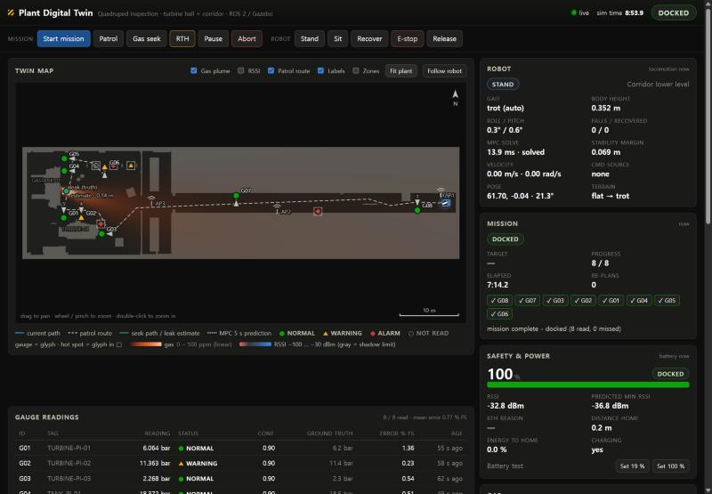
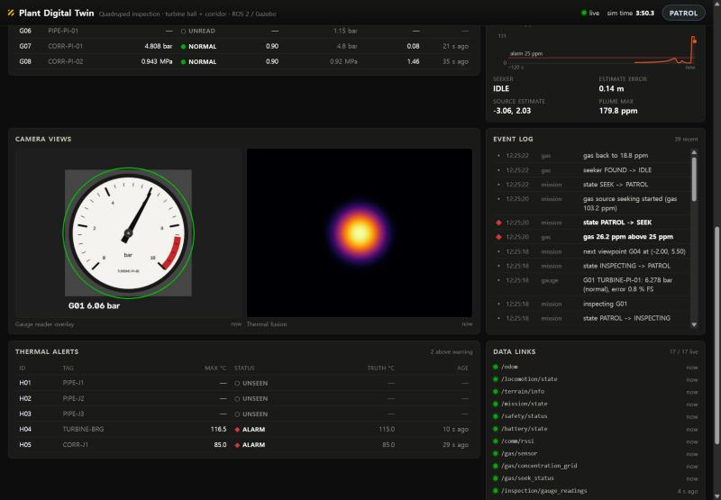
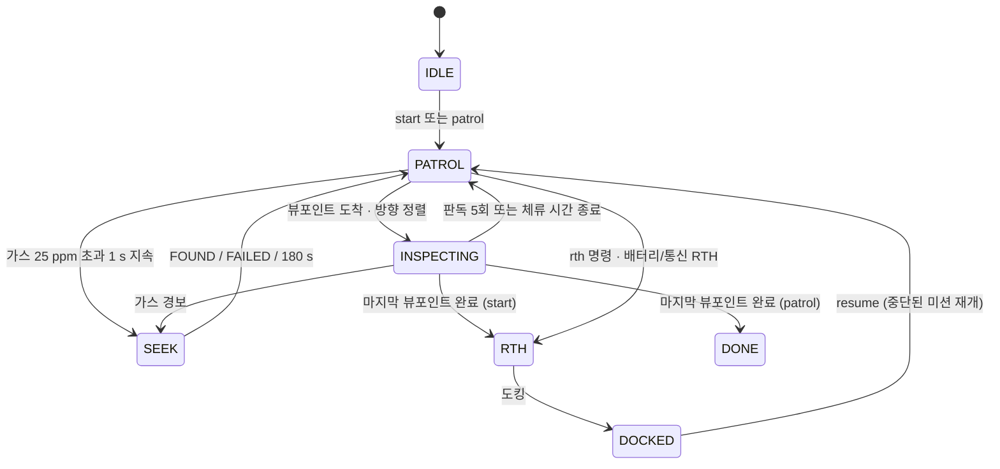

# 실행·사용 가이드

설치와 빌드는 [README](../README.md#install)에, 수동 설치와 환경 설정은 [SETUP_GUIDE](SETUP_GUIDE.md)에 있습니다.
명령은 저장소 폴더(`~/dusan_ws/src/DusanAI`)에서 실행합니다. Ubuntu 24.04 + Jazzy에서는 명령 앞에 `ROS_DISTRO=jazzy`를 붙이세요.

## 목차

1. [통합 실행](#run-bringup) · [데모 모드](#run-demo)
2. [시뮬레이터만 실행](#run-sim)
3. [모듈별 단독 실행](#run-modules)
4. [키보드 조작](#teleop)
5. [관제 대시보드](#dashboard)
6. [RViz](#rviz)
7. [미션 시나리오](#scenarios)
8. [기능별 설정](#settings): [보행 모드](#locomotion-mode) · [경로 지형 비용](#terrain-cost) · [지도에 없는 장애물 회피](#obstacle-avoidance)
9. [저사양 PC 옵션](#low-spec)
10. [결과 확인](#results)
11. [업데이트](#update)
12. [테스트·개발 도구](#dev-tools)
13. [문제 해결 FAQ](#faq)

---

<a id="run-bringup"></a>
## 1. 통합 실행

```bash
bash scripts/run_bringup.sh                                    # = ros2 launch plant_simulation bringup.launch.py
bash scripts/run_bringup.sh rviz:=true                         # RViz도 실행
bash scripts/run_bringup.sh mission_autostart:=true            # 시뮬레이션 시간 25 s 뒤 전체 미션 자동 시작
bash scripts/run_bringup.sh teleop_terminal:=xterm             # 키보드 텔레옵 창을 xterm으로 띄움
bash scripts/run_bringup.sh thermal_source:=synthetic          # GPU 열화상 센서 대신 합성 열화상
bash scripts/run_bringup.sh gui:=false headless_rendering:=true   # 화면 없이 (서버 + EGL 렌더링)
bash scripts/run_demo.sh                                       # 데모 모드 (= demo:=true)
```

`run_bringup.sh`는 ROS와 워크스페이스를 source한 뒤, 받은 인자를 그대로 `ros2 launch plant_simulation bringup.launch.py`에 넘깁니다.

**`bringup.launch.py` 인자**

| 인자 | 기본값 | 설명 |
|---|---|---|
| `gui` | `true` | Gazebo GUI 창. `false`면 서버만 실행 |
| `headless_rendering` | `false` | `gui:=false`일 때 카메라를 EGL로 렌더링 (디스플레이 없는 PC, 원격 접속) |
| `rviz` | `false` | RViz2 실행 (`rviz/plant.rviz`) |
| `thermal_source` | `gazebo` | `gazebo`: Gazebo 열화상 센서. `synthetic`: `synthetic_thermal_camera` 노드가 열화상을 만들고 Gazebo 센서는 자동으로 꺼짐 |
| `mission_autostart` | `false` | `autostart_delay` 뒤 전체 미션(`start`) 자동 시작 |
| `autostart_delay` | `25.0` | 자동 시작 대기 시간 (시뮬레이션 시간, s) |
| `dashboard_port` | `8080` | 웹 대시보드 포트. 사용 중이면 +1…+5를 차례로 시도 |
| `teleop_terminal` | `none` | 텔레옵 실행 방식: `none` / `xterm` / `gnome-terminal` / `konsole` / `gz`(터미널 없이 Gazebo 창 키 입력만) |
| `metrics` | `true` | 실행 지표를 `~/dusan_metrics/<YYYYmmdd_HHMMSS>/`에 기록 |
| `module_delay` | `6.0` | 시뮬레이터를 띄운 뒤 세 모듈을 시작할 때까지 대기 (s) |
| `use_sim_time` | `true` | Gazebo `/clock` 사용 |
| `world` / `layout_file` / `map_yaml` | `''` | 다른 SDF 월드 / `world_layout.yaml` / 항법 지도 YAML (`''`이면 설치본) |
| `demo` | `false` | 미션 자동 시작 + 추적 카메라 + HUD (`run_demo.sh`) |
| `hud` | `true` | HUD 노드 `demo_hud` (`/demo/hud`, Gazebo "Robot HUD" 창) |
| `follow_camera` | `''` (= `demo`) | Gazebo GUI 추적 카메라. `gui:=false`면 켜지지 않음 |
| `follow_offset` | `-2.5,0.0,1.6` | 로봇 기준 추적 카메라 위치 (m, 뒤/옆/위) |

**시작 순서**

1. 로봇이 다리를 편 자세로 충전소(도크, 복도 아래층)에 생성됩니다. 6 s(`module_delay`) 뒤 세 모듈이 시작되고 로봇이 스스로 일어섭니다.
2. 브라우저에서 **http://localhost:8080**을 엽니다. 다른 PC에서는 `http://<우분투 IP>:8080`으로 접속합니다.
3. 대시보드 **로봇** 패널의 배지가 **서 있음**이면 준비가 끝난 것입니다.

<a id="run-demo"></a>
### 데모 모드 (`scripts/run_demo.sh`)

```bash
bash scripts/run_demo.sh                                   # = ros2 launch plant_simulation bringup.launch.py demo:=true
bash scripts/run_demo.sh autostart_delay:=15.0 follow_offset:="-3.0 0.0 1.8"
bash scripts/run_demo.sh thermal_source:=synthetic         # 다른 bringup 인자도 그대로 전달
```

- **추적 카메라**: Gazebo 3D 화면이 로봇 뒤 2.5 m, 위 1.6 m에서 따라갑니다. 3D 화면을 클릭하고 Esc를 누르면 자유 시점이 됩니다.
- **Robot HUD 창**(3D 화면 왼쪽 위): 로봇 카메라 영상 위에 가스 농도(10 ppm 이상 주황, 25 ppm 이상 빨강, 경보 중에는 빨간 테두리),
  배터리, 임무 상태(예: `순찰 이동 → G03 (2/8)`), 보행 상태(예: `보행: WALK · stable · trot`), 시뮬레이션 시간이 보입니다.
- **가스 누출**: 누출 밸브에서 초록색 반투명 가스가 바람 방향으로 퍼집니다.
- **자동 임무**: 25 s 뒤 도크를 떠나 복도 → 공장 → 게이지를 순찰합니다. 가스 경보가 나면 누출원을 찾고, 끝나면 도크로 돌아옵니다.
  공장 입구에서 이미 경보가 날 수 있어서, 게이지보다 가스 탐색을 먼저 하기도 합니다.
- 한글 HUD에는 `sudo apt install python3-pil fonts-noto-cjk`가 필요합니다. 없으면 영어(`GAS: X ppm`)로 나옵니다.
- 추적 카메라만 쓰려면 `bash scripts/run_bringup.sh follow_camera:=true`, 이미 떠 있는 Gazebo에서는 `ros2 run plant_simulation follow_camera`.
- HUD는 `ros2 run rqt_image_view rqt_image_view /demo/hud`로도 볼 수 있습니다(`install_deps.sh --desktop`).
- 데모 중에도 `bash scripts/run_teleop.sh`를 띄우고 `m`(수동 오버라이드)을 누르면 직접 조작할 수 있습니다.

<a id="run-sim"></a>
## 2. 시뮬레이터만 실행

Gazebo 월드, 로봇, 브리지, odom/TF, 지도 서버만 띄웁니다. 모듈을 하나씩 시험할 때 씁니다.

```bash
bash scripts/run_sim.sh                                   # = ros2 launch plant_simulation sim.launch.py
bash scripts/run_sim.sh gui:=false headless_rendering:=true
bash scripts/run_sim.sh enable_thermal:=false             # Gazebo 열화상 센서 끄기 (합성 열화상을 쓸 때)
ros2 launch plant_simulation sim.launch.py verbosity:=4   # Gazebo 로그를 더 자세히
```

| 인자 | 기본값 | 설명 |
|---|---|---|
| `gui`, `headless_rendering`, `world`, `use_sim_time`, `layout_file`, `map_yaml` | bringup과 같음 | |
| `x`, `y`, `z`, `yaw` | `''` | 생성 자세 (`''`이면 `world_layout.yaml`의 `robot_spawn`). 다른 곳에 생성하면 `/odom`이 틀어질 수 있으므로 기본값을 권장 |
| `spawn_delay` / `spawn_attempts` | `3.0` / `5` | 로봇 생성까지 대기 (s) / 생성 재시도 횟수 |
| `verbosity` | `3` | `gz sim -v` 로그 수준 |
| `enable_thermal` / `enable_cameras` | `true` | Gazebo 열화상 카메라 / Depth·점검 카메라 |
| `mesh_uri_prefix` | `''` | 로봇 메쉬 URI 접두사 ([Q1](#faq-mesh)) |
| `bridge` | `true` | ros_gz_bridge 실행 |
| `clock_relay` | `true` | Gazebo 시계를 `/clock` 200 Hz로 다시 발행. `false`면 브리지가 직접 발행 |
| `start_odom_tf` / `start_map_server` | `true` | `odom_tf`(`/odom` + TF) / `map_server_lite`(`/map`) 실행 |

> `sim.launch.py`에는 `cmd_vel_mux`가 없습니다. 로봇을 걷게 하려면 `/cmd_vel`을 직접 발행하거나 mux를 따로 띄우세요(아래).

<a id="run-modules"></a>
## 3. 모듈별 단독 실행

터미널 1에서 `bash scripts/run_sim.sh`를 실행해 둡니다. 새 터미널마다 먼저 아래 두 줄을 실행합니다.

```bash
source /opt/ros/lyrical/setup.bash      # 24.04: /opt/ros/jazzy/setup.bash
source ~/dusan_ws/install/setup.bash
```

다른 모듈의 속도 명령(`/cmd_vel/teleop`, `/cmd_vel/seek`, `/cmd_vel/rth`, `/cmd_vel/patrol`)으로 로봇을 움직이려면 `cmd_vel_mux`와 module1이 함께 돌아야 합니다.

```bash
ros2 run plant_simulation cmd_vel_mux --ros-args \
  --params-file $(ros2 pkg prefix plant_simulation)/share/plant_simulation/config/mux.yaml -p use_sim_time:=true
```

**Module 1: 지형 인지 + 보행 제어 (+ 텔레옵)**

```bash
ros2 launch module1_locomotion locomotion.launch.py                          # terrain_mapper + locomotion_controller
ros2 launch module1_locomotion locomotion.launch.py teleop_terminal:=xterm   # + 텔레옵 창 (움직이려면 cmd_vel_mux 필요)
ros2 topic pub -r 20 /cmd_vel geometry_msgs/msg/Twist "{linear: {x: 0.3}}"   # mux 없이 직접 걷기 (Ctrl-C로 멈춤)
ros2 topic pub --once /locomotion/command std_msgs/msg/String "{data: 'gait:crawl'}"
ros2 topic echo /locomotion/state --field data
```

- 인자: `use_sim_time`(true), `start_terrain`(true), `start_controller`(true), `terrain_config` / `controller_config` / `teleop_config`(각 `config/*.yaml`),
  `layout_file`(''. 미끄러운 철판 정보를 읽을 `world_layout.yaml`), `teleop_terminal`(`none` / `xterm` / `gnome-terminal` / `konsole` / `gz` / `"tilix -e"` 같은 접두사), `teleop_mode`(`hold` / `latch`).
- `/locomotion/command` 명령: `stand` `sit` `walk` `gait:trot` `gait:crawl` `gait:auto` `mode:stable` `mode:mpc` `mode:toggle` `recover` `estop` `release` `push` `push:<fx>,<fy>` `reset_pose`.
- mux 없이 텔레옵만 쓰려면: `bash scripts/run_teleop.sh -p cmd_vel_topic:=/cmd_vel`.
- 자세한 내용은 [module1 README](../module1_locomotion/README.md).

**Module 2: 게이지 판독 + 열화상 퓨전 + 순찰 경로**

로봇이 게이지를 바라봐야 판독됩니다. 도크에서 가장 가까운 게이지는 복도 아래층의 G08(x 57.0 m)입니다.

```bash
ros2 launch module2_inspection inspection.launch.py                          # gauge_reader, thermal_fusion, patrol_planner
ros2 topic pub --once --qos-durability transient_local /inspection/target std_msgs/msg/String "{data: G08}"
ros2 topic echo /inspection/gauge_readings --field data
ros2 topic echo /inspection/thermal_alerts --field data
ros2 topic pub --once /patrol/replan std_msgs/msg/Empty "{}"                 # 순찰 경로 재계획
```

- 인자: `use_sim_time`(true), `thermal_source`(`gazebo` / `synthetic`), `map_yaml`(''), `layout_file`('').
- 합성 열화상을 쓰려면 시뮬레이터를 `run_sim.sh enable_thermal:=false`로 다시 띄운 뒤 `inspection.launch.py thermal_source:=synthetic`으로 실행합니다.
  이 launch는 Gazebo 센서를 끄지 못하므로 두 단계가 모두 필요합니다.
- 자세한 내용은 [module2 README](../module2_inspection/README.md)와 [THERMAL_PATROL.md](../module2_inspection/THERMAL_PATROL.md).

**Module 3: 가스 확산 + 누출원 탐색 + 배터리/통신/복귀**

```bash
ros2 launch module3_gas_safety gas_safety.launch.py                           # 5개 노드
ros2 topic pub --once /gas/seek/enable std_msgs/msg/Bool "{data: true}"       # 누출원 탐색 시작
ros2 topic pub --once /battery/set_level std_msgs/msg/Float32 "{data: 19.0}"  # 배터리 테스트 → RTH
ros2 topic pub --once /mission/command std_msgs/msg/String "{data: rth}"      # 수동 복귀
ros2 topic echo /gas/seek_status --field data
ros2 topic echo /safety/status --field data
```

- 인자: `use_sim_time`(true), `map_yaml`(''), `layout_file`('').
- 탐색과 복귀로 로봇을 실제로 움직이려면 module1과 `cmd_vel_mux`가 필요합니다. 자세한 내용은 [module3 README](../module3_gas_safety/README.md).

**대시보드만 (실행 중인 시스템에 붙이기)**

```bash
ros2 launch plant_simulation dashboard.launch.py                      # 인자: port(8080) use_sim_time(true) layout_file('') metrics(false)
ros2 launch plant_simulation dashboard.launch.py port:=8090 metrics:=true
```

<a id="teleop"></a>
## 4. 키보드 조작

```bash
bash scripts/run_teleop.sh                           # ① 지금 터미널에서
bash scripts/run_teleop.sh -p mode:=latch            #    --ros-args 파라미터 전달 가능
bash scripts/run_bringup.sh teleop_terminal:=xterm   # ② bringup이 xterm 창을 띄움
bash scripts/run_bringup.sh teleop_terminal:=gz      # ③ 터미널 없이 Gazebo 창 키 입력만 사용
```

- **터미널에서**: 텔레옵 터미널을 클릭하고 키를 누릅니다. 상태 줄에 모드, 속도 배율, 보행 모드, 배터리, 미션 상태가 나옵니다.
  `run_teleop.sh`는 실제 터미널에서 실행해야 합니다. IDE나 파이프에서 실행하면 키보드 입력을 받지 못하고 Gazebo 창 키만 받습니다.
- **Gazebo 창에서**: 3D 화면을 한 번 클릭하고 같은 키를 누릅니다. 텔레옵 노드는 ①②③ 중 하나로 떠 있어야 합니다. Gazebo 창의 ESC는 "정지"입니다.

| 키 | 동작 | 발행 토픽 |
|---|---|---|
| `w` / `s` (↑ / ↓) | 전진 / 후진 | `/cmd_vel/teleop` |
| `a` / `d` (← / →) | 좌회전 / 우회전 | `/cmd_vel/teleop` |
| `q` / `e` | 왼쪽 / 오른쪽 게걸음 | `/cmd_vel/teleop` |
| `x` | 정지 (속도 0) | `/cmd_vel/teleop` |
| `space` | 비상정지 토글 (`estop` ↔ `release`) | `/locomotion/command` |
| `+` / `-` (`=` / `_`) | 속도 배율 ±0.1 (0.1–1.0, 처음 0.5) | — |
| `m` | 수동 오버라이드 토글. 켜 두면 텔레옵이 최우선이고, 키를 놓으면 그 자리에 섬 | `/teleop/active` |
| `1` / `2` | 서기 `stand` / 앉기 `sit` | `/locomotion/command` |
| `3` / `4` / `5` | 보행 `gait:trot`(기본) / `gait:crawl` / `gait:auto`(지형에 따라 자동) | `/locomotion/command` |
| `v` | 보행 모드 전환 stable ↔ MPC (`mode:toggle`) | `/locomotion/command` |
| `r` | 자가 복구 `recover` | `/locomotion/command` |
| `f` | 밀기 테스트 `push` (측면 150 N × 0.2 s) | `/locomotion/command` |
| `0` | 자세 리셋 `reset_pose` (현재 위치에 똑바로 놓은 뒤 기립) | `/locomotion/command` |
| `t` | 전체 미션 시작 `start` | `/mission/command` |
| `p` | 순찰만 `patrol` | `/mission/command` |
| `g` | 가스 누출원 탐색 `seek` | `/mission/command` |
| `h` | 충전소 복귀 `rth` | `/mission/command` |
| `o` | 일시정지 / 재개 (`pause` / `resume`) | `/mission/command` |
| `b` / `n` | 배터리 19 % / 100 %로 설정 | `/battery/set_level` |
| `?` | 도움말 | — |
| `ESC` / `Ctrl-C` | 텔레옵 종료 (속도 0과 `/teleop/active = false`를 보냄) | — |

- 영문자는 대소문자를 구분하지 않습니다.
- **속도**: 배율 1.0일 때 최대 전후 0.5 m/s, 좌우 0.3 m/s, 회전 0.8 rad/s입니다.
- **`hold` 모드**(기본): 키를 누르는 동안 움직이고, 마지막 입력 0.6 s 뒤 멈춥니다. **`latch` 모드**: 누를 때마다 속도가 최대의 1/5씩 바뀌고 `x`까지 유지됩니다.
- **속도 명령 우선순위**(`cmd_vel_mux`): 텔레옵 > 복귀(RTH) > 가스 탐색 > 순찰. 입력마다 0.5 s 동안 새 메시지가 없으면 무효입니다.
  현재 소스는 `ros2 topic echo /cmd_vel_mux/active`나 대시보드 로봇 패널의 "주행 명령 출처"에서 봅니다.

**운전 요령**

- 속도 배율은 0.5(전진 0.25 m/s)로 시작합니다. 장애물 근처에서는 올리지 마세요.
- 보행은 `3`(trot)을 기본으로 씁니다.
- 도크 서쪽 약 3.4 m의 배관(C-OBS1)은 북쪽 끝(벽 쪽)으로 돌아가고, 복도 위층 잔해(C-OBS3, x 37–39)는 북쪽 벽 쪽 통로(y ≈ +1.1)로 지나가세요.
- 경사로 남쪽 가장자리(복도 x ≈ 47.6–50.2 m)는 난간 없이 0.2–0.55 m 낙차가 있습니다.

<a id="dashboard"></a>
## 5. 관제 대시보드 (http://localhost:8080)

`monitor_dashboard` 노드가 내장 HTTP 서버로 웹 UI를 제공합니다. 따로 설치할 것은 없습니다. 화면은 5 Hz로 갱신됩니다.

| 위치 | 버튼 | 보내는 명령 | 동작 |
|---|---|---|---|
| 운영 제어 1행 | **임무 시작** | `/mission/command` `start` | 전체 미션: 게이지 순찰 → (가스 경보 시) 누출원 탐색 → 순찰 재개 → 충전소 복귀 |
| | **일시정지** / **재개** | `pause` / `resume` | 일시정지하면 버튼이 **재개**로 바뀜 |
| | **비상정지** | `/locomotion/command` `estop` | 관절을 그 자리에 고정 |
| 운영 제어 · 임무 | **순찰** | `patrol` | 순찰만. 가스 경보가 나면 탐색은 함 |
| | **가스 추적** / **충전소 복귀** | `seek` / `rth` | 즉시 누출원 탐색 / 충전소 복귀 |
| | **임무 중단** | `abort` | 확인 후 정지, 남은 점검 지점을 버림 |
| 운영 제어 · 로봇 | **서기** / **앉기** / **복구** | `stand` / `sit` / `recover` | 서기 / 앉기 / 자가 복구 |
| | **비상정지 해제** | `release` | 해제 후 기립 |
| 상세 정보 | **19 %로 설정** / **100 %로 설정** | `/battery/set_level` 19 / 100 | 배터리 시험 |
| 플랜트 지도 | 레이어 버튼, **전체 보기**, **로봇 따라가기** | — | 가스 확산, 신호 세기, 순찰 경로, 이름표, 구역, 저마찰 바닥 |

**화면 구성** (1920×1080 한 화면)

- **임무 상태 띠**(맨 위): 임무 상태, 순찰 진행 막대와 계기판 8칸, 경과 시간, 현재 목표, **임무 보고서** 버튼
- **플랜트 지도**: 로봇, 현재 경로, 순찰 경로, 가스 농도, 계기판·열점 상태. 이름표는 ID만 표시하고 값은 마우스를 올리면 보임. 드래그로 이동, 휠로 확대·축소
- **계기판 판독 결과** 탭: 계기판 8개 카드(판독값, 상태, 범위 막대, 실제값·오차 %FS), 계기 카메라·열화상 카메라 영상 · **임무 보고서** 탭: 결과 요약, 조치가 필요한 항목, 계기판 요약 표
- **운영 제어**, **로봇 · 전원**(배터리, 보행 상태, 속도, 넘어짐/복구, 통신, 자동 복귀), **경보**(가스 농도·추이·누출원 추적, 열화상 지점), **최근 이벤트**
- **상세 정보**(오른쪽 위 버튼): MPC 계산 시간, 안정 여유, 마찰 추정, 미끄럼 모드, 주행 명령 출처, 토픽 수신 상태 같은 진단 값

<p align="center">
  
  
</p>
<p align="center"><sub>왼쪽: 미션 완료 후 충전소 도착 (8/8 판독). 오른쪽: 가스 누출원 추적 중</sub></p>

- 다른 PC에서 접속하려면 `http://<우분투 IP>:8080`. 방화벽을 쓰면 `sudo ufw allow 8080/tcp`.
- 대시보드에는 인증이 없고 모든 인터페이스(0.0.0.0)에서 대기합니다. 신뢰할 수 없는 네트워크에서는 `simulation/config/dashboard.yaml`의 `host`를 `"127.0.0.1"`로 바꾸고 다시 실행하세요.

<a id="rviz"></a>
## 6. RViz

```bash
bash scripts/run_bringup.sh rviz:=true
# 또는 실행 중인 시스템에 따로:
ros2 run rviz2 rviz2 -d $(ros2 pkg prefix plant_simulation)/share/plant_simulation/rviz/plant.rviz --ros-args -p use_sim_time:=true
```

`plant.rviz`(Fixed Frame `map`)에는 로봇 모델·TF, 지도·Traversability·Elevation cloud, MPC 5 s 예측·발 디딤·GRF, 순찰 경로·Nav plan,
가스 농도·탐색 경로·누출원 추정·RSSI 지도, 게이지 오버레이·열화상 퓨전 이미지가 미리 들어 있습니다.

<a id="scenarios"></a>
## 7. 미션 시나리오

전체 시스템(`bash scripts/run_bringup.sh`)을 띄운 상태에서 실행합니다. 같은 명령을 대시보드 버튼, 텔레옵 키, `ros2 topic pub` 중 아무것으로나 보낼 수 있습니다.



<sub>`MANUAL`(텔레옵 오버라이드)과 `PAUSED`(일시정지)는 진행 중인 상태 위에 겹쳐집니다. 해제하면 하던 일을 이어서 합니다.</sub>

| 시나리오 | 시작 방법 | 기대 동작 | 확인할 곳 |
|---|---|---|---|
| **전체 미션** | **임무 시작** / `t` / `ros2 topic pub --once /mission/command std_msgs/msg/String "{data: start}"` / `run_bringup.sh mission_autostart:=true` / `run_demo.sh` | 게이지 8개 순회(계획 순서 예: 도크 → G08 → G06 → G05 → G04 → G01 → G02 → G03 → G07) → (가스 경보 시) `SEEK` → 순찰 재개 → `RTH` → `DOCKED` | 임무 8/8, 게이지 오차 % FS, 열화상 경보(H02–H05가 경고·경보, H01은 45 °C라 정상), 가스 추정 위치, `DOCKED` |
| **순찰만** | **순찰** / `p` / `"{data: patrol}"` | 게이지 8개 순회 후 그 자리에서 `DONE`. 가스 경보가 나면 탐색은 함 | 임무 `DONE`(완료), 계기 판독 표 |
| **가스 추적** | 전체 미션 중 자동, 또는 **가스 추적** / `g` / `"{data: seek}"` | `SEARCH → SURGE → (CAST) → GRADIENT → FOUND`. 미션 쪽 제한 시간 180 s | 가스 패널, 지도의 추적 경로, `/gas/seek_status` |
| **복귀 (RTH)** | **충전소 복귀** / `h` / `"{data: rth}"` | `RTH_PLANNING → RTH_NAVIGATING → DOCKING → DOCKED` → `CHARGING` → 95 % 또는 `resume`이면 `MONITOR` | 안전 · 전원 패널, `/safety/status` |
| **넘어짐 테스트** | IDLE 또는 일시정지 상태에서 `f` / `"{data: push}"`. 더 세게: `"{data: 'push:0,300'}"` (fx, fy [N], 0.2 s) | `FALL_DETECTED → DAMP → TUCK → (ROCK) → SELF_RIGHT → PREPARE → STAND_UP → VERIFY`. 3회 실패하면 보조 리셋 | 로봇 패널 "넘어짐 / 복구", `/locomotion/fall_event` |
| **배터리 테스트** | 순찰 중 **19 %로 설정** / `b` / `ros2 topic pub --once /battery/set_level std_msgs/msg/Float32 "{data: 19.0}"` | 20 % 미만 1 s → `battery_low` RTH → 도킹 → 충전. 남은 점검 지점은 보존 | 안전 · 전원 패널의 복귀 사유. 이어서 하려면 `resume`. `n` / **100 %로 설정**은 충전을 건너뜀 |

- **가스 추적**: 누출원은 터빈홀(x −3.2, y 2.0)에 있습니다. 도크에서 바로 `seek`를 누르면 180 s 안에 못 찾을 수 있으니, 홀 안에서 누르세요.
- **밀기**: `push`와 `reset_pose`는 `gz` 명령줄 도구를 씁니다. 기본 push는 150 N × 0.2 s = 30 N·s입니다. 버티면 힘을 키우세요.
- **통신 음영**: 앞으로 갈 경로의 RSSI가 −80 dBm 아래로 예측되면 자동으로 복귀합니다(`comm_shadow_predicted`). 음영 구역은 터빈 피트(지도 좌하단)입니다.

<a id="settings"></a>
## 8. 기능별 설정

YAML을 고친 뒤에는 노드를 다시 실행하면 반영됩니다(기본 빌드 `--symlink-install`). `bash scripts/build.sh --no-symlink`로 빌드했다면 `bash scripts/build.sh`를 다시 실행하세요.

<a id="locomotion-mode"></a>
<a id="mpc-mode"></a>
### 8.1 보행 모드와 보행 방식

| 설정 (`module1_locomotion/config/locomotion.yaml`) | 기본값 | 실행 중에 바꾸기 |
|---|---|---|
| 보행 모드 `locomotion_mode` | `stable` (CHAMP 방식 기구학 보행) | 텔레옵 `v`, 또는 `/locomotion/command`에 `mode:stable` / `mode:mpc` / `mode:toggle` |
| 보행 방식 `gait_mode` | `trot` | 텔레옵 `3` trot / `4` crawl / `5` auto, 또는 `gait:trot` / `gait:crawl` / `gait:auto` |

- 걷는 중에 모드를 바꾸면 안전한 보행 경계에서 멈춘 뒤 바꾸고 다시 걷습니다. 현재 모드는 텔레옵 상태 줄(`[stable]` / `[mpc]`)과 대시보드 로봇 패널(`트롯 · 안정 모드` / `트롯 · MPC`)에 나옵니다.
- **MPC 모드**는 5 s(28 step)를 내다보는 convex MPC입니다. 풀이 시간은 `/locomotion/state`의 `mpc_solve_ms`와 대시보드 로봇 패널(MPC 계산)에 나옵니다. 경사로와 긴 자율 주행에는 stable 모드를 권장합니다.
- 파라미터 조정 방법은 [module1 README §5 튜닝 가이드](../module1_locomotion/README.md#5-튜닝-가이드)에 있습니다.

<a id="terrain-cost"></a>
### 8.2 경로 지형 비용

자율 경로(미션, 복귀, 순찰)는 배관·잔해·철판·낮은 단에 비용을 더해, 돌아갈 길이 있으면 돌아갑니다(예: C-OBS1 배관 북쪽 끝, C-OBS3 잔해 북쪽 통로).
돌아갈 길이 없으면 그대로 지나갑니다. 같은 `terrain_*` 파라미터가 `simulation/config/mission.yaml`, `module3_gas_safety/config/safety.yaml`,
`module2_inspection/config/patrol.yaml`에 있습니다.

| 파라미터 | 기본값 | 의미 |
|---|---|---|
| `terrain_cost_enabled` | true | 지형 비용 사용 |
| `terrain_w_pipe`, `terrain_w_rubble` | 25.0, 25.0 | 배관·잔해 칸마다 더하는 비용 |
| `terrain_w_plate`, `terrain_w_platform` | 1.0, 2.0 | 철판, 낮은 단 (작은 비용) |
| `terrain_margin`, `terrain_margin_fraction` | 0.25 m, 0.15 | 바깥 여유 폭과 그 비용 비율 |

<a id="obstacle-avoidance"></a>
### 8.3 지도에 없는 장애물 회피

자율 주행은 내비 맵에 없는 물체(상자, 카트 등)를 깊이 카메라 elevation map(`/elevation_map/points`)에서 찾아 피합니다. 기본으로 켜져 있습니다.
핵심 코드는 `dusan_common/dusan_common/obstacle_layer.py`입니다.

| 단계 | 조건 | 동작 |
|---|---|---|
| 1. 감속 / 정지 | 경로 앞에 장애물 | 1.0 m 아래부터 감속, 0.35 m 아래에서 정지 |
| 2. 좌·우 우회 | 확정된 장애물이 2.5 m 안에서 경로를 막음 | 왼쪽·오른쪽 중 싼 쪽으로 돌아간 뒤 장애물 너머 0.8 m에서 원래 경로에 합류 |
| 3. 전역 재계획 | 쓸 만한 우회가 없음 | 지도 + 탐지한 장애물로 다시 계획 (목표당 3회) |
| 4. 정체 처리 | 돌아갈 길이 전혀 없음 | 장애물 앞에 서고, 기존 정체 로직이 판단(후진 → 재계획, 4회 뒤 뷰포인트 건너뜀) |

- `mission_manager`는 1–4단계, `return_to_home`(복귀)은 1–3단계를 씁니다. `source_seeker`(가스 탐색)는 탐지 장애물을 국소 지도에 합쳐 피합니다.
- **끄기**: `simulation/config/mission.yaml`, `module3_gas_safety/config/safety.yaml`, `seeker.yaml`에서 `obstacle_enabled: false`로 바꾸고 다시 실행합니다.
  단계만 끄려면 `mission.yaml`·`safety.yaml`의 `obstacle_slowdown_enabled`, `obstacle_detour_enabled`, `obstacle_replan_enabled`를 씁니다.

| 주요 파라미터 | 기본값 | 의미 |
|---|---|---|
| `obstacle_enabled` | true | 전체 스위치 (false면 elevation map을 구독하지 않음) |
| `obstacle_source` | `elevation` | `elevation`: `/elevation_map/points` 높이 차 검사. `traversability`: 비용 지도 사용 |
| `obstacle_step_height`, `obstacle_step_window` | 0.22 m, 5 | 장애물 높이 기준. `terrain.yaml`의 `step_crit`, `step_window`와 같게 유지 |
| `obstacle_slow_dist`, `obstacle_stop_dist` | 1.0 m, 0.35 m | 감속 시작, 정지 거리 |
| `obstacle_forget_time` | 60.0 s | 새 증거가 없으면 잊는 시간 (0 = 잊지 않음) |
| `obstacle_frames` | `odom,map,world` | 받아들이는 지도 frame_id. 다른 프레임은 버리고 `rejected`로 셈 |

`mission.yaml`과 `safety.yaml`에는 같은 키가 모두 있고, `seeker.yaml`에는 인지·메모리 키와 `obstacle_rebuild_period`만 있습니다.
전체 목록은 [DESIGN_SPEC §5](DESIGN_SPEC.md#5-algorithms-must-be-implemented--these-are-graded-deliverables)와 각 YAML의 주석에, 설계와 결과는 [REPORT §7.8](REPORT.md#obstacle-avoidance)에 있습니다.

- **상태 확인**: `/mission/state`와 `/safety/status`의 `obstacle`에 확정 셀 수(`confirmed`), 속도 배율(`speed_scale`), 우회 방향(`detour`),
  마지막 판단(`last`)이 나옵니다. 로봇이 서 있는 동안 `frames`가 늘어나면 지도가 들어오고 있는 것입니다. 가스 탐색기는 `/gas/seek_status`의 `obstacles`입니다.
- **한계**: 높이 0.22 m 미만 물체는 장애물로 보지 않고 넘습니다. 카메라가 아래를 향해 높은 물체도 약 1.0–1.45 m 앞에서야 보이므로,
  가까이 가서 감속한 뒤 돌아갑니다. 치운 물체는 다시 보이거나 60 s가 지나야 지워집니다.
  복귀(`return_to_home`)는 완전히 막히면 건너뛸 목표가 없어 후진 → 재계획을 반복합니다.

<a id="low-spec"></a>
## 9. 저사양 PC 옵션

| 옵션 | 효과 |
|---|---|
| `gui:=false` | Gazebo 3D 창 없이 서버만 실행. 대시보드로 봅니다 |
| `gui:=false headless_rendering:=true` | 디스플레이 없이 카메라를 EGL로 렌더링 (SSH 원격, 화면 없는 PC) |
| `thermal_source:=synthetic` | GPU 열화상 센서 대신 합성 열화상 |
| `rviz:=false` (기본) | RViz를 띄우지 않음 |
| `module_delay:=15.0` | 월드 로딩이 느린 PC에서 모듈 시작을 늦춤 |
| `export LIBGL_ALWAYS_SOFTWARE=1` | GPU 없는 VM에서 소프트웨어 렌더링 (매우 느림, 최후의 수단) |

```bash
bash scripts/run_bringup.sh gui:=false thermal_source:=synthetic                           # 가장 가벼운 조합 (디스플레이 있음)
bash scripts/run_bringup.sh gui:=false headless_rendering:=true thermal_source:=synthetic   # 디스플레이 없음
```

- 모든 노드가 시뮬레이션 시간으로 동작하므로 RTF가 1보다 낮아도 결과는 같고 진행만 느려집니다.
- MPC 모드에서 `mpc_solve_ms`가 30 ms를 넘으면 `locomotion.yaml`의 `mpc_rate`를 20.0 → 10.0으로, `mpc_qp_max_iter`(250)를 낮추세요
  ([module1 README §5](../module1_locomotion/README.md#5-튜닝-가이드)).

<a id="results"></a>
## 10. 결과 확인

<a id="results-dashboard"></a>
### 10.1 대시보드

http://localhost:8080에서 로봇 위치와 상태, 게이지 판독값과 오차(% FS), 과열 경보, 가스 농도 지도와 누출원 추정, 배터리·RSSI·복귀 사유,
넘어짐/복구 횟수, 이벤트 기록을 봅니다. **토픽 수신 상태** 패널에서 토픽이 들어오는지 확인할 수 있습니다.

<a id="results-topics"></a>
### 10.2 토픽 확인

```bash
ros2 topic hz /clock                                    # ≈ 200 Hz × RTF
ros2 topic echo /mission/state --field data             # {state, target, completed, pending, gas_alarm, message, obstacle, ...}
ros2 topic echo /locomotion/state --field data          # {mode, gait, body_height, roll, pitch, fall_count, mpc_solve_ms, slip_mode, ...}
ros2 topic echo /terrain/info --field data              # {class, recommended_gait, slippery, friction_mu, ...}
ros2 topic echo /locomotion/fall_event --field data     # {event: fall|recovered|recovery_failed|..., t, x, y, roll, pitch}
ros2 topic echo /inspection/gauge_readings --field data # {readings: [{id, value, unit, confidence, status, ...}]}
ros2 topic echo /inspection/thermal_alerts --field data # {hotspots: [{id, max_temp_c, status, ...}]}
ros2 topic echo /gas/sensor                             # 로봇 위치 가스 농도 [ppm]
ros2 topic echo /gas/seek_status --field data           # {state, concentration, estimate, error_m, ...}
ros2 topic echo /safety/status --field data             # {state, rth_active, reason, battery_pct, rssi_dbm, ...}
ros2 topic echo /battery/state --field percentage       # 0..1
ros2 topic echo /cmd_vel_mux/active                     # teleop | rth | seek | patrol | none
ros2 topic echo /patrol/plan_json --once --field data --qos-durability transient_local
```

<a id="results-metrics"></a>
### 10.3 실행 기록과 그래프 (`tools/plot_metrics.py`)

bringup은 기본으로 `metrics_logger`를 실행합니다(`metrics:=true`). 로그에 `recording metrics to <폴더>`가 찍힙니다.

```
~/dusan_metrics/<YYYYmmdd_HHMMSS>/
├── events.csv           모든 이벤트 (모드 전환, 경보, 넘어짐, RTH ...)
├── pose.csv             위치·자세·속도·보행 모드·미션 상태 (2 Hz)
├── gauge_readings.csv   판독값 + 정답 + 오차 %FS
├── thermal.csv          열화상 검출 결과, 온도 오차
├── gas.csv              농도, 탐색 상태, 추정 위치·오차 (2 Hz)
├── battery.csv          배터리, RSSI, safety 상태, RTH (1 Hz)
└── summary.json         집계 지표 (10 s마다, 종료 시 갱신)
```

```bash
python3 tools/plot_metrics.py                                         # 가장 최근 세션
python3 tools/plot_metrics.py ~/dusan_metrics/<세션>                  # 특정 세션
python3 tools/plot_metrics.py ~/dusan_metrics/<세션> --out <폴더>     # 다른 폴더로
```

`<세션>/figures/`에 `trajectory.png`(지도 위 경로), `gauge_errors.png`, `battery_comm.png`, `gas.png`, `locomotion.png`, `summary.md`(핵심 수치 표)가 생깁니다.
실행을 Ctrl-C로 끝내면 `summary.json`이 마지막으로 갱신됩니다.

<a id="update"></a>
## 11. 업데이트

```bash
cd ~/dusan_ws/src/DusanAI
git pull
bash scripts/build.sh                 # 이상하면 bash scripts/build.sh --clean
bash scripts/check_install.sh         # 마지막 줄이 "0 FAIL"이어야 함
```

- 새 파일은 빌드해야 설치되므로, 업데이트한 뒤에는 항상 `build.sh`를 실행하세요.
- 저장소 안의 파일을 직접 고쳤다면 `git pull` 전에 백업하거나 `git stash`로 치워 두세요.
- `git clone`이 아닌 방법(USB 복사 등)으로 받은 폴더는 `.git`이 없어 `git pull`이 되지 않습니다. 한 번만 다시 받습니다(고친 파일은 먼저 백업).

  ```bash
  rm -rf ~/dusan_ws/src/DusanAI
  git clone https://github.com/YUGyuSang/DusanAI.git ~/dusan_ws/src/DusanAI
  cd ~/dusan_ws/src/DusanAI && bash scripts/build.sh && bash scripts/check_install.sh
  ```

<a id="dev-tools"></a>
## 12. 테스트·개발 도구

아래 도구는 ROS·colcon 없이 Python만으로 실행됩니다. 저장소 루트에서 실행하세요.

```bash
pip install numpy opencv-python-headless pyyaml scipy matplotlib pytest xacro     # mujoco는 물리 검증 도구용 (선택)
python -m pytest -q                                   # 전체 테스트
python tools/eval_gauge.py                            # 오프라인 평가 (eval_locomotion / terrain / gauge / thermal / patrol / gas)
PYTHONPATH=dusan_common:simulation python -m plant_simulation.dashboard_demo   # 오프라인 대시보드 데모 (http://localhost:8080)
python tools/generate_world.py                        # world_layout.yaml을 고친 뒤 월드·지도 다시 생성
```

- **테스트**: `pytest.ini`가 모든 패키지의 test 폴더와 `tools/test`를 지정합니다. mujoco, xacro, Gazebo 파이썬 바인딩이 없으면 일부 테스트를 건너뜁니다(`pytest -rs`로 확인).
- **평가 스크립트**: `docs/results/*.json`과 `docs/images/*.png`를 덮어씁니다. 결과 분석은 [REPORT](REPORT.md)에 있습니다.
- **대시보드 데모**: 미션 로직과 대시보드를 간단한 로봇 모델로 돌립니다. 옵션 `--no-autostart`, `--port 8090`, `--speed 8`,
  `--headless --metrics-dir <폴더>`(미션 1회를 기록해 `plot_metrics.py`로 그래프).
- **월드 재생성**: `simulation/config/world_layout.yaml`이 게이지·열점·장애물·누출원·AP·도크 위치와 정답의 단일 출처입니다. 고친 뒤
  `generate_world.py`(`--no-images`: 그림 생략) → `python -m pytest tools/test -q` → `bash scripts/build.sh`.
- **에셋 재변환**: `tools/convert_spot.py`, `tools/convert_environment.py`. 과제 제공 원본 에셋(`Doosanenerbility/` 폴더)이 필요하며 저장소에는 없습니다.

<a id="gazebo-check"></a>
<a id="obstacle-check"></a>
**보행·장애물 검증 도구**

| 도구 | 빠른 실행 | 결과·설명 |
|---|---|---|
| `tools/physics_check.py` (MuJoCo 물리 검증, `pip install mujoco`), `tools/tune_locomotion.py` (파라미터 탐색) | `python tools/physics_check.py --quick` | `docs/results/physics_check.json`, [module1 README §4](../module1_locomotion/README.md#4-평가) |
| `tools/gazebo_check.py` (Gazebo 헤드리스 보행 검증) | `python tools/gazebo_check.py --scenarios a b --seeds 0 --duration 9 --no-save` | `docs/results/gazebo_check.json`, [module1 README §4.5](../module1_locomotion/README.md#45-gazebo-헤드리스-검증-toolsgazebo_checkpy) |
| `tools/obstacle_check.py` (지도에 없는 박스를 넣은 미션) | `python tools/obstacle_check.py --scenarios u --seeds 0` | `--out` 파일, [REPORT §7.8.3](REPORT.md#783-gazebo-신규-박스-실험-toolsobstacle_checkpy) |
| `tools/fall_check.py` (넘어짐 → 물리 자가 복구: 옆·등·밀기·벽·경사로·미션 중) | `python tools/fall_check.py --cases side back --seeds 0 --no-save` | `docs/results/fall_check.json`, [module1 README §4.9](../module1_locomotion/README.md#49-gazebo-넘어짐-복구-검증-toolsfall_checkpy) |
| `tools/mission_check.py` (데모 미션 전체: 도크 → 8개 계기판 → 가스 탐색 → 귀환·도킹) | `python tools/mission_check.py --seeds 0 --out <파일>.json` | `--out` 파일, [module1 README §4.10](../module1_locomotion/README.md#410-gazebo-전체-미션-검증-toolsmission_checkpy) |

- Gazebo 도구 네 개는 gz-sim 8 파이썬 바인딩(`gz.sim8`, `gz.transport13`)이 필요합니다. conda-forge의 `gz-sim8` 등으로 설치합니다([SETUP_GUIDE §7](SETUP_GUIDE.md#7-개발-도구)).
  Jetty(gz-sim 10) 바인딩은 `GZ_CHECK_RELEASE=jetty`로 시도할 수 있습니다(미검증).
- 보행 모드는 `gazebo_check.py --mode stable|mpc`, `obstacle_check.py --modes stable mpc`로 고릅니다. 실제 plant 월드와 깊이 카메라 지도는 `--map depth`입니다
  (예: `python tools/gazebo_check.py --label plant_depth --map depth --scenarios j k o`).
- physics_check는 `--out <파일>.json --no-figures`, gazebo_check·fall_check는 `--no-save`를 붙이면 저장소의 결과 파일을 덮어쓰지 않습니다. obstacle_check·mission_check는 `--out`에만 씁니다
  (mission_check는 `--save`일 때만 `docs/results/mission_check.json`).
  mission_check의 구간 실행: `--leg K --legs N`(순찰 계획의 K번째 구간부터 N개), `--spawn=x,y,yaw --goal=x,y`(임의 구간).
  시나리오와 다른 옵션은 각 도구의 `--help`에 있습니다.
- `GZ_PYTHON=<바인딩이 있는 python 경로>`를 지정하면 `tools/test/test_gazebo_check.py`, `tools/test/test_fall_check.py`, `tools/test/test_mission_check.py`의 폐루프 테스트도 실행됩니다.

---

<a id="faq"></a>
## 13. 문제 해결 FAQ

<a id="faq-mesh"></a>
### Q1. Gazebo에서 로봇(또는 발전소)이 안 보인다

로봇은 TF와 대시보드에서 움직이는데 메쉬가 안 보이면, `package://`·`model://` 경로를 찾지 못한 것입니다.

1. `bash scripts/build.sh`로 빌드했는지, `source ~/dusan_ws/install/setup.bash`를 했는지 확인합니다(`check_install.sh`의 Workspace 항목).
2. 경로를 직접 추가해 실행합니다.

   ```bash
   export GZ_SIM_RESOURCE_PATH=$(ros2 pkg prefix plant_simulation)/share:$(ros2 pkg prefix plant_simulation)/share/plant_simulation/models:$GZ_SIM_RESOURCE_PATH
   bash scripts/run_bringup.sh
   ```

3. 로봇 메쉬만 안 보이면 `ros2 launch plant_simulation sim.launch.py mesh_uri_prefix:=file://$(ros2 pkg prefix plant_simulation)/share/plant_simulation/models/spot/meshes`.
4. 월드 오류는 `gz sdf -k $(ros2 pkg prefix plant_simulation)/share/plant_simulation/worlds/plant.sdf`로 확인합니다.
5. 로딩이 느려 로봇 생성이 실패하면 `sim.launch.py spawn_delay:=10.0`.

<a id="faq-thermal"></a>
### Q2. 열화상 카메라가 안 나온다

Gazebo 열화상 센서는 GPU가 필요합니다. `bash scripts/run_bringup.sh thermal_source:=synthetic`으로 실행하면 합성 열화상이 같은 토픽(`/thermal_camera/image`)에 나옵니다.
모듈 단독 실행이라면 `run_sim.sh enable_thermal:=false` + `inspection.launch.py thermal_source:=synthetic`.

<a id="faq-q3"></a>
### Q3. `ros-lyrical-...` 패키지가 없다

1. 대부분 ROS 2 apt 저장소가 없는 경우입니다. `bash scripts/install_deps.sh --add-ros-repo`를 실행하세요.
2. `apt-cache policy ros-lyrical-ros-base ros-lyrical-ros-gz`로 후보 버전을 확인합니다.
3. 그래도 없으면 Ubuntu 24.04 + ROS 2 Jazzy + Gazebo Harmonic을 쓰세요(`export ROS_DISTRO=jazzy` 후 같은 스크립트). Jazzy는 26.04에 apt로 설치되지 않습니다.
4. `ros2: error: argument ...: invalid choice: 'launch'`가 나면 `sudo apt install ros-$ROS_DISTRO-ros-base`.

Gazebo는 짝을 맞추세요: Lyrical에는 Jetty, Jazzy에는 Harmonic(`ros-<distro>-ros-gz`가 설치하는 것).

<a id="faq-crlf"></a>
### Q4. CRLF 줄바꿈 오류

`/usr/bin/env: 'python3\r'`, `bash: $'\r': command not found`, YAML 파싱 오류는 파일 줄바꿈이 CRLF일 때 생깁니다.
`git clone`으로 받으면 `.gitattributes`가 LF로 맞춰 주므로 생기지 않습니다. 다른 방법으로 복사했다면 저장소 루트에서 아래를 실행하고 다시 빌드합니다.

```bash
cd ~/dusan_ws/src/DusanAI
find . \( -name '*.py' -o -name '*.yaml' -o -name '*.sh' -o -name '*.xacro' -o -name '*.sdf' -o -name '*.urdf' \
       -o -name '*.config' -o -name '*.rviz' -o -name '*.js' -o -name '*.html' -o -name '*.css' \) \
       -not -path './.git/*' -exec sed -i 's/\r$//' {} +
```

편집기는 LF·UTF-8로 설정하세요. YAML의 실수 값은 소수점을 유지해야 합니다(`1`이 아니라 `1.0`).

<a id="faq-build"></a>
### Q5. 빌드가 실패한다

| 메시지 | 해결 |
|---|---|
| `Package 'dusan_common' specified with --packages-select was not found` | `colcon`을 직접 부르지 말고 `bash scripts/build.sh`를 쓰세요. `DUSAN_WS`도 확인 |
| `workspace ... is the repository or inside it` | `DUSAN_WS`는 저장소 바깥이어야 함 (예: `DUSAN_WS=~/dusan_ws`) |
| `<ws>/src/DusanAI exists and is not this repository` | 예전 복사본을 지우거나 이름을 바꾸거나 다른 `DUSAN_WS` 사용 |
| setuptools가 `--symlink-install`을 거부 | `bash scripts/build.sh --no-symlink` |
| 예전 빌드 잔재로 이상 동작 | `bash scripts/build.sh --clean` |
| 의존 패키지 누락 | `bash scripts/install_deps.sh` |
| 노드 시작 시 `ParameterException` / `InvalidParameterTypeException` | YAML 값의 타입이 바뀜 (`1.0` → `1`) |

<a id="faq-rtf"></a>
### Q6. RTF(실시간 배율)가 낮다

Gazebo 창 오른쪽 아래 World stats나 `ros2 topic hz /clock`(≈ 200 × RTF Hz)으로 확인합니다. RTF가 낮아도 결과는 같고 진행만 느려집니다.
가볍게 돌리는 방법은 [9. 저사양 PC 옵션](#low-spec)에 있습니다. 대시보드 탭은 하나만 열고, MPC 풀이가 느리면 `libopenblas0-pthread`가 설치되어 있는지 확인하세요.
그래도 느리면 `locomotion.yaml`의 `mpc_rate`(20.0 → 10.0)와 `mpc_qp_max_iter`를 낮춥니다.

<a id="faq-port"></a>
### Q7. 대시보드가 안 열린다 (포트 충돌)

- 8080이 사용 중이면 8081…8085를 차례로 씁니다. 실제 포트는 로그의 `digital twin dashboard: http://...:<포트>`에 나옵니다.
- 직접 지정: `bash scripts/run_bringup.sh dashboard_port:=8090`. 사용 중인 프로그램 확인: `ss -ltnp | grep :8080`.
- 다른 PC에서 안 열리면 `sudo ufw allow 8080/tcp`. Ubuntu 자신에서는 `http://127.0.0.1:8080`으로 시도하세요.
- 같은 네트워크에 ROS 2 사용자가 여럿이면 모든 터미널에서 `export ROS_DOMAIN_ID=<0–101 중 하나>`.

<a id="faq-fall"></a>
### Q8. 로봇이 넘어진다 / 일어나지 못한다

- **자동 복구**: |roll| 또는 |pitch| > 55°, 또는 몸통 높이 < 0.12 m가 0.3 s 이어지면 넘어짐으로 봅니다. 로봇이 자기 다리로 일어납니다
  (옆으로 누우면 다리로 밀어 배 쪽으로 굴리고, 등으로 누우면 먼저 옆으로 굴림). 3회 시도가 모두 실패하면 5 s(`recovery_retry_time`,
  `locomotion.yaml`) 쉬고 처음부터 다시 시도하며, 일어설 때까지 반복합니다. 순간이동(`gz` set_pose) 보조 리셋은 기본으로 꺼져 있고
  `locomotion.yaml`의 `assisted_reset: true`로 켤 수 있습니다.
  미션 중 20 s(`recover_after`, `mission.yaml`) 넘게 넘어져 있으면 미션 관리자가 `recover`를 보내고, 일어서면 경로를 다시 계획해 이어 갑니다.
- **수동 복구**: 대시보드 **복구**, 텔레옵 `r`, 또는 `ros2 topic pub --once /locomotion/command std_msgs/msg/String "{data: recover}"`.
  자세를 강제로 리셋하려면 텔레옵 `0`(`reset_pose`).
- **자주 넘어진다면**
  1. 보행은 `3`(trot)을 쓰세요. MPC 모드(`[mpc]`)라면 `v`로 stable로 바꿉니다.
  2. 속도 배율은 0.5 이하로 두세요. 배율 1.0(0.5 m/s)으로 장애물에 다가가면 넘어지기 쉽습니다.
  3. 배관(C-OBS1)과 잔해(C-OBS3)는 [운전 요령](#teleop)대로 돌아가세요. 배관을 꼭 넘어야 하면 수직으로 다가가 `w`만 누르고, 네 다리가 다 넘을 때까지 방향키를 쓰지 마세요.
     곧게 넘기만 할 때는 `4`(crawl)에 `locomotion.yaml`의 `stable_walk_period: 1.8`, `stable_walk_max_vx: 0.15`가 더 잘 넘습니다. 넘은 뒤에는 바로 `3`으로 돌아오세요.
  4. 튜닝 파라미터는 `module1_locomotion/config/locomotion.yaml`과 [module1 README §5 튜닝 가이드](../module1_locomotion/README.md#5-튜닝-가이드)에 있습니다.

<a id="faq-q9"></a>
### Q9. 노드가 아무것도 안 한다 / 미션이 시작되지 않는다

- **대시보드 데이터가 모두 멈춤**: `/clock`이 없습니다. `ros2 topic hz /clock`을 확인하고, Gazebo가 일시정지면 왼쪽 아래 ▶를 누르세요.
  `sim.launch.py clock_relay:=false`로 브리지가 `/clock`을 직접 발행하게 할 수도 있습니다.
- **로봇이 명령에 반응하지 않음**: `ros2 topic echo /cmd_vel_mux/active`로 선택된 소스를 봅니다. 수동 오버라이드(`m`)나 비상정지(space)가 켜져 있으면 텔레옵이 계속 선택됩니다.
- **`t`를 눌러도 미션이 시작되지 않음**: 텔레옵 상태 줄에 `mission ...(stale Ns)`가 보이거나 대시보드 **토픽 수신 상태**에서 `/mission/state`가 끊김이면 미션 관리자가 멈춘 것입니다.
  bringup 터미널에서 Traceback이나 `process has died`를 찾고 bringup을 다시 띄우세요.
- 로그에 `mission aborted after an internal error - press 't' to start again`이 있으면 `t`로 새로 시작할 수 있습니다.

<a id="faq-slip"></a>
### Q10. 로봇이 갑자기 느려진다 (슬립 모드)

- **정상 동작**: 미끄러운 철판(C-OBS4 μ 0.2, F-OBS9 μ 0.15)에 다가가면 슬립 모드가 켜져 속도가 0.2 m/s(횡 0.1 m/s, 회전 0.4 rad/s)로 제한됩니다.
  철판을 지나면 풀립니다. 철판 위에서는 crawl보다 trot이 안전합니다.
- **확인**: `ros2 topic echo /locomotion/state --field data`의 `slip_mode`, `slip_source`(`terrain` = 레이아웃 정보, `detected` = 온라인 감지), `slip_events`.
- **평지에서도 켜지면**: `config/locomotion.yaml`에서 `slip_speed_threshold`나 `slip_confirm_time`을 올리거나 `slip_max_force_ratio`를 낮추세요.
  감지를 끄려면 `slip_detection: false`, 레이아웃 정보를 끄려면 `config/terrain.yaml`의 `friction_prior: false`.
- 레이아웃에 없는 저마찰 구역은 `world_layout.yaml`에 `friction_zones: [{id, rect, mu}]`로 넣으세요. 자세한 내용은 [module1 README §3.8](../module1_locomotion/README.md#38-미끄러운-철판-마찰-사전정보--슬립-감지).

<a id="faq-obstacle"></a>
### Q11. 자율 주행 중 아무것도 없는 곳에서 느려지거나 멈춘다 / 장애물 앞에 서 있다

- `ros2 topic echo /mission/state --field data`의 `obstacle`을 봅니다(복귀 중이면 `/safety/status`). `confirmed`가 0보다 크고 `speed_scale`이 1보다 작으면
  장애물 회피가 감속시키는 중입니다. `last`에 마지막 판단이 있습니다.
- 앞에 실제 물체가 있고 돌아갈 길이 없으면 정상입니다. 재계획 3회 뒤 정체 로직이 뷰포인트를 건너뜁니다.
- 오검출이 의심되면 `frames`가 늘어나는지(지도가 들어오는지), `rejected`가 늘어나는지(frame_id가 `obstacle_frames`에 없음) 확인합니다.
  회피를 끄려면 세 YAML에서 `obstacle_enabled: false`([8.3절](#obstacle-avoidance)).
