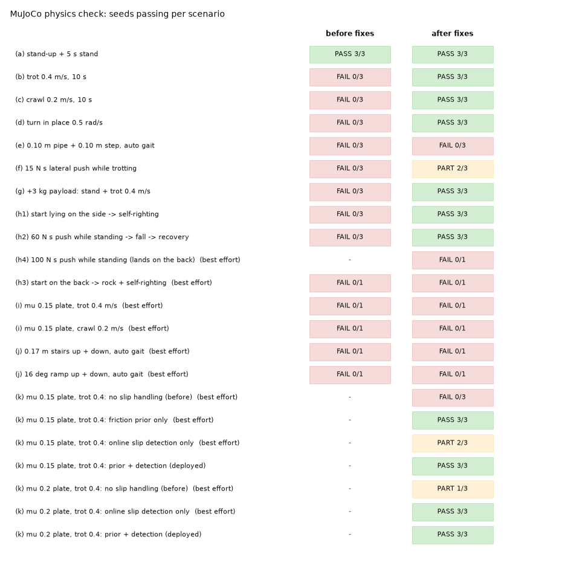
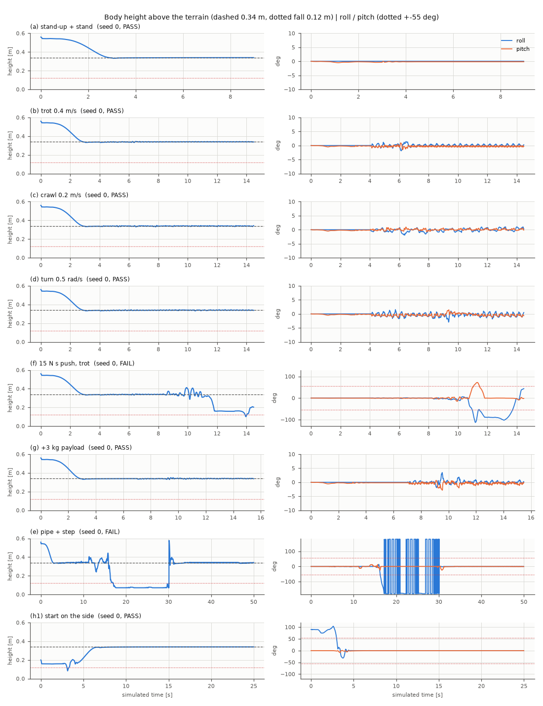
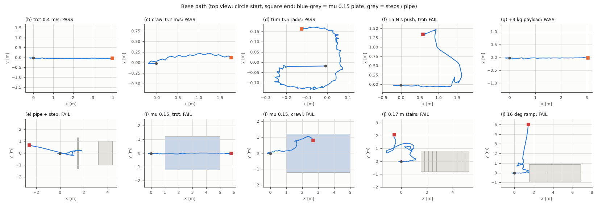
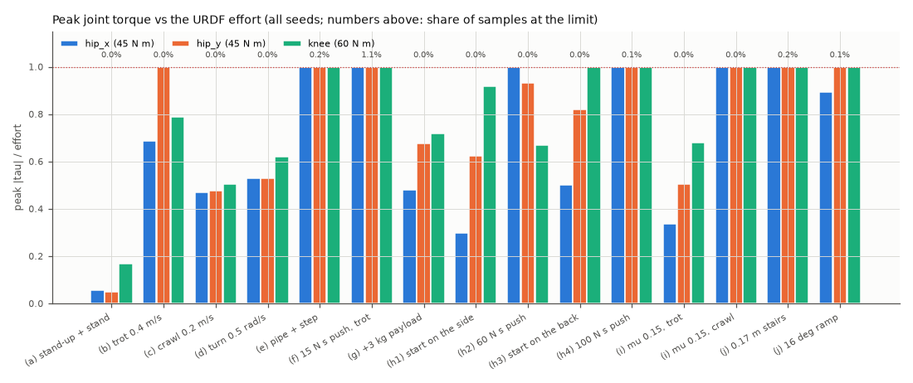
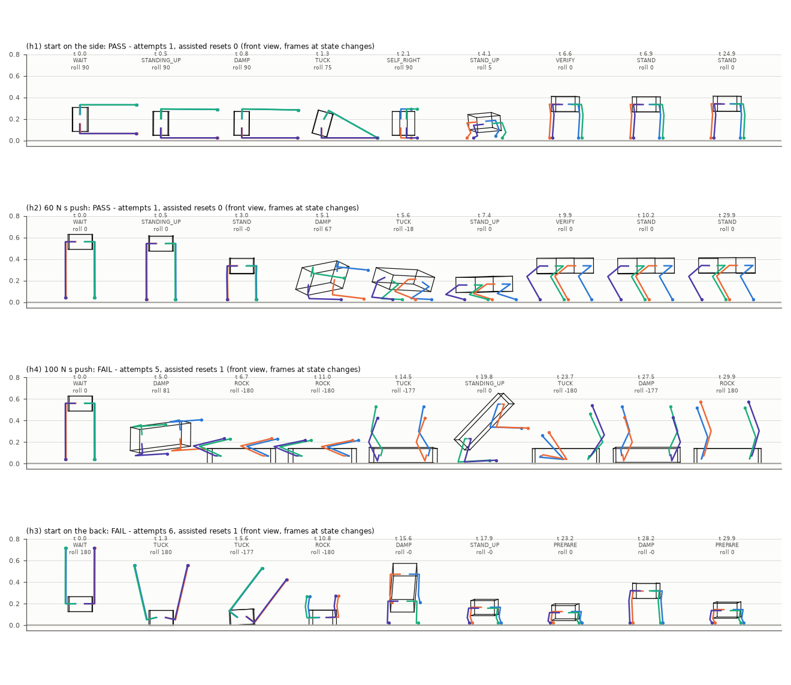
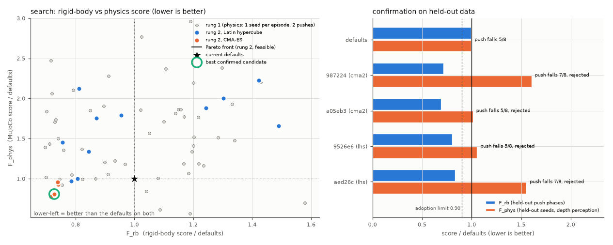
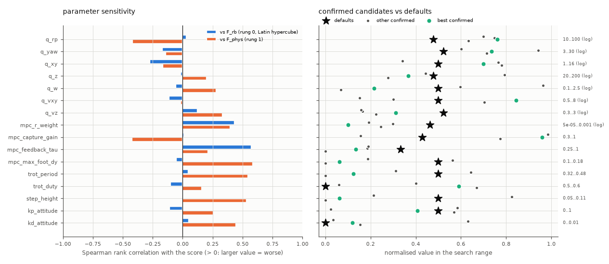
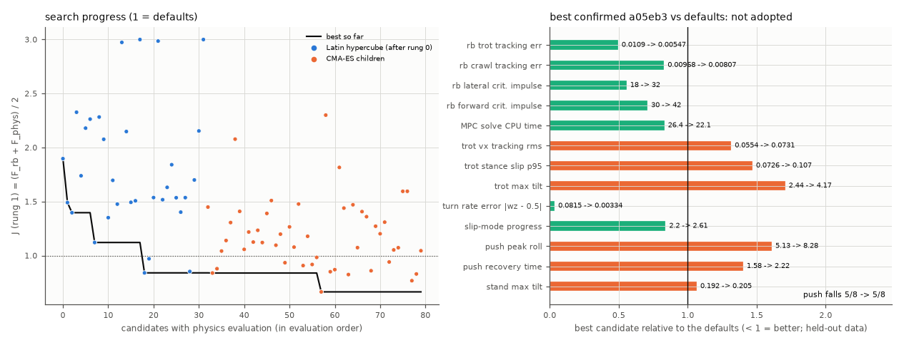
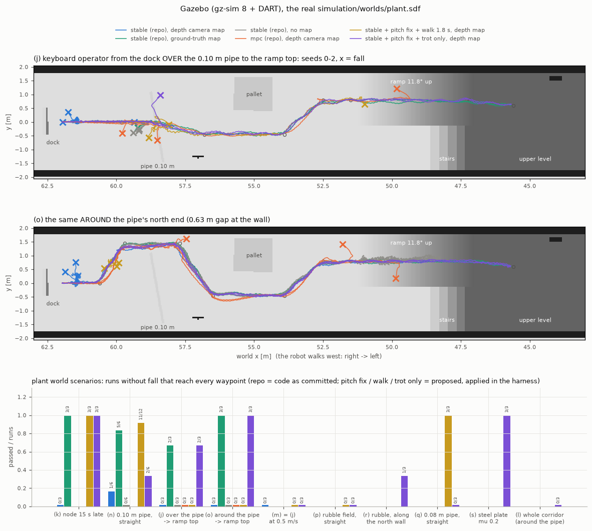

# Module 1 - 보행 제어 코어

Spot형 4족 로봇 `spot`(15 kg, 다리 0.2256 m + 0.2997 m)의 기구학, 보행 스케줄링, 자체 ADMM QP 솔버,
**5초 예측 구간의 convex centroidal MPC**, 지형 적응을 포함한 100 Hz 보행 컨트롤러, 넘어짐 감지와 자가
복구를 다룹니다. 이 패키지의 지형 인지(elevation map, foothold planner, terrain classifier)와 키보드
텔레옵은 [TERRAIN_AND_TELEOP.md](TERRAIN_AND_TELEOP.md)에서 설명합니다.

알고리즘은 모두 ROS 없이 numpy로 작성했고(Windows에서 단위 테스트), ROS 노드는 얇은 래퍼입니다.

**넘어짐 보호** (2026-11): `terrain_mapper`는 `/locomotion/state`를 구독해 로봇이 넘어져 있는 동안(mode FALLEN / RECOVERING,
또는 recovery_state가 NORMAL이 아님) 깊이 영상을 지도에 넣지 않고, 일어서면 지도를 넘어지기 2 s 전 상태로 되돌립니다
(`elevation_map.MapFallGuard`, `terrain.yaml`의 `fall_guard`, `fall_lookback` 2 s, `fall_settle` 1 s, `fall_snapshot_period` 0.5 s).
일어서며 보이는 자기 다리(SLIDE 자세에서 높이 0.27–0.31 m, 몸 중심에서 0.57–0.66 m)나 기울며 번진 점이 가짜 단차로 약 200 s 남아
미션 경로를 막던 문제를 막습니다.

**`terrain_mapper` 출력의 다른 사용처** (2026-10-26): `/elevation_map/points`는 보행 제어기 말고도 `mission_manager`,
`return_to_home`, `source_seeker`가 구독합니다. 내비 맵에 없는 장애물을 찾아 피하는 데 씁니다
(`dusan_common/dusan_common/obstacle_layer.py`, [USAGE §8.3](../docs/USAGE.md#obstacle-avoidance), [REPORT §7.8](../docs/REPORT.md#obstacle-avoidance)).
- 증거는 `step` 레이어와 같은 기준입니다(5×5 셀 창의 최고 − 최저 ≥ 0.22 m). `config/terrain.yaml`의 `map.step_crit`나
  `map.step_window`를 바꾸면 세 노드의 `obstacle_step_height`, `obstacle_step_window`도 같이 바꿔야 합니다. 테스트가 두 값이 같은지 검사합니다.
- `publish_rate`(5 Hz)가 장애물 확정 지연을 정합니다(2프레임 = 0.4 s).
- `/elevation_map/traversability`는 세 노드가 `obstacle_source: traversability`일 때만 씁니다. 기본값에서는 쓰지 않습니다.
  평탄면 경사 규칙(0.70 rad) 때문에 배관 옆면과 경사로 가장자리도 100이 되어 오검출이 났기 때문입니다(실제 경로 44셀, step 방식 0셀).
- 깊이 카메라가 아래로 0.6 rad 숙여져 있어 높은 물체의 면은 약 1.0–1.45 m 앞에서만 0.22 m step으로 보입니다. 이 거리가 장애물
  회피의 탐지 거리를 정합니다.

**보행 모드는 두 가지입니다** (`locomotion_mode`, 실행 중 `/locomotion/command`의 `mode:stable` / `mode:mpc` /
`mode:toggle`, 키보드 텔레옵 `v`):

| 모드 | 내용 |
|---|---|
| `stable` (**기본값**) | CHAMP 방식의 기구학 보행(`stable_gait.py`, §3.9). 몸체 프레임 발 궤적, Raibert 착지점, Bezier 스윙, IMU 수평 유지, 중력 피드포워드, 지지력 제한. MPC는 돌지 않음 |
| `mpc` | 5초 convex MPC + 월드 고정 착지점·몸체 목표(§3.4, §3.5). 2026-10-26에 Gazebo로 안정화(§4.8). 경사로에서는 풀이 지연 30 ms 이하가 필요 |

실제 Gazebo(gz-sim + DART)에서 두 모드를 같은 시나리오로 비교했고(§4.6), 넘어지지 않는 쪽이 분명히 `stable`이라서
기본값으로 정했습니다. 기립, 앉기, 넘어짐 복구, 슬립 모드 속도 한계, 보행 자동 선택, E-stop은 두 모드가 같은 코드를 씁니다.
보행(gait) 기본값은 **trot 고정**(`gait_mode: trot`)입니다. 실제 plant 월드에서 지형 자동 선택이 돌 때 4박자 walk로 바뀌어
넘어졌기 때문입니다(§4.7). 자동 선택은 `gait:auto`(텔레옵 `5`)로 켭니다.

| 파일 | 내용 |
|---|---|
| `module1_locomotion/kinematics.py` | 해석적 다리 FK / IK(무릎이 뒤로 굽는 해), 자코비안, 작업공간·관절 한계 클램프, 정역학 `tau = -J^T f`, base <-> world 변환 |
| `module1_locomotion/gait.py` | `GaitScheduler`(stand / trot / crawl, 안전한 전환, 임의의 미래 시간 격자에 대한 접촉 스케줄), 스윙 궤적, 지지 다각형 여유 |
| `module1_locomotion/qp.py` | 밀집 행렬용 OSQP식 ADMM QP 솔버(Ruiz 스케일링, 적응형 rho, 과완화, 웜스타트, 불가능성 감지, 해 연마), BLAS 스레드 제어 |
| `module1_locomotion/mpc.py` | `ConvexMPC`(13상태 단일 강체, 28스텝 비균일 5.0 s 예측 구간, GRF에 대한 축약 QP), Raibert + capture point 착지점 예측, 예측 관절 토크, crawl sway, 하중 관측기 |
| `module1_locomotion/controller.py` | ROS 없는 `LocomotionController`(모드, 보행 모드 전환, 지지 / 스윙 다리 제어, 지형 적응, 보행 자동 선택, 한계, 포화를 고려한 속도 스케일링, MPC 워커 스레드), PointCloud2 파서 |
| `module1_locomotion/stable_gait.py` | `StableGait`: stable 모드의 CHAMP 방식 기구학 보행(§3.9) |
| `module1_locomotion/fall_recovery.py` | 관절 공간 키프레임을 쓰는 `FallRecovery` 상태기계 |
| `module1_locomotion/slip_detector.py` | 온라인 슬립 감지 (지지발 월드 속도, 힘 비율 게이트, 히스테리시스)와 마찰계수 추정 (§3.8) |
| `module1_locomotion/friction_map.py` | 마찰 사전정보: `world_layout.yaml`의 철판/저마찰 구역 (terrain_mapper가 사용, [TERRAIN_AND_TELEOP.md §5.1](TERRAIN_AND_TELEOP.md)) |
| `module1_locomotion/gz_tools.py` | 블로킹하지 않는 `gz` CLI 래퍼(밀기, 렌치 해제, 자세 리셋) |
| `module1_locomotion/locomotion_controller_node.py` | ROS 2 노드 `locomotion_controller` |
| `config/locomotion.yaml` | 노드의 모든 파라미터(기본값은 코드와 같고 테스트로 확인) |
| `test/test_{kinematics,gait,qp,mpc,fall_recovery,controller,slip_detector,stable_gait}.py` | 단위 / 폐루프 테스트 |
| `../tools/eval_locomotion.py` | 오프라인 평가 -> `docs/images/loco_*.png`, `docs/results/locomotion_eval.json` |
| `../tools/physics_check.py` (+ `../tools/physics/`) | MuJoCo 물리 검증 (개발 전용, §4.2) -> `docs/results/physics_check.json`, `docs/images/physics_*.png` |
| `../tools/tune_locomotion.py` | MPC·보행 파라미터 자동 탐색 (개발 전용, §4.4) -> `docs/results/tuning.json`, `docs/images/tuning_*.png` |
| `../tools/gazebo_check.py` (+ `../tools/gazebo_check/`) | 실제 gz-sim + DART 헤드리스 검증, 두 보행 모드 비교, 실제 plant 월드 검증, MPC 최종 검증 (개발 전용, §4.5–4.8) -> `docs/results/gazebo_check.json`, `docs/images/gazebo_*.png` |
| `../tools/fall_check.py` | 같은 Gazebo 하네스에서 넘어짐 → 물리 자가 복구 검증(옆·등·밀기·벽·경사로·미션 중 넘어짐, 개발 전용, §4.9) -> `docs/results/fall_check.json` |
| `../tools/mission_check.py` | 같은 하네스에서 데모 미션 전체(도크 → 계기판 8개 → 가스 탐색 → 귀환·도킹), 넘어짐·멈춤 위치 분석(개발 전용, §4.10) -> `--out` 파일 |

---------------------------------------------------------------------------

## 1. 실행

```bash
# 전체 시스템 (Gazebo + 브리지 + 모든 모듈)
ros2 launch plant_simulation bringup.launch.py
# module 1만 (terrain_mapper + locomotion_controller [+ teleop]), Gazebo가 이미 실행 중일 때
ros2 launch module1_locomotion locomotion.launch.py
ros2 launch module1_locomotion locomotion.launch.py teleop_terminal:=xterm
# 컨트롤러만, 다른 파라미터 파일로
ros2 run module1_locomotion locomotion_controller --ros-args \
    --params-file $(ros2 pkg prefix module1_locomotion)/share/module1_locomotion/config/locomotion.yaml \
    -p use_sim_time:=true
# MPC 모드로 시작 (기본은 stable, 실행 중에는 'mode:mpc' 명령이나 텔레옵 v)
ros2 run module1_locomotion locomotion_controller --ros-args \
    --params-file $(ros2 pkg prefix module1_locomotion)/share/module1_locomotion/config/locomotion.yaml \
    -p use_sim_time:=true -p locomotion_mode:=mpc
```

명령(`/locomotion/command`의 `std_msgs/String`, 텔레옵도 같은 명령을 보냄):

```bash
ros2 topic pub --once /locomotion/command std_msgs/msg/String "data: 'gait:crawl'"
ros2 topic pub --once /locomotion/command std_msgs/msg/String "data: 'mode:mpc'"     # 보행 모드 전환
ros2 topic pub --once /locomotion/command std_msgs/msg/String "data: 'push:0,150'"   # base 프레임 힘 [N]
ros2 topic pub -r 20 /cmd_vel geometry_msgs/msg/Twist "{linear: {x: 0.3}, angular: {z: 0.2}}"
ros2 topic echo /locomotion/state
```

| 명령 | 동작 |
|---|---|
| `stand` / `sit` / `walk` | 발 디딤을 멈춤(안전한 보행 경계에서) / 몸체를 0.16 m로 낮춤 / `/cmd_vel`이 0이어도 제자리 걸음 |
| `gait:trot` `gait:crawl` `gait:auto` | 보행 강제 / `/terrain/info.recommended_gait`에서 선택 (`gait:walk` = `gait:crawl`, stable 모드에서는 4박자 walk). 시작 값은 `gait_mode`(기본 `trot`) |
| `mode:stable` `mode:mpc` `mode:toggle` | 보행 모드 전환. 서 있을 때 바로 적용하고, 걷는 중이면 안전한 보행 경계에서 멈춘 뒤 바꾸고 명령이 남아 있으면 새 모드로 다시 걷습니다 |
| `estop` / `release` | 관절 목표를 고정(스윙 중인 발은 먼저 내려놓음) / 측정 자세에서 일어섬 |
| `recover` | 자가 복구 시퀀스 재시작(시도 횟수 초기화) |
| `push` / `push:<fx>,<fy>` | `gz`로 `spot::base_link`에 0.2 s 동안 힘을 가함(base 프레임 성분, 기본 0 / 150 N) |
| `reset_pose` | `gz` set_pose: 현재 x, y, z + 0.5 m에 똑바로 세우고 현재 yaw 유지. 이후 일어섬 |

시작 후 일반적인 순서: 노드는 `/joint_states`와 `/odom`을 기다린 뒤, 측정 관절(스폰 시 다리가 곧게 펴져
있음)에서 서기 자세(발 위 몸체 높이 0.34 m)로 2.5 s 동안 보간하고 `STAND`가 됩니다. `/cmd_vel`이 0이
아니면 걷기 시작하고(`auto_walk`), 명령이 1 s 동안 0이면 `STAND`로 돌아갑니다.

## 2. 노드 `locomotion_controller`

### 토픽

| 방향 | 토픽 | 타입 | 비고 |
|---|---|---|---|
| sub | `/odom` | nav_msgs/Odometry | 월드 자세(프레임 `odom` = `map`), **twist는 base 프레임** |
| sub | `/imu` | sensor_msgs/Imu | IMU 자세에서 roll / pitch(`use_imu_orientation`, 50 Hz 오도메트리 대신 200 Hz), 자세 PD에 자이로 사용(`use_imu_gyro`) |
| sub | `/joint_states` | sensor_msgs/JointState | 이름으로 매핑, 순서 무관 |
| sub | `/cmd_vel` | geometry_msgs/Twist | (vx, vy, wz) 몸체 프레임, 0.5 s 타임아웃 |
| sub | `/locomotion/command` | std_msgs/String | 위 표 참고 |
| sub | `/terrain/info` | std_msgs/String JSON | `recommended_gait`, `class`, `ahead_clear`, `slippery` / `friction_mu` (마찰 사전정보 -> 슬립 모드, §3.8) |
| sub | `/elevation_map/points` | sensor_msgs/PointCloud2 | organised x/y/z 클라우드, numpy로 파싱(sensor_msgs_py 없음) -> `ElevationMap.from_cloud_xyz` |
| pub | `/spot/joint/<joint>/cmd_pos` x 12 | std_msgs/Float64 | 관절 위치 목표, 100 Hz |
| pub | `/locomotion/state` | std_msgs/String JSON | 20 Hz, 아래 참고 |
| pub | `/locomotion/fall_event` | std_msgs/String JSON | `{event: fall\|recovered\|recovery_failed\|recovery_retry\|assisted_reset, t, x, y, roll, pitch}` |
| pub | `/mpc/predicted_trajectory` | nav_msgs/Path | 자세 29개, 0 ... 5.0 s (프레임 `odom`). `/mpc/*` 네 토픽은 `mpc` 모드에서만 데이터가 나옴 |
| pub | `/mpc/footholds` | visualization_msgs/MarkerArray | 다리마다 5 s 동안의 예측 착지점을 SPHERE_LIST로 |
| pub | `/mpc/grf` | visualization_msgs/MarkerArray | 지지발마다 ARROW, t + dt가 속한 예측 스텝, `grf_arrow_scale` m/N |
| pub | `/mpc/predicted_torques` | sensor_msgs/JointState | `effort` = t + dt(현재 + 제어 주기 1회)를 포함하는 예측 스텝의 예측 토크, `position` = 예측 착지점의 IK |

`/locomotion/state`에는 DESIGN_SPEC 필드 `mode, locomotion_mode(stable|mpc), locomotion_mode_pending, gait, gait_auto,
phase, contacts[4], body_height, roll, pitch, fall_count, recovery_attempts,
recovery_success, mpc_solve_ms, mpc_status, stability_margin, terrain, cmd[3]`과 함께
`yaw, gait_mode, gait_target, assisted_resets, recovery_state,
mpc_solve_ms_mean, mpc_rejected, mpc_age, mpc_horizon_s, cmd_raw, speed_scale,
torque_ratio, torque_horizon_max[12]`(첫 1초 동안 관절별 예측 최대 |tau|),
`ground_z, terrain_pitch, ik_reachable`이 들어갑니다. NaN은 `null`로 보냅니다.
미끄러운 바닥 상태(§3.8)도 함께 보냅니다: `slip`(감지 플래그), `slip_mode`(슬립 모드 동작 중),
`slip_source`(`detected` | `terrain` | `both` | `none`), `slip_speed`(지지발 최대 속도 [m/s]),
`slip_legs[4]`, `slip_events`(감지 횟수), `mu_est`(마찰 추정), `mpc_mu`(이번 MPC의 마찰계수),
`friction_prior`(/terrain/info의 μ, 없으면 null), `torque_ff`(토크 피드포워드 이득).

### 스레드

`MultiThreadedExecutor`(스레드 4개): 100 Hz 제어 타이머는 자체 상호 배타 콜백 그룹을, elevation map 파싱은
다른 상호 배타 그룹을, 센서 구독은 재진입 가능 그룹을 씁니다. MPC는 컨트롤러의 워커 스레드에서
풀므로(`use_mpc_thread`) MPC 풀이나 맵 갱신이 느려도 관절 명령이 늦어지지 않습니다. BLAS 풀은 스레드
1개로 제한합니다(`blas_threads`). 약 300 x 300 행렬에서는 이 설정이 가장 빠르고, Gazebo와 CPU를 두고
경쟁하는 것도 피합니다.

### 파라미터 (모두 `config/locomotion.yaml`)

| 그룹 | 파라미터 (기본값) |
|---|---|
| 보행 모드 | `locomotion_mode` stable (또는 mpc) |
| 루프 | `control_rate` 100 Hz, `mpc_rate` 20 Hz, `use_mpc_thread` true, `mpc_max_age` 0.3 s, `state_rate` 20 Hz, `viz_rate` 5 Hz, `cmd_timeout` 0.5 s, `sensor_timeout` 0.5 s, `startup_delay` 0.5 s, `blas_threads` 1 |
| 상태 추정 | `use_imu_orientation` true, `use_imu_gyro` true, `odom_velocity_source` differentiate(연속한 `/odom` 자세에서 속도 계산, `odom_velocity_tau` 0.08 s. `twist` = gz twist의 0.2 s 이동 평균), `odom_extrapolate` true(`odom_max_extrapolation` 0.05 s) |
| 자세 | `body_height` 0.34, `sit_height` 0.16, `stand_up_duration` 2.5 s, `sit_duration` 2.0 s, `stance_width_offset` 0, `body_x_offset` 0 |
| 보행 | `gait_mode` trot(기본, §4.7. `auto` = 지형 자동 선택, `crawl`), `default_gait` trot, `trot_period` 0.40 / `trot_duty` 0.50, `crawl_period` 1.20 / `crawl_duty` 0.80, `auto_walk`, `idle_to_stand_time` 1.0 s, `crawl_to_trot_delay` 1.0 s(히스테리시스), `terrain_info_timeout` 2 s, `blocked_speed_scale` 0.7 |
| 한계 | trot vx/vy/wz 0.6 / 0.3 / 0.9, crawl 0.25 / 0.12 / 0.5, 가속도 0.8 / 0.5 m/s^2, 1.5 rad/s^2, `cmd_deadband` 0.02 |
| 스윙 | `step_height` 0.08 (crawl 0.10), `swing_clearance` 0.04, `swing_max_lift` 0.25, `swing_lift_fraction` 0.2, `swing_retarget_until` 0.8 (trot; crawl `crawl_retarget_until` 0 = 재타겟 없음), `max_retarget_step` 0.06, `touchdown_measured_xy` |
| 몸체 | `body_lead_time` 0.02 s, `body_target_mode` integrated(또는 prediction), `max_body_lead` 0.06 m(측방은 `max_body_lead_lateral` 0.015 m), `max_yaw_lead` 0.05 rad (crawl은 `crawl_max_body_lead` 0.10 m / `crawl_max_body_lead_lateral` 0.03 m / `crawl_max_yaw_lead` 0.20 rad, §4.5), `mpc_lateral_ref_blend` 0.5(§4.8), `kp_attitude` 0.0(2026-10-26, 이전 0.5, §4.8), `kd_attitude` 0.0, `max_attitude_correction` 0.15 rad, `ki_height` 0.5, `max_height_integral` 0.03, `max_body_pitch` 0.30, `terrain_pitch_gain` 1.0, `ground_filter_tau` 0.2, `stand_filter_tau` 0.3, `max_joint_speed` 12 rad/s |
| 서보 | `torque_feedforward` 0.0(꺼짐. MPC 지지 토크 중 `tau / servo_kp`로 위치 목표에 더하는 비율), `servo_kp` 450 N m/rad(= `spot.urdf.xacro`의 `servo_p_gain`) |
| 지형 | `use_foothold_planner` true, `foothold_search_radius` 0.10, `foothold_keep_unseen` true(stable: 착지 셀이 맵에 없으면 공칭 착지점 유지, §3.9) |
| 포화 | `torque_scale_threshold` 0.85, `torque_recover_threshold` 0.70, `speed_scale_min` 0.3, `speed_scale_down` 0.9, `speed_scale_up` 0.02 |
| 넘어짐 | `auto_recover`, `fall_angle_deg` 55, `fall_height` 0.12, `fall_detect_time` 0.3, `fall_lean_deg` 30 / `fall_lean_time` 2.0 s(벽에 기대 선 자세), `max_recovery_attempts` 3, `assisted_reset` false(true면 3회 실패 뒤 gz set_pose 순간이동), `reset_height_offset` 0.5, `reset_settle_time` 1.0, `reset_confirm_timeout` 8.0, `recovery_retry_time` 5.0 |
| gz | `enable_gz_tools`, `gz_timeout` 3 s, `push_force_x/y` 0 / 150 N, `push_duration` 0.2 s, `grf_arrow_scale` 0.004 m/N |
| MPC | `mpc_mass` 15, `mpc_mu` 0.5, `mpc_f_min` 0, `mpc_f_max` 250 N, `mpc_q_weights` [30 30 10 4 4 60 0.5 0.5 0.5 2 2 1], `mpc_r_weight` 2e-4, `mpc_time_weighting`, `mpc_tail_decay` 0, `mpc_capture_gain` 0.6, `mpc_feedback_tau` 0.5 s, `mpc_max_foot_dx/dy` 0.16 / 0.14, `mpc_terrain_horizon` 1.2 s, `mpc_sway_gain` 0.5, `mpc_sway_smooth` 0.5 s, `mpc_sway_ramp` 0.6 s, `mpc_anchor_window` 0(= 보행 주기), `mpc_terrain_robust` true(중앙값 + Theil-Sen 지형 기준, §3.4), `mpc_qp_max_iter` 250, `mpc_qp_eps` 1e-3, `mpc_qp_time_limit` 0.04 s |
| MPC 지지·회전 (§4.8) | `mpc_stance_max_error` 0.02 m, `mpc_stance_rel_error` 0.02 m, `mpc_heading_hold_gain` 1.0 1/s / `mpc_heading_hold_max` 0.2 rad/s, `mpc_land_tau` 0.05 s, `mpc_contact_lift` 0.02 m, `mpc_contact_map_tol` 0.04 m, `swing_guard_clearance` 0.02 m, `swing_guard_radius` 0.06 m, `retarget_check_radius` 0.05 m, `retarget_jump_until` 0.3, `mpc_turn_pivot_x` −0.15 m(0 = 원점 회전), `mpc_turn_pivot_fade` 0.10 m/s. 모두 MPC 모드에서만 씀. `mpc_stance_*`, `mpc_heading_hold_gain`, `mpc_land_tau`, `mpc_contact_lift`, `swing_guard_clearance`는 0이면 꺼짐 |
| 미끄러운 바닥 (§3.8) | 감지: `slip_detection` true, `slip_speed_threshold` 0.08 m/s, `slip_window` 0.06 s, `slip_settle_time` 0.03 s, `slip_min_legs` 2, `slip_max_force_ratio` 0.4, `slip_confirm_time` 0.10 s, `slip_decay` 0.5, `slip_release_time` 2.0 s + `slip_release_distance` 3.0 m, `slip_max_tilt_deg` 15; 추정: `slip_mu_min` 0.15, `slip_mu_margin` 1.0, `slip_mu_drop` 0.6, `slip_recover_tau` 8 s, `slip_min_normal_force` 20 N; 슬립 모드: `use_terrain_friction` true, `slip_gait` keep, `slip_max_vx/vy/wz` 0.2 / 0.1 / 0.4, `slip_accel_scale` 0.5, `slip_torque_feedforward` 1.0, `slip_ff_ramp_time` 0.5 s, `slip_max_body_lead` 0.015 m, `slip_resync_feet` true, `slip_stance_width_offset` 0 |
| stable 보행 (§3.9) | `stable_trot_period` 0.40 / `stable_trot_duty` 0.60, `stable_walk_period` 1.20 / `stable_walk_duty` 0.80, 한계 trot 0.5 / 0.25 / 0.8, walk 0.2 / 0.1 / 0.4, `stable_step_height` 0.07 (walk 0.08), `stable_stance_depth` 0.005, `stable_retarget_until` 0.8, `stable_max_retarget_step` 0.015 m(맵·foothold planner가 있을 때만), `stable_retarget_jump` 0.05 m / `stable_retarget_jump_until` 0.25, `stable_max_step_x/y` 0.12 / 0.08 |
| stable 장애물 보행 (§3.9) | `stable_obstacle_trot_period` 0.5 s / `stable_obstacle_trot_duty` 0.6(0 = 끔), `stable_obstacle_height` 0.04 m, `stable_obstacle_ahead` 0.55 m, `stable_obstacle_hold` 1.0 s, `stable_obstacle_early_x` true, `stable_terrain_pitch_window` 0.12 m(0 = 공칭 착지점 높이 그대로) |
| stable 안정화 | `stable_stance_max_error` 0.015 m(지지력 제한), `stable_raibert_gain` 0.1 s(`stable_max_feedback` 0.05 m), `stable_kp_level` 0.3 / `stable_ki_level` 1.0 / `stable_max_level` 0.15 rad, `stable_ki_height` 1.0 / `stable_max_height_corr` 0.03 m, `stable_gravity_ff` 1.0, `stable_load_ramp` 0.03 s, `stable_load_tau` 0.1 s, `stable_land_tau` 0.05 s, `stable_swing_attitude_blend` 0, `stable_walk_sway` 0.4 (`stable_walk_sway_x` 0, `stable_walk_sway_smooth` 0.5 s), `stable_stand_center_tau` 0.5 s, `stable_heading_hold_gain` 1.0 / `stable_heading_hold_max` 0.2 rad/s |
| 토픽 | `odom_topic`, `imu_topic`, `joint_states_topic`, `cmd_vel_topic`, `command_topic`, `terrain_info_topic`, `elevation_topic`, `world_frame` |

---------------------------------------------------------------------------

## 3. 알고리즘

### 3.1 기구학 (`kinematics.py`)

트리(모든 각도 0 = 다리가 수직 아래), `sx = +1` 앞 / `-1` 뒤, `sy = +1` 왼쪽 / `-1` 오른쪽:
hip_x(축 +X)는 `h = (sx 0.2245, sy 0.044, 0)`, hip_y(축 +Y)는 `(0, sy 0.090, 0)`, knee(축 +Y)는
`(0, 0, -L1)`, 발 중심은 `(0, 0, -L2)`에 있습니다. 시상면 좌표로 쓰면

```
x' = -L1 sin q1 - L2 sin(q1 + q2)          z' = -L1 cos q1 - L2 cos(q1 + q2)
p  = h + [ x',  a cos q0 - z' sin q0,  a sin q0 + z' cos q0 ],   a = sy * 0.090
```

`hip_y > 0`이면 발이 뒤로 가고, `knee < 0`이면 무릎이 뒤로 굽습니다.
IK: `q0 = atan2(dz, dy) - atan2(z', a)`, `z' = -sqrt(dy^2 + dz^2 - a^2)`(발이 hip_y 축 아래),
이어서 평면 2링크 사슬 `q2 = -acos((r^2 - L1^2 - L2^2) / (2 L1 L2))`(무릎이 뒤로 굽는 해),
`q1 = atan2(-x', -z') - atan2(L2 sin q2, L1 + L2 cos q2)`입니다. 무릎 한계로 정해지는 도달 고리
`[R_min, R_max]` 밖의 목표는 반지름 방향으로 투영한 뒤 관절을 URDF 한계로 클램프하며, 함수는 도달 가능
여부를 함께 돌려줍니다. 해석적 자코비안은 유한 차분과 비교해 검증했고, `joint_torques`는
`tau_i = -J_i(q)^T R^T f_i`를 구현합니다. 모든 함수는 다리와 시간 스텝에 대해 벡터화되어 있습니다(MPC는
28 x 4개의 IK를 한 번에 계산).

### 3.2 보행 (`gait.py`)

전역 위상 `phi`, 다리별 스윙 시작 오프셋, 국소 위상 `l_i = (phi - offset_i) mod 1`을 쓰고,
`l_i < 1 - duty`인 동안 스윙합니다.

| 보행 | 주기 | duty | 오프셋 FL FR RL RR | 순서 |
|---|---|---|---|---|
| stand | - | 1 | - | - |
| trot | 0.40 s | 0.50 | 0, .5, .5, 0 | 대각 쌍 |
| crawl | 1.20 s | 0.80 (`crawl_duty`. 라이브러리 기본값이자 최솟값은 0.75) | 0, .5, .75, .25 | FL -> RR -> FR -> RL (한 번에 다리 하나, 박자 사이에 4다리 지지 구간) |

*전환*은 대기열에 넣었다가 안전한 경계에서 실행합니다. stand -> 보행은 즉시, 보행 -> stand는 스윙 중인
다리가 없는 다음 스윙 종료 시점, 보행 -> 보행은 주기가 한 바퀴 돌 때입니다(trot과 crawl의 위상 0에서는
스윙 중인 다리가 없음). `contacts_at(times)`는 *대기 중인 전환까지 포함해* 임의의 미래 격자에서 스케줄을
예측하며(MPC 예측 구간에 사용), 결과는 `update`를 차례로 호출했을 때와 같습니다(테스트로 확인).

*스윙 궤적*: 이륙점 `p0`에서 착지점 `p1`까지 수평은 최소 저크 블렌드 `10u^3 - 15u^4 + 6u^5`, 수직은 3차
베지어 상승 / 유지 / 하강이고 양 끝 속도는 0입니다. 정점
`z_apex = max(max(z0, z1) + step_height, h_obstacle + r_foot + clearance)`는 `max_lift`로 제한하며,
`h_obstacle = max_height_along(emap, p0, p1)`(지형 쪽 기능)입니다. 장애물 때문에 정점이 높아지면 발을
먼저 들어 올린 다음 앞으로 옮깁니다(`swing_lift_fraction`). trot에서는 스윙의 80 %까지 새 MPC 착지점을
따라갑니다(`swing_retarget_until`, MPC 갱신당 최대 `max_retarget_step` 6 cm). crawl은 이륙 때의 착지점을
유지합니다(`crawl_retarget_until` 0, §4.2 참고).

### 3.3 QP 솔버 (`qp.py`)

`min 1/2 x'Px + q'x  s.t.  l <= Ax <= u`, OSQP 알고리즘(Stellato et al. 2020):

```
x~ = (P + sigma I + A' diag(rho) A)^-1 (sigma x - q + A'(rho z - y))
x  = alpha x~ + (1 - alpha) x                       (과완화, alpha = 1.6)
z  = Pi_[l,u]( alpha A x~ + (1 - alpha) z + y / rho )
y  = y + rho ( alpha A x~ + (1 - alpha) z_old - z )
```

비용 스케일링을 포함한 수정 Ruiz 평형화, 행별 rho(등식 x 1e3, 자유 행 rho_min), 잔차 균형 rho 적응(5배
이상 변할 때만 재분해), x와 y의 웜스타트, 스케일하지 않은 절대 + 상대 primal/dual 잔차에 의한 종료,
primal·dual 불가능성 인증서, 벽시계 상한, OSQP *해 연마*(추정한 활성 집합에서 축소 KKT 시스템, Schur
보수 + 반복 개선, primal-dual 활성 집합 보정, 잔차를 악화시키지 않을 때만 채택)를 구현했습니다. 밀집
행렬은 rho마다 한 번 역행렬을 구하고, MPC의 마찰 피라미드 행렬(> 99 %가 0)은 스케일링과
`A' diag(rho) A`에 희소 코드 경로를 씁니다. 닫힌 형태 해, OSQP 문서 예제, scipy와 비교한 무작위 QP,
불가능 문제, 조건수가 나쁜 헤시안으로 테스트했습니다.

### 3.4 Convex MPC (`mpc.py`)

**모델** (Di Carlo et al., IROS 2018). 단일 강체, 질량 `m = 15 kg`,
관성 `I_b = diag(0.07, 0.32, 0.34)`(`robot_model.MPC_BODY_INERTIA`), 상태는

```
x = [roll pitch yaw | px py pz | wx wy wz | vx vy vz | g]       (13, g = -9.81)
d/dt Theta = Rz(psi)^T w        d/dt p = v
d/dt w     = I_w^-1 sum_i r_i x f_i + alpha_bias,    I_w = Rz(psi) I_b Rz(psi)^T
d/dt v     = sum_i f_i / m + [0 0 g] + a_bias
```

각 스텝의 기준 yaw `psi_k`에서 선형화하고, 모멘트 팔 `r_i = p_contact,i - p_com`은 이전 해의 예측 CoM
경로에서 잡습니다(`exp(-t / 0.5 s)`로 기준 경로에 섞음). 아핀 항은 13번째 상태에 실립니다.
`M = [[A, B], [0, 0]]`이 `M^3 = 0`을 만족하므로 영차 유지 이산화가 닫힌 형태로 정확합니다:
`A_d = I + A dt + A^2 dt^2 / 2`, `B_d = B dt + A B dt^2 / 2`.

**예측 구간** 10 x 0.05 s + 18 x 0.25 s = **5.0 s**(28스텝). 거친 스텝 하나가 trot 지지 시간보다 길기
때문에, 모든 스텝은 다리 i의 스텝 k 안 *접촉 비율* `c_ik`를 씁니다(2.5 ms 격자에서
`GaitScheduler.contacts_at`으로 계산). 스텝 힘은 `fmin c <= f_z <= fmax c`인 시간 평균 GRF이고, 지렛대
팔은 접촉 가중 평균 착지점이며, `c < 0.05`인 다리는 스윙 다리로 보고 힘을 문제에서 뺍니다(정확히 0).

**축약 QP**: 활성 GRF `U`에 대해(`x_k = Phi_k x_0 + Gamma_k U`):

```
min  sum_k w_k (x_k - x_ref,k)' Q (x_k - x_ref,k) + sum_k w_k alpha ||u_k - u_nom,k||^2
s.t. |f_x| <= mu f_z,  |f_y| <= mu f_z,  fmin c <= f_z <= fmax c       (마찰 피라미드)
```

`w_k = dt_k / dt_0`로 비용이 시간 적분이 되고, `u_nom`은 중력을 보상하는 분배입니다(높이를 치우치게 하지
않으면서 내부에서 조이는 힘을 억제하는 약한 정규화). `H = sum Gamma_k' W_k Gamma_k`를 만들 때 `Gamma`의
블록 하삼각 구조를 활용합니다. QP는 웜스타트(이전 해를 시간 이동, 나머지는 중력 보상)로부터의 편차에 대해
연마와 함께 풉니다. 변수 약 250-300개, ADMM 반복 약 15회입니다.

**기준 궤적**: 명령 몸체 twist를 yaw를 따라 적분하고(`yaw = yaw0 + wz t`), 높이는 `몸 아래 지형(elevation map,
없으면 지지발 지면 추정) + body_height`, pitch는 앞뒤 지형 높이 차(계단, 경사로)에서 구해 0.2 s로 평활합니다.
`STAND`에서는 발 중심 위치와 방향을 유지합니다. 지형은 기본으로 강건하게 추정합니다(`mpc_terrain_robust` true,
`ConvexMPC._robust_terrain`). 몸 밑의 좌·중·우 세 줄을 뒤 착지점 5 cm 뒤부터 앞 착지점 5 cm 앞까지 표본으로 뽑습니다.
높이는 표본의 중앙값, pitch는 열 중앙값들의 Theil-Sen 기울기(모든 쌍 기울기의 중앙값)입니다. 경사로에서는 두 값이 평면과
같고, 배관이나 깊이 맵의 벽 모서리(열의 약 2/9 이하)는 무시됩니다. 네 명목 착지점만 쓰면(false) 앞발 밑 0.10 m 배관이
12° 경사로처럼 보여 몸이 5 cm 들렸다 떨어졌습니다(Gazebo, C-OBS1에서 넘어짐).

**예측 구간의 착지점**: 예측된 모든 착지(모든 다리, 5 s 전체, 한 번의 벡터화 계산)에 대해

```
p_foot = p_hip(t_td + T_st/2)                                   (지지 중간 시점의 기준 경로 위 hip)
       + (T_st/2 + k_cp sqrt(h/g)) (v - v_ref) exp(-t_td / tau)  (Raibert + capture point, 점차 감소)
       + (h / 2g) (v_ref x w_ref)                               (선회)
```

hip 주변 +-0.16 / +-0.14 m(heading 프레임)로 클램프합니다. 첫 1.2 s의 착지점은 지형 쪽
`FootholdPlanner.select`로 다듬고(경사 / 거칠기 / 모서리 비용, 클램프 밖으로 최대 5 cm), 나머지는
elevation map 높이를 씁니다. 이것이 "다음 5 s의 발 위치"입니다(`/mpc/footholds`).

**Crawl sway.** 3다리 지지 구간에서는 CoM 기준을 경로에서 계획된 지지 삼각형의 무게중심 쪽으로
`sway_gain`(0.5)만큼 옮기고, 0.5 s Hann 창으로 평활합니다(기준 sway 가속도 최대는 기본 duty 0.80에서
3.5 m/s^2, duty 0.75에서 3.7 m/s^2로 마찰 한계 `mu g` 안. 무게중심 자체(gain 1)로 옮기면 약 10 m/s^2
필요). crawl을 시작할 때는 0.6 s에 걸쳐 서서히 적용합니다. 착지점을 계획하는 경로는 측정 위치의
*보행 주기 평균*에서 시작하며, 각 위치는 명령 변위 `D(t)`로 전파합니다: 한 주기에 걸쳐
`a = mean_i(p_i - D(t_i)) + D(t)`. 주기적인 sway는 정확히 상쇄되고, 명령보다 뒤처진 몸체에는 앞선 경로가
주어집니다. capture point 항은 sway가 적용된 기준(이전 해의 sway 속도)에 대한 속도 오차를 씁니다.
(이전 버전은 경로를 "측정값 빼기 예측 sway"에 고정하고 capture point 항에 sway를 빼지 않은 속도를
썼습니다. 둘 다 양의 피드백을 만들어 crawl이 옆으로 표류하고 명령 속도의 절반에 머물렀습니다. 회귀
테스트로 확인합니다.)

**토크** ("다음 5 s의 토크"): 각 스텝에서 예측 착지점을 예측 몸체 프레임으로 표현해 `q = IK(...)`를
구하고 `tau = -J(q)^T R^T f / c`(접촉 중의 힘)를 계산합니다. 첫 1초 동안의 최대 비율 `|tau| / effort`가
속도 스케일링을 결정합니다.

일정한 선 / 각 가속도 편향(하중, CoM 오프셋)을 추정하는 1차 **외란 관측기**(`AccelBiasObserver`)를 아핀
열에 넣을 수 있습니다. 평가(하중 실험)에서 사용합니다.

### 3.5 컨트롤러 (`controller.py`)

```
            start / release / reset done
                    v
   +------------ STANDING_UP (2.5 s joint interpolation from ANY posture)
   |                 | done
   v      cmd != 0   v      sit                  stand
 ESTOP <-- any -- STAND <---------> WALK      STAND ----> SIT ----> STANDING_UP
  (estop)            ^  idle 1 s     |
                     +---------------+
   fall detected (any of STAND/WALK/SIT/STANDING_UP) -> FALLEN -> RECOVERING -> STAND
```

STANDING_UP은 어떤 자세에서든 2.5 s 관절 보간으로 일어서는 상태이고, 넘어짐은 STAND / WALK / SIT /
STANDING_UP 어디에서든 감지합니다.

100 Hz 스텝마다:

1. **지면 / 지형**: base와 네 명목 착지점 아래를 맵에서 한 번에 벡터화 조회합니다. 맵 높이가 지지발
   추정과 0.35 m 안에서 일치하면 맵 높이를, 아니면 지지발 높이를 지면 높이로 씁니다(평지 대체 경로.
   z = -0.88인 복도 하층에서도 동작하며, 바닥 z = 0을 가정하지 않음). 지형 pitch는 앞뒤 높이에서
   구합니다(+-0.30 rad).
2. **보행**: 기본은 trot 고정(`gait_mode: trot`, §4.7의 Gazebo plant 월드 결과로 선택)입니다. auto 모드(`gait:auto`,
   텔레옵 `5`)는 `recommended_gait`를 따르고(crawl은 즉시, trot 권장이 1 s 이어지면 trot으로 복귀), `gait:trot|crawl`로
   강제할 수 있습니다. 명령은 보행별로 제한하고(전환 중에는 더 느린 쪽 한계),
   가속도를 제한하며, `speed_scale`을 곱하고 `ahead_clear`가 false이면 0.7을 더 곱합니다.
3. **스윙 다리** 이륙 시: 목표는 예측 착지 시각이 맞는(+-0.12 s) MPC 착지점, 없으면 foothold planner로
   다듬은 국소 Raibert/capture point 착지점입니다. 장애물 위로 정점을 올리고, 착지하면 측정된 발 xy를
   고정합니다.
4. **MPC**: 보행 스케줄 스냅샷, elevation map 높이 함수, foothold planner와 함께 20 Hz로 워커 스레드에
   제출합니다. 타당하지 않은 예측(비유한 값, |roll|/|pitch| > 0.6 rad, 0.5 s 안에 높이가 0.15 m 넘게
   벗어남)은 버립니다.
5. **몸체 목표**: MPC의 `t + lead` 시점 값, STAND에서는 발 중심 위의 필터링된 자세입니다. 기본
   `body_target_mode: integrated`에서는 수평 위치와 heading을 MPC 예측 속도 / yaw rate로 적분한 내부
   상태로 둡니다(trot에서는 측정 자세보다 최대 0.06 m / 0.05 rad 앞서고, 그중 측방은 최대 0.015 m. crawl은
   CoM sway 때문에 0.10 m / 0.20 rad / 측방 0.03 m. 몸체 옆에 남은 목표는 다음 착지 때 몸체를 세게 끌어당김).
   이 리드는 지지발에 걸리는 수평 힘 요구이기도 합니다. 지지 다리 하나의 발끝 강성이 약 4.5 kN/m라서 예전
   trot 값 0.10 m / 0.20 rad는 마찰 한계(약 130 N)를 크게 넘었고, Gazebo(DART)에서 회전 중 지지발이 미끄러져
   넘어졌습니다(§4.5). 높이와 roll / pitch는 MPC의 지형 기준을 씁니다. 대안인
   `prediction`은 예측 자세 자체를 씁니다. 매 풀이가 측정 상태에서 시작하므로 이 목표는 초당 20번 측정
   자세에 다시 고정되고, 관절 서보가 늦으면 보행이 느려집니다(1차 서보 지연이 있는 운동학 모델, 0.5 m/s
   trot 명령: 지연 0 / 30 / 60 ms에서 0.50 / 0.31 / 0.08 m/s, `integrated`는 0.50 / 0.55 / 0.53 m/s.
   테스트로 확인). 그 위에 IMU roll/pitch PD 보정(`kp_attitude` 0.0, `kd_attitude` 0, 클램프 0.15 rad.
   roll / pitch는 200 Hz IMU 자세)과 높이 적분기가 작용합니다. `kp_attitude`는 2026-10-26에 0.5에서 0.0으로 바꿨습니다.
   Gazebo에서 약 30 ms MPC 지연이 있을 때 P 보정이 IK roll을 최대 8.6°까지 키웠기 때문입니다(§4.8). 서보가 강하면 몸체가 IK 자세를 수 ms 안에
   따라가므로, D항은 이전 보정에 대한 이득 `kd / tau`처럼 작동합니다. 서보 / 몸체 지연이 5-10 ms이면
   `kd_attitude` 0.02에서 리밋 사이클(50 Hz에서 약 +-0.1 rad)이 생깁니다(IK 자세를 1차 지연으로 따라가는
   플랜트로 테스트). gz PID 힘 모드 서보를 쓰는 MuJoCo 물리 검증(§4.2)에서는 D항을 0으로 둡니다(강한 관절
   서보와 함께 리밋 사이클을 만들고 밀기 복구를 악화시켰음).
6. **지지발**은 월드에 고정됩니다: `p_b = R_cmd^T (p_foot_w - p_cmd)` -> 해석적 IK. 스윙 발은 궤적을
   따르고, 관절 한계와 12 rad/s 목표 변화율 제한을 적용합니다. WALK에서는 지지발 앵커를 측정 발에서 2 cm 안으로 묶고
   (`mpc_stance_max_error`), 정적 처짐을 뺀 수평 처짐도 2 cm로 제한합니다(`mpc_stance_rel_error`). 서보는 처짐을 수평 힘으로
   바꾸므로 이 두 값이 지지발의 힘 한계입니다. 내려오는 스윙 발은 맵의 장애물 위에 머물게 합니다(`swing_guard_*`). 자세한
   이유는 §4.8에 있습니다.
7. **포화를 고려한 속도 스케일링**: 예측 토크 비가 0.85를 넘으면 MPC 풀이마다 `speed_scale *= 0.9`
   (최소 0.3), 0.70 미만이면 `+0.02`.

*중단 처리*(넘어짐, E-stop 해제, `recover`, `reset_pose`, 시계 점프. 시계가 되돌아가면 노드는
`startup_delay` 게이트도 다시 걸고 마지막 `/cmd_vel`을 버리므로, Gazebo 월드 리셋 후 0.5 s 뒤에 관절 명령이
재개됨): 가공된 명령을 0으로 리셋하고(다음 걷기는 넘어지기 전 속도가 아니라 가속 램프에서 시작), 대기 중인
`walk` / `sit` 요청을 버리고, MPC를 무효화합니다. 워커 스레드에서 아직 돌고 있는 풀이는 이전 동작의
것이므로 결과를 폐기합니다(세대 카운터, 시계 점프에도 안전). 스윙 재타겟은 `mpc_max_age`보다 새로운
계획만 따릅니다. `/odom`이나 `/joint_states`가 5 s 동안 없으면 어떤 토픽을 기다리는지 로그로 남깁니다.

토크 구현: 관절 위치 목표는 PID 힘 모드의 Gazebo JointPositionController로 갑니다(p 450, d 3, 출력은 관절
effort 45 / 45 / 60 N m로 제한. `spot.urdf.xacro`, DESIGN_SPEC §3). MPC 힘 / 토크는 몸체 궤적 뒤에 있는
계획이며, 모니터링용으로 발행하고 속도 스케일링에 씁니다. 선택적으로(`torque_feedforward`, 기본 0) 지지
다리의 MPC 토크를 `tau / servo_kp`로 위치 목표에 더하면 PD 서보의 하중 비례 처짐이 사라집니다.

토크 피드포워드는 MuJoCo 물리 검증(§4.2)에서 trot 지지발 미끄러짐 p95를 0.19 → 0.015 m/s로,
서기·탑재 높이를 0.340 m로, 회전을 0.497 rad/s로 개선했습니다. 하지만 측면 밀기 복구가 0/6이
되어(끄면 3/6) 기본값은 0입니다. 미끄러운 바닥의 슬립 모드에서만 켭니다
(`slip_torque_feedforward` 1.0, §3.8).

### 3.6 넘어짐 복구 (`fall_recovery.py`)

```
NORMAL --(|roll| 또는 |pitch| > 55 deg 또는 높이 < 0.12 m가 0.3 s 지속, 해제 문턱 50 deg / 0.14 m;
          또는 |roll| 또는 |pitch| > 30 deg가 2 s 지속 = 벽 등에 기대 섬)--> FALL_DETECTED
FALL_DETECTED -> DAMP -> TUCK -> [|roll| > 120 deg이면 ROCK] -> SELF_RIGHT -> PREPARE -> STAND_UP -> VERIFY -> NORMAL
SELF_RIGHT --(배 대신 등 쪽으로 넘어감)--> ROCK (다음 시도로 셈, DAMP / TUCK 생략)
ROCK --(양쪽 방향 모두 시간 초과 + 장애물에 받쳐 누움: 중앙값 |pitch| > 7 deg, 높이 < 0.2 m)--> SLIDE -> DAMP (다음 시도)
VERIFY --(몸은 바로 섰는데(|roll| < 20 deg) |pitch| > 30 deg로 두 번째 실패: 턱에 걸침)--> BACK_OFF -> DAMP
실패 -> 다음 시도 (DAMP) ... 3회 시도 후 -> recovery_failed -> FAILED
                                         (assisted_reset: true일 때만 ASSISTED_RESET = gz set_pose 순간이동)
FAILED --(다리로 서 있음이 0.3 s 확인)--> NORMAL (컨트롤러가 측정 자세에서 일어섬)
       --(recovery_retry_time 5 s 뒤)--> recovery_retry -> DAMP (3회 시도를 새로 시작, 일어설 때까지 반복)
```

기본값은 순간이동 없이 로봇이 자기 다리로 일어나는 **물리 복구**입니다(`assisted_reset: false`). 3회 시도가 모두
실패해도 포기하지 않고 `recovery_retry_time`(5 s)을 쉰 뒤 처음부터 다시 시도합니다. 일어서면 STAND로 돌아가고,
미션 관리자는 현재 위치에서 경로를 다시 계획해 이어 갑니다. FAILED에 계속 머무는 것은 `auto_recover: false`일
때뿐입니다(수동 `recover`).

| 단계 | 관절 (hip_x, hip_y, knee) | 이유 |
|---|---|---|
| DAMP | 측정 관절을 따름(\|omega\| < 1 rad/s가 될 때까지 0.5-2 s) | 충격에 맞서지 않음 |
| TUCK (0.8 s) | 모든 다리 (0, 1.25, -2.70): 발이 hip 아래 0.11 m / 앞 0.08 m | 자유롭게 구르는 작은 몸체 |
| ROCK (등을 대고 있을 때, 시도당 최대 6 s) | **열기** 0.6 s: 낮게 남을 쪽 다리는 곧게 펴서(hip_y 0, knee -0.25) hip_x 0.7로 몸통 가장자리 바깥으로 기울이고, 올라갈 쪽 다리는 접은 채 다리 평면만 바깥으로(hip_x 0.7). 이어서 **밀기** 0.4 s(올라갈 쪽 앞다리 hip_y -1.6 / knee -1.5, 뒷다리 2.6 / -0.2) → **거두기** 0.35 s → **유지** 0.5 s를 반복 | 낮은 쪽 다리가 무게중심을 회전축(몸통 가장자리) 쪽으로 옮겨, 넘어가는 데 필요한 roll을 약 58°에서 29°로 줄입니다. 올라갈 쪽 발은 등 너머 몸통 옆 지면을 짚어 그쪽을 들어 올리고, roll이 가장 클 때 그 다리를 떼면 무게중심이 낮은 쪽으로 돌아가며 몸이 옆으로 넘어갑니다. \|roll\| < 135°이면 SELF_RIGHT. 시간이 다 되면 다음 시도는 반대 방향으로 굴립니다(벽이나 경사로의 오르막 쪽이 한 방향을 막을 수 있음) |
| SELF_RIGHT | 지면 쪽 다리: 앞 (-0.25 -> 0.6, -1.5, -1.5), 뒤 (-0.25 -> 0.6, 2.4, -0.6). 위쪽 다리는 접음 | 옆으로 누우면 다리 평면이 수평입니다. 지면 쪽 발을 로봇 윗면 쪽으로 휘두르며 지면 쪽으로 벌리면, 지면 반력이 CoM의 윗면 쪽에 작용해 몸체를 배 쪽으로 굴립니다. 등 쪽으로 넘어가 버리면(\|roll\| > 150°) 바로 ROCK |
| PREPARE (1.3 s) | ① 무릎을 접고 hip_x를 가운데로, hip_y는 그대로(0.35 s) ② 무릎을 접은 채 hip_y를 1.25로(0.6 s) ③ (0, 1.20, -2.55)(0.35 s) | 배를 대고 발을 hip 아래로. SELF_RIGHT에서 편 다리를 땅에 댄 채 hip_y를 돌리면 0.5 m 지렛대가 45 N·m 한계에 걸려 몸이 다시 옆으로 넘어갔습니다. 무릎을 먼저 접으면(발까지 0.14 m) 5-10 N·m로 몸을 넘깁니다 |
| STAND_UP (2.5 s) | 서기 자세까지 smoothstep | |
| VERIFY | 1.5 s 안에 0.3 s 동안 똑바로 섬(\|roll\|, \|pitch\| < 25 deg, 높이 > 0.22 m) | 성공 -> `recovered` |
| SLIDE (배관 위에 등을 대고 누움) | 앞다리를 지지대로 세움(hip_y -1.6, knee -1.5: 정강이가 바닥을 짚음) → 발을 붙인 채 hip_x를 +0.6에서 -0.6으로 함께 쓸기(0.8 s) → 들기(hip_y -0.6) → 되돌리기. 뒷다리는 접음. 머리 방향이 80° 바뀌면(최대 6회) 끝 | C-OBS5 위에 누우면 몸통 뒤쪽이 배관에, 앞쪽이 바닥에 닿아 ROCK이 배관을 받침점 삼아 제자리로 돌아왔습니다. 앞쪽을 옆으로 밀어 몸을 돌리면 배관과 나란해지거나(능선 위라 한쪽으로 기움) 배관 밖으로 비켜나 바닥에 눕고, 다음 ROCK이 넘깁니다. 같은 넘어짐에서 다음 SLIDE는 반대로 돎 |
| BACK_OFF (턱에 걸침) | 낮은 쪽 다리는 접고, 높은 쪽 다리를 높은 바닥에 짚은 채(hip_y 0.9, knee -1.6) hip_x로 함께 옆으로 쓸기 → 들기 → 되돌리기. 머리 방향이 70° 바뀌면(최대 6회) 끝, 다음 BACK_OFF는 반대 방향 | 경사로 남쪽 가장자리(난간 없음) 밖으로 떨어지면 앞발은 경사로, 뒷발은 0.3 m 아래 통로에 둔 채 pitch 45°로 걸쳐 일어서기만 되풀이했습니다. 몸을 돌려 턱과 나란하게 하면 통로 쪽으로 떨어지고, 평평한 바닥에서 다시 일어섭니다 |

30° / 2 s 기울기 조건(`fall_lean_deg`, `fall_lean_time`)은 벽 쪽으로 밀린 로봇이 벽에 기대 41° 기운 채 STAND로 남아
멈춘 경우 때문에 넣었습니다(55°에 닿지 않아 넘어짐으로 보지 않았음). 이벤트 `fall`, `recovered`, `recovery_failed`,
`recovery_retry`, `assisted_reset`은 `/locomotion/fall_event`로, 카운터는 `/locomotion/state`로 보냅니다.
FAILED 동안 관절은 측정값을 따라 힘을 빼므로, 벽이나 물체에 걸쳐 있던 몸이 미끄러져 내려와 다음 시도는 다른 자세에서
시작합니다. FAILED에서 로봇이 이미 다리로 서 있으면(직립 조건 0.3 s) 그대로 복구로 보고 일어서기(STANDING_UP →
STAND)로 넘어갑니다. 수동으로는 `recover`로 바로 재시도합니다. 복구 중 직립 판정의 높이는 지도 기준 높이와 측정한
발 기준 높이(다리 기구학) 중 큰 값입니다. 넘어지는 동안 depth 카메라가 같이 굴러서 몸 아래 지도 칸이 틀어질 수 있기
때문입니다. 실제로 이 경우 "넘어진 뒤 일어났는데 미션이 멈춤"이 생겼습니다(로봇은 서 있는데 상태는 계속 FALLEN).

`assisted_reset: true`로 켜는 순간이동 보조 리셋(선택)은 3회 실패 뒤 스레드에서 `gz_tools.reset_pose(x, y, z + 0.5,
yaw)`를 호출하고, `gz service` 호출이 응답할 때까지(CLI는 약 0.3-1 s 걸림, 최대 `reset_confirm_timeout`) 서기 자세를
유지한 뒤, 낙하를 위해 `reset_settle_time`을 기다리고 일어섭니다. set_pose가 실패하면 FAILED로 갑니다. `reset_pose`
명령(텔레옵 `0`)은 이 설정과 관계없이 쓸 수 있고, 안정 대기 창은 요청 시점이 아니라 순간이동이 실행된 시점부터
시작합니다.

**검증 결과**: Gazebo 헤드리스(`tools/fall_check.py`, §4.9)에서 옆·등·밀기·벽·경사로·미션 중 넘어짐 9개
케이스 × 시드 10개 중 **89/90**을 순간이동 없이 일으켜 세웠고, 일어선 뒤 모두 다시 걸었습니다(이전 키프레임은 같은 케이스에서
12/45). 미션 중 넘어진 10회는 모두 일어선 뒤 미션이 이어져 목표 지점에 도착했습니다. MuJoCo(§4.2,
`physics_check.py --scenarios h_side h_push h_push100 h_back --seeds 0 1 2`)에서는
옆으로 누운 채 시작(h1) 3/3, 60 N·s 밀기(h2) 3/3, 등을 대고 시작(h3) 3/3, 100 N·s 밀기로 등으로
떨어짐(h4) 3/3이고 모두 첫 시도, 넘어짐 → STAND 6.4 / 6.3 / 7.5 / 7.7 s, 보조 리셋 0입니다(이전 키프레임은
h3·h4 0/1). 남은 약점은 §4.9 결과 아래에 정리했습니다.

### 3.7 gz 도구 (`gz_tools.py`)

밀기: `gz topic -t /world/plant/wrench/persistent -m gz.msgs.EntityWrench -p
'entity: {name: "spot::base_link", type: LINK}, wrench: {...}'`, 해제는
`/world/plant/wrench/clear`(`gz.msgs.Entity`)입니다. `gz topic` 호출은 매번 새 CLI 프로세스이고 시작과
탐색(약 0.3-1 s)이 끝난 뒤에야 발행하므로, 해제 프로세스는 적용 프로세스가 시작되고 `push_duration`이
지나면 *시작*합니다(시뮬레이션 시계로 측정, 벽시계로 상한). 두 프로세스가 같은 지연을 가지므로 힘은 약
`push_duration` 동안 걸립니다(적용 프로세스가 끝나기를 먼저 기다리면 0.2 s 밀기가 약 1 s 동안 걸렸음).
둘 다 끝난 뒤 해제를 한 번 더 무조건 보냅니다(`gz topic`은 아무도 메시지를 받지 않아도 0으로 종료).
리셋: `gz service -s /world/plant/set_pose --reqtype gz.msgs.Pose --reptype
gz.msgs.Boolean --timeout 2000 --req 'name: "spot", position: {...},
orientation: {...}'`, 한 번 재시도합니다. 결과(`data: true`, 또는 `timed
out` / `failed` 응답)는 호출이 끝나면 콜백으로 알립니다. 각 작업은 subprocess 타임아웃이 있는 데몬
스레드에서 실행합니다(종류별로 한 번에 하나). `gz` 실행 파일이 없으면 예외를 던지지 않고 보고만 합니다.
노드는 base 프레임 밀기 힘을 월드 프레임으로 회전해 보냅니다.

### 3.8 미끄러운 철판: 마찰 사전정보 + 슬립 감지

미션 시나리오 "미끄러운 철판 → 지형 적응형 보행 모드 전환"을 다룹니다. 철판(F-OBS9 μ 0.15,
C-OBS4 μ 0.2, 두께 1 cm)은 깊이 데이터로는 바닥과 같아 `flat`으로 분류됐고, 로봇은 trot 0.4 m/s로
들어가 넘어졌습니다 (MuJoCo (k) `off`: μ 0.15에서 3개 시드 모두 넘어짐). 이제 두 가지 경로가 같은
**슬립 모드**를 켭니다.

1. **마찰 사전정보** (`friction_map.py`, terrain_mapper): `world_layout.yaml`의 철판과
   `friction_zones`가 로봇 발자국 + 앞 1 m 코리도와 겹치면 `/terrain/info`가 `class: slippery`,
   `slippery: true`, `friction_mu`를 보냅니다 ([TERRAIN_AND_TELEOP.md §5.1](TERRAIN_AND_TELEOP.md)).
   컨트롤러는 앞발이 철판에 닿기 약 2.6 s 전에 슬립 모드에 들어갑니다.
2. **온라인 슬립 감지** (`slip_detector.py`, 사전정보 없이 동작): 매 제어 주기마다 측정 관절의
   다리 FK와 오도메트리 자세(IMU roll/pitch)로 지지발의 월드 위치를 구합니다. 착지 후
   `slip_settle_time`(0.03 s)이 지나면 `slip_window`(0.06 s) 구간의 수평 속도를 봅니다.
   - 지지발 2개 이상(`slip_min_legs`)이 0.08 m/s(`slip_speed_threshold`)보다 빠르면 슬립 표가
     됩니다. 단, 그 발들의 접선/법선 지면력 비율 중앙값이 0.4(`slip_max_force_ratio`) 이상이면
     표를 버립니다. 평지(μ 0.9)에서 15 N·s로 밀면 발이 실제로 미끄러지지만 이때 비율은 0.7–1.5이고,
     μ 0.15 철판에서는 0.15–0.45입니다. 즉 "작은 힘에도 미끄러진다"는 것만 저마찰의 증거로 봅니다.
   - 표가 쌓인 증거(새는 적분, 감쇠 0.5)가 0.1 s(`slip_confirm_time`)에 이르면 플래그를 세웁니다.
   - 해제는 표 없이 2 s **그리고** 몸체 이동 3 m가 지나야 합니다(`slip_release_time`,
     `slip_release_distance`). 슬립 모드에서는 발이 거의 미끄러지지 않으므로, 시간만으로 풀면
     철판 한가운데서 빠른 보행으로 돌아가 버리기 때문입니다.
   - |roll| 또는 |pitch|가 15°(`slip_max_tilt_deg`)를 넘으면 발을 보지 않습니다. 넘어지는 로봇이
     발을 끄는 것은 바닥 정보가 아닙니다(장애물 코스의 낙상이 슬립으로 감지되던 문제).
   - **μ 추정**: 지면력은 gz JointPositionController(PID 힘 모드)의 서보 법칙
     `tau = servo_kp (q_target - q)`와 준정적 다리 `f = -J^-T tau`로 추정합니다. 미끄러지는 발의
     |f_t|/f_n(쿨롱 마찰에서는 운동 마찰계수와 같음) 중앙값이 `mu_est`가 되며, 미끄러지는 동안에는
     내려가기만 합니다. 힘 추정이 없으면 감지 때마다 `slip_mu_drop`(0.6)배로 낮춥니다. 해제 후에는
     `slip_recover_tau`(8 s)로 천천히 `mpc_mu`(0.5)까지 회복합니다.

**슬립 모드에서 바뀌는 것과 물리적 근거** (모두 MuJoCo 실험에서 정함):

| 조치 | 값 | 근거 |
|---|---|---|
| 속도 한계, 가속 | `slip_max_vx/vy/wz` 0.2 / 0.1 / 0.4, 가속 x `slip_accel_scale` 0.5 | 피드포워드를 켠 trot 기준으로 0.2–0.25 m/s는 3/3, 0.3은 2/3, 0.4는 0/1 통과. 목표 속도를 낮추고 그 속도로 가는 감속도 마찰 범위 안에서 제한함 |
| 토크 피드포워드 | `slip_torque_feedforward` 1.0, 0.5 s 램프 | PD 서보는 하중에 비례해 처지므로, 하중이 다리 사이로 옮겨갈 때 지지발이 수평으로 밀림. μ 0.15는 이를 버티지 못함. 0.2 m/s trot에서 피드포워드가 없으면 넘어지고, 켜면 3/3 통과 |
| 몸체 목표 리드 | `slip_max_body_lead` 0.015 m (trot만) | integrated 몸체 목표가 측정 몸체보다 앞선 거리만큼 뻣뻣한 지지 다리가 밀어냄. 기본 0.10 m의 추진력 요구는 μmg = 22 N보다 훨씬 큼. 감지 경로에서 0.4 m/s로 미끄러지기 시작한 trot이 0.10 m일 때 0/6 → 0.015 m + 발 재동기화로 4/4. 0.01 m면 전진하지 못함. crawl은 sway에 리드가 필요해 제외(평지에서도 넘어짐) |
| 발 목표 재동기화 | `slip_resync_feet` true | 감지 순간 지지발의 고정 목표를 측정 위치(미끄러진 위치)로 옮김. 그대로 두면 IK가 발을 원래 자리로 끌어당겨 더 미끄러짐 |
| MPC 마찰계수 | `mu_mpc = clip(min(mu_est, slip_mu_margin x friction_mu), slip_mu_min 0.15, mpc_mu)` | 풀이마다 `MPCInput.mu`로 전달하므로 워커 스레드와 경합 없음. 피드포워드가 켜지면 계획한 접선력이 실제로 들어가므로 마찰 피라미드가 의미를 가짐. μ만 낮추고 다른 조치가 없으면 효과가 없거나 더 일찍 넘어짐(0.12에서 trot·crawl 모두). 그래서 하한을 0.15로 둠 |
| 보행 | `slip_gait` keep (지형 선택 유지 = 평평한 철판은 trot) | μ 0.15 철판 위 crawl은 시험한 모든 변형(주기, sway, 피드포워드, μ, 슬립 모드)에서 넘어짐. crawl sway에 필요한 횡가속도(2–3.6 m/s²)가 μg = 1.5 m/s²보다 큼. `crawl`/`trot`으로 강제할 수 있음 |
| 자세 폭 | `slip_stance_width_offset` 0 | 선택 기능, 효과는 확인하지 않음 |

**MuJoCo 결과** (`tools/physics_check.py`의 (k) 시나리오: 철판 x 1–5 m, 폭 2.4 m, trot 명령
0.4 m/s, 자동 보행, 목표 x = 6 m, 시드 0/1/2; `docs/results/physics_check.json`의 `slippery` 항목,
그림 `docs/images/physics_slippery.png`):

| μ | 슬립 처리 | 통과 | 넘어짐 | 철판 위 속도 | 미끄러짐 거리 | 지지발 미끄러짐 p95 | 감지 지연 / 사전 모드 |
|---|---|---|---|---|---|---|---|
| 0.15 | 없음 (이전) | 0/3 | 7 | 0.05 m/s | 6.3 m | 1.14 m/s | - |
| 0.15 | 사전정보만 | **3/3** | 0 | 0.19 m/s | 5.1 m | 0.36 m/s | 진입 2.6 s 전 |
| 0.15 | 감지만 | 2/3 | 1 | 0.16 m/s | 5.5 m | 0.45 m/s | 진입 후 1.35 s |
| 0.15 | 사전 + 감지 (배포 설정) | **3/3** | 0 | 0.19 m/s | 5.1 m | 0.36 m/s | 진입 2.6 s 전 |
| 0.2 | 없음 (이전) | 1/3 | 6 | 0.16 m/s | 4.4 m | 0.74 m/s | - |
| 0.2 | 감지만 | **3/3** | 0 | 0.27 m/s | 3.8 m | 0.50 m/s | 진입 후 1.54 s |
| 0.2 | 사전 + 감지 | **3/3** | 0 | 0.19 m/s | 3.9 m | 0.35 m/s | 진입 2.6 s 전 |

미끄러짐 거리는 철판 위에서 접촉한 발의 수평 속도 x dt를 합한 값입니다. 기존 (i) 시나리오도
달라졌습니다. trot 0.4 강제(사전정보 없음)는 이전에 11.2 s에 넘어졌지만, 이제 9.76 s에 감지한 뒤
넘어지지 않고 30 s 창 안에 x = 5.82 m까지 갑니다. crawl 강제는 여전히 넘어집니다.

**필수 시나리오는 그대로**입니다: (a)(b)(c)(d)(g)(h1)(h2)는 3/3, (e)는 0/3, (f)는 2/3로 이전 단계와 같습니다.
(f) 측면 밀기 뒤에는 발이 실제로 미끄러져서 시드 0과 2에서 슬립 모드가 켜집니다. 시드 0–5로
넓혀 보면 밀기 결과는 3/6으로, 감지가 없을 때와 개수는 같고 시드 구성만 달라집니다(4 통과,
5 실패). 힘 비율 게이트가 없을 때는 1/6이었습니다.

**한계와 Gazebo 위험**

- 사전정보 없이 μ 0.15 철판에 0.4 m/s로 들어가면 감지가 진입 후 0.6–2.7 s에 일어나고 2/3만
  통과합니다. 알려진 저마찰 구역은 `world_layout.yaml`에 넣어야 합니다.
- 감지기는 지지발 속도만 봅니다. 미끄러짐 없이 발을 디딘 채 서서히 미끄러지는 경사면(빙판 경사)은
  다루지 않습니다.
- μ 추정은 서보 법칙(D 항 무시, 준정적)에 기대므로 대략적인 값입니다. 피드포워드가 꺼진 상태에서는
  0.33–0.46(실제 0.15), 켜진 상태에서는 약 0.17로 나타납니다. 그래서 MPC μ는 `slip_mu_min` 0.15
  아래로 내려가지 않습니다.
- 감지 문턱값은 MuJoCo 기록을 재생해 정했습니다. 평지 시나리오의 최대 증거는 0.09 s로 확인 기준
  0.1 s에 가깝습니다. DART는 접촉 모델이 다르므로, Gazebo 첫 실행에서 평지 trot 중 `slip_events`가
  0인지 확인하기 바랍니다.
- 슬립 모드를 빠져나와 가속한 직후 trot→crawl 이동 중 전환이 겹치면 넘어질 수 있습니다(기존 (e)
  문제). 테스트 철판 끝(x ≈ 6 m)에서 지형이 `unknown`이 되며 crawl로 바뀌는 장면이 있었습니다.
- 실제 철판은 반사 때문에 깊이 값이 빠질 수 있습니다. 레이아웃 구역에서는 `unknown`을
  `slippery`로 대체하지만, 레이아웃에 없는 철판은 감지 경로에만 의존합니다.

---------------------------------------------------------------------------

### 3.9 stable 모드 (`stable_gait.py`)

`locomotion_mode: stable`(기본값). [CHAMP](https://github.com/chvmp/champ)의 방식을 ROS 의존성 없이 직접 구현하고,
Gazebo의 순응적인 위치 서보(p 450 N m/rad)에 맞게 고쳤습니다. MPC는 풀지 않습니다(`mpc_status` = `none`).

| 요소 | 구현 |
|---|---|
| 위상 발생기 | 컨트롤러의 `GaitScheduler`를 stable 전용 패턴으로 씀. trot 0.40 s, duty 0.6(쌍이 바뀔 때 0.04 s 동안 네 발 지지). walk(보행 이름 `crawl`, `gait:walk`) 1.2 s, duty 0.8, FL → RR → FR → RL. 멈춤·전환은 안전한 경계에서만 |
| 발 궤적 | 수평 프레임 L(진행 방향 x, 중력 z, 원점 = base). 지지발은 명령 속도로 몸 아래를 뒤로 쓸고 지나감(`v + ω × r`). 즉 명령과 함께 움직이는 프레임에 발이 고정되고, 몸 속도는 발이 쓸고 지나가는 데서 나옴. 월드에 고정한 몸체 목표가 없음 |
| 지지력 제한 | `stable_stance_max_error` 1.5 cm. 지지발 목표는 측정 발(관절 FK)에서 수평으로 1.5 cm 넘게 떨어지지 않음. 서보 강성이 발끝에서 약 4.5 kN/m라서 이 오차가 곧 수평 지면력이고, 1.5 cm는 약 70 N(마찰 한계 약 130 N 아래) |
| Raibert 착지점 | 공칭 발 위치 + `(v + ω × r) T_stance / 2` + `stable_raibert_gain`·(측정 속도 − 명령 속도)(최대 5 cm). 착지할 때까지 몸이 움직일 만큼 앞에 두고, 스윙 80 %까지 매 주기 다시 계산 |
| Bezier 스윙 / stance push | 수평 진행 제어점 (0 0 0 0 1 1 1 1): 들 때와 놓을 때 지면 기준 속도·가속도 0. 수직은 정점 `stable_step_height` 0.07 m의 bump, 착지 수직 속도 0. 지지 중에는 `stable_stance_depth` 5 mm × sin(π s)만큼 눌러 줌(CHAMP의 stance curve) |
| 몸 자세 | 높이 0.34 m 고정. IMU roll/pitch PI(kp 0.3, ki 1.0/s, 최대 0.15 rad)로 몸을 수평으로. 지지 다리 FK로 높이를 보정(ki 1.0/s, 최대 3 cm) |
| 중력 피드포워드 | 지지 다리마다 τ = −Jᵀ Rᵀ (0, 0, m g w_i)를 τ / `servo_kp`로 관절 목표에 더함. PD 서보가 무게 때문에 1–2 cm 처지는 것을 없앰. 하중 비율 w_i는 지지 시작과 끝 0.03 s 동안 램프(네 발 지지 구간에서 하중을 부드럽게 넘기고, 들 때는 하중 0) |
| heading hold | 회전 명령이 없을 때 회전이 끝난 시점의 yaw를 P 1.0/s(최대 0.2 rad/s)로 유지 |
| 지형 (맵이 있을 때) | 착지 높이와 지지발 높이가 elevation map을 따름(몸 높이 = 공칭 발 아래 맵 높이 평균 + 0.34 m). 몸 pitch = 지형 pitch(`terrain_pitch_gain`, `max_body_pitch`). Raibert 착지점은 MPC 모드와 같은 foothold planner로 배관 위·모서리를 피함(선택이 바뀌면 착지점 이동을 `stable_max_retarget_step` 1.5 cm/주기로 제한). 스윙 경로의 가장 높은 맵 점 + 발 반지름 + `swing_clearance` 위로 정점을 올리고(최대 `swing_max_lift`), 먼저 들고(`swing_lift_fraction`) 정점을 유지한 채 앞으로 옮긴 뒤 내림. 맵이 없거나 발 높이와 0.35 m 넘게 어긋나면 평지로 가정 |
| 장애물 보행 | ① 공칭 착지 셀이 맵에 없으면(카메라가 앞만 봄: 출발 직후 몸 아래·뒤, 회전한 바깥쪽) 공칭 착지점을 그대로 씀(`foothold_keep_unseen`). 예전에는 planner가 가장 가까운 *보이는* 셀로 최대 0.16 m 앞으로 당겨 뒷발이 몸 밑으로 들어갔고, 도크 출발 5회 중 2회 뒤로 넘어졌음 ② 들어 올린 뒤 planner의 선택이 배관 반대편으로 바뀌면(착지점 변위가 `stable_retarget_jump` 5 cm 넘게 바뀜) 스윙 25 %까지는 새 착지점을 통째로 받고, 그 뒤에는 정한 착지점을 지킴. 예전에는 1.5 cm/주기로 옮겨 가다 스윙이 끝나 발이 배관 위에 내려섰음 ③ 다리 아래·앞(뒷발 뒤 0.4 m ~ 몸 앞 0.55 m, 왼발·가운데·오른발 선 세 개)의 맵에 지형선보다 4 cm 넘게 솟은 것(배관·잔해·단 모서리)이 있으면 1 s 동안 trot 주기를 0.5 s로 늦춤(스윙 0.16 → 0.2 s). 위상은 이어지므로 패턴만 바뀜. 경사로·계단 비탈은 직선이라 해당 없음 ④ 장애물 때문에 정점을 올린 스윙은 수평 이동을 앞당기고(스윙의 5–70 %) 정점을 80 %까지 유지한 뒤 내림(`stable_obstacle_early_x`). 서보가 늦게 따라와 실제 발이 배관을 다 넘기 전에 내려와 배관 위에 섰음 ⑤ 지형을 따르는 몸통 pitch는 각 공칭 착지점에서 진행 방향 ±0.12 m(0.04 m 간격)의 맵 높이 중 하위 20 %로 앞뒤 지지 높이를 잡음(`stable_terrain_pitch_window`). 예전에는 착지점 한 점의 높이를 써서 앞 착지점 두 곳이 0.08 m 배관 위에 오면 10° 오르막으로 읽었음. 몸통이 C-OBS5 위에서 17°까지 들리며 앞발 하나가 지지 구간에 허공에 떠 옆으로 넘어졌음. 경사로·계단은 앞뒤가 같이 내려가므로 pitch가 그대로임 |
| IK | `kinematics.ik_all` |

**Gazebo 튜닝에서 확인한 것** (`tools/gazebo_check.py`, §4.5)

- 순수 CHAMP(개방 루프로 발을 쓸기만 함)는 직진 trot과 제자리 회전은 통과했지만 텔레옵은 0/3이었습니다. 몸이 명령보다 늦거나
  빠르면 지지발 목표 오차가 (v_cmd − v_body)·T_stance만큼 쌓입니다. 3–7 cm면 발마다 150–300 N이라 지지발이 미끄러졌고, 몸이
  1 m/s까지 튀어 나간 뒤 뒤로 넘어졌습니다. MPC 모드의 몸체 목표 리드(§4.5)와 같은 현상입니다. 지지력 제한을 넣고 3/3이 됐습니다.
- 착지 순간 목표를 측정 발 위치로 바꾸거나 착지 높이를 측정 지면으로 정하면 높이·자세 기준이 사라져 곧바로 넘어졌습니다. 쓰지 않습니다.
- 스윙 발을 측정 자세 기준으로 착지시키는 옵션(`stable_swing_attitude_blend` 1)은 10 N·s 밀기에서 1/3이었고, 명령 자세(0)는 3/3이었습니다.
- Raibert 속도 피드백이 0이면 밀기 1/3, 0.1 s면 3/3입니다. trot duty 0.55 → 0.6으로 밀기 뒤 pitch 최대값이 17–30°에서 6–10°로 줄었습니다.
- walk(0.2 m/s)는 전후+측방 sway 0.7에서 0.12 m/s로 느렸습니다(전후 sway가 몸 속도를 ±0.3 m/s 흔듦). 측방만 1.0은 넘어졌고,
  측방만 0.4가 가장 좋았습니다(0.198 m/s, 지지발 미끄럼 p95 0.17 m/s).
- heading hold가 없으면 11.8° 경사로를 직진할 때 6 m에 약 20° 틀어졌습니다.

## 4. 평가

보행 스택은 다섯 가지 오프라인 도구로 평가합니다. 모두 Windows에서 ROS 없이 실행합니다.

| 도구 | 플랜트 | 무엇을 보나 | 결과 |
|---|---|---|---|
| `tools/eval_locomotion.py` (§4.1) | 단일 강체 + 이상적 점 접촉 (결정론적) | MPC 자체: 속도 추종, 밀기, 하중, 풀이 시간, crawl 안정 여유 | `docs/results/locomotion_eval.json`, `docs/images/loco_*.png` |
| `tools/physics_check.py` (§4.2) | MuJoCo 다물체 + gz식 PID 관절 서보 + 접촉·마찰 | 제어기 전체: 서보, 토크 포화, 접촉, 센서 주기, 깊이 기반 지각, 넘어짐 복구, 미끄러운 철판 | `docs/results/physics_check.json`, `docs/images/physics_*.png` |
| `tools/tune_locomotion.py` (§4.4) | 위 두 가지를 함께 사용 | MPC·보행 파라미터 자동 탐색과 채택 판정 | `docs/results/tuning.json`, `docs/images/tuning_*.png` |
| `tools/gazebo_check.py` (§4.5–4.8) | **실제 gz-sim 8(Harmonic) + DART**, 로봇의 gz 플러그인 그대로, 헤드리스 | 제어기 전체를 Gazebo 접촉·서보에서: 평지 시나리오, 지연, 두 보행 모드 비교, 실제 `plant.sdf`(깊이 카메라 → 지형 맵 경로 흉내, 키보드 운전자) | `docs/results/gazebo_check.json`, `docs/images/gazebo_*.png` |
| `tools/fall_check.py` (§4.9) | 위와 같은 Gazebo 하네스 | 넘어짐 → 순간이동 없는 자가 복구 → 다시 걷기: 옆·등·밀기·벽·경사로·미션 중 넘어짐 | `docs/results/fall_check.json` |

`physics_check.py`와 `tune_locomotion.py`는 `pip install mujoco matplotlib`이 필요한 개발 도구입니다.
런타임 패키지(`module1_locomotion`, `dusan_common`)는 mujoco와 scipy를 import하지 않습니다.
`gazebo_check.py`는 conda-forge Gazebo Harmonic의 파이썬 바인딩이 필요합니다. 렌더링(카메라 영상, GUI)과 ROS 노드·브리지는 없으므로
Ubuntu의 GUI 실행 결과는 [REPORT §8.4](../docs/REPORT.md#84-gazebo-실측-결과-기입용-템플릿과-측정-절차)의 절차로 따로 기록합니다.

### 4.1 강체 오프라인 평가 (`tools/eval_locomotion.py`)

15 kg 단일 강체(전체 관성, 하중과 무게중심 오프셋 선택 가능)에 이상적인 점 접촉을 준 폐루프입니다.
입각 다리는 현재 스텝의 MPC 힘을 그대로 가하고, 착지점은 MPC 착지점이며, 접촉 스케줄은 제어기와
같은 `GaitScheduler`가 만듭니다. 다리 기구학 검사로 도달할 수 없는 입각 다리를 찾아냅니다.
"넘어짐"은 |roll| 또는 |pitch| > 55°, 높이 < 0.12 m, 또는 입각 다리 도달 불가가 0.1 s 넘게 계속되는 경우입니다.

```
python tools/eval_locomotion.py            # 커밋된 실행 49 s. docs/results/locomotion_eval.json + docs/images/loco_*.png를 덮어씀
python tools/eval_locomotion.py --quick    # 짧은 실행
```

커밋된 실행 결과(`docs/results/locomotion_eval.json`, 그림 `docs/images/loco_tracking.png`,
`loco_push.png`, `loco_payload.png`, `loco_solve_time.png`, `loco_crawl_margin.png`, `loco_horizon.png`):

| 실험 | 결과 |
|---|---|
| (a) trot: 0.5 m/s 전진 → 0.25 m/s 횡이동 → 0.3 m/s + 0.6 rad/s 선회 | RMS 오차 vx 0.012 / vy 0.008 m/s (주기 평균 0.005 / 0.006), wz 0.001 rad/s, 높이 0.9 mm. 최대 roll 1.3°, pitch 0.6°. 최대 토크는 effort 한계의 30 % |
| (a) crawl: 0.2 m/s → 0.1 m/s + 0.3 rad/s | 3–6 s 평균 속도 0.199 m/s. 주기 평균 RMS 오차 vx 0.006 / vy 0.010 m/s, wz 0.004 rad/s, 높이 1.7 mm, 최대 roll 1.8°. 측방 sway ±2.5 cm. 시작 과도 때문에 6 s 시점에 옆으로 0.12 m 벗어남 (속도 명령 보행이라 측방 위치 피드백이 없음) |
| (b) trot 0.3 m/s 중 측면 밀기 0.1 s | 10 / 20 N·s (최대 측방 속도 0.87 / 1.59 m/s): 넘어짐 없음, 최대 roll 3.2 / 13.2°, 회복 0.58 / 1.07 s. 30 N·s 이상(최대 측방 속도 2.2 m/s 이상): 다음 착지 전에 입각 다리가 작업공간을 벗어나 넘어짐 |
| (b) 전방 밀기 | 10 / 20 / 30 N·s: 넘어짐 없음, 최대 pitch 0.6 / 1.5 / 2.9°, 회복 0.36 / 0.45 / 0.65 s. 40 N·s 이상 넘어짐. 밀기 12회 중 7회 넘어짐 |
| (b) 하중 +20 % (18 kg, MPC 모델은 15 kg) | 넘어짐 없음. 높이 처짐 5.3 cm, 가속도 편향 관측기를 쓰면 0.24 cm |
| (b) +20 %에 무게중심 4 cm 전방 | 넘어짐 없음. pitch 10.0°, 관측기를 쓰면 0.50° |
| (c) MPC 풀이 시간 (660회. QP 구성 + ADMM + 연마 + 착지점 + 토크, BLAS 1스레드) | 중앙값 10.85 ms, 평균 11.81 ms, p95 14.71 ms, 최대 18.33 ms, 30 ms 미만 100 %. 풀이 스레드 CPU 시간 평균 11.65 ms. ADMM 평균 14.6회 반복, 마지막 실행 160회 모두 `solved`. QP에 40 ms 벽시계 상한(`mpc_qp_time_limit`)이 있어서 넘어짐 경계 근처의 밀기 결과는 CPU 부하에 따라 실행마다 조금 다를 수 있음. 최종 점검에서 한 번 더 돌린 실행도 넘어지지 않는 최대 충격량과 넘어짐 횟수는 같았음 |
| (d) crawl 정적 여유, duty 0.75 | 기준 궤적(sway 적용) 평균 2.4 cm, 주기의 75 %에서 2 cm 초과, 다리 교대 순간 약 0 (연속한 지지 삼각형이 대각선 하나만 공유하므로 구조적). 폐루프 평균 3.4 cm, 최소 −1.7 cm (교대 순간). sway가 없으면 사이클 내내 0 |
| (d) crawl, duty 0.80 (기본값) | 기준 궤적 최소 0.9 cm / 평균 4.4 cm, 폐루프 최소 +0.1 cm / 평균 4.8 cm (4다리 지지 구간이 교대를 받침) |

실제 Elevation Map과 FootholdPlanner까지 넣은 MuJoCo 폐루프(§4.2)에서는 MPC 벽시계 풀이 시간이 평균
23.7 ms(trot) / 28.1 ms(crawl)였고 시드별 p95는 최대 34.1 ms였습니다. 여러 시나리오를 동시에 돌린
개발 PC의 값이라 부하에 따라 달라집니다.

주의할 점: 이 플랜트는 계획한 힘을 그대로 가합니다. 관절 토크 포화, 서보, 미끄러짐이 없습니다. 넘어지지
않은 밀기의 계획 토크는 effort 한계 안이었지만(측면 20 N·s 79 %, 전방 30 N·s 64 %), 실제 로봇에서는 서보
처짐·포화·미끄러짐 때문에 더 일찍 넘어질 수 있습니다. 그래서 위의 밀기 한계는 상한 추정입니다. 서보·접촉·미끄러짐을
포함한 검증은 §4.2입니다.
제어기의 위치 서보 쪽은 `test_controller.py`에서 운동학 플랜트(서보 지연 있음/없음)로 따로 시험합니다.

### 4.2 MuJoCo 물리 검증 (`tools/physics_check.py`)

강체 평가에는 관절 서보, 토크 포화, 접촉, 미끄러짐이 없습니다. 개발 PC에는 Gazebo가 없으므로 Gazebo 설정을
최대한 흉내 낸 MuJoCo 플랜트를 만들고, 그 위에서 **실제 ROS-free 제어 코드 전체**(MPC, 자동 보행 선택,
깊이 → elevation map → 지형 분류, 넘어짐 복구, 슬립 감지)를 시뮬레이션 시간으로 돌립니다.

**플랜트 구성** (`tools/physics/mjcf.py`, `tools/physics/sim.py`, JSON의 `engine` 항목)

| 항목 | 설정 | Gazebo 대응 |
|---|---|---|
| 로봇 모델 | `simulation/urdf/spot.urdf`를 MJCF로 변환. 링크 관성, 충돌 도형(발은 반지름 25 mm 구, μ 1.0), 관절 범위·감쇠·마찰을 그대로 옮김. 시각 메쉬는 제외 | 같은 URDF |
| 관절 서보 | gz JointPositionController를 URDF 플러그인 설정대로 재현. PID 힘 모드 `-(p e + d de/dt)`, p 450, d 3, i 0. 출력은 관절 effort(45 / 45 / 60 N·m)로 제한하고 1 ms gz 스텝마다 계산 | `spot.urdf.xacro`의 플러그인 블록 |
| 적분 | gz 스텝 1 ms를 MuJoCo 10 서브스텝(0.1 ms)으로 적분 | `plant.sdf` `max_step_size` 1 ms (DART) |
| 접촉 | 타원 마찰 원뿔, `impratio` 10, `solref` 2 ms(단단한 접촉 근사). 두 면의 마찰 중 작은 값 사용 | DART LCP 접촉, μ = min(μ_a, μ_b) |
| 센서 | 관절 상태 200 Hz, IMU 200 Hz(자이로 노이즈), 오도메트리 50 Hz(속도는 10샘플 이동 평균) | JointStatePublisher, IMU, OdometryPublisher 기본값 |
| 제어 | `LocomotionController` 100 Hz. MPC 결과는 시뮬레이션 시간으로 10 / 20 / 30 ms 뒤 도착(확률 0.25 / 0.5 / 0.25, 시드 고정) | 노드의 MPC 워커 스레드 |
| 지각 | 깊이 카메라(212 × 120, 10 Hz)를 광선 투사 → `ElevationMap` → 5 Hz 클라우드 → `TerrainClassifier` | `terrain_mapper` 노드와 같은 파이프라인 |

**실행**

```
python tools/physics_check.py                  # 모든 시나리오: 필수는 시드 0 1 2, best effort는 시드 0
python tools/physics_check.py --quick          # (a) 서기 + 짧은 trot, 시드 0. JSON과 그림을 쓰지 않음
python tools/physics_check.py --scenarios k_slip_off k_slip_both --out <임시>.json --no-figures   # 철판만
python tools/physics_check.py --servo velocity --out <임시>.json --no-figures                    # 이전 속도 모드 서보와 비교
python tools/physics_check.py --params "{\"torque_feedforward\": 1.0}" --out <임시>.json --no-figures   # 파라미터 바꿔 보기
```

`--quick` 외에는 `--out`을 주지 않으면 `docs/results/physics_check.json`과 `docs/images/physics_*.png`를
덮어씁니다. 커밋된 실행은 54개 작업(시나리오 × 시드)이고 작업 시간의 합은 약 23분입니다. 기본 `--jobs`는
CPU 코어 수 − 2(최대 8)입니다. 이전 실행을 비교 기준으로 남기려면 `--previous <이전>.json`을 씁니다.

**시나리오 결과** (`docs/results/physics_check.json` 2026-10-13 실행). "이전"은 원래 module1과 원래 URDF
(속도 모드 서보)로 돌린 `before_fixes`입니다. 수치는 시드 평균이고, 최대 roll·pitch·토크는 시드 중 최댓값입니다.

| 시나리오 | 통과 기준 | 이전 | 현재 | 주요 수치 (현재) |
|---|---|---|---|---|
| (a) 기립 + 5 s 서기 | STAND 도달. 5 s 동안 높이 0.34 ± 0.03 m, roll·pitch < 3°, 넘어짐 없음 | 3/3 | **3/3** | 높이 0.339 m, pitch 최대 0.19°, 수평 드리프트 2.2 mm |
| (b) trot 0.4 m/s, 10 s | 넘어짐 없음, 평균 vx가 0.4의 ±20 % 안 | 0/3 | **3/3** | vx 0.429 m/s, roll / pitch 최대 3.2 / 4.2°, 무릎 토크 최대 effort의 79 %, MPC 평균 23.7 ms |
| (c) crawl 0.2 m/s, 10 s | 넘어짐 없음, vx ±20 % | 0/3 | **3/3** | vx 0.193 m/s, roll 최대 2.0°, 무릎 최대 50 %, 토크 포화 0 |
| (d) 제자리 회전 0.5 rad/s | 넘어짐 없음, wz ±20 % | 0/3 | **3/3** | wz 0.490 rad/s (시드별 0.495 / 0.483 / 0.494), roll 최대 2.9° |
| (e) 배관 0.10 m + 단차 0.10 m, 자동 보행 | 넘어짐 없음, x = 5.4 m 통과 (배관 x 1.5 m, 단차 x 3.2–4.4 m) | 0/3 | **0/3** | 최대 x 1.61 m, 넘어짐 8회 (3개 시드 합) |
| (f) trot 0.4 m/s 중 15 N·s 측면 밀기 (75 N × 0.2 s) | 넘어짐 없음 | 0/3 | **2/3** | 시드 0 넘어짐(최대 roll 113°), 시드 1·2 회복. 시드 0–5로 넓히면 3/6 |
| (g) +3 kg 탑재: 서기 + trot 0.4 m/s | 서기 높이 0.34 ± 0.03 m, vx ±20 %, 넘어짐 없음 | 0/3 | **3/3** | 서기 높이 0.338 m, vx 0.414 m/s, 무릎 최대 72 % |
| (h1) 옆으로 누운 상태에서 시작 | 넘어짐 감지 → 자가 복구 → STAND (보조 리셋 없이) | 0/3 | **3/3** | 첫 시도에 복구, 넘어짐 → STAND 6.07 s |
| (h2) 서 있을 때 60 N·s 밀기 → 넘어짐 → 복구 | (h1)과 같음 | 0/3 (당시 100 N·s) | **3/3** | 첫 시도에 복구, 5.16 s, 보조 리셋 0 |
| (k) μ 0.15 철판, 사전정보 + 감지 | 넘어짐 없음, x = 6 m 통과 | 0/3 (처리 없음) | **3/3** | §3.8 |
| (k) μ 0.2 철판, 사전정보 + 감지 | 같음 | 1/3 (처리 없음) | **3/3** | §3.8 |
| (h3) 등을 대고 시작 (best effort) | (h1)과 같음 | 0/1 | 0/1 | 6회 시도 실패 → 보조 리셋 (등 굴리기 키프레임 이후 3/3, 첫 시도, 7.5 s. §3.6) |
| (h4) 서 있을 때 100 N·s 밀기, 등으로 떨어짐 (best effort) | (h1)과 같음 | – | 0/1 | 5회 시도 실패 → 보조 리셋 (등 굴리기 키프레임 이후 3/3, 첫 시도, 7.7 s. §3.6) |
| (i) μ 0.15 철판, trot 0.4 강제, 사전정보 없음 (best effort) | 철판 통과 | 0/1 | 0/1 | 9.76 s에 슬립 감지, 넘어지지 않았지만 30 s 안에 x 5.82 m까지만 감 |
| (i) μ 0.15 철판, crawl 0.2 강제 (best effort) | 철판 통과 | 0/1 | 0/1 | 넘어짐 2회, x 2.69 m |
| (j) 0.17 m 계단 4단 상행 + 하행 (best effort) | 넘어짐 없음, x = 6.3 m 통과 | 0/1 | 0/1 | 최대 x 1.13 m까지만 가고 목표에 도달하지 못함, 넘어짐 6회 (보조 리셋 2회) |
| (j) 16° 경사로 상행 + 하행 (best effort) | 넘어짐 없음, x = 8.2 m 통과 | 0/1 | 0/1 | x 1.5 m에서 넘어짐, 넘어짐 4회 |

필수 시나리오 11개 중 9개가 모든 시드에서 통과합니다. (e)는 0/3, (f)는 2/3입니다. (h2)는 공정한 비교를
위해 밝혀 둡니다. 100 N·s를 맞으면 로봇이 약 2 m 날아가 등으로 떨어지고 40 N·s도 옆을 지나 등까지 굴러갑니다.
그래서 필수 (h2)는 확실히 옆으로 넘어지는 60 N·s로 바꿨고, 100 N·s는 best effort (h4)로 남겼습니다.



*시나리오별 통과 시드 수, 이전(속도 모드 서보, 원래 module1)과 현재.*

| 시간 이력 | 몸통 경로 |
|---|---|
|  |  |
|  |  |

*위 왼쪽: 지면 기준 몸통 높이와 roll·pitch(시드 0). 위 오른쪽: 위에서 본 몸통 경로(철판·단차 표시).
아래 왼쪽: 관절별 최대 토크와 URDF effort(모든 시드, 한계에 닿은 샘플 비율). 아래 오른쪽: 넘어짐 복구 이력.
스틱 그림은 [physics_sticks.png](../docs/images/physics_sticks.png), 미끄러운 철판 전후 비교는
[physics_slippery.png](../docs/images/physics_slippery.png)입니다.*

**물리 검증으로 바꾼 것과 근거**

1. **관절 서보: 속도 모드 → PID 힘 모드** (URDF와 Gazebo에 동일하게 적용, DESIGN_SPEC §3).
   - 속도 모드는 100 Hz 목표를 1 ms 안에 따라가려 해서, 서 있는 네 다리가 사실상 강체로 고정된 채 10 ms마다 튑니다.
     그 결과 모든 보행 시나리오에서 넘어졌습니다(이전 열). 원인이 서보 구조 자체라 DART에서도 같은 위험이 있다고 봅니다.
   - d를 3으로 묶은 이유: gz PID의 미분항은 오차에 걸려 있어서 d가 크면 목표가 바뀔 때마다 튀는 힘이 커집니다.
     또 정강이가 0.25 kg으로 가벼워(무릎 유효 관성 0.0056 kg·m²) 1 ms 스텝에서 d·dt/I가 1에 가까우면 발산합니다.
     d 6은 기립 중에 발산했고, p 600 / d 4는 trot에서 불안정했습니다.
2. **crawl 주기 1.6 s / duty 0.85 → 1.2 s / 0.80.** 1.6 s에서는 0.2 m/s일 때 보폭이 0.32 m로 발 위치 작업공간
   한계(±0.16 m)에 걸립니다. 1.2 s면 0.24 m입니다. 스윙 발 평균 속도 v/(1 − duty)도 1.33 → 1.0 m/s로 줄어듭니다.
   duty 0.75는 네 발이 동시에 닿는 구간이 없어 다리를 바꾸는 순간에 넘어졌습니다.
3. **crawl 스윙 중 착지점 재조정 없음** (`crawl_retarget_until` 0, trot은 0.8 유지). crawl은 접지 시간이 0.96 s로 길어
   착지 보정식 (T_st/2 + k√(h/g))·v_err의 이득이 약 0.6 s가 됩니다. 순응적인 서보 때문에 생기는 속도 출렁임이 이 이득을
   타고 MPC 갱신마다 착지점을 몇 cm씩 옮겼고, 발이 계획 지점에서 최대 13 cm 떨어진 곳에 착지했습니다. 끄자 3/3이 통과했습니다.
4. **자세·추정 관련 기본값**: `kp_attitude` 0.5 / `kd_attitude` 0, IMU 자세(200 Hz) 사용, 오도메트리 속도 필터,
   측방 리드 제한 0.03 m, `mpc_max_foot_dy` 0.14 m. PID 서보에서 다시 확인한 값입니다(이 검증 당시 값. `kp_attitude`는
   2026-10-26 Gazebo 결과로 0.0이 됐습니다, §4.8).
5. **토크 피드포워드**(`torque_feedforward`)는 구현했지만 기본값은 0입니다(§3.5). 슬립 모드에서만 켭니다.

**이 검증이 보여 주는 것과 보여 주지 않는 것**

- 보여 주는 것
  - 실제 제어 코드가 PID 관절 서보(effort 한계 포함), 접촉, Gazebo와 같은 센서 주기, MPC 지연, 깊이 기반 지각을
    포함한 폐루프에서 서기, trot, crawl, 회전, 탑재, 옆으로 넘어진 뒤 복구, 미끄러운 철판 통과를 해낸다는 것(시드 3개).
  - 원래 URDF의 속도 모드 서보가 구조적으로 보행을 깨뜨린다는 것. 이 문제는 Gazebo에서도 생겼을 가능성이 높아서
    URDF를 고쳤습니다.
  - 미끄러운 철판 처리의 전후 비교(§3.8).
  - "넘어짐 횟수"에 가장 가까운 오프라인 수치: 필수 시나리오 33회 실행 중 넘어짐이 생긴 실행은 (e) 3회와 (f) 1회입니다.
    (h1)(h2)의 넘어짐은 시나리오가 일부러 만든 것이고 모두 복구했습니다.
- 보여 주지 않는 것
  - **Gazebo/DART에서의 결과.** MuJoCo는 0.1 ms 서브스텝과 부드러운 접촉(solref 2 ms)을, DART는 1 ms 단일 스텝과
    LCP 접촉을 씁니다. 서보 p·d의 안정 여유, 착지 충격, 미끄러짐 양상이 다를 수 있습니다.
  - ros_gz_bridge, ROS 실행기 스레드, Gazebo가 렌더링한 깊이 영상(노이즈·결측), 실제 CPU 부하에서의 타이밍.
  - 월드 전체가 아니라 단순화한 지형 조각(배관 1개와 단차, 계단, 경사로, 철판)만 다룹니다.
  - 시드 3개는 결과가 갈리는 밀기 같은 시나리오에서 표본이 작습니다((f)는 시드 0–5에서 3/6).
- Gazebo 첫 실행에서 확인할 것: 무릎 진동(서보 안정성), 평지 trot 중 `/locomotion/state`의 `slip_events`가 0인지.
  기록 표는 [REPORT 표 8-4](../docs/REPORT.md#842-기입용-표).

**남은 실패와 원인**

- **(e) 걷는 도중 trot → crawl 전환**: 계획된 지지 여유가 −0.05 m까지 떨어집니다. 처음부터 crawl로 걷는 (c)는 통과합니다.
  전환 시점의 sway 시작 처리를 고쳐야 합니다. 계단·경사로 (j)와 철판 끝에서 `unknown`으로 crawl이 될 때도 같은 전환이 겹칩니다.
- **(f) 측면 밀기**: 착지 순간 큰 힘이 실려 몸통이 뜨고(hopping), 옆으로 크게 내딛는 발이 IK 자세와 실제 자세의
  차이(약 5°) 때문에 일찍 지면을 칩니다(약 400 N). 스윙 발을 측정 자세 기준으로 계산하거나 `kd_attitude`를 쓰는 방법은
  더 나빴습니다. 다음 후보는 관절 토크로 추정한 조기 접지 감지입니다.
- **(h3)(h4) 등으로 떨어짐**: 이 표의 실행 당시 ROCK 키프레임(다리를 편 채 hip_x를 같은 위상으로 흔듦)의 한계였습니다.
  지금의 등 굴리기 키프레임(§3.6)으로는 시드 0/1/2 모두 첫 시도에 섭니다.
- **(j) 계단·경사로**: 계단은 x 1.13 m까지만 가고 6번 넘어졌으며, 경사로는 x 1.5 m에서 넘어졌습니다(넘어짐 4회). 원인 분석은 다음 단계 과제입니다.

### 4.3 미끄러운 철판

μ 0.15 / 0.2 철판 시나리오 (k)의 방법, 전후 결과, 한계는 §3.8에 있습니다. 요약하면 처리 없이는 μ 0.15에서
0/3(넘어짐 7회), μ 0.2에서 1/3(넘어짐 6회)이었고, 배포 설정(마찰 사전정보 + 온라인 슬립 감지)은 두 철판 모두
3/3, 넘어짐 0회입니다.

### 4.4 MPC 파라미터 탐색 도구 (`tools/tune_locomotion.py`)

MPC 가중치와 보행 파라미터를 재현 가능하게 자동 탐색하는 도구입니다. 결론부터 말하면 **기본값은 바꾸지 않았습니다.**
두 번 탐색했지만 탐색에 쓰지 않은 데이터(held-out)로 다시 확인했을 때 채택 규칙과 회귀 가드를 모두 통과한 후보가
없었습니다. `config/locomotion.yaml`과 코드 기본값은 그대로이고, 테스트가 `tuning.json`의 결정과 기본값이 일치하는지 확인합니다.

**방법** (모든 난수는 `--seed`로 고정)

1. **탐색 후보**: 현재 기본값 1개 + 라틴 하이퍼큐브 80개. 가중치는 로그 스케일입니다.
2. **3단 successive halving**
   - rung 0: 강체 평가(아래)를 모든 후보에 실행 → F_rb 상위 32개
   - rung 1: MuJoCo 시드 1개(서기·trot·회전·슬립 모드 각 1회, 밀기 2회) → J 상위 12개
   - rung 2: MuJoCo 시드 3개(밀기는 6회)
3. **CMA-ES 국소 탐색**: numpy로 직접 구현. rung 2 최고 후보에서 시작해 4세대 × 12개를 돌리고 상위 4개를 rung 2로 올립니다.
4. **Pareto와 held-out 확정**: rung 2 후보의 (F_rb, F_phys) Pareto 전선에서 상위 4개를 기본값과 함께 새 데이터로 다시 평가합니다.
   물리 시드 10–17(밀기 8회), physics_check와 같은 깊이 기반 지각, 강체 밀기의 새 위상(0.05 / 0.15 s)을 씁니다.
5. **채택 규칙**(`decide`): F_rb ≤ 0.9 그리고 F_phys ≤ 0.9, 서기·trot·회전·슬립 실패 0, 밀기 넘어짐이 기본값 이하,
   강체 임계 충격량이 기본값 이상, crawl 가드(crawl 0.2 m/s ±20 %) 통과.
6. **회귀 가드**: 규칙을 통과한 후보는 physics_check 필수 시나리오 11개를 시드 0–2로 기본값과 나란히 돌립니다.
   통과 시드 수가 기본값보다 적은 시나리오가 하나라도 있으면 채택하지 않습니다.

**평가와 점수** (값이 작을수록 좋음, 같은 데이터에서 기본값 = 1)

- 강체(`eval_locomotion.EvalRun`, 결정론적): trot·crawl 속도 추종, 두 위상에서 이분법으로 찾은 측면·전방 임계 충격량, MPC 풀이 CPU 시간.
- 물리(physics_check 시나리오 단축판): (a) 서기, (b) trot 0.4 m/s, (d) 회전 0.5 rad/s, (f) 15 N·s 측면 밀기,
  (k) 마찰 사전정보로 슬립 모드를 켠 채 μ 0.15 철판 진입. 확정 단계에는 crawl 가드가 붙습니다.
- f_rb = 0.35 추적 + 0.10 자세 + 0.40 밀기 + 0.15 풀이 시간, f_phys = 0.10 서기 + 0.25 trot + 0.15 회전 + 0.35 밀기 + 0.15 슬립.
  F_rb, F_phys는 기본값 대비 비율이고 J = (F_rb + F_phys) / 2입니다.

**탐색 공간** (16개)

| 파라미터 | 범위 | 기본값 |
|---|---|---|
| Q roll = pitch / yaw / x = y / z | 10–100 / 3–30 / 1–16 / 20–200 (로그) | 30 / 10 / 4 / 60 |
| Q ω / vxy / vz | 0.1–2.5 / 0.5–8 / 0.3–3 (로그) | 0.5 / 2 / 1 |
| `mpc_r_weight` | 5e-5–1e-3 (로그) | 2e-4 |
| `mpc_capture_gain` / `mpc_feedback_tau` | 0.3–1.0 / 0.25–1.0 s | 0.6 / 0.5 s |
| `mpc_max_foot_dy` | 0.10–0.18 m | 0.14 m |
| `trot_period` / `trot_duty` | 0.32–0.48 s / 0.50–0.60 | 0.40 s / 0.50 |
| `step_height` | 0.05–0.11 m | 0.08 m |
| `kp_attitude` / `kd_attitude` | 0–1 / 0–0.01 | 0.5 / 0 (탐색 당시. 지금 `kp_attitude`는 0.0, 아래 `later_changes`) |

**결과** (`docs/results/tuning.json`)

1차 탐색에서 고른 후보는 회귀 때문에 버렸습니다. 처음에는 물리 평가가 서기·trot·밀기뿐이었고, 그때 고른 `9d34b63849`는
held-out에서 채택 규칙을 통과했습니다(F_rb 0.765, F_phys 0.872, 밀기 넘어짐 2/8, 기본값은 5/8). 그러나 이 파라미터로
physics_check 전체를 돌리자 필수 시나리오가 9/11에서 5/11로 떨어졌습니다(같은 부하에서 기본값과 비교).

| | a | b | c | d | e | f | g | h1 | h2 | k 0.15 | k 0.2 | 모든 시드 통과 |
|---|---|---|---|---|---|---|---|---|---|---|---|---|
| 기본값 | 3 | 3 | 3 | 3 | 0 | 2 | 3 | 3 | 3 | 3 | 3 | **9/11** |
| 9d34b63849 | 3 | 3 | 3 | **2** | 0 | 2 | 3 | 3 | **2** | **0** | **0** | **5/11** |

파라미터 그룹을 하나씩 적용해 보니(k, 시드 0) `trot_period` 0.32와 `trot_duty` 0.539만으로도 슬립 모드 trot이 철판 앞에서
넘어졌습니다. 그래서 회전·슬립 에피소드와 회귀 가드(6단계)를 도구에 추가했습니다. 이 경과는 JSON의 `previous_search`와
`note`에 남아 있습니다.

2차 탐색(23.9분, 12 워커, 평가 작업 1202개)에서는 채택된 후보가 없습니다. 후보 129개(기본값 1 + LHS 80 + CMA-ES 48) 중
81개가 물리 평가를 거쳤고 17개가 rung 2까지 갔습니다. held-out 확정 결과는 다음과 같습니다.

| 후보 | F_rb | F_phys | 밀기 넘어짐 | 강체 trot 추종 오차 / 임계 충격량 (측면·전방) | 물리 trot vx / 회전 wz / 슬립 진행 x | 불채택 사유 |
|---|---|---|---|---|---|---|
| 기본값 | 1.000 | 1.000 | 5/8 | 0.0109 / 18 · 30 N·s | 0.429 m/s / 0.418 rad/s / 2.20 m | – |
| `a05eb35ff7` (CMA-ES) | **0.697** | 1.016 | 5/8 | 0.0055 / 32 · 42 N·s | 0.332 / 0.497 / 2.61 | F_phys > 0.9 |
| `9526e631ff` (LHS) | 0.810 | 1.058 | 5/8 | 0.0090 / 26 · 42 N·s | 0.421 / 0.428 / 1.94 | F_phys > 0.9 |
| `987224181f` (CMA-ES) | 0.719 | 1.608 | 7/8 | 0.0061 / 36 · 39 N·s | trot 실패 (0.003) / 0.465 / 2.47 | F_phys, trot 실패 1, 밀기 넘어짐 7 > 5 |
| `aed26ccc22` (LHS) | 0.837 | 1.557 | 7/8 | 0.0082 / 26 · 42 N·s | 0.118 / 0.448 / 2.57 | F_phys, 보행 실패 3, 밀기 넘어짐 7 > 5, crawl 가드 실패 |

- **강체 개선은 실제입니다.** 강체 평가는 결정론적이고, 최선 후보에서 trot 추종 오차가 절반으로, 임계 충격량은 1.4–1.8배가 됩니다.
- **물리로는 이어지지 않습니다.** 최선 후보 `a05eb35ff7`도 trot 지지발 미끄러짐 p95가 0.073 → 0.107 m/s로 늘고, 밀기 최대 roll이
  5.1° → 8.3°로 커지며, 밀기 넘어짐은 5/8로 기본값과 같습니다.
- **선택 편향이 큽니다.** `987224181f`는 탐색 데이터에서 J 0.747이었는데 held-out에서는 1.163입니다. 밀기는 시드에 따라
  넘어짐 여부가 크게 갈려서 밀기 6회로는 작은 차이를 가려낼 수 없습니다. 그래서 held-out 확정과 회귀 가드가 꼭 필요합니다.
- **민감도**(강체, 순위 상관): `mpc_feedback_tau`(+0.57)와 `mpc_r_weight`(+0.43)는 작을수록 F_rb가 좋아집니다. 물리 쪽 상관은
  F_rb로 걸러진 후보에서 계산한 것이라 편향이 있습니다.

| Pareto와 확정 | 민감도 | 진행 |
|---|---|---|
|  |  |  |

**실행** (저장소 루트)

```
python tools/tune_locomotion.py                    # seed 0, 약 24분 (12 워커). docs/results/tuning.json, docs/images/tuning_*.png를 덮어씀
python tools/tune_locomotion.py --budget-min 20 --seed 1 --n-explore 64 --cma-gens 3   # 시간이 모자라면 CMA-ES 세대와 가드를 건너뜀
python tools/tune_locomotion.py --quick            # 약 3분 smoke 실행. 결과는 <임시 폴더>/tune_locomotion_quick (docs를 덮어쓰지 않음)
python tools/tune_locomotion.py --replot docs/results/tuning.json   # 그림만 다시 그림
```

후보 하나를 손으로 검증하려면 `tuning.json`의 `decision.params`를 넘겨 physics_check를 돌립니다.

```
python tools/physics_check.py --scenarios a_stand b_trot c_crawl d_turn e_obstacles f_push g_payload h_side h_push k_slip_both k_slip02_both --params '<decision.params JSON>' --jobs 12 --no-figures --out <임시>.json
```

MPC에는 벽시계 상한(0.04 s)이 있어서 같은 시드라도 PC 부하에 따라 결과가 조금 달라질 수 있습니다. 2차 실행에 붙인
`--previous`, `--note`는 JSON에 메타데이터만 더합니다.

**탐색 뒤 바뀐 기본값 (`later_changes`)**: `tuning.json`의 `later_changes`는 MuJoCo 탐색(2026-10-13) 뒤에 바꾼 기본값의
기록입니다. 지금은 `kp_attitude` 0.5 → 0.0 하나입니다(날짜 2026-10-26, 근거는 Gazebo MPC 안정화, §4.8). 탐색 실행 자체의
기록(`defaults`, `decision`, 점수)은 그대로 두었습니다. 지금 코드 기본값 = `defaults`(+ 채택된 `decision.changes`) + `later_changes`입니다.
`tools/test/test_tune_locomotion.py`의 `test_recorded_tuning_result_matches_the_code_defaults`가 이 관계를 확인합니다.
나머지 파라미터는 기록과 같아야 하고, 바꾼 값은 기록의 최종값에서 출발해야 하며, 날짜와 근거(40자 초과)가 있어야 합니다.
도구를 다시 돌리면 그때의 코드 기본값이 그대로 `defaults`로 기록됩니다.

### 4.5 Gazebo 헤드리스 검증 (`tools/gazebo_check.py`)

MuJoCo에서 통과한 설정이 Ubuntu의 실제 Gazebo(gz-sim)에서는 몇 걸음 만에 넘어졌습니다. 그래서 **실제 gz-sim + DART**를
헤드리스로 돌리는 하네스를 만들었습니다. 개발 PC(Windows)에서는 conda-forge의 Gazebo Harmonic(gz-sim 8)으로 검증했습니다.

**구성** (`tools/gazebo_check/`)

| 항목 | 설정 |
|---|---|
| 월드 | `simulation/worlds/plant.sdf`의 `<physics>`(DART, 1 ms)와 시스템(Physics, UserCommands, SceneBroadcaster, Imu, Contact, ApplyLinkWrench)을 그대로 복사. 렌더링이 필요한 Sensors는 뺌. 평지 바닥 μ 0.9. 지형: `pipe`(x = 2 m에 0.08 m 배관), `ramp`(plant 복도 경사로와 같은 11.8°, x = 1.5 m부터 0.615 m 높이의 평탄부까지), `obstacles`(0.10 m 배관 + 0.10 m 단차) |
| 로봇 | `spot.urdf.xacro`를 `enable_cameras:=false enable_thermal:=false`로 펼친 URDF(xacro가 없으면 커밋된 `spot.urdf`에서 카메라 센서만 제거). 메시 visual만 빼고 링크·관성·충돌·발 마찰·플러그인은 launch가 스폰하는 것과 같음 |
| 플러그인 | 로봇 자신의 JointPositionController 12개(PID 힘 모드), JointStatePublisher, OdometryPublisher(50 Hz), IMU(200 Hz)가 실제로 동작 |
| 통신 | ros_gz_bridge 대신 gz-transport로 `/world/plant/model/spot/joint_state`, `/model/spot/odometry`, `/imu`를 구독하고 `/spot/joint/<j>/cmd_pos`로 명령 |
| 제어기 | 실제 ROS-free `LocomotionController`를 시뮬레이션 시간 100 Hz로 실행(TestFixture pre-update 콜백). RobotState는 노드의 `_robot_state`와 같은 방식(OdomFilter, IMU roll/pitch·자이로), 시작 게이트 0.5 s |
| 지연 | `--latency`: 제어 틱 → cmd_pos 게시 지연(기본 0.01 s = 제어 1주기). `--mpc-latency`: MPC 결과가 늦게 도착하는 시간(기본 `measured` = 벽시계 풀이 시간 × `--rtf`). `--drop-ticks`: 제어 틱을 무작위로 건너뜀(과부하 PC) |
| 맵 | `--map`(= `--map truth`): 정답 지형 높이로 만든 elevation map(6 m × 6 m, 0.04 m, 5 Hz, 로봇 중심)을 제어기에 넘김. Ubuntu에서 깊이 카메라 → `terrain_mapper` → `/elevation_map/points`가 하는 일의 대역(센서 잡음·구멍 없음). `--map depth`는 깊이 카메라를 흉내 내 `terrain_mapper`와 같은 코드로 맵과 `/terrain/info`를 만듦(§4.7). 없으면 지형을 모르는 채로 걸음 |
| 모드 | `--mode stable` / `--mode mpc` (= `--params '{"locomotion_mode": ...}'`) |

시나리오(시드 0/1/2, 각 실행은 별도 프로세스와 별도 `GZ_PARTITION`): (a) 스폰 → 기립 → 10 s 서기,
(b) trot 0.35 m/s 20 s, (c) crawl 0.2 m/s 20 s, (d) 제자리 회전 0.5 rad/s 12 s, (e) 키보드 텔레옵처럼
무작위 명령(vx −0.3…0.5, vy ±0.2, wz ±0.8, 1.5–4 s마다 바뀜, 15 %는 정지) 60 s, (f) trot 0.3 m/s로 0.08 m 배관 넘기
(전진 3 m 이상), (g) trot 0.3 m/s로 11.8° 경사로 오르기(전진 4.5 m 이상, 평탄부까지), (h) 평탄부에서 경사로 내려가기
(전진 4 m 이상), (i) trot 0.3 m/s 중 10 N·s 밀기 세 번(왼쪽, 오른쪽, 앞, 각 100 N × 0.1 s). 일정 명령은 시드마다
0.07 s씩 늦게 시작하고 밀기도 시드마다 0.13 s씩 늦춰서, 시드마다 다른 보행 위상에서 배관·밀기를 만납니다. 넘어짐 기준은
|roll| 또는 |pitch| > 55° 또는 몸통 높이 < 0.12 m가 0.1 s 이상, 또는 제어기의 FALLEN입니다.

**실행** (gz 파이썬 바인딩이 있는 파이썬, 예: Windows conda `C:\gzmamba\envs\gz\python.exe`, Ubuntu는 Harmonic의 `python3`)

```
python tools/gazebo_check.py --mode stable --label stable --scenarios a b c d e i  # 기본 모드, 시드 0 1 2
python tools/gazebo_check.py --mode mpc --label mpc --scenarios a b c d e i --jobs 6   # MPC 모드 (풀이 시간이 지연이 되므로 병렬 수를 줄임)
python tools/gazebo_check.py --mode stable --label stable_map --map --scenarios f g h  # 지형, 맵 있음
python tools/gazebo_check.py --scenarios a b --seeds 0 --duration 9 --no-save     # 빠른 확인
python tools/gazebo_check.py --latency 0.02 --drop-ticks 0.3 --label slow_pc     # 느린·과부하 PC 흉내
python tools/gazebo_check.py --params '{"stable_step_height": 0.09}' --label what_if  # 파라미터 what-if
python tools/gazebo_check.py --figures-only                   # 그림만 다시 (matplotlib 있는 파이썬)
```

두 모드 비교 전체(§4.6)는 라벨 `stable`, `mpc`와 `_lat0`, `_lat2`, `_rtf05`, `_drop30`, `_map`, `_blind`가 붙은 블록입니다.
`before` / `after` / `*_lat20` / `*_mpc50` / `*_mpc100` 블록은 아래 MPC 리드 수정 때의 기록입니다.

결과는 `docs/results/gazebo_check.json`(라벨별 블록), 그림은 `docs/images/gazebo_timelines.png`(stable 대 MPC의 높이·roll·pitch·전진 속도),
`gazebo_sticks.png`(옆에서 본 막대 그림), `gazebo_summary.png`(조건별 통과 수, stable 대 MPC)입니다. Windows conda 환경에서는 gz DLL 경로를
PATH에 넣어야 하고(`<env>`, `<env>\Library\bin` 등), `DynamicFactory ... descriptor set` 경고는 무시해도 됩니다.

**MPC 모드의 첫 수정 (리드 한계, 이 단계의 기록)**

- **원인: integrated 몸체 목표의 리드가 마찰 한계를 넘는 힘 요구였음.** 관절 서보 p 450 N m/rad이면 지지 다리 하나의
  발끝 강성이 약 4.5 kN/m입니다. 목표가 측정 몸체보다 L만큼 앞서면 지지발 두 개(trot)에 약 2 × 4.5 kN/m × L의 수평 힘을
  요구하는데, 마찰 한계는 μmg ≈ 130 N입니다. 예전 trot 한계(0.10 m, 측방 0.03 m, yaw 0.20 rad)에서는 회전 중 yaw가 약 12°
  뒤처지자 발마다 약 250 N을 요구했고, DART에서 지지발이 미끄러졌습니다(텔레옵 지지발 속도 p95 0.5 m/s, 최대 2–4 m/s).
  몸통이 최대 4 rad/s로 돌고, 다음 착지 때 앞다리가 들리며 뒤로 넘어졌습니다. MuJoCo의 부드러운 접촉에서는 이 미끄러짐이
  작아서 드러나지 않았습니다.
- **수정**: trot 리드 한계를 `max_body_lead` 0.06 m, `max_body_lead_lateral` 0.015 m, `max_yaw_lead` 0.05 rad로 줄였습니다.
  yaw와 측방이 가장 중요합니다. 전진 0.03 m는 Gazebo에서는 괜찮았지만 MuJoCo trot이 0.30 m/s로 느려지고 한 시드에서
  넘어져서 0.06 m로 정했습니다. crawl은 CoM sway에 리드가 필요하므로(`crawl_max_*` 0.10 m / 0.03 m / 0.20 rad, MuJoCo에서
  trot 값으로는 crawl 0/3) 예전 값을 유지합니다.

**결과: MPC 모드, 리드 수정 전후** (지연 1주기, MPC 지연 = 풀이 시간 약 15–20 ms, 통과 시드 수)

| 시나리오 | 이전 | 이후 | 이후 주요 수치 |
|---|---|---|---|
| (a) 기립 + 10 s 서기 | 3/3 | 3/3 | 높이 0.340 m, roll/pitch < 0.2° |
| (b) trot 0.35 m/s | 3/3 | 3/3 | vx 0.378 m/s, roll < 2° |
| (c) crawl 0.2 m/s | 3/3 | 3/3 | vx 0.192–0.195 m/s |
| (d) 제자리 회전 0.5 rad/s | 3/3 | 3/3 | wz 0.47–0.48 rad/s |
| (e) 텔레옵 60 s | **1/3** (15.8 s, 23.8 s에 넘어짐) | **3/3** | 넘어짐 0 |
| (e) 텔레옵, 지연 2주기(20 ms) | 1/3 | **3/3** | MPC 결과 30 ms 지연 포함 |
| (d) 회전, 지연 2주기 | 2/3 | 3/3 | wz 0.44–0.46 rad/s |
| (e) 텔레옵, MPC 결과 50 ms 지연 | 0/3 | **3/3** | |
| (e) 텔레옵, MPC 결과 100 ms 지연 | (미측정) | 0/3 | 남은 위험 (10.7–19.1 s에 넘어짐) |

**MPC 모드의 남은 한계** (stable 모드를 만든 이유): MPC 결과가 100 ms 가까이 늦으면(매우 느리거나 과부하된 PC) 텔레옵이 넘어집니다(0/3, 회전·방향 전환 중
yaw가 명령보다 빠르게 도는 폭주와 발 배치 꼬임). 제자리 회전도 지연 2주기에서 시험 중 한 번(전진 리드 0.03 m 설정)
같은 yaw 폭주로 넘어진 적이 있습니다. 15 N·s 측면 밀기(MuJoCo f)는 리드를 줄인 만큼
나빠졌습니다(같은 부하에서 이전 2/3 → 이후 1/3). Gazebo의 깊이 카메라 → elevation map → 지형 분류 경로(렌더링 필요)는 이
단계에서 시험하지 못했습니다(§4.7에서 광선 투사로 흉내 냄). Harmonic의 JointStatePublisher는 `<update_rate>`를 지원하지 않아 1 kHz로 게시하므로
(플러그인 DLL에서 확인), 브리지와 노드의 CPU 부하가 MPC 지연을 키울 수 있습니다.

### 4.6 보행 모드 비교: stable 대 MPC (Gazebo), 기본값 선택

§4.5 하네스(Gazebo Harmonic gz-sim 8 + DART, Ubuntu와 같은 플러그인, 실제 제어기)로 두 모드를 같은 시나리오·시드에서
돌렸습니다. 결과는 `docs/results/gazebo_check.json`의 `stable*` / `mpc*` 블록, 그림은 `docs/images/gazebo_summary.png`,
`gazebo_timelines.png`, `gazebo_sticks.png`입니다. MPC 결과 지연은 실제 벽시계 풀이 시간(12–20 ms)이고, MPC 실행은 병렬 6개로
돌려 풀이 시간이 부풀지 않게 했습니다. 표의 숫자는 넘어지지 않고 기준을 통과한 시드 수입니다.

| 조건 | 시나리오 | stable | mpc |
|---|---|---|---|
| 평지, 지연 1주기(10 ms) | (a) 기립 + 서기 / (b) trot 0.35 / (c) crawl 0.2 / (d) 회전 0.5 / (e) 텔레옵 60 s | 3/3 · 3/3 · 3/3 · 3/3 · 3/3 | 3/3 · 3/3 · 3/3 · 3/3 · 3/3 |
| 평지 | (i) 10 N·s 밀기 세 번 | **3/3** | 1/3 (13.6 s, 13.9 s에 넘어짐) |
| 지연 0 | (b) / (d) / (e) | 3/3 · 3/3 · 3/3 | 3/3 · 3/3 · 3/3 |
| 지연 2주기(20 ms) | (b) / (d) / (e) | 3/3 · 3/3 · 3/3 | 3/3 · 3/3 · 3/3 |
| RTF 0.5 | (b) / (d) / (e) | 3/3 · 3/3 · 3/3 | 3/3 · 3/3 · 3/3 |
| 제어 틱 30 % 누락 | (b) / (d) / (e) | **3/3** · 3/3 · 3/3 | 0/3 (넘어짐 1, 측방 이탈 0.64·1.10 m) · 3/3 · 3/3 |
| MPC 결과 100 ms 지연 | (e) | MPC 없음(영향 없음) | 1/3 (11.7 s, 19.6 s에 넘어짐) |
| 맵 있음 | (f) 0.08 m 배관 / (g) 11.8° 오르막 / (h) 내리막 | **3/3** · 3/3 · 3/3 | 1/3 (넘어짐 1, 측방 0.62 m) · 3/3 · 3/3 |
| 맵 없음(블라인드) | (f) / (g) / (h) | 0/3 · 0/3 · 0/3 | 0/3 · 0/3 · 0/3 |

합계(블라인드 제외): **stable 63/63, mpc 57/66**. 배관은 시드 8개로 다시 돌려 보았습니다(개발 실행, 저장 안 함):
stable 7/8, mpc 3/8.

추종과 흔들림(시드 3개 평균, 하네스 기록에서 계산: 속도 오차는 명령 대비 진행 방향 속도의 RMS, 지지발 미끄럼은 착지 30 ms 뒤부터의
지지발 수평 속도)

| 시나리오 | 지표 | stable | mpc |
|---|---|---|---|
| (b) trot 0.35 m/s | 평균 속도 / 최대 roll | 0.355 m/s / 2.7° | 0.356–0.388 m/s / 1.5° |
| (d) 회전 0.5 rad/s | 평균 yaw rate | 0.56–0.57 rad/s | 0.48 rad/s |
| (e) 텔레옵 | vx 오차 RMS / wz 오차 RMS | 0.058 m/s / 0.24 rad/s | 0.084 m/s / 0.42 rad/s |
| (e) 텔레옵 | 지지발 미끄럼 p95 / 최대 roll·pitch | 0.17 m/s / 4.8°·2.8° | 0.20 m/s / 3.0°·2.4° |
| (i) 밀기 | 최대 roll·pitch | 11.6°·6.7° | 9.8°·12.4° (넘어진 시드는 넘어지기 0.5 s 전까지) |
| (e) 텔레옵, 틱 30 % 누락 | vx / wz 오차 RMS | 0.078 / 0.28 | 0.100 / 0.45 |

**기본값은 `stable`로 정했습니다.** 이유는 다음과 같습니다.

1. 넘어지지 않는 쪽이 분명히 stable입니다. stable은 모든 조건을 통과했고, MPC는 밀기(1/3), 틱 누락 trot(0/3), MPC 결과 100 ms
   지연(1/3), 맵이 있는 배관(1/3)에서 넘어지거나 경로를 벗어났습니다.
2. stable은 MPC를 풀지 않아서 MPC 지연(느리거나 Gazebo와 CPU를 나눠 쓰는 PC)의 영향을 받지 않습니다. MPC는 20 Hz × 12–20 ms로
   한 코어의 약 25–40 %를 씁니다. stable은 제어 주기마다 IK와 작은 행렬 연산만 하고, 맵이 있을 때 foothold planner(스윙 다리당
   약 0.4 ms)를 더합니다.
3. 텔레옵 추종 오차가 더 작습니다(vx 0.058 대 0.084 m/s, wz 0.24 대 0.42 rad/s).

MPC가 나은 점도 있습니다. roll 흔들림이 작고(텔레옵 최대 3.0° 대 4.8°, trot 1.5° 대 2.7°), 회전 속도가 명령에 더 가깝고
(stable은 약 12 % 빠름), `/mpc/*` 예측·토크 토픽을 냅니다. 철판(μ 0.15) 슬립 모드의 토크 피드포워드와 MPC μ는 MPC 모드에서만
의미가 있습니다(stable도 슬립 모드의 속도·가속 한계는 공유). 그래서 `mode:mpc`로 언제든 바꿀 수 있게 남겨 두었습니다.
이 표는 10-13 MPC 코드의 결과입니다. 2026-10-26 안정화 뒤에는 밀기와 정답 맵 배관도 3/3입니다(§4.8). 기본값은 그대로 stable입니다.

**MuJoCo에서는 반대입니다.** stable 모드는 Gazebo(DART의 단단한 접촉)에 맞춰 튜닝했고, MuJoCo의 부드러운 접촉에서는 지지발이
미끄러져 거의 제자리에서 걷습니다(b trot 8 s에 0.29 m, 지지발 미끄럼 p95 0.32 m/s). MPC가 MuJoCo에서 통과하고 Gazebo에서 넘어졌던
것과 같은 종류의 차이입니다. `tools/physics_check.py`는 MPC 모드 검증 도구로 보고, 단위 테스트(`test_physics_check.py`)는 MPC 모드를
명시합니다. 이 도구로 돌릴 때는 `--params '{"locomotion_mode": "mpc"}'`를 주세요. 철판 접근 단축 테스트(`k_slip_both`, 5 s)는
광선 투사 깊이 지도에서 MPC trot이 5 s 안에 철판에 닿지 않아(예전 리드 값으로도 같음) 정답 높이 지도(`perception="gt"`)로
바꿨습니다. 마찰 사전정보 → 슬립 모드라는 테스트의 목적은 그대로이고, 깊이 경로는 `physics_check.py`의 전체 시나리오에 남아 있습니다.

### 4.7 실제 plant 월드 검증 (시나리오 j–s), 수정과 남은 문제

§4.5–4.6은 평평한 시험 월드였습니다. 사용자가 실제로 띄우는 `simulation/worlds/plant.sdf`에서도 확인하려고 하네스를
확장했습니다(`--terrain plant`, 시나리오 j–s). Ubuntu와 같은 위치(충전 도크, 복도 아래층)에서 스폰하고, 키보드 텔레옵을 쓰는
사람처럼 운전해 배관·팔레트를 지나 경사로를 오릅니다.

**추가한 것** (`tools/gazebo_check/`)

| 항목 | 내용 |
|---|---|
| 월드 (`world.plant_world_sdf`) | `plant.sdf`의 충돌체를 하나도 바꾸지 않고 씀(건물, 복도, 계단, 경사로, 장애물, 기계, 팔레트·게이지·도크·밸브 모델, 263개). `<include>`는 각 `model.sdf`로 펼쳐 넣음(gz 파이썬 TestFixture가 `model://` 경로를 찾지 못함). visual·조명·가스 파티클과 렌더링이 필요한 Sensors 시스템은 뺌(물리에 영향 없음). 원본과 충돌체 목록이 같은지 테스트로 확인 |
| 스폰 | `world_layout.yaml`의 `robot_spawn` (61.9, 0, −0.32, yaw π) = `sim.launch.py`와 같음. 다리를 편 자세, 관절 서보는 URDF `initial_position`을 유지 |
| 깊이 카메라 + 지형 맵 (`--map depth`) | 헤드리스라 렌더링이 없으므로 깊이 카메라(212 × 120, hfov 1.5, 0.1–4 m, 10 Hz, 몸통 0.34 m 앞, 0.6 rad 아래)를 **충돌체에 대한 광선 투사**로 흉내 냄(`mapper.DepthCamera`, 실제 카메라 자세에서). 그 깊이 영상을 `terrain_mapper`와 **같은 코드**로 처리: `depth_image_to_points` → `camera_points_to_world`(odometry 자세, PointFilter) → `ElevationMap.integrate`, 5 Hz로 `to_cloud_xyz` + `TerrainClassifier`(마찰 사전정보 포함). 제어기는 노드처럼 `ElevationMap.from_cloud_xyz`로 맵을 다시 만들고 `/terrain/info`를 `set_terrain_info`로 받음. 파라미터는 `config/terrain.yaml` |
| `--map truth` | 충돌체에서 만든 정답 높이 격자(`world.HeightField`). 센서 시야·구멍이 없는 이상적인 맵 |
| 운전자 (`scenarios.KeyboardOperator`) | `keyboard_teleop` hold 모드: 속도 배율 0.5(기본) → `w` 0.25 m/s, `a`/`d` 0.4 rad/s, 20 Hz, 키를 떼도 0.6 s 동안 값이 남음(`hold_timeout`). Gazebo 화면을 보는 사람처럼 다음 웨이포인트 방향 오차가 0.2 rad를 넘으면 회전 키를, 0.5 rad 미만이면 `w`를 누름. 실제 자세는 운전자에게만 주고 제어기에는 주지 않음 |
| 노드 시작 지연 | `controller_start`: 그때까지 관절 명령이 없음(서보가 `initial_position`만 유지). `bringup.launch.py`는 모듈을 `module_delay` 6 s(벽시계) 뒤에 띄움 |
| 넘어짐 판정 | 몸통 높이를 바닥(높이 격자의 중앙값) 기준으로 계산. 기울기 기준은 §4.5와 같음 |
| gz 버전 | Harmonic(gz-sim 8) 바인딩으로 검증. `GzBindings`가 Ionic·Jetty(gz-sim 9·10)의 모듈 이름도 시도함(`GZ_CHECK_RELEASE=jetty`, 시험 안 함) |

**시나리오** (시드 0/1/2, n은 0–5. 시드마다 명령 시작이 0.07 s씩 늦어 다른 보행 위상에서 장애물을 만남. 통과 = 넘어지지 않고 웨이포인트를 모두 지남)

| 키 | 내용 |
|---|---|
| (j) `j_corridor` | 도크 → C-OBS1 배관(지름 0.10 m, x ≈ 58.5, 복도를 거의 가로지름)을 **넘어서** → 팔레트 남쪽 → 경사로(11.8°)로 위층(x 45.6)까지, 110 s |
| (k) `k_late_start` | 노드가 스폰 15 s 뒤에 시작 → 기립 → 0.25 m/s 8 s (시작 전 몸통 높이 ≥ 0.45 m, 기울기 ≤ 5°, 1 m 이상 전진) |
| (l) `l_corridor_full` | 복도 전체: 배관을 **돌아서** 경사로 → 잔해(x 37–39)를 **북쪽 통로**(y 1.1)로 비켜 감 → 철판 μ 0.2(x 30–32.5) → 배관 0.08 m(x 22, 넘어야 함) → 홀 문(x 16.8), 340 s |
| (m) `m_corridor_fast` | (j)를 속도 배율 1.0(0.5 m/s, 0.8 rad/s)으로 |
| (n) `n_pipe_dock` | C-OBS1 배관 1.9 m 앞에서 출발해 **곧게** 넘기(회전 거의 없음) |
| (o) `o_corridor_detour` | (j)와 같지만 배관 북쪽 끝을 **돌아감**(배관 끝 y 1.08 ~ 벽 y 1.76 사이 0.63 m, 로봇 폭 약 0.32 m) |
| (p) `p_rubble` / (r) `r_rubble_detour` | C-OBS3 잔해(2–6 cm 블록 45개, 2026-10-13부터 y −1.3–0.5)를 곧게 지나기 / 북쪽 통로로 비켜 가기(빈 띠 y 0.5–1.76, 웨이포인트 y 1.1). 이전 결과는 잔해가 y 1.3까지였을 때(빈 띠 y 1.3–1.76)입니다 |
| (q) `q_pipe08` / (s) `s_plate` | C-OBS5 배관 0.08 m를 곧게 넘기 / C-OBS4 철판 μ 0.2를 곧게 지나기 |

**결과: 수정 전 코드** (① 수정과 trot 기본값이 들어가기 전, stable 모드, Harmonic + DART, 통과 수. 블록 `plant_*`)

| 시나리오 | 깊이 카메라 맵 (Ubuntu와 같은 경로) | 정답 맵 | 맵 없음 | MPC 모드, 깊이 맵 |
|---|---|---|---|---|
| (k) 노드 15 s 늦게 시작 | **0/3** (기립은 됨, 걷기 시작 후 넘어지거나 제자리) | 3/3 | – | – |
| (n) 배관 곧게 | **1/6** | 5/6 | 0/6 | – |
| (j) 배관 넘어 경사로 위까지 | **0/3** (2개는 출발 1 m 안에서) | 2/3 (66–68 s에 도착) | 0/3 (배관에서) | 0/3 |
| (o) 배관 돌아 경사로 위까지 | **0/3** (2개는 출발 1 m 안에서) | 3/3 (75–76 s) | 0/3 (넘어지지 않았지만 경사로를 못 오름) | 0/3 |
| (m) (j)를 0.5 m/s로 | 0/3 | – | – | – |

**결과: ① 수정을 하네스에서 덮어써 검증** (깊이 카메라 맵. 블록 `proposal_*`. ①과 trot 기본값은 이 결과로 저장소에 반영)

| 시나리오 | ① + trot만 사용 (`gait_mode: trot`) | ① + walk 1.8 s / 0.15 m/s (보행 자동 선택) |
|---|---|---|
| (k) 노드 15 s 늦게 시작 | **3/3** | 3/3 |
| (n) 0.10 m 배관 곧게 | 2/6 | **11/12** (시드 12개) |
| (j) 배관 넘어 경사로 위까지 | 2/3 | 0/3 |
| (o) 배관 돌아 경사로 위까지 | **3/3** (74–78 s) | 0/3 (돌면서 walk로 넘어짐) |
| (m) (j)를 0.5 m/s로 | 0/3 | 0/3 |
| (q) 0.08 m 배관 곧게 | 0/3 | **3/3** |
| (s) 철판 μ 0.2 | **3/3** (슬립 모드) | – |
| (p) 잔해 곧게 / (r) 벽 따라 비켜 가기 | 0/3 / 1/3 | 0/3 / – |
| (l) 복도 전체 | 0/3 (세 시드 모두 잔해에서, 웨이포인트 17개 중 11개) | – |

**결과: 지금 저장소 코드 그대로** (① 반영, stable + trot 기본값, 깊이 카메라 맵, 시드 0–2, 블록 `final_default`)

| 시나리오 | 통과 | 내용 |
|---|---|---|
| (a) 기립 + 10 s 서기 (평지) | **3/3** | |
| (e) 무작위 텔레옵 60 s (평지) | **3/3** | 최대 roll 4.9–6.2° |
| (i) 10 N·s 밀기 세 번 (평지) | **3/3** | 최대 roll 9.9–15.1° |
| (k) 노드 15 s 늦게 시작 | **3/3** | |
| (o) 배관 돌아 경사로 위까지 | **3/3** | 74–78 s |
| (j) 배관 넘어 경사로 위까지 | 2/3 | 시드 1이 19.5 s에 배관 위(x 58.5)에서 넘어짐 |

같은 날 ①만 반영하고 보행을 auto로 둔 코드(`fix1_depth_auto`)는 (o) 0/3, (j) 1/3이었고, trot으로 고정하면(`fix1_depth_trot`)
(o) 3/3, (j) 2/3이었습니다. 그래서 `gait_mode` 기본값을 `trot`으로 바꿨습니다.



**스폰과 시작 순서는 문제가 없었습니다.**
- 다리를 편 채 스폰된 로봇은 제어기 없이 30 s 동안 서 있습니다(몸통 −0.334 m = 바닥 위 0.544 m, roll·pitch 0.0°). 1.4 cm
  떨어져 발이 닿고 그대로 멈춥니다. 노드가 15 s 늦게 시작해도 시작 전 최저 높이 0.543 m, 최대 기울기 0.07°였고 그 뒤 정상
  기립했습니다(정답 맵 3/3, 기립 후 높이 0.341 m). 스폰 높이, 초기 관절 자세, launch 순서는 바꾸지 않았습니다.
- 도크 뒤판(x 62.45–62.53)과 몸통 뒤(x 62.2) 사이에 여유가 있고, 기립 중 충돌하지 않습니다.
- 이 월드의 물리 실시간 배율은 렌더링 없이 이 PC에서 약 0.6이었습니다(평지 시험 월드 약 0.7). 모든 노드가 시뮬레이션
  시간을 따르므로 동작에는 영향이 없습니다.

**① 출발 직후 넘어지는 버그 (깊이 맵에서만, 제어기 코드)** — `controller._terrain_pitch`
- 깊이 카메라는 몸통 앞만 봅니다. 스폰 직후 몸 아래는 한 번도 보지 못했으므로 맵에서 비어 있습니다. 로봇이 0.3–0.9 m 걸어가는
  동안 앞발 자리는 맵에 있고 뒷발 자리는 비어 있습니다.
- `_terrain_pitch`는 비어 있는 쌍의 높이를 **측정한 발 높이**로 대신합니다. 그런데 그 발이 스윙 중이면 최대 7 cm 떠 있습니다.
  그래서 몸통 목표 pitch가 걸음마다 ±5–15° 흔들리고, 로봇은 제자리에서 비틀거리다 넘어집니다(위 표의 깊이 맵 (k) 0/3, (j)·(o)의
  출발 직후 넘어짐). 정답 맵(빈 칸 없음)과 맵 없음(이 경로를 안 씀)에서는 생기지 않습니다. MPC 모드도 같은 함수를 씁니다.
- **수정** (저장소에 반영): 비어 있는 높이는 지지발로 추정한 지면 높이 `ground_z`로 채웁니다.

  ```python
  def _terrain_pitch(self, terr, feet_w):
      g = float(self.ground_z)
      zf = np.where(np.isfinite(terr[:2]), terr[:2], g)
      zr = np.where(np.isfinite(terr[2:]), terr[2:], g)
      pitch = -math.atan2(float(np.mean(zf) - np.mean(zr)), 2.0 * rm.HIP_X_OFFSET) * float(self.p["terrain_pitch_gain"])
      m = float(self.p["max_body_pitch"])
      return float(np.clip(pitch, -m, m))
  ```

  적용하면 같은 출발에서 0.27 m/s, pitch 2° 미만으로 걷고 (k)가 0/3 → 3/3입니다. 지금 `controller.py`의 `_terrain_pitch`가 이
  코드입니다(위 `final_default` 표).

**② 0.10 m 배관 넘기는 믿을 수 없습니다.**
- 둥근 배관(지름 0.10 m)을 넘으려면 한 걸음이 배관과 발 반지름을 합친 약 0.25–0.36 m를 건너야 합니다. trot 스윙은 0.16 s,
  walk(주기 1.2 s, duty 0.8) 스윙은 0.24 s입니다. 발 궤적을 서보가 따라가지 못해서 발이 배관 위나 옆면에 내려앉고 미끄러집니다.
  정점 높이는 맵에서 올라가고(0.13–0.14 m), foothold planner는 배관 꼭대기를 피해 배관 너머를 고릅니다. 문제는 스윙 시간입니다.
- walk 주기를 1.8 s(스윙 0.36 s), walk 최고 속도를 0.15 m/s로 하면 0.10 m 배관 곧게 넘기가 0/6 → 11/12, 0.08 m 배관이 3/3이
  됩니다(trot은 0/3). 하지만 배관을 밟고 있는 동안 운전자가 방향을 고치면(텔레옵에서 흔함) 여전히 넘어지고, 앞다리가 넘은 뒤
  지형 분류가 "flat"이 되어 뒷다리가 넘기 전에 trot으로 돌아갑니다(`crawl_to_trot_delay` 5 s로도 (j) 0/3).
- 4박자 walk는 돌 때도 약합니다. 벽이나 배관 끝이 카메라에 보이면 분류가 obstacle/rough가 되어 walk로 바뀌는데, 그 상태에서
  좌우로 방향을 고치다 옆으로 넘어졌습니다((o) walk 0/3, walk 회전 한계를 0.2 rad/s로 낮춰도 1/3). 같은 경로를 trot만 쓰면 3/3입니다.

**③ 잔해(2–6 cm 블록)는 어느 설정으로도 통과하지 못했습니다.** 블록 모서리를 밟고 관절 토크가 한계(60 N·m)에 닿으며 넘어집니다
(곧게: trot 0/3, walk 1.8 s 0/3). 벽을 따라 비켜 가기도 1/3이었습니다. 복도 전체 (l)은 세 시드 모두 여기서 멈췄습니다.
그래서 잔해 범위를 줄여 북쪽 통로를 남겼습니다(아래 "잔해 통로" 결과).

**그래서 권하는 운전** (지금 기본값): stable 모드 + trot 고정(기본값. `5`로 auto를 켰다면 `3` = `gait:trot`으로 돌아옴) + 속도 배율
0.5 이하(기본 0.5). C-OBS1 배관은 북쪽 끝으로 돌아가고((o) 3/3), 철판은 그대로 지나가도 됩니다((s) 3/3). 배관을 넘어야 하면 수직으로
다가가 `w`만 누르고 네 다리가 모두 넘을 때까지 방향을 고치지 않습니다(기본값 (j) 2/3). 곧게 넘기만 할 때는 walk(`4`, 위의 1.8 s 설정)가
낫지만 넘은 뒤 `3`으로 돌아옵니다. 잔해는 북쪽 통로(y ≈ +1.1)로 지나가세요. 0.5 m/s로 장애물에 다가가면 모든 설정에서 넘어졌습니다
((m) 0/3).

**잔해 통로 (2026-10-13, 지금 저장소 코드 그대로: stable 기본값, trot 기본, `_terrain_pitch` 수정 반영, 깊이 맵)**

C-OBS3 잔해를 y −1.3–0.5로 줄여(블록 45개·시드·높이 그대로) 북쪽 벽 쪽에 1.26 m 통로를 남기고, (l)·(r)의 웨이포인트를 통로
가운데(y 1.1, `scenarios.RUBBLE_PASS_Y`)로 옮겼습니다. 결과 블록은 `routes_final`(시드 0–2)과 `routes_final_more`(시드 3–5)입니다.

| 시나리오 (`routes_final`, 시드 0–2) | 결과 | 내용 |
|---|---|---|
| (o) 도크 → 배관 북쪽 끝으로 돌아 → 팔레트 → 경사로 위층까지 (다시 확인) | **3/3** | 74–78 s에 도착 |
| (l) 복도 전체: 도크 → 배관 우회 → 경사로 → 잔해 **북쪽 통로** → 철판 μ 0.2 → 0.08 m 배관 넘기 → 홀 문(x 16.9) | **3/3** | 188–194 s에 17개 웨이포인트를 모두 지남. 통로 구간 y 0.91–1.15, 최대 roll 4.5°. 0.08 m 배관 위 최대 roll 8.6° |
| (r) 잔해 앞 1.6 m에서 출발해 북쪽 통로로 비켜 가기 | 2/3 (시드 3–5 추가: 0/3, 합계 2/6) | 실패 4회는 모두 잔해에 닿기 전, 출발점 북쪽 0.8–0.9 m(x 40.4–40.7)에서 넘어짐. 출발 직후 벽 쪽으로 약 50° 꺾으며 걷는 구간이고, 왼쪽 앞발 스윙 높이가 0.12 → 0.20 m로 커지고 지형 분류가 obstacle로 깜박임. 통로까지 간 2회는 모두 통과 |
| (p) 잔해 곧게 (참고, 시드 3–5) | 0/3 | 블록은 여전히 못 넘음 |
| (q) 0.08 m 배관 곧게 (참고) | 0/3 | 출발점에서 약 1.9 m 앞의 배관에서 넘어짐. 같은 배관을 (l)에서는 3/3 넘었으므로 배관 넘기는 아직 믿을 수 없음 |
| (s) 철판 μ 0.2 곧게 (참고) | 3/3 | |

- (l)은 도크에서 홀 문까지 처음으로 끝까지 갔습니다(52 m 주행). 통로로는 x 44에서 비스듬히 들어갑니다(경로 계획기의 지형 비용
  경로와 같은 모양).
- (r)은 출발점(40.6, 0)이 잔해 1.6 m 앞이라 시작하자마자 벽 쪽으로 약 50° 꺾어야 합니다. 넘어진 4회 모두 이 구간(t 9.0–9.5 s,
  벽에서 약 1.1 m)이었고, 앞으로 거의 나가지 못한 채 왼쪽 앞발 스윙 정점이 걸음마다 0.12 → 0.20 m로 커졌으며 지형 분류가
  obstacle과 flat 사이를 오갔습니다. 바닥은 평평합니다. 벽을 향해 걸으며 도는 동작의 약점으로 보이며, 잔해 통로 자체의 문제는
  아닙니다. 이전 잔해 배치의 (r)도 같은 시점(9.3–9.8 s)에 넘어졌습니다.
- (q) 0.08 m 배관은 0/3인데 (l)에서는 같은 배관을 3/3 넘었습니다. 출발 직후 약 2 m 앞에서 만나는 경우와 오래 걸어온 뒤 만나는
  경우의 차이로, 배관 넘기는 여전히 믿을 수 없습니다(②).

```
python tools/gazebo_check.py --mode stable --map depth --label routes_final --scenarios r l o q s
python tools/gazebo_check.py --mode stable --map depth --label routes_final_more --scenarios r p --seeds 3 4 5
```

**남은 한계**
- 깊이 카메라 흉내는 충돌체를 광선 투사한 것입니다. Gazebo는 visual 메시를 렌더링합니다(충돌체는 메시에서 측정해 만들었지만
  팔레트 틈 같은 세부는 다름). 로봇 자신의 다리가 영상에 들어가는 것, 렌더링 지연, Jetty(gz-sim 10)의 동작은 확인하지 못했습니다.
- 운전자 모델은 한 가지 운전 방식입니다. 사람마다 배관 위에서 방향을 고치는 정도가 다릅니다.
- 정답 맵 결과는 맵이 이상적일 때의 상한입니다.
- 배관·잔해를 안정적으로 넘으려면 제어기 쪽 작업이 더 필요합니다(장애물을 넘는 다리만 느리게 스윙, 뒷다리가 넘을 때까지 walk
  유지, 배관 위에서는 회전 명령 제한).

**실행** (지금 코드로 돌리면 `--map depth` 결과는 위 `final_default` 표의 조건입니다. `plant_*` 블록은 수정 전 코드의 기록)

```
python tools/gazebo_check.py --mode stable --map depth --label final_default --scenarios a e i k o j   # 지금 기본값
python tools/gazebo_check.py --mode stable --label plant_depth --map depth --scenarios j k m o   # Ubuntu와 같은 깊이 맵 경로
python tools/gazebo_check.py --mode stable --label plant_depth_n --map depth --scenarios n --seeds 0 1 2 3 4 5
python tools/gazebo_check.py --mode stable --label plant_truth --map truth --scenarios j k n o
python tools/gazebo_check.py --mode stable --label plant_blind --scenarios j n o                 # 맵 없음
python tools/gazebo_check.py --mode stable --label trot_only --map depth --params '{"gait_mode": "trot"}' --scenarios o s l
python tools/gazebo_check.py --figures-only                                                      # gazebo_corridor.png 포함
```

결과 블록은 `docs/results/gazebo_check.json`의 `plant_depth`, `plant_truth`, `plant_blind`, `plant_mpc_depth`(수정 전 코드),
`proposal_depth`(① + trot만), `proposal_walk_depth`(① + walk 1.8 s), `fix1_depth_auto` / `fix1_depth_trot`(① 반영 직후, 보행 auto / trot),
`final_default`(지금 기본값), `routes_final` / `routes_final_more`(잔해 통로)입니다. `proposal_*` 블록의 `config.controller_patch`에 덮어쓴
내용이, `config.params`에 파라미터가 적혀 있습니다. 그림은 `docs/images/gazebo_corridor.png`(j·o 궤적과 시나리오별 통과 수)입니다.

### 4.8 MPC 모드 안정화와 최종 검증 (2026-10-26)

§4.6에서 MPC는 밀기 1/3, 정답 맵 배관 1/3이었고, §4.7 plant 깊이 맵에서는 (j)(o) 0/3이었습니다. 같은 하네스로 MPC 모드를
세 차례 고쳤습니다. stable 모드 코드는 그대로입니다. 1–3차 검증은 MPC 결과 지연을 30 ms로 고정했고(`--mpc-latency 0.03`),
최종 검증은 실측 지연으로 했습니다. **결론: 기본값은 `stable`로 둡니다.** MPC가 모든 시나리오에서 stable 이상이어야
바꾸는데, 그렇지 않았습니다.

**파라미터** (`config/locomotion.yaml`, MPC 모드에서만 사용)

| 파라미터 | 기본값 | 하는 일 | 넣은 이유 (Gazebo 기록) | 차수 |
|---|---|---|---|---|
| `mpc_stance_max_error` | 0.02 m | 지지발 앵커를 측정 발에서 이 거리 안으로 묶음(0 = 끔) | 서보(발끝 약 4.5 kN/m)가 앵커 오차를 수평 힘으로 바꿈. 미끄러진 발이 옛 앵커에 수백 N으로 끌려가 몸이 돌았음. 실패한 실행은 모두 앵커 오차 p95 > 7 cm, 통과는 ≤ 3.3 cm | 1차 |
| `mpc_terrain_robust` | true | 지형 기준 = 몸 밑 표본 중앙값 높이 + Theil-Sen 기울기(§3.4) | 네 착지점만 쓰면 앞발 밑 0.10 m 배관이 12° 경사로가 되어 몸이 5 cm 들렸다 떨어짐 | 1차 |
| `mpc_heading_hold_gain` / `_max` | 1.0 1/s / 0.2 rad/s | 회전 명령이 없을 때 heading 유지(0 = 끔) | 기준 yaw가 풀이마다 측정 yaw로 다시 잡혀 yaw 충격이 남음. 배관 구간 4 m에서 14–41° → hold 후 3° | 1차 |
| `swing_guard_clearance` / `swing_guard_radius` | 0.02 m / 0.06 m | 측정 발 밑에 높은 지형이 있으면 내려오는 스윙 발을 그 위에 둠 | 서보가 스윙 명령보다 약 30 ms 늦어 발이 배관 옆면에 300–450 N으로 박힘 | 1차 |
| `retarget_check_radius` / `retarget_jump_until` | 0.05 m / 0.3 | 높은 지형 옆의 속도 제한 리타깃 점은 쓰지 않음. 스윙 30 %까지는 통째로 옮기고, 그 뒤는 목표 유지 | 두 계획 착지점 사이의 중간점이 배관 위에 떨어져 발이 3–8 cm 눌림 | 1차 |
| `mpc_land_tau`, `mpc_contact_lift`, `mpc_contact_map_tol` | 0.05 s, 0.02 m, 0.04 m | 지지발 높이를 맵 높이로 낮춤(올리지는 않음). 맵의 장애물 위에 올라선 발은 측정 높이로 | 배관 위에 내린 발이 계획 바닥 높이를 유지해 3–8 cm(150–350 N) 눌리고 50 ms 안에 몸이 넘어감 | 1차 |
| `mpc_lateral_ref_blend` | 0.5 | 적분 몸통 목표의 옆 속도를 예측 → 기준 쪽으로 섞음 | 회전 뒤 목표가 몸의 바깥 흐름(0.05–0.11 m/s)을 따라가 0.63 m 틈에 0.12 m 비켜 들어감. 0.5에서 ±0.03 m/s | 1차 |
| `kp_attitude` | 0.5 → **0.0** | IMU roll/pitch P 보정 | 약 30 ms MPC 지연에서 IK roll을 최대 8.6°까지 키움. 0이면 0.08 m 배관 (f) 5/6(0.5는 2/6), 밀기 (i) 6/6(4/6) | 1차 |
| `mpc_stance_rel_error` | 0.02 m | 지지 다리의 수평 처짐(정적 처짐 제외)을 제한(0 = 끔) | 처짐 = 앵커 오차 2 cm + 몸통 목표 리드(측방 1.5 cm, yaw 약 1.3 cm, 전방 최대 6 cm). 최대 약 5 cm, 약 220 N으로 마찰 한계 초과 | 2차 |
| `mpc_turn_pivot_x` | −0.15 m | 제자리 회전 중심의 몸 x(0 = 원점 회전). MPC 명령에 vy = wz × 0.15 m를 더함 | C-OBS1 북쪽 틈 출구에서 약 30° 제자리 좌회전 때 오른쪽 뒤 무릎이 벽(y 1.76)에 걸림 | 3차 |
| `mpc_turn_pivot_fade` | 0.10 m/s | 병진 명령(원래·정형 명령 중 큰 값)에 따라 피벗을 선형으로 줄임. 이 값 이상이면 0 | 배관에 걸려 속도 배율로 느려진 걸음은 피벗 없이 원래 회전을 유지 | 3차 |

- **피벗 기하**: 무릎이 뒤로 굽어 뒤 무릎이 원점에서 약 0.43 m 뒤에 있습니다. 원점 회전이면 뒤 무릎 회전 반경이 약 0.47 m입니다.
  0.15 m 뒤를 중심으로 돌면 뒤 무릎 약 0.33 m, 앞 몸통 모서리 약 0.46 m, 앞발 약 0.42 m로 몸 전체가 원점 회전 원 안에 듭니다.
- **3차 A/B** (고정 30 ms, 깊이 맵, 같은 시드, 2차 코드 = `--params '{"mpc_turn_pivot_x": 0.0}'`)

  | 시나리오 | 피벗 없음 (2차) | 피벗 −0.15 m (3차, 유지) | stable |
  |---|---|---|---|
  | (o) 배관 우회 → 경사로 위 | 2/6 (갭 출구 x 57.0–57.9) | **6/6** | 3/3 |
  | (l) 복도 전체 | 0/3 | **6/6** | 3/3 |
  | (j) 배관 넘어 → 경사로 위 | 3/6 | 3/6 (피벗이 꺼진 배관·경사로 직진 구간) | 2/3 |
  | a d e i f k q r s | 각 3/3 | 각 3/3 | – |
  | 갭 출구만 떼어 낸 스크래치 출발점 xa/xb/xc × 9시드 | 15/27 | 21/27 (xa 9/9, xb 5/9, xc 7/9) | xb 8/9 |

- MPC 토크를 관절에 바로 쓰는 선택형 토크 모드를 개발 중입니다(진행 중, 결과 없음).

**최종 검증** (`docs/results/gazebo_check.json`의 `mpc_final2` 대 `stable_regress2`, 시드 0–2, MPC는 실측 지연)

```
python tools/gazebo_check.py --mode mpc --scenarios a b c d e i                      # 맵 없음
python tools/gazebo_check.py --mode mpc --map --scenarios f g h                      # 정답 맵
python tools/gazebo_check.py --mode mpc --map depth --scenarios j o k l s q r        # 깊이 맵
python tools/gazebo_check.py --mode stable --map depth --label stable_regress2 --scenarios a e i k o j l s q r
```

`gazebo_check.py`는 한 번에 맵 설정이 하나뿐이라, 세 번 돌린 결과를 `mpc_final2` 한 라벨로 합쳤습니다(`config.groups`,
`config.map_by_scenario`). 실측 지연이 부풀지 않게 동시 실행을 약 10개로 제한했습니다. 그림 도구(`plots.py`)는 이 라벨을 읽지 않습니다.

| 시나리오 | 맵 | MPC | stable | 비고 |
|---|---|---|---|---|
| (a) (b) (c) (d) (e) | 없음 | 각 3/3 | 각 3/3 | stable b c d는 10-13 `stable` |
| (i) 밀기 세 번 | 없음 | **3/3** | 3/3 | 10-13 MPC 1/3 |
| (f) (g) (h) | 정답 | 각 3/3 | 각 3/3 | stable은 10-13 `stable_map`. 10-13 MPC (f) 1/3 |
| (k) / (s) | 깊이 | 3/3 / 3/3 | 3/3 / 3/3 | |
| (q) 0.08 m 배관 곧게 | 깊이 | **3/3** | 0/3 | MPC가 나음 |
| (r) 잔해 북쪽 통로 | 깊이 | **3/3** | 2/3 | MPC가 나음 |
| (o) | 깊이 | 2/3 | **3/3** | MPC s1: 경사로 x 48.5(68 s) |
| (l) | 깊이 | 1/3 | **3/3** | MPC s0: 경사로 x 48.8(69 s), s1: C-OBS5 0.08 m 배관 x 21.7(192 s) |
| (j) | 깊이 | 1/3 | **2/3** | MPC s1: 경사로 x 48.2, s2: C-OBS1 배관 x 58.1(복구 후 완주, 넘어짐이라 실패) |

- 평지·정답 맵 MPC 27/27, stable 27/27. plant 깊이 맵 MPC 16/21, stable 16/21.
- 갭 출구 낙하 0회. 남은 낙하는 경사로 3회, C-OBS1 배관 1회, C-OBS5 배관 1회입니다.
- `stable_regress2`는 `final_default`·`routes_final`과 33회 실행 모두 통과 여부, 도착 시간, 진행 거리까지 같습니다(stable 퇴행 없음).
- MPC 실측 지연(동시 실행 10개): 실행별 평균 18–28 ms, 중앙값 22–25 ms, p95 30–35 ms, 최대 45–118 ms.
- 장애물 회피 미션(`tools/obstacle_check.py`): MPC r t u v w x z 21/21(stable 21/21), 45 m 경로 y 0/3(stable 3/3).
  표는 [REPORT §7.8.3](../docs/REPORT.md#783-gazebo-신규-박스-실험-toolsobstacle_checkpy)에 있습니다.

**경사로 약점** (11.8°, x 51.2 → 47.0, 깊이 맵). 공식 실행에서 경사로를 오른 8회 중 3회가 x 48.2–48.8에서 넘어졌습니다.
경사로만 떼어 출발점 3곳 × 시드 3개로 진단했습니다(스크래치).

| 조건 | 결과 |
|---|---|
| 실측 지연, 부하 낮음 (평균 18–28 ms) | 9/9 |
| 고정 30 ms | 8/9 |
| 실측 지연, 부하 높음 (평균 37–50 ms, p95 45–85 ms) | 3/9 |
| 고정 30 ms + 정답 맵 | 9/9 |
| 고정 30 ms + `kp_attitude` 0.5 | 2/9 |
| 고정 30 ms + `mpc_stance_rel_error` 0 | 8/9 (효과 없음) |

- 과정: 경사면에서 뒤 스윙발이 제때 내려오지 못합니다(명령보다 8–10 cm 높음, IK 도달 불가 틱, 고관절 외전 약 0.57 rad).
  대각 지지 한쪽이 비고 앞 지지발 하나에 약 175 N이 걸립니다. 몸이 들리며 뒤로 젖혀지거나(pitch −14° → −38°), 그 전에
  옆으로 최대 1.1 m/s 미끄러지고 roll이 커져 넘어집니다.
- 지연이 길수록 잦고, 정답 맵에서는 9/9라 깊이 맵 품질도 영향을 줍니다. 제어기 동작은 아직 바꾸지 않았습니다.
- 해결 후보(미검증): 지연 보상(예측 상태에서 MPC 시작), 경사에서 스윙 타이밍과 착지 보장(늦은 착지 때 지지 전환 지연),
  경사 인식 시 속도 제한.

**남은 과제**
- 벽에 더 붙여 출발하는 갭 출구(스크래치 xb: 벽 쪽 y 1.50, yaw π − 0.10)는 MPC 5/9, stable 8/9입니다. 뒤 무릎이 벽에 닿는
  것은 stable도 같지만, MPC는 그 다리가 스윙 중일 때 yaw 리드를 따르는 IK가 반대쪽 지지다리에 150–250 N 횡력을 내며 미끄러집니다.
  피벗을 −0.20~−0.25 m로 옮기면 뒤 무릎 반경이 0.25–0.29 m로 줄지만 앞 모서리는 0.56 m로 커집니다(미검증).
- (j)의 C-OBS1 0.10 m 배관 횡단은 두 모드 모두 3회 중 1회 넘어집니다.
- 지연 수치는 개발 PC에서 Gazebo 10개를 동시에 돌린 조건입니다. 실제 로봇 PC의 풀이 시간에 따라 경사로 결과가 달라질 수 있습니다.

### 4.9 Gazebo 넘어짐 복구 검증 (`tools/fall_check.py`)

§4.5와 같은 하네스(실제 gz-sim 8 + DART, 로봇 자신의 gz 플러그인, 실제 `LocomotionController`)에서 로봇을 일부러
넘어뜨리고, **순간이동 없이**(기본값 `assisted_reset: false`) 자기 다리로 일어나는지 봅니다. 일어선 지 2 s 뒤에는 다시
걷게 합니다. 평지에서는 0.3 m/s로 6 s 걷고, plant 월드에서는 제자리 trot(`walk` 명령) 6 s입니다. plant에서는 팔레트·배관·
경사로 가장자리가 가까워 아무 방향으로나 걷게 하면 복구가 아니라 길 찾기를 시험하게 되기 때문입니다(어디로 갈지는 미션이
정하며, `mission` 케이스가 그 경우를 봅니다).

| 케이스 | 넘어뜨리는 방법 |
|---|---|
| `side` | 옆으로 누운 채 스폰(roll ±(90 ± 15)°, pitch ±11°, 방향 무작위) |
| `back` | 등을 대고 스폰(roll 180 ± 20°) |
| `trot` | trot 0.4 m/s 중 몸통에 측면 400-500 N × 0.2 s |
| `roll` | 서 있을 때 몸통 위 0.3 m에 측면 400-500 N × 0.2 s (발 위로 넘어감) |
| `push` | 서 있을 때 몸통 위 0.3 m에 뒤쪽으로 400-500 N × 0.2 s |
| `wall` | 실제 plant 월드 아래층 복도, 북쪽 벽에서 0.5 m 떨어져 서 있다가 벽 쪽으로 300-400 N |
| `ramp_walk` | 11.8° 복도 경사로를 trot 0.3 m/s로 오르다가 경사로 위에서 측면 250-350 N |
| `ramp_push` | 경사로 가운데(x = 49.1 m)까지 걸어 올라가 멈추고 2.5 s 뒤 측면 300-400 N |
| `mission` | 실제 MissionLogic이 위층 복도에서 V1으로 가는 미션 중 약 14 s에 측면 450-550 N. 일어난 뒤 미션이 이어져 V1에 도착해야 함 |
| `pipe_back` | C-OBS5 배관(0.08 m)을 건너다 넘어진 자세로 스폰: 등을 대고(roll 180 ± 10°), 배관을 가로지르는 방향(서쪽 / 동쪽, ±20°), 배관이 몸통 뒤쪽 아래(중심 뒤 0.04-0.14 m)에 있어 pitch 약 +11° |
| `ramp_edge` | 경사로 남쪽 가장자리(난간 없음) 밖으로 떨어져 걸친 자세로 스폰: 한 쌍의 발은 경사로, 다른 쌍은 0.2-0.4 m 아래 통로, pitch 약 45°(짝수 시드는 북쪽을 보고 앞이 높음, 홀수 시드는 남쪽) |

평지 케이스는 지도 없이, plant 케이스는 Ubuntu처럼 깊이 카메라 → `terrain_mapper` 지도(`--map depth`)로 걷습니다.
옆·등으로 스폰하는 케이스는 roll / pitch를 오도메트리에서 읽습니다(`use_imu_orientation: false`). gz IMU의 자세가 스폰
자세 기준이기 때문입니다. Ubuntu에서는 로봇이 똑바로 선 채 스폰하므로 IMU 그대로입니다. 통과 조건은 넘어짐 감지, 순간이동
0회, `recovered`, 다시 걷기(걷기 구간의 절반 이상 WALK 모드, 미션은 V1 도착), 마지막 2 s 동안 STAND / WALK 모드에
\|roll\|, \|pitch\| < 15°, 몸통이 지면 위 0.25 m 이상입니다. 걷다가 다시 넘어지면 다음 복구 뒤에 다시 걷게 하고, 그 횟수를
따로 셉니다. 밀어도 넘어지지 않은 실행은 복구율에서 뺍니다.

```
python tools/fall_check.py                                   # 11개 케이스 x 시드 0-9 -> docs/results/fall_check.json
python tools/fall_check.py --cases side back --seeds 0 1 --no-save
python tools/fall_check.py --summary-only                    # 저장된 요약 보기
```

**결과** (`docs/results/fall_check.json`, 2026-11-11, 시드 0-9. "이전 키프레임"은 같은 도구로 잰 이전 ROCK / PREPARE와
순간이동 끈 설정, 시드 0-4)

| 케이스 | 이전 키프레임 (시드 0-4) | 현재 (시드 0-9) | 첫 시도에 복구 | 넘어짐 → STAND 평균 / 최대 | 다시 걷다 또 넘어짐 | 순간이동 |
|---|---|---|---|---|---|---|
| `side` 옆으로 누운 채 시작 | 1/5 | **10/10** | 5 | 10.1 / 32.3 s | 0 | 0 |
| `back` 등을 대고 시작 | 0/5 | **10/10** | 10 | 9.1 / 10.7 s | 0 | 0 |
| `trot` trot 중 측면 밀기 | 1/5 | **10/10** | 6 | 8.3 / 11.0 s | 0 | 0 |
| `roll` 서서 측면 밀기 | 2/5 | **10/10** | 9 | 9.0 / 12.1 s | 0 | 0 |
| `push` 서서 뒤로 밀기 | 1/5 | **10/10** | 8 | 8.7 / 11.0 s | 0 | 0 |
| `wall` 복도 벽 쪽으로 밀기 | 4/5 | **10/10** | 9 | 6.8 / 9.7 s | 0 | 0 |
| `ramp_walk` 경사로 오르다 밀기 | 0/5 | **9/10** | 3 | 15.3 / 29.4 s | 0 | 0 |
| `ramp_push` 경사로에 서서 밀기 | 2/5 | **10/10** | 5 | 11.1 / 16.4 s | 1 | 0 |
| `mission` 미션 중 밀기 | 1/5 | **10/10** | 6 | 14.4 / 62.6 s | 1 | 0 |

- 넘어진 90회 중 **89회를 순간이동 없이 일어섰습니다**(이전 키프레임 12/45). 순간이동은 0회이고, 일어선 뒤에는 모두 다시
  걸었습니다. `mission` 10회는 모두 일어선 뒤 경로를 다시 계획해 V1까지 갔습니다(미션은 넘어져 있는 동안
  "locomotion not ready" 상태로 기다림).
- 대부분 첫 시도나 두 번째 시도에서 6-12 s 만에 섭니다. 오래 걸린 경우는 아래와 같습니다.
  - `side` 시드 3 (32 s): 배를 대고 일어서는 중 왼쪽 앞다리가 몸 아래에 끼어(hip_y가 -0.5 rad에서 멈춤) 세 다리로 기운 채
    VERIFY에 3번 실패했습니다. FAILED 5 s 동안 힘을 빼자 몸이 옆으로 누웠고, 다음 시도는 SELF_RIGHT부터 다시 해서 섰습니다.
  - `mission` 시드 4 (62.6 s): 위층 복도 벽 가까이에서 몸 앞쪽이 들린 채 앉은 자세(pitch 50-60°)로 멈춰 PREPARE → STAND_UP이
    세 번 실패했습니다. FAILED 동안 미끄러져 내려온 뒤 등 굴리기 → 옆 → 배 순서로 섰습니다.
  - `ramp_walk` 시드 0 / 5 / 9 (25-29 s): 경사면에서 옆과 등을 오가며 3회를 다 쓰고, 5 s 쉰 뒤 새 시도에서 섰습니다.
- **실패 1회**: `ramp_walk` 시드 8. 경사로 남쪽 가장자리(난간 없음) 밖으로 떨어져, 경사로 옆면(약 0.27 m 높이) 바로 옆에
  왼쪽 옆구리를 대고 누웠습니다. 몸 윗면이 옆면 쪽이라 SELF_RIGHT의 발이 디딜 곳이 없고, 등 굴리기는 같은 쪽으로 되돌아와
  100 s 동안 14회 시도하고도 서지 못했습니다(시도는 계속함).
- 경사로에서 일어선 직후 제자리 trot이나 미션 재개 중에 다시 넘어진 경우가 2회 있었습니다(`ramp_push` 1, `mission` 1).
  두 번 다 다시 일어나 걸었습니다. 경사면을 가로질러 걷는 보행 자체의 약점입니다.

**배관 위에 누움·경사로 턱 (2026-11-12, `pipe_back` / `ramp_edge` 케이스와 SLIDE / BACK_OFF 추가 뒤)**

| 케이스 | 이전 코드 | 현재 | 넘어짐 → STAND 평균 / 최대 | 순간이동 |
|---|---|---|---|---|
| `pipe_back` 배관 위에 등을 대고 누움 | 0/5(시드 0-4, ROCK만 되풀이) | **13/13**(시드 0-12) | 37 / 55 s | 0 |
| `ramp_edge` 경사로 턱에 걸침 | 2/3(시드 0-3. 턱에 걸친 채 남은 시드 2는 일어서기만 되풀이) | **6/7**(시드 2·4·6·10, 10·11·12) | 58 / 84 s | 0 |

- `pipe_back`은 ROCK이 두 방향 모두 시간 초과한 뒤(넘어지고 약 16 s) SLIDE로 몸을 돌리므로 다른 케이스보다 오래 걸립니다.
  돌린 뒤에는 배가 바닥으로 와서 바로 PREPARE로 가거나(시드 0·5·8·9), 배관 옆 바닥에서 ROCK으로 넘어갔습니다.
- `ramp_edge` 실패 1회(시드 2)는 BACK_OFF가 매번 같은 방향으로 쓸던 설정의 실행입니다. 처음에 53°만 돌고, 다음 두 번은 몸이
  거의 돌지 않아 90 s 안에 서지 못했습니다. 그래서 같은 넘어짐의 다음 BACK_OFF는 반대 방향으로 씁니다(시드 10-12는 이 설정).
- 11개 케이스 × 시드 10-12 전체(33회)는 33/33, 순간이동 0이었습니다(`ramp_push` 시드 12도 이번에는 경사로 위에서 일어섬).

### 4.10 Gazebo 전체 미션 검증 (`tools/mission_check.py`)

§4.5와 같은 하네스에서 **데모 미션 전체**를 돌립니다. 도크에서 스폰하고 3.5 s에 't'(= `start`)를 보낸 뒤, 순찰 계획기의
계기판 8개를 돌고, 도중에 가스 경보가 울리면 누출원을 찾고, 귀환해서 도킹할 때까지입니다. 실제 plant 월드(gz-sim + DART)와
로봇 자신의 gz 플러그인에, 미션에 참여하는 노드의 실제 코드를 ROS 없이 연결합니다(`tools/gazebo_check/mission_stack.py`).

- 보행: `LocomotionController`(stable, 깊이 카메라 → terrain_mapper 지도), 넘어지면 스스로 일어남(순간이동 없음)
- 미션: `MissionLogic`(지형 비용 경로 계획, 배관 건너기, 장애물 계층), `ViewpointPlanner`, 가스 확산 + `SourceSeeker`,
  배터리, 통신, `RthLogic`, `CmdVelMux`
- 계기판 판독기는 정답 자세에서 계기판이 보이는지(입사각, 픽셀 크기, 가림, 회전 속도)로 대신합니다. 열화상은 돌리지 않습니다.

실행마다 완료 여부(DOCKED + 계기판 8/8 + 가스 누출원 FOUND + 순간이동 0), 계기판 결과, 가스 결과, 넘어짐마다 위치·구역·가장
가까운 잔해·미션 상태·보행 위상·속도·명령·직전 2 s 방향 변화·일어나는 데 걸린 시간, 멈춤(주행 중 15 s 동안 0.25 m 미만 이동),
sim / wall 시간을 JSON으로 남깁니다. `--save-npz`는 100 Hz 로봇 기록과 10 Hz 미션 기록을 남깁니다.

```
python tools/mission_check.py --seeds 0 1 2 3 4 --jobs 5 --out <파일>.json --save-npz
python tools/mission_check.py --seeds 0 --leg 9 --out <파일>.json                      # 9번째 구간만 (G07 → 도크)
python tools/mission_check.py --seeds 0 1 --spawn=24.2,0.5,3.14 --goal=19.8,0.3 --out <파일>.json   # 임의 구간 (C-OBS5 서쪽 방향)
```

**이전 코드의 넘어짐 위치** (시드 0–4, 32회, `stable` 기본값, 넘어지기 시작한 위치 기준)

| 위치 | 횟수 | 원인 |
|---|---|---|
| C-OBS5 배관(0.08 m, 복도를 가로지름) | 18 | A* 경로가 배관 바로 앞뒤에서 40–45° 꺾여 발이 배관 옆에 있을 때 돌았음(0.4 m/s, 최대 0.6 rad/s). 곧게 건너도 스윙 0.16 s에 0.3 m를 넘는 발이 서보 지연으로 배관 위에 내려섰고, 스윙 중 foothold 선택이 배관 반대편으로 바뀌면 1.5 cm/주기로 옮겨 가다 배관 위에서 스윙이 끝났음 |
| F-OBS5 잔해 | 10 | 가스 탐색기가 잔해를 지도에서 빈 곳으로 보고 곧장 가로질렀음(8회 탐색 중, 2회 순찰 중 잔해 가장자리). 탐색이 시간 초과되자 두 번째 탐색이 통신 음영 예측으로 귀환을 일으켜 계기판 3개에서 미션이 끝난 시드도 2개 |
| 도크 출발 | 2 | 출발 직후 카메라가 아직 몸 아래·뒤를 보지 못해 뒷발 착지점이 0.16 m 앞(보이는 셀)으로 당겨졌고, 뒷발이 몸 밑으로 들어가 뒤로 넘어졌음 |
| F-OBS3 배관 북쪽 끝(칸막이 출입구) | 2 | 배관 끝을 돌아 문으로 들어가는 0.6 m 동안 약 100°를 꺾음(0.37 m/s, 0.6 rad/s) |

**고친 것**

- `dusan_common/debris_crossing.py` + `mission_logic`: 배관을 건너는 구간을 배관에 직각인 직선(축 앞 0.9 m ~ 뒤 0.8 m)으로 다시
  만들고, 발이 배관에 닿기 전(축 앞 0.9 m)에 제자리에서 그 방향으로 돈 뒤 0.25 m/s, 옆걸음 없이, 회전 명령 0(heading hold가
  방향 유지)으로 건넘. 건너지 않고 배관 끝을 지날 때는 같은 곡선을 따라 0.25 m/s, 0.35 rad/s 이하로 느리게 감
- 보행(§3.9 "장애물 보행"): 맵에 없는 착지 셀은 공칭 착지점 유지, 스윙 후반의 foothold 점프 무시, 배관 같은 범프 근처에서
  trot 주기 0.5 s, 장애물 스윙은 수평 이동을 앞당기고 늦게 내림
- 가스 탐색기 지도(`debris_blocked_kinds` `rubble,pipe`): 잔해와 배관을 벽처럼 피함. 막으면 통로가 끊기는 배관(C-OBS1·C-OBS5·
  F-OBS3)은 그대로 둠

**결과** (Gazebo Harmonic, 시드마다 스폰 위치·명령 시각이 조금 다름. 이전 = 위 표의 실행)

| 시드 | 이전 | 이후 | 이후 넘어짐 (위치) | 미션 시간 |
|---|---|---|---|---|
| 0 | 미완료: C-OBS5에서 240 s 못 일어남(계기판 7, 가스 FOUND), 넘어짐 5 | **완료** | 0 | 495 s |
| 1 | 완료, 넘어짐 8 | **완료** | 0 | 513 s |
| 2 | 미완료: C-OBS5에서 못 일어남(계기판 7, FOUND), 넘어짐 8 | **완료** | 3 (C-OBS5, F-OBS3 끝, 탐색 중 F-OBS3) | 796 s |
| 3 | 미완료: 통신 음영 귀환(계기판 3, 가스 TIMEOUT), 넘어짐 7 | **완료** | 0 | 775 s |
| 4 | 미완료: 통신 음영 귀환(계기판 3, TIMEOUT), 넘어짐 4 | **완료** | 0 | 503 s |
| **합계** | **1/5 완료, 넘어짐 32(6.4/회)** | **5/5 완료** | **3 (0.6/회)** | 평균 616 s |
| 5–9 (추가) | - | 4/5 완료 | 6 (1.2/회): C-OBS5 4, F-OBS3 끝 1, 탐색 중 1 | 평균 634 s |

- 순간이동은 이전·이후 모두 0회입니다. 계기판은 완료한 실행 모두 8/8, 가스 누출원은 모두 FOUND입니다.
- 미완료 1회(시드 8): C-OBS5를 건너다 넘어져 **배관 위에 등을 대고** 누웠고, 등 굴리기가 배관을 받침점 삼아 같은 자리로
  되돌아와 240 s 동안 9번 다시 시도하고도 서지 못했습니다.
- C-OBS5: 이후 미션 10회에서 19번 건너 14번은 넘어지지 않았습니다(서쪽 8/10, 돌아오는 동쪽 6/9). 이전 미션 5회에서는
  10번 중 1번이었습니다. 구간 실행(`--spawn`, 방향마다 시드 5개)으로는 서쪽 5/5, 동쪽 3/5입니다.
- 가스 탐색이 칸막이 뒤(뒷방)에서 시작하면 첫 탐색이 180 s 안에 끝나지 않는 경우가 있습니다(시드 2, 3). 두 번째 탐색에서
  찾지만 미션 시간이 약 280 s 길어집니다.

**회귀 확인** (같은 날, 최종 코드)

- `tools/gazebo_check.py --mode stable --map depth`, 시드 0·1: a·e·i·k·o·s 각 2/2, r 2/2(이전 1/2), q 1/2(이전 0/2),
  **j 0/2(이전 1/2), l 0/2(이전 2/2)**, 합계 15/20(이전 16/20). 이전 값은 같은 도구·설정으로 잰 이번 수정 전 보행 코드입니다.
  j와 l은 키보드 운전자가 배관을 0.25 m/s로 곧게(C-OBS1, j) 또는 방향을 고치며 20° 비스듬히(C-OBS5, l) 넘는 시나리오입니다.
  미션은 C-OBS1을 돌아가고 C-OBS5는 직각으로 건너므로 이 경우를 쓰지 않지만, 텔레옵으로 배관을 넘는 일은 전보다 위험합니다.
  j는 `stable_obstacle_early_x: false`면 1/2로 돌아오지만(q는 2/2, l은 그대로 0/2), 그 설정에 앞다리의 빈 착지 셀을 planner에
  맡기는 변경을 더해 돌린 미션은 출발 230 s 안에 5회 중 3회 넘어져 중단했고, 기본값은 미션 10회로 확인한 설정으로 두었습니다.
- `tools/obstacle_check.py`(지도에 없는 박스, r t u v w x z × 시드 3개): 21/21, 넘어짐 0(이전 21/21).

**추가 개선 (2026-11-12)**: 배관 위에 누운 자세 빠져나오기(SLIDE, §3.6), 배관을 경사로로 읽지 않는 지형 pitch
(`stable_terrain_pitch_window`, §3.9 장애물 보행 ⑤), 가스 탐색 스텝의 배관 건너기 governor(module3 README §4.2).

| | 완료 | 넘어짐 | 탐색 중 넘어짐 | 순간이동 | 미션 시간 |
|---|---|---|---|---|---|
| 이전, 시드 10–14 | 4/5 | 6 (1.2/회) | 4 (F-OBS3 출입구) | 0 | 평균 633 s (완료 4회) |
| **이후, 시드 10–14** | **5/5** | **2 (0.4/회)** | **0** | 0 | 평균 573 s |

- 이전 미완료(시드 10)는 C-OBS5 위에 등을 대고 누워 245 s 동안 서지 못한 경우였습니다. 이후 시드 10은 넘어짐 없이 498 s에
  끝났습니다. 완료한 실행은 모두 계기판 8/8, 누출원 FOUND입니다. 남은 넘어짐 2회(시드 13)는 C-OBS5 건너기 1회, 순찰 중
  F-OBS3 배관 끝 1회이고 둘 다 다시 일어나 이어 갔습니다.
- C-OBS5 구간 실행(위와 같은 `--spawn` / `--goal`, `--duration 50`, 깊이 10 Hz, 방향마다 시드 20개, 넘어지지 않고 통과한 비율):
  이전 서쪽 7/10·동쪽 5/10(시드 20–29, 넘어진 건너기 40 %) → 이후 서쪽 **16/20**·동쪽 **16/20**(시드 20–39, 20 %).
  같은 조건에서 건너기 속도 0.15 m/s는 9/20, 건너는 동안 crawl 보행은 12/20으로 나아지지 않았습니다.
- 회귀: `tools/gazebo_check.py --mode stable --map depth` 시드 0은 9/10(이전 8/10, l 복도 전체가 통과로 바뀜, j는 그대로 실패).
  `tools/obstacle_check.py` 21/21, 넘어짐 0으로 이전과 같습니다.
- 이후 결과(시드 10–14)는 `docs/results/mission_check.json`에 있습니다(`python tools/mission_check.py --summary docs/results/mission_check.json`).

## 5. 튜닝 가이드

* **stable 모드 (기본)**: 먼저 Gazebo 하네스로 확인합니다(§4.5, `--mode stable`).
  - 발이 미끄러지거나 몸이 앞뒤로 출렁이면 `stable_stance_max_error`를 줄입니다(0.015 → 0.01, 밀기 6/6). 0.02는
    텔레옵 지지발 미끄럼 p95가 약 1.5배가 되고 밀기 2/3이었습니다(duty 0.55 시험). 0으로 끄면 안 됩니다(텔레옵 0/3).
  - 밀기에 약하면 `stable_raibert_gain`(0.1 s; 0은 1/3), `stable_trot_duty`(0.6; 0.55는 밀기 뒤 pitch가 크게 흔들림).
  - 발이 장애물에 걸리면 맵이 들어오는지 먼저 확인합니다(`/elevation_map/points`, `ground_z`). 맵이 없으면 `stable_step_height`만 쓰이고,
    0.08 m 배관은 맵 없이는 넘지 못했습니다(§4.6). `stable_step_height` 0.08은 평지 텔레옵 3/3, 밀기 2/3이었습니다(duty 0.55 시험).
  - 직진이 틀어지면 `stable_heading_hold_gain`, 몸이 기울면 `stable_kp_level` / `stable_ki_level`, 처지면 `stable_gravity_ff`(1.0)와
    서보 게인(`servo_kp` = URDF `servo_p_gain`)이 맞는지 확인합니다.
  - walk(4박자)가 느리거나 휘청이면 `stable_walk_sway`(0.4)를 낮춥니다. 1.0은 넘어졌습니다.
  - **plant 월드에서 넘어질 때 (§4.7)**: 출발 직후 1 m 안에서 비틀거리면 `_terrain_pitch` 수정(①)이 들어갔는지 확인합니다.
    배관을 곧게 넘을 때는 `stable_walk_period` 1.8, `stable_walk_max_vx` 0.15(0.10 m 배관 11/12, 0.08 m 3/3)가 기본값(1.2 s, 0.2 m/s,
    0.10 m 배관 0/6)보다 낫습니다. 다만 walk는 돌 때 약하므로 평지와 경사로는 trot(`gait_mode: trot`, 텔레옵 `3`)이 안전합니다.
* **MPC 모드 (§4.8)**: 풀이 지연에 민감합니다. 경사로에서 평균 지연이 30 ms를 넘으면 낙하가 늘어납니다(37–50 ms에서 3/9).
  `/locomotion/state`의 `mpc_solve_ms`를 보고, 길면 `mpc_rate`·`mpc_qp_max_iter`로 풀이 시간을 줄이거나 stable 모드를 씁니다.
  - 제자리 회전 중 뒤가 벽에 걸리면 `mpc_turn_pivot_x`(−0.15 m)를 봅니다. 0이면 원점 회전입니다. −0.20~−0.25 m는 뒤 무릎
    여유가 2–3 cm 늘지만 앞 모서리 반경이 커지고, 아직 검증하지 않았습니다. 피벗이 꺼지는 병진 속도는 `mpc_turn_pivot_fade`(0.10 m/s)입니다.
  - 지지발이 미끄러지면 `mpc_stance_max_error`·`mpc_stance_rel_error`(각 0.02 m)를 확인합니다. 0으로 끄면 서보가 마찰 한계를
    넘는 힘을 요구할 수 있습니다.
  - 직진이 틀어지면 `mpc_heading_hold_gain`(1.0)을 봅니다.
* **Gazebo에서 몸통이 흔들리거나 자세가 진동할 때**: `kp_attitude`는 기본값 0.0을 유지합니다. 0.5는 Gazebo에서 배관, 밀기,
  경사로 모두 나빴습니다(f 2/6, i 4/6, 경사로 2/9, §4.8). `kd_attitude`도 0으로 둡니다.
  50 Hz 정도의 빠른 roll/pitch 떨림은 D 게인이 너무 크다는 신호입니다. 무릎이 떨면 URDF 서보 게인(`servo_p_gain` 450,
  `servo_d_gain` 3)을 확인합니다. d를 키우면 가벼운 정강이 때문에 1 ms 스텝에서 발산할 수 있습니다(§4.2). 서보 p를 바꾸면
  `servo_kp`도 같이 바꿉니다. 몸통이 처지면 `ki_height`(적분기)나 `body_height`를 올립니다.
* **속도가 명령과 다를 때**: `body_target_mode: integrated`를 유지합니다(`prediction`은 뻣뻣하고 지연 없는 서보에만 맞음).
  순응적인 서보에서 속도가 너무 빠르면 발이 계획보다 뒤에 착지한 것입니다. 착지 래치 `touchdown_measured_xy`가 이를 MPC에
  알려 줍니다. 서보를 더 뻣뻣하게 하거나 `touchdown_measured_xy: false`를 씁니다. `max_body_lead`는 목표가 측정 몸통보다
  얼마나 앞설 수 있는지를 제한합니다. 하중 때문에 처지고 느려지면 `torque_feedforward`를 시험해 볼 수 있지만, 물리 검증에서는
  밀기 복구가 나빠졌습니다(§3.5).
* **장애물에 발이 걸릴 때**: `step_height`, `swing_clearance`, `swing_lift_fraction`. 정점 높이는 elevation map에서 자동으로 올라갑니다.
* **밀기 복구**: `mpc_capture_gain` 0.6 → 0.8, `mpc_max_foot_dy`(기본 0.14 m, 다리 작업공간이 허락하는 만큼). `trot_period`를
  줄이면 더 자주 딛습니다. 다만 0.32 s 근처로 줄이면 슬립 모드 trot이 철판 앞에서 넘어졌습니다(§4.4). 바꾼 뒤에는 반드시
  `tools/physics_check.py`의 필수 시나리오로 회귀를 확인합니다.
* **crawl 여유와 부드러움**: `mpc_sway_gain`(0.5)은 무게중심을 지지 삼각형 안쪽으로 더 옮기고, `mpc_sway_smooth`(0.5 s)는 여유와
  sway 가속도를 맞바꿉니다(최대 가속도를 `mu g` 아래로). `crawl_duty` 0.80(기본)은 4다리 지지 구간을 만들어 다리 교대 중에도
  여유를 양수로 유지합니다. 0.75는 물리 검증에서 교대 순간에 넘어졌습니다. crawl 착지점 재조정(`crawl_retarget_until`)은 0으로 둡니다.
* **대상 PC에서 MPC가 느릴 때**: `mpc_qp_max_iter` 250 → 100, `mpc_qp_time_limit`, `mpc_rate` 20 → 10 Hz(DESIGN_SPEC 최소).
  numpy가 참조 BLAS가 아닌 OpenBLAS(`libopenblas0-pthread`)를 쓰는지 확인합니다.
* **포화**: `torque_scale_threshold` / `speed_scale_min`. `/locomotion/state`의 `torque_horizon_max`로 한계에 걸린 관절을 봅니다.
* **미끄러운 바닥 (§3.8)**: 철판 위에서 넘어지면 먼저 `slip_max_vx`를 0.15로 낮추고, 그다음 `slip_max_body_lead`를 확인합니다
  (0.01은 전진하지 못하고 0.03 이상이면 다시 미끄러짐). 평지에서 슬립 모드가 자꾸 켜지면(`/locomotion/state`의 `slip_events`)
  `slip_speed_threshold`나 `slip_confirm_time`을 올리거나 `slip_max_force_ratio`를 낮춥니다. 감지는 느려집니다. 알려진 저마찰
  구역은 `world_layout.yaml`의 `friction_zones`에 넣는 것이 가장 확실합니다(사전정보 경로는 모든 시드에서 통과).
* **자동 탐색**: 파라미터를 여러 개 함께 바꿀 때는 `tools/tune_locomotion.py`(§4.4)를 씁니다. 채택 규칙과 회귀 가드가
  강체에서만 좋아 보이는 후보를 걸러 냅니다. 탐색 공간은 `SPACE`(도구 안)에서 바꿉니다.

## 6. 테스트

```
python -m pytest module1_locomotion/test/test_kinematics.py module1_locomotion/test/test_gait.py \
    module1_locomotion/test/test_qp.py module1_locomotion/test/test_mpc.py \
    module1_locomotion/test/test_fall_recovery.py module1_locomotion/test/test_controller.py \
    module1_locomotion/test/test_slip_detector.py module1_locomotion/test/test_stable_gait.py -q
python -m pytest tools/test/test_physics_check.py tools/test/test_tune_locomotion.py -q   # 개발 도구 (mujoco 없으면 해당 테스트 skip)
GZ_PYTHON=<gz 파이썬 경로> python -m pytest tools/test/test_gazebo_check.py tools/test/test_fall_check.py tools/test/test_mission_check.py -q   # Gazebo 폐루프 (GZ_PYTHON 없으면 skip)
```

- **Gazebo 하네스** (`tools/test/test_gazebo_check.py`): 하네스 URDF·월드가 Ubuntu 실행과 같은지(plant.sdf 물리·시스템, PID 힘 모드 서보
  12개, 렌더링 센서 없음), 실제 plant 월드가 원본의 충돌체를 모두 그대로 갖고 레이아웃 위치에 스폰하는지, 광선 투사(상자·기울어진 상자·
  원기둥·구), plant 높이 격자(도크, 위층, 배관 꼭대기, 팔레트, 철판, 11.8° 경사로, 벽), 경로 웨이포인트가 빈 바닥 위인지, 깊이 카메라
  흉내 + terrain_mapper 경로가 앞의 단을 맵에 올리는지, 키보드 운전자가 단순 이동 모델을 웨이포인트로 끌고 가는지(hold 0.6 s 포함),
  시나리오·판정. `GZ_PYTHON`이 있으면 평지 기립·trot(두 모드)과 plant 월드 도크 출발 폐루프를 실제 gz-sim으로 돌립니다.

- **기구학**: FK/IK 왕복, 야코비안 대 유한차분, 정역학, 리그 정지 자세.
- **stable 모드** (`test_stable_gait.py`): Bezier 프로파일(끝점 속도 0, 정점 1), 스윙 끝점·정점·먼저 들기, 파라미터 매핑이
  `DEFAULT_PARAMS`의 `stable_*`를 모두 덮는지, Raibert 착지점(프레임 이동, 속도 오차 피드백 제한, 회전), 지지발이 명령 속도로 쓸리는지와
  측정 발이 멈춰 있을 때 목표가 `stable_stance_max_error` 안에 머무는지(지지력 제한), 중력 피드포워드가 서보를 통해 m g를 정확히
  내는지, 수평 유지 PI와 지형 pitch 기준, 맵 높이를 따르는 지지발, 장애물 위 정점. 지지발이 몸을 *들고 가는* 운동학 플랜트(지지발을
  월드에 고정하고 몸 자세를 최소제곱으로 맞춤)에서 기립·trot 0.3 m/s·회전 0.5 rad/s·정지(발이 미끄러질 필요 없음, 잔차 p95 < 3 mm),
  속도 한계, walk, E-stop(스윙 발을 내려놓음), 걷는 중 `mode:mpc` 전환(경계에서 멈춤 → 전환 → 새 모드로 다시 걷기), `mode:toggle`,
  heading hold, 맵 → 지형 입력. ROS 노드 테스트에서는 YAML 기본값이 stable이고 MPC가 돌지 않으며 `/locomotion/command`로 모드가 바뀌는지 봅니다.
- **보행 스케줄**: 스케줄, 예약된 전환을 포함한 예측 = 순차 `update` 결과, 스윙, 여유, sway.
- **QP**: 알려진 해, OSQP 예제, scipy와 비교한 랜덤 QP, 불가능 판정, 웜스타트, 연마.
- **MPC**: 5.0 s 비균일 호라이즌, 정확한 이산화, 서 있을 때 힘 = m g 이고 대칭, 보행 시 실행 가능성과 마찰 원뿔, 착지점, 지형,
  아래층 바닥, 풀이 시간, KKT, 관측기, crawl 앵커·sway 회귀, 폐루프 crawl, 풀이마다 전달되는 μ.
- **넘어짐 복구**: 감지와 히스테리시스, 기댄 자세(30° / 2 s) 감지, 시퀀스, 등 굴리기 키프레임과 방향 바꾸기, SELF_RIGHT에서 등으로
  넘어갈 때, PREPARE 단계, 시도 횟수, 기본값이 순간이동 없음이고 실패해도 계속 다시 시도하는지, 보조 리셋(선택), gz 명령줄, 비동기 밀기.
- **넘어짐 검증 도구** (`tools/test/test_fall_check.py`): 케이스 설정(스폰 자세, 미는 방향·크기, plant 위치), 걷기·멈춤·밀기 운전자,
  판정. `GZ_PYTHON`이 있으면 옆으로 누운 로봇이 gz-sim에서 순간이동 없이 일어나는지 돌립니다.
- **전체 미션 검증 도구** (`tools/test/test_mission_check.py`): 위치 → 구역·가장 가까운 잔해, 넘어짐 분석(기울기가 커지기 시작한 시점,
  위치, 미션 상태, 속도·명령), 멈춤 분석, 완료 판정, `--leg`·`--spawn` 구간 계획. `GZ_PYTHON`이 있으면 위층 복도의 짧은 구간을
  미션 스택 전체와 함께 돌립니다.
- **장애물 보행** (`test_controller.py`, `test_stable_gait.py`): 맵에 없는 착지 셀은 공칭 착지점을 유지하는지, 스윙 초반의 foothold 점프는 받고 후반의 점프는 무시하는지, 작은 변화는 1.5 cm/주기로 제한되는지, 배관 같은 범프에서는
  trot 주기가 0.5 s로 바뀌고 1 s 유지되며 경사로에서는 바뀌지 않는지.
- **제어기**: 기립, 한계를 지키는 유한한 목표로 걷기, 속도 한계, 보행 자동 선택, E-stop, 앉기, 넘어짐, 복도 아래층(z = −0.88),
  경사로, 맵 없음, 스레드 MPC, PointCloud2 파서, crawl 속도·표류, crawl 착지점 재조정 없음, 토크 피드포워드, 50 ms 서보 지연에서의
  보행 속도(integrated 대 prediction 몸체 목표), 실제 ElevationMap + FootholdPlanner로 10 cm 단차 두 개를 넘는 통합 실행,
  중단 뒤 명령·MPC 리셋(워커가 푸는 중에 요청한 리셋은 그 풀이 뒤에 적용), IK 자세를 3–30 ms 지연으로 따라가는 몸체와의
  IMU 자세 PD 폐루프(예전 kd 0.02의 리밋 사이클 포함), `body_x_offset`, 서보로 가거나 고착되면 안 되는 NaN 상태.
- **MPC 안정화 (§4.8)**: 미끄러진 발을 따라가는 지지 앵커(`test_mpc_stance_anchor_follows_a_slid_foot`), 맵의 장애물 위 지지발
  높이와 맵 높이로만 낮추기, heading hold, 장애물 옆 리타깃, 늦은 스윙 발의 가드, 횡방향 기준 혼합, 수평 처짐 제한
  (`test_stance_deflection_limit_bounds_the_horizontal_servo_force`), 몸 뒤 점을 중심으로 한 제자리 회전과 페이드
  (`test_mpc_turn_in_place_about_a_point_behind_the_base`). `test_mpc.py`의 `test_robust_terrain_reference_ignores_a_pipe_but_follows_a_ramp`는
  강건한 지형 기준이 배관은 무시하고 경사로는 따르는지 봅니다.
- **ROS 노드 스모크 테스트**(엄격한 rclpy·메시지 대역): `config/locomotion.yaml`의 파라미터(정수를 double로 넘기는 경우 포함),
  모든 구독·발행, 메시지 필드 이름과 rosidl 타입, `/locomotion/state`와 `/locomotion/fall_event` JSON(슬립 필드 포함),
  PointCloud2 맵 경로, 밀기(base → world 프레임)·리셋 gz 명령줄, E-stop, 넘어짐 이벤트, `main()`. 잘못된 `/joint_states`, 실패하는
  명령 처리기, 깨진 MPC 결과는 로그로만 남고 콜백 밖으로 예외가 나가지 않습니다.
- **미끄러운 바닥 (§3.8)**: 슬립 감지기에서는 고정된 지지발에서 오탐이 없는지, 지속 미끄러짐을 한 번만 감지하는지, 한 발·짧은
  충격·착지 직후 구간을 무시하는지, 힘 비율 게이트(밀기)와 μ 추정, 시간 + 거리 해제와 μ 회복, 스윙 다리 제외, 시계 리셋,
  파라미터 매핑을 봅니다. 제어기에서는 `/terrain/info` 사전정보로 슬립 모드를 켜고 끄는지(속도 한계와 감속, 피드포워드 램프,
  MPC μ, 몸체 리드 0.015 m, 이벤트, 오래된 정보 무시), 미끄러지는 가짜 플랜트에서 온라인 감지와 발 목표 재동기화, μ 하락과
  해제가 되는지, 기능을 끄거나 몸이 기울었을 때 감지하지 않는지, `slip_gait` 옵션, 자세 폭 오프셋, 서보 힘 추정(야코비안
  역변환)을 확인합니다.
- **개발 도구**: `test_physics_check.py`는 URDF 서보와 `servo_kp`의 일치, d 안정 범위, MJCF가 URDF를 반영하는지, gz PID 재현,
  노드 기본값 일치, 짧은 폐루프(기립 + 3 s trot), 사전정보로 철판 진입 전에 슬립 모드가 켜지는지를 봅니다.
  `test_tune_locomotion.py`는 정규화 공간 왕복, LHS 층화, CMA-ES의 sphere 함수 최소화, Pareto, 순위 상관, 점수와 채택 규칙,
  가짜 평가기로 돌린 전체 파이프라인(채택, 가드 거부, 예산 초과 시 CMA-ES 생략), 그림 생성, `tuning.json`의 결정 +
  `later_changes`(날짜·근거 필수, §4.4)와 코드·YAML 기본값의 일치, 실제 강체 밀기와 MuJoCo 서기 단축 실행을 봅니다.
- **rclpy 로거 규칙**: `test_elevation_map.py`의 노드 스텁(`terrain_mapper`, `keyboard_teleop`)은 가짜 로거로
  `dusan_common/rclpy_logger_rules.py`의 `CallSiteRules`를 씁니다. 한 줄에서 심각도를 바꿔 로그를 남기면 rclpy처럼 `ValueError`를 냅니다.
